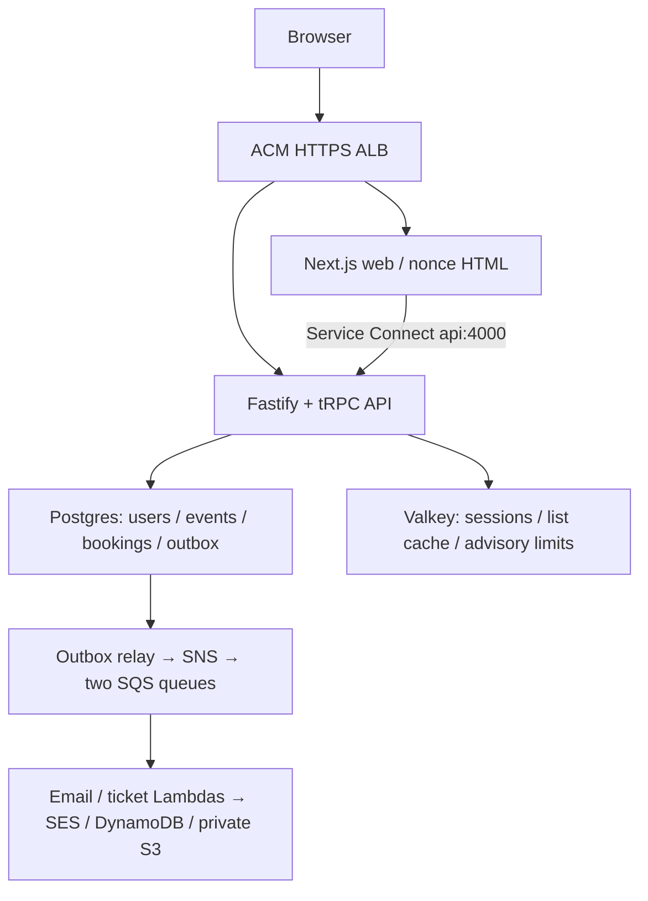
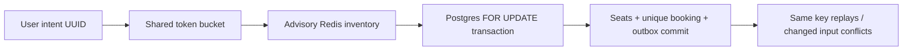
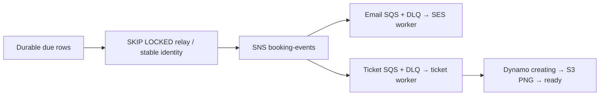
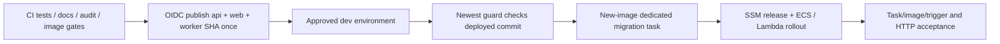

# Architecture: the living big picture

MiniTickets implements search, secure sessions, atomic bookings, durable confirmations, signed tickets and constrained poster uploads. The repository is locally tested; the owner still verifies the deployed AWS boundaries. [Start here](handbook/guides/index.html) orders the learning material.

## 1. The whole system today

The committed dev shape enables data/compute/entry with `cdnEnabled=false` and domain `minitickets.theversehub.in`. HTTPS terminates at the ALB. CloudFront is implemented but inactive while account verification is pending. Same-origin `/trpc/*` routes to API; other paths route to web. The browser never resolves Service Connect names.

Local owner ports are web :3000/API :4000. Tests use separate ports and isolated data. Docker provides Postgres, Redis, ElasticMQ, DynamoDB Local and Moto; AWS SDK boundaries stay the same but local success does not prove IAM, SES delivery or managed-service behavior.

## 2. Read, write and security paths

Catalogue SSR and client searches call `events.search`: escaped title/venue substring, pg_trgm GIN, `(starts_at,id)` keyset pages, one stable upcoming cutoff and a virtualized browser list. The cursor is not a database snapshot. Legacy `events.list` retains canonical filter/generation keys, single-flight/distributed rebuild coordination, soft 30–33 s refresh and hard 300 s stale cap. Search bypasses those list caches and the old Next public-data helper.

All HTML/RSC uses dynamic fresh nonces and `private,no-store`; hashed static assets retain caching. The explicit public data helper and signed fixed-tag revalidation endpoint remain for their list use case. Never share personalized results or nonce HTML through Next/CloudFront caches.

The API derives user identity from a verified session. Rate limits and inventory hints reduce load; the locked transaction and CHECK constraint protect seats. Every user/key is unique. Unknown outcomes retry the same intent. Pool size is 10 per API, with 2 s acquisition/connect and 5 s SQL timeouts. My tickets joins booking/event truth and signs only verified owner records; its final response is not yet bounded/paginated.

Mutations require exact trusted Origin and non-cross-site Fetch Metadata. Production nonce CSP blocks unsafe-eval. Indexed opaque sessions rotate at login, cap 20 devices, fail closed on missing membership, and support all-device logout. Admin roles are read lazily from Postgres; role changes revoke before/after update. In-flight requests and the two-store role change cannot be treated as one atomic auth transaction.

## 3. The asynchronous side path

At-least-once publishing can duplicate. Email dedup uses `booking.confirmed:<bookingId>` and completed-job TTL 30 days; send-before-record and two-worker windows can still send twice. Ticket ids are `bookingId:seat`, so conditional reservation plus deterministic object writes converge. Ticket claims are HMAC-authenticated, not encrypted or one-time use. Owner GET URLs last 120 s. Admin poster uploads use bounded staging, signed headers and ETag-pinned immutable publication; no malware scanner is claimed.

Email Lambda is 256 MB/10 s with queue visibility 60 s; ticket Lambda is 512 MB/30 s with visibility 180 s. Both are arm64 and outside the VPC. Independent queues retry/back off and have 14-day DLQs. Queues are not the only backlog: pending Postgres outbox rows need inspection too.

## 4. Delivery and observation

Committed `infra/Pulumi.dev.yaml` defines environment shape; SSM `/minitickets/dev/image-tag` records images and `/minitickets/dev/deployed-commit` protects infrastructure history. No profile or per-image emergency tag belongs in the committed YAML. Locally use `AWS_PROFILE=ticketlite`; GitHub uses scoped OIDC. App rollback uses current infra with an older compatible image; it must respect migrations. The owner performs all AWS changes.

Correlated JSON logs, four symptom alarms, SNS email, dashboard and saved queries are built. P10 adds bounded normalized browser-vital logs and three axe page checks. Critical dependency/image gates are configured; local dependency audit has 0 critical with high braces and moderate esbuild remaining. CI image scanning and live AWS acceptance remain open operational checks.

## 5. Layers and build documents

| Documents | What they build | Depends on |
| --- | --- | --- |
| [01 setup](01-setup.md) – [11 Docker](11-docker.md) | Web/API/shared, auth, DB, CI and containers | Toolchain and local services |
| [12 network](12-infra-network.md) – [19 CloudFront](19-infra-cloudfront.md) | Network, SGs, managed data, ECR, ECS and entry layers | Output-to-input Pulumi wiring; current modes in docs 31–34 |
| [20 deploy runbook](20-deploy-day.md) | Owner operational procedure and live acceptance | Approved CI/CD and committed config |
| [21 list](21-events-list.md) – [24 cache](24-events-cache.md) | Historical read-path baselines | Auth/layout and events schema |
| [25: Cache stampede protection](25-cache-stampede.md) | Infrastructure/cache evolution and current behavior | Existing app and named infra outputs |
| [26: Generation invalidation and admin authorization](26-cache-invalidation-rbac.md) | Infrastructure/cache evolution and current behavior | Existing app and named infra outputs |
| [27: Stale-while-revalidate and stale-if-error](27-stale-while-revalidate.md) | Infrastructure/cache evolution and current behavior | Existing app and named infra outputs |
| [28: Canonical filters and cache keys](28-filter-aware-cache-keys.md) | Infrastructure/cache evolution and current behavior | Existing app and named infra outputs |
| [29: Public Next data cache and revalidation](29-next-data-cache.md) | Infrastructure/cache evolution and current behavior | Existing app and named infra outputs |
| [30: HTTP cache privacy after nonce CSP](30-cache-privacy.md) | Infrastructure/cache evolution and current behavior | Existing app and named infra outputs |
| [31: Publish once with GitHub OIDC](31-oidc-publish.md) | Infrastructure/cache evolution and current behavior | Existing app and named infra outputs |
| [32: Private calls with ECS Service Connect](32-service-connect.md) | Infrastructure/cache evolution and current behavior | Existing app and named infra outputs |
| [33: HTTPS directly on the ALB](33-alb-https.md) | Infrastructure/cache evolution and current behavior | Existing app and named infra outputs |
| [34: Approved delivery, migrations and stale-run safety](34-approved-delivery.md) | Infrastructure/cache evolution and current behavior | Existing app and named infra outputs |
| [35: Booking transactions and My tickets](35-booking-transactions.md) | Current hardening and measured feature record | Earlier app/storage layers |
| [36: One booking per retryable intent](36-booking-idempotency.md) | Current hardening and measured feature record | Earlier app/storage layers |
| [37: Background confirmation jobs](37-background-jobs.md) | Current hardening and measured feature record | Earlier app/storage layers |
| [38: Job retries, idempotency and dead letters](38-job-failures.md) | Current hardening and measured feature record | Earlier app/storage layers |
| [39: Repeatable local setup and diagnostics](39-local-stack-health.md) | Current hardening and measured feature record | Earlier app/storage layers |
| [40: AWS email pipeline and publish-policy repair](40-aws-job-pipeline.md) | Current hardening and measured feature record | Earlier app/storage layers |
| [41: Follow one booking through logs and alarms](41-observability.md) | Current hardening and measured feature record | Earlier app/storage layers |
| [42: Durable confirmation outbox](42-transactional-outbox.md) | Current hardening and measured feature record | Earlier app/storage layers |
| [43: SNS fan-out and recoverable signed tickets](43-signed-qr-tickets.md) | Current hardening and measured feature record | Earlier app/storage layers |
| [44: Private downloads and constrained poster publication](44-ticket-assets.md) | Current hardening and measured feature record | Earlier app/storage layers |
| [45: Indexed search and bounded event rendering](45-search-big-lists.md) | Current hardening and measured feature record | Earlier app/storage layers |
| [46: Rate limits and advisory inventory](46-sale-day.md) | Current hardening and measured feature record | Earlier app/storage layers |
| [47: Security hardening, vitals and accessibility](47-security-vitals-accessibility.md) | Current hardening and measured feature record | Earlier app/storage layers |

## 6. Explain-only extensions

P5 reminders, P6 door check-in, P9 live seats, P8 autoscaling/waiting rooms/customer timed holds and P11 Lighthouse CI are not built. D2 gives proposed files, layers, diagrams and trade-offs. Tracing, SLO resources, replicas, multi-region booking and malware scanning remain explain-only too. [Scenarios](handbook/guides/interview-scenarios.md) distinguish these from local implementation and live acceptance.

## How this connects

Read the [handbook big picture](handbook/00-big-picture.md), then [city tours](handbook/guides/infra-explorer.html), [source tours](handbook/guides/code-tours.html) and [practice scenarios](handbook/guides/scenarios.html). [Catch-up coverage](handbook/generated/catchup-coverage.json) maps every cleared pending entry to durable evidence.
