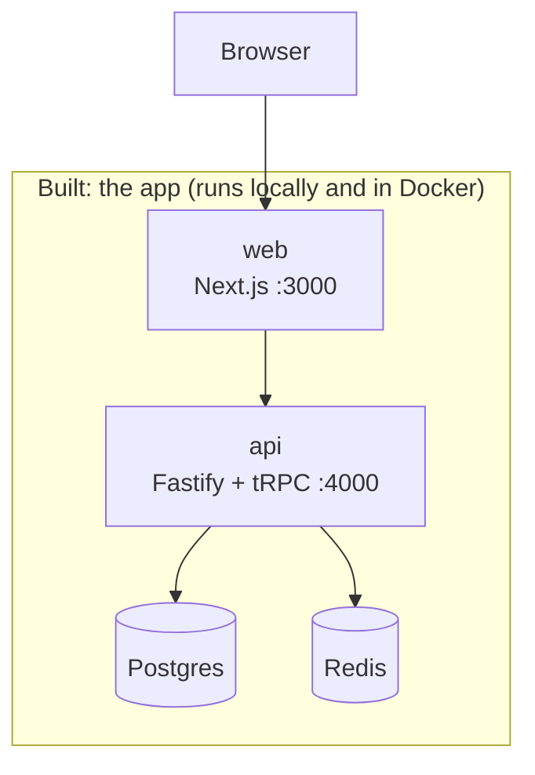
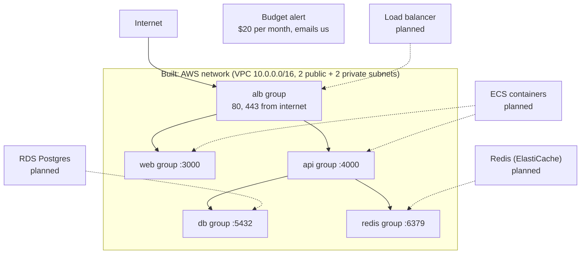

# Architecture: the living big picture

This file shows the **whole system as it exists today**. It is updated in every step.
Boxes marked "planned" are not built yet.

Last updated: Step 11b (security groups + budget alert).

## 1. The whole system

Reading the AWS diagram: solid arrows are traffic the security groups **allow**. Dotted arrows
mean "this planned thing will wear that group". Nothing is attached to the groups yet.

The budget is not inside the VPC. It watches the whole AWS account.

## 2. Layers and docs

| Doc | Layer | What it creates | Depends on |
| --- | ----- | --------------- | ---------- |
| [01](01-setup.md) | Setup | Monorepo: web, api, shared | nothing |
| [03](03-landing.md) – [04](04-signup-form.md) | Web UI | Landing page, signup form | 01 |
| [05](05-database.md) | Database | Postgres (Docker), migrations | 01 |
| [06](06-signup-api.md) – [08](08-logout.md) | Auth | Signup, login session (Redis), logout | 04, 05 |
| [09](09-dashboard.md) | Dashboard | Private page and `account.profile` | 07 |
| [10](10-ci.md) | CI | Lint, unit tests, GitHub Actions | 01 |
| [11](11-docker.md) | Docker | Dockerfiles for api and web | 01 |
| [12](12-infra-network.md) | AWS network | VPC, 4 subnets, internet gateway, route tables | nothing |
| [13](13-infra-security-groups.md) | AWS security | 5 security groups + their rules, monthly budget alert | 12 (`vpcId`) |
| planned | Database / cache | RDS Postgres, Redis | 12 (private subnets), 13 (db, redis groups) |
| planned | Containers + load balancer | ECR, ECS, ALB | 12, 13 |
| planned | IAM roles | Permissions for containers | ECS |
