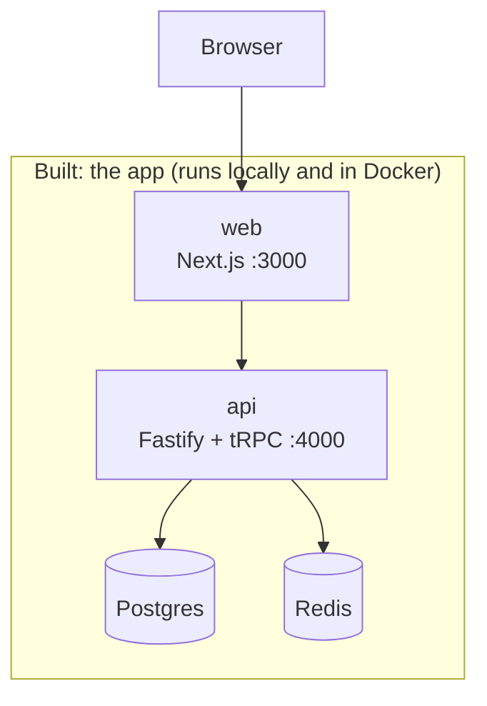
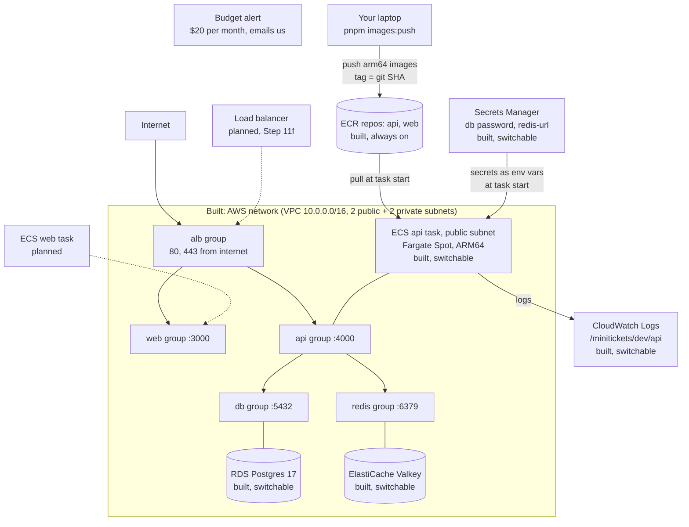
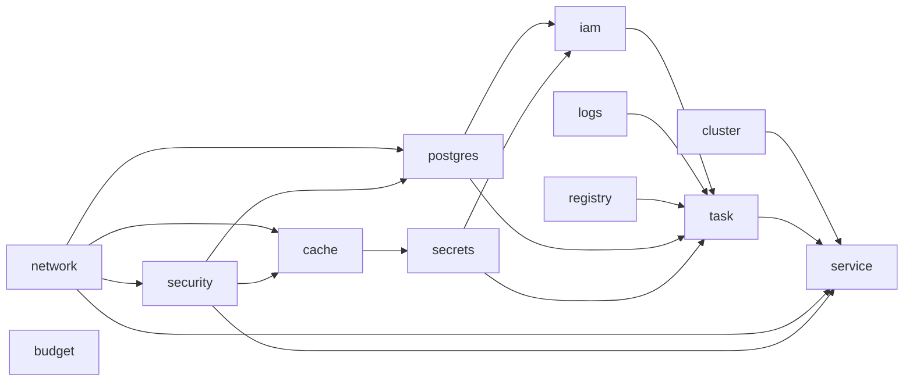

# Architecture: the living big picture

This file shows the **whole system as it exists today**. It is updated in every step.
Boxes marked "planned" are not built yet.

Last updated: Step 11e (ECS cluster + api service, IAM roles, TLS to RDS, `computeEnabled` switch).

## 1. The whole system

Reading the AWS diagram: arrows between groups are traffic the security groups **allow**. A plain
line means "this thing wears that group". Dotted arrows are planned. The api task now wears the
api group, so it (and only it) can reach the database and cache. Nothing wears the alb or web
groups yet, so nothing from the internet can reach the api yet: that comes with the load balancer.
The api task sits in a public subnet with a public IP only so it can reach ECR, Secrets Manager
and CloudWatch without a NAT gateway (see [17](17-infra-ecs-api.md)).

"Switchable" means the part exists only while its Pulumi config switch is `true`. Both are off
by default, because these parts cost money every hour:

- `dataEnabled` ([14](14-infra-data.md)): RDS, Valkey, the redis-url secret.
- `computeEnabled` ([17](17-infra-ecs-api.md)): log group, ECS cluster, IAM roles, api task
  definition and service. It needs `dataEnabled` and an `apiImageTag` (a pushed git SHA).

The network, security groups, budget and ECR repositories are always on.

How the infra code is wired (see [15](15-infra-dependencies.md)): each layer is a function and
only `infra/index.ts` passes outputs into inputs.

The budget is not inside the VPC. It watches the whole AWS account. Secrets Manager is an AWS
service outside our VPC too.

## 2. Layers and docs

| Doc | Layer | What it creates | Depends on |
| --- | ----- | --------------- | ---------- |
| [01](01-setup.md) | Setup | Monorepo: web, api, shared | nothing |
| [03](03-landing.md) – [04](04-signup-form.md) | Web UI | Landing page, signup form | 01 |
| [05](05-database.md) | Database | Postgres (Docker), migrations | 01 |
| [06](06-signup-api.md) – [08](08-logout.md) | Auth | Signup, login session (Redis), logout | 04, 05 |
| [09](09-dashboard.md) | Dashboard | Private page and `account.profile` | 07 |
| [10](10-ci.md) | CI | Lint, unit tests, GitHub Actions | 01 |
| [11](11-docker.md) | Docker | Dockerfiles for api and web | 01 |
| [12](12-infra-network.md) | AWS network | VPC, 4 subnets, internet gateway, route tables | nothing |
| [13](13-infra-security-groups.md) | AWS security | 5 security groups + their rules, monthly budget alert | 12 (`vpcId`) |
| [14](14-infra-data.md) | AWS data (switchable) | RDS Postgres 17, ElastiCache Valkey, redis-url secret, `dataEnabled` switch | 12 (private subnets), 13 (db, redis groups) |
| [15](15-infra-dependencies.md) | Infra wiring | Nothing new in AWS. Each layer is a function; only `index.ts` connects them | 12, 13, 14 |
| [16](16-infra-ecr.md) | AWS registry | 2 ECR repositories (immutable tags, scan on push, lifecycle policy) + `images:push` script; web image calls the API on the same origin | nothing |
| [17](17-infra-ecs-api.md) | AWS compute (switchable) | Log group, ECS cluster (FARGATE + FARGATE_SPOT), execution + task IAM roles, api task definition and service, `computeEnabled` + `apiImageTag`, `infra:migrate` script; api accepts `DB_*` + verified TLS to RDS | 12 (public subnets), 13 (api group), 14 (address, 2 secret ARNs), 16 (image) |
| planned | Load balancer | ALB (routes `/trpc/*` to api, `/*` to web), real `WEB_ORIGIN` | 12, 13, 17 |
| planned | Web service | web task definition + service | 16, 17 (cluster), load balancer |
