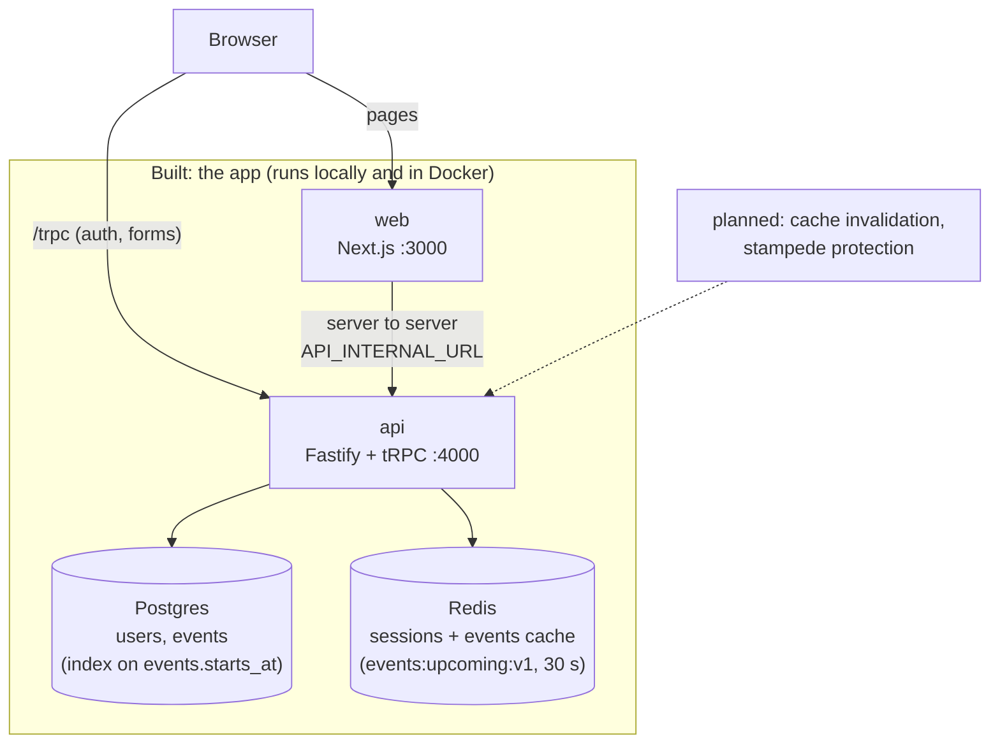
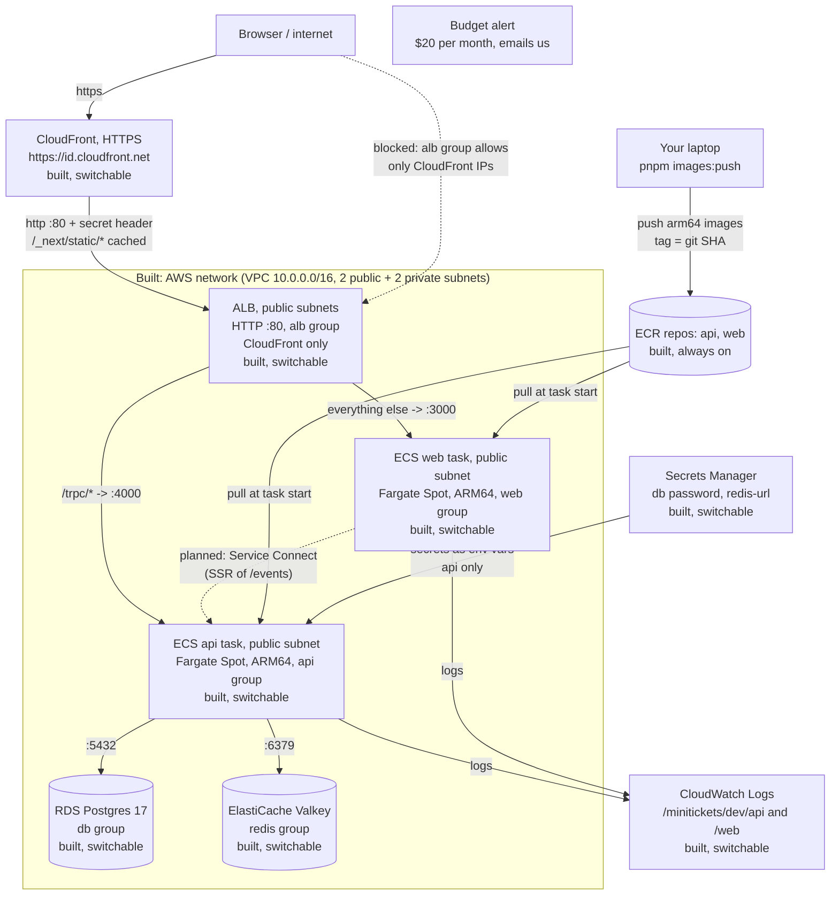
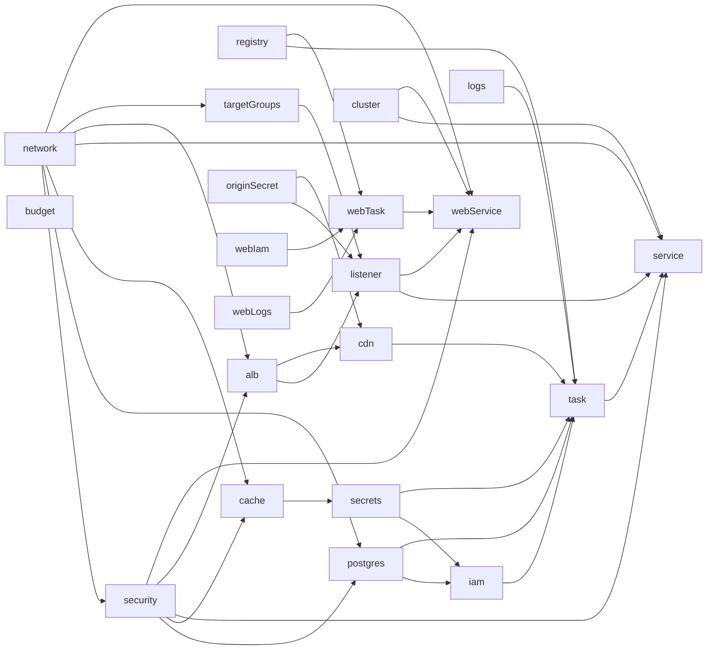

# Architecture: the living big picture

This file shows the **whole system as it exists today**. It is updated in every step.
Boxes marked "planned" are not built yet.

Last updated: Feature 1, step 4 (Redis cache-aside for `events.list`, graceful degradation when Redis fails: [24](24-events-cache.md)). Before that: Feature 1, step 3 (index on `events.starts_at`, `EXPLAIN ANALYZE` explained: [23](23-events-index.md)). Before that: Feature 1, step 2 (`/events` rendered on the server with streaming, CSR vs SSR measured: [22](22-events-ssr.md)); before that: Feature 1, step 1 (events list, no caching: [21](21-events-list.md)), Step 11g (CloudFront + HTTPS in front of the ALB, origin protection, real `WEB_ORIGIN`,
`trustProxy`) and the deploy-day runbook ([20](20-deploy-day.md)).

The same system explained **by concept** (interview-ready, tied to the code) is in the
[handbook](handbook/README.md); start with its [big picture](handbook/00-big-picture.md).

## 1. The whole system

`/events` is rendered on the server: the web server calls `events.list` itself (server to server,
`API_INTERNAL_URL`) and streams the HTML with the events in it; the browser reuses that data and
does not call `events.list` again ([22](22-events-ssr.md)). Every other page still calls the api
from the browser. The api caches the `events.list` answer in Redis for about 30 seconds ([24](24-events-cache.md)); if Redis fails it reads Postgres. The planned boxes come in later steps, each measured
against the baselines in [doc 21](21-events-list.md) and [doc 22](22-events-ssr.md). In the AWS diagram below, the `events` table
exists on RDS once the new migration is run (`pnpm infra:migrate`); the seed script is a laptop and CI tool only.

Reading the AWS diagram: the browser talks only to **CloudFront**, over HTTPS (free
`*.cloudfront.net` certificate), so the Secure session cookie and login work ([19](19-infra-cloudfront.md)).
CloudFront caches the built `/_next/static/*` files at the edge and passes everything else on.
The hop from CloudFront to the ALB is plain http in dev (production: HTTPS there too).
The dotted web → api arrow is **planned**: server rendering of `/events` needs the web task to call
the api directly, and today nothing allows that (the ALB takes only CloudFront, the api takes only
the ALB, and the web task has no `API_INTERNAL_URL`), so "SSR on AWS" is 🟡 ([22](22-events-ssr.md), section 7).
Two locks keep everyone else out of the ALB: its security group allows port 80 **only** from
CloudFront's IP ranges (a managed prefix list), and its listener answers **403** unless the request
carries CloudFront's secret `X-Origin-Verify` header. Every other arrow into a box inside the VPC is
traffic that box's security group **allows** (rules from [13](13-infra-security-groups.md)): only
the ALB may reach web (3000) and api (4000); only the api may reach the database and cache. The ALB
splits by path: `/trpc/*` goes to the api, everything else to web, so the browser uses one origin
([18](18-infra-alb-web.md)). The api trusts 2 proxy hops (CloudFront + ALB), so its logs show the
real visitor IP. The tasks sit in public subnets with public IPs only so they can reach ECR,
Secrets Manager and CloudWatch without a NAT gateway (see [17](17-infra-ecs-api.md)).

"Switchable" means the part exists only while its Pulumi config switch is `true`. All three are off
by default, because these parts cost money every hour:

- `dataEnabled` ([14](14-infra-data.md)): RDS, Valkey, the redis-url secret.
- `computeEnabled` ([17](17-infra-ecs-api.md)): log group, ECS cluster, IAM roles, api task
  definition and service. It needs `dataEnabled` and an `apiImageTag` (a pushed git SHA).
- `entryEnabled` ([18](18-infra-alb-web.md), [19](19-infra-cloudfront.md)): ALB, 2 target groups,
  listener (default 403) + 2 rules, the origin secret, the CloudFront distribution, and the web app
  (log group, execution role, task definition, service); connects the api service to the ALB and
  sets the api's `WEB_ORIGIN` to the CloudFront address. It needs `dataEnabled`, `computeEnabled`
  and a `webImageTag`.

The network, security groups, budget and ECR repositories are always on. The order for turning
everything on, checking it and turning it off is in [20-deploy-day.md](20-deploy-day.md).

How the infra code is wired (see [15](15-infra-dependencies.md)): each layer is a function and
only `infra/index.ts` passes outputs into inputs.

The budget is not inside the VPC. It watches the whole AWS account. Secrets Manager is an AWS
service outside our VPC too.

## 2. Layers and docs

| Doc | Layer | What it creates | Depends on |
| --- | ----- | --------------- | ---------- |
| [01](01-setup.md) | Setup | Monorepo: web, api, shared | nothing |
| [03](03-landing.md) – [04](04-signup-form.md) | Web UI | Landing page, signup form | 01 |
| [05](05-database.md) | Database | Postgres (Docker), migrations | 01 |
| [06](06-signup-api.md) – [08](08-logout.md) | Auth | Signup, login session (Redis), logout | 04, 05 |
| [09](09-dashboard.md) | Dashboard | Private page and `account.profile` | 07 |
| [10](10-ci.md) | CI | Lint, unit tests, GitHub Actions | 01 |
| [11](11-docker.md) | Docker | Dockerfiles for api and web | 01 |
| [12](12-infra-network.md) | AWS network | VPC, 4 subnets, internet gateway, route tables | nothing |
| [13](13-infra-security-groups.md) | AWS security | 5 security groups + their rules, monthly budget alert | 12 (`vpcId`) |
| [14](14-infra-data.md) | AWS data (switchable) | RDS Postgres 17, ElastiCache Valkey, redis-url secret, `dataEnabled` switch | 12 (private subnets), 13 (db, redis groups) |
| [15](15-infra-dependencies.md) | Infra wiring | Nothing new in AWS. Each layer is a function; only `index.ts` connects them | 12, 13, 14 |
| [16](16-infra-ecr.md) | AWS registry | 2 ECR repositories (immutable tags, scan on push, lifecycle policy) + `images:push` script; web image calls the API on the same origin | nothing |
| [17](17-infra-ecs-api.md) | AWS compute (switchable) | Log group, ECS cluster (FARGATE + FARGATE_SPOT), execution + task IAM roles, api task definition and service, `computeEnabled` + `apiImageTag`, `infra:migrate` script; api accepts `DB_*` + verified TLS to RDS | 12 (public subnets), 13 (api group), 14 (address, 2 secret ARNs), 16 (image) |
| [18](18-infra-alb-web.md) | AWS entry + web (switchable) | ALB (HTTP :80), api + web target groups (type ip, 30 s draining), listener (default -> web, `/trpc/*` -> api); web log group, web execution role (no secrets), web task definition + service; api service joins the ALB; `entryEnabled` + `webImageTag` | 12 (public subnets, vpcId), 13 (alb, web, api groups), 16 (web image), 17 (cluster, api service), 14 (via 17) |
| [19](19-infra-cloudfront.md) | AWS CloudFront + origin protection (switchable, part of entry) | CloudFront distribution (`*.cloudfront.net` HTTPS, 3 cache behaviors: static cached, `/trpc/*` and pages never cached), `appUrl`; alb group: port 80 from the CloudFront prefix list only (443 rule removed); `X-Origin-Verify` secret header, listener default 403 + 2 header rules; api `WEB_ORIGIN` = `appUrl`, `TRUST_PROXY_HOPS` = 2 + Fastify `trustProxy` | 13 (alb group), 18 (ALB, target groups, listener), 17 (api task definition) |
| [20](20-deploy-day.md) | Deploy day (runbook) | Nothing new. One ordered runbook for the whole stack: prepare, push, data, compute + entry, migrate, verify, console tour, off, troubleshooting | 12 – 19 |
| [21](21-events-list.md) | Events list (read path baseline) | `events` table with 3 CHECK constraints, `db:seed` (12 events), `events.list` (public), `/events` page (client-side rendering), Events header link | 05 (database), 09 (procedure and hook pattern) |
| [22](22-events-ssr.md) | Events SSR + streaming | `/events` rendered on the server: per-request `QueryClient`, server tRPC client (`API_INTERNAL_URL`, Zod-checked), prefetch + dehydrate + `HydrationBoundary`, `<Suspense>` streaming, `error.tsx`, `EventDate` (no hydration mismatch); CSR vs SSR measured. AWS: 🟡 (needs Service Connect, planned) | 21 (events list), 04 (TanStack Query, tRPC client), 11 (docker compose) |
| [23](23-events-index.md) | Events index + `EXPLAIN ANALYZE` | Migration `0002`: B-tree index `events_starts_at_idx` on `events (starts_at)` (serves `listUpcoming`: filter + order by + limit on one column); handbook cards `indexing` ✅ and `explain-analyze` 📖. No AWS change (the migration runs with `infra:migrate`) | 21 (events table, `listUpcoming`), 05 (migrations) |
| [24](24-events-cache.md) | Events cache (cache-aside in Redis) | `queries/events-cache.ts` (`GET`/`SET EX` on `events:upcoming:v1`, 100 ms deadline), cache-aside logic in `services/events.ts` (TTL 30 s + 0-3 s jitter, Zod check on read, fallback to Postgres when Redis fails), `cache` field on the request log; handbook cards `cache-aside`, `cache-key-versioning`, `graceful-degradation` ✅, `ttl`, `fail-fast` updated. No AWS change (ElastiCache Valkey already exists) | 21 (`listUpcoming`, Zod schema), 07 (Redis client), 23 (index) |
