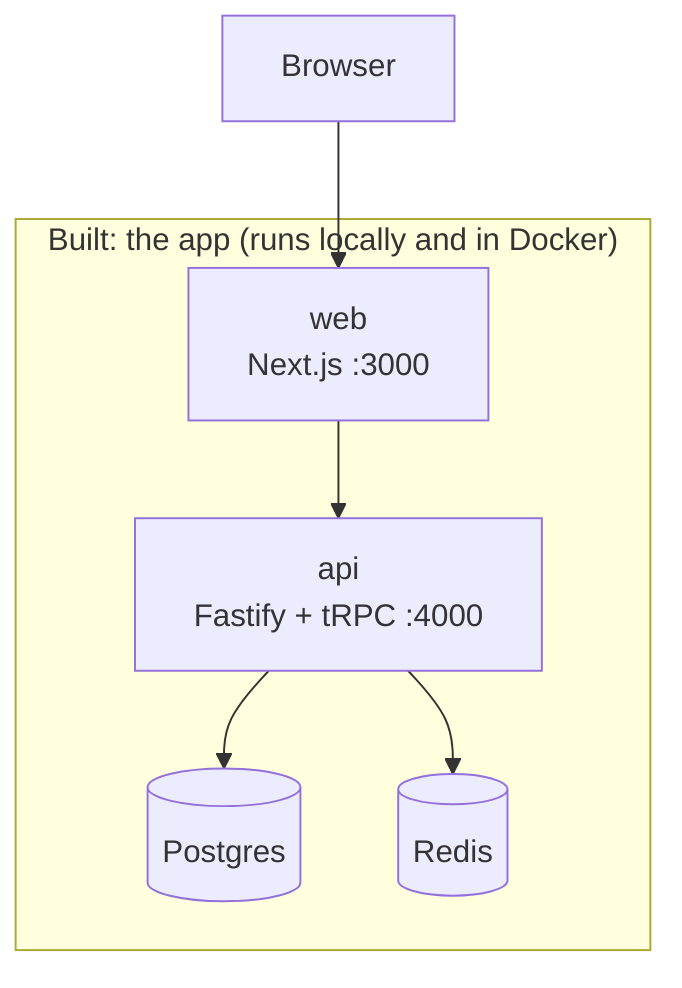
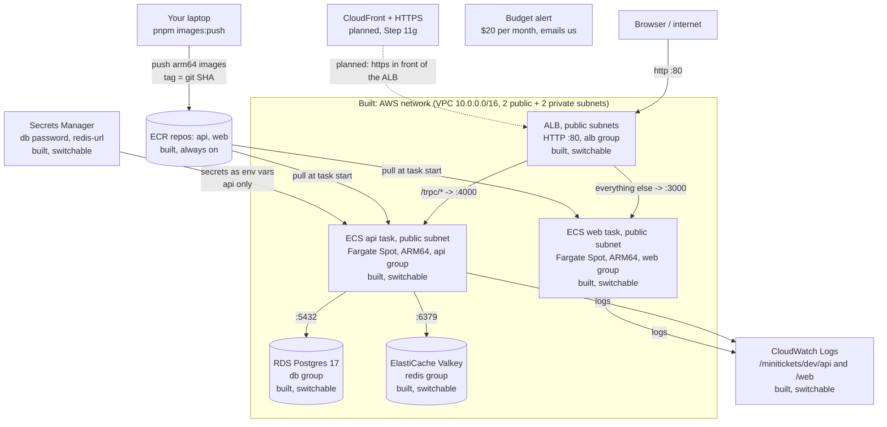
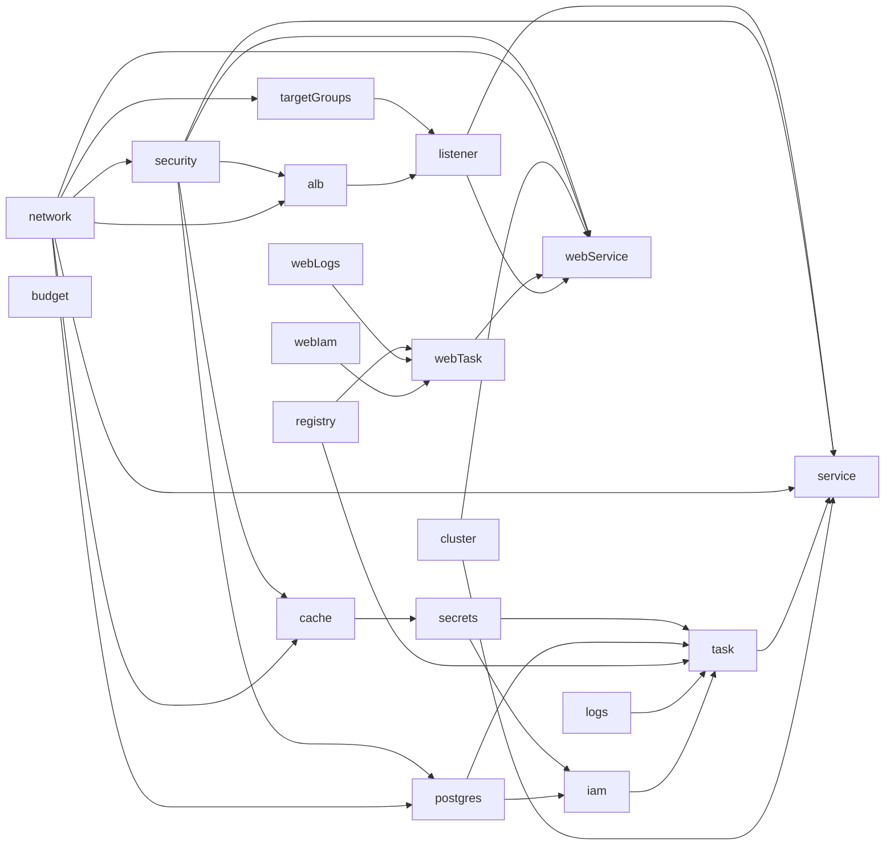

# Architecture: the living big picture

This file shows the **whole system as it exists today**. It is updated in every step.
Boxes marked "planned" are not built yet.

Last updated: Step 11f (ALB + web service + `/trpc/*` path routing, `entryEnabled` switch).

## 1. The whole system

Reading the AWS diagram: every arrow into a box inside the VPC is traffic that box's security
group **allows** (rules from [13](13-infra-security-groups.md)): the internet may reach only the
ALB; only the ALB may reach web (3000) and api (4000); only the api may reach the database and
cache. The ALB splits by path: `/trpc/*` goes to the api, everything else to web, so the browser
uses one origin ([18](18-infra-alb-web.md)). The dotted arrow is planned: until CloudFront adds
HTTPS (Step 11g), the site is plain http and login does not stick (the session cookie is Secure).
The tasks sit in public subnets with public IPs only so they can reach ECR, Secrets Manager and
CloudWatch without a NAT gateway (see [17](17-infra-ecs-api.md)).

"Switchable" means the part exists only while its Pulumi config switch is `true`. All three are off
by default, because these parts cost money every hour:

- `dataEnabled` ([14](14-infra-data.md)): RDS, Valkey, the redis-url secret.
- `computeEnabled` ([17](17-infra-ecs-api.md)): log group, ECS cluster, IAM roles, api task
  definition and service. It needs `dataEnabled` and an `apiImageTag` (a pushed git SHA).
- `entryEnabled` ([18](18-infra-alb-web.md)): ALB, 2 target groups, listener + `/trpc/*` rule, and
  the web app (log group, execution role, task definition, service); connects the api service to
  the ALB. It needs `dataEnabled`, `computeEnabled` and a `webImageTag`.

The network, security groups, budget and ECR repositories are always on.

How the infra code is wired (see [15](15-infra-dependencies.md)): each layer is a function and
only `infra/index.ts` passes outputs into inputs.

The budget is not inside the VPC. It watches the whole AWS account. Secrets Manager is an AWS
service outside our VPC too.

## 2. Layers and docs

| Doc | Layer | What it creates | Depends on |
| --- | ----- | --------------- | ---------- |
| [01](01-setup.md) | Setup | Monorepo: web, api, shared | nothing |
| [03](03-landing.md) – [04](04-signup-form.md) | Web UI | Landing page, signup form | 01 |
| [05](05-database.md) | Database | Postgres (Docker), migrations | 01 |
| [06](06-signup-api.md) – [08](08-logout.md) | Auth | Signup, login session (Redis), logout | 04, 05 |
| [09](09-dashboard.md) | Dashboard | Private page and `account.profile` | 07 |
| [10](10-ci.md) | CI | Lint, unit tests, GitHub Actions | 01 |
| [11](11-docker.md) | Docker | Dockerfiles for api and web | 01 |
| [12](12-infra-network.md) | AWS network | VPC, 4 subnets, internet gateway, route tables | nothing |
| [13](13-infra-security-groups.md) | AWS security | 5 security groups + their rules, monthly budget alert | 12 (`vpcId`) |
| [14](14-infra-data.md) | AWS data (switchable) | RDS Postgres 17, ElastiCache Valkey, redis-url secret, `dataEnabled` switch | 12 (private subnets), 13 (db, redis groups) |
| [15](15-infra-dependencies.md) | Infra wiring | Nothing new in AWS. Each layer is a function; only `index.ts` connects them | 12, 13, 14 |
| [16](16-infra-ecr.md) | AWS registry | 2 ECR repositories (immutable tags, scan on push, lifecycle policy) + `images:push` script; web image calls the API on the same origin | nothing |
| [17](17-infra-ecs-api.md) | AWS compute (switchable) | Log group, ECS cluster (FARGATE + FARGATE_SPOT), execution + task IAM roles, api task definition and service, `computeEnabled` + `apiImageTag`, `infra:migrate` script; api accepts `DB_*` + verified TLS to RDS | 12 (public subnets), 13 (api group), 14 (address, 2 secret ARNs), 16 (image) |
| [18](18-infra-alb-web.md) | AWS entry + web (switchable) | ALB (HTTP :80), api + web target groups (type ip, 30 s draining), listener (default -> web, `/trpc/*` -> api); web log group, web execution role (no secrets), web task definition + service; api service joins the ALB; `entryEnabled` + `webImageTag` | 12 (public subnets, vpcId), 13 (alb, web, api groups), 16 (web image), 17 (cluster, api service), 14 (via 17) |
| planned | CloudFront + HTTPS (Step 11g) | HTTPS address in front of the ALB, so the Secure session cookie and login work; real `WEB_ORIGIN` | 18 |
