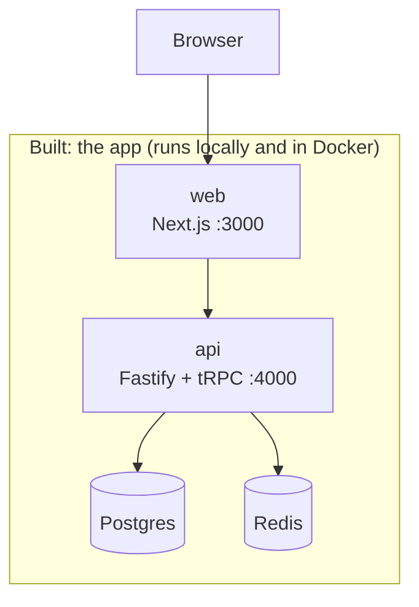
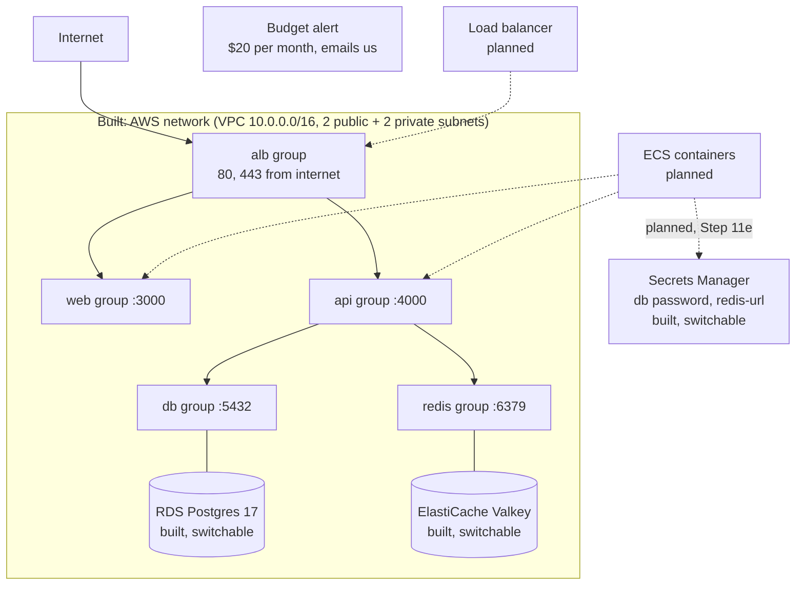
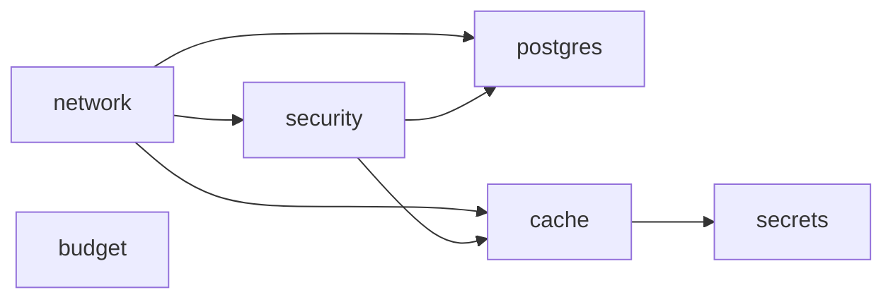

# Architecture: the living big picture

This file shows the **whole system as it exists today**. It is updated in every step.
Boxes marked "planned" are not built yet.

Last updated: Step 11d (infra refactor: explicit layer dependencies, no AWS change).

## 1. The whole system

Reading the AWS diagram: solid arrows are traffic the security groups **allow**. A plain line
means "this thing wears that group". Dotted arrows are planned. Nothing wears the alb, web or
api groups yet, so nobody can reach the database or cache yet.

"Switchable" means the part exists only while the Pulumi config `dataEnabled` is `true`
(see [14](14-infra-data.md)). It is off by default, because RDS and ElastiCache cost money
every hour. The network, security groups and budget are always on.

How the infra code is wired (see [15](15-infra-dependencies.md)): each layer is a function and
only `infra/index.ts` passes outputs into inputs.

The budget is not inside the VPC. It watches the whole AWS account. Secrets Manager is an AWS
service outside our VPC too.

## 2. Layers and docs

| Doc | Layer | What it creates | Depends on |
| --- | ----- | --------------- | ---------- |
| [01](01-setup.md) | Setup | Monorepo: web, api, shared | nothing |
| [03](03-landing.md) – [04](04-signup-form.md) | Web UI | Landing page, signup form | 01 |
| [05](05-database.md) | Database | Postgres (Docker), migrations | 01 |
| [06](06-signup-api.md) – [08](08-logout.md) | Auth | Signup, login session (Redis), logout | 04, 05 |
| [09](09-dashboard.md) | Dashboard | Private page and `account.profile` | 07 |
| [10](10-ci.md) | CI | Lint, unit tests, GitHub Actions | 01 |
| [11](11-docker.md) | Docker | Dockerfiles for api and web | 01 |
| [12](12-infra-network.md) | AWS network | VPC, 4 subnets, internet gateway, route tables | nothing |
| [13](13-infra-security-groups.md) | AWS security | 5 security groups + their rules, monthly budget alert | 12 (`vpcId`) |
| [14](14-infra-data.md) | AWS data (switchable) | RDS Postgres 17, ElastiCache Valkey, redis-url secret, `dataEnabled` switch | 12 (private subnets), 13 (db, redis groups) |
| [15](15-infra-dependencies.md) | Infra wiring | Nothing new in AWS. Each layer is a function; only `index.ts` connects them | 12, 13, 14 |
| planned | Containers + load balancer | ECR, ECS, ALB | 12, 13 |
| planned | IAM roles | Permissions for containers (read the 2 secrets) | ECS, 14 (secret ARNs) |
