# Step 11a: The AWS network (VPC, subnets, routes)

## 1. In one sentence

This step builds the empty **network** in AWS where the database and the app will live later, using Pulumi to write it as code.

Nothing runs inside it yet. No servers, no database, no security groups. Only the streets and the doors.

## 2. The big picture

Think of a **private office building**. The building is the VPC. Each floor is a subnet. The building has a front door to the street (the internet gateway). A signboard on each floor says where its corridors lead (the route table).

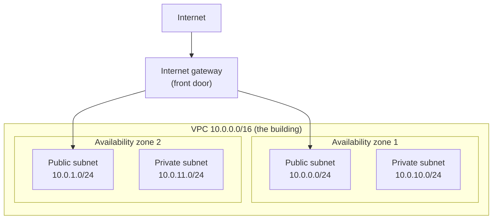

Some words used above:

- **AWS** is a company that rents out computers and networks over the internet.
- **Infrastructure as code** means we describe the network in TypeScript files, not by clicking in the AWS website. The files can be reviewed, committed and repeated.
- **Pulumi** is the tool that reads our TypeScript and creates the matching things in AWS.
- A **stack** is one copy of the setup. Ours is called `dev`.

### The files

| File                    | Job                                                         |
| ----------------------- | ----------------------------------------------------------- |
| `infra/Pulumi.yaml`     | Project name (`minitickets`) and language (Node.js)         |
| `infra/Pulumi.dev.yaml` | Settings for the `dev` stack. Only `aws:region: us-east-1`  |
| `infra/index.ts`        | Imports the layer files and exports their outputs           |
| `infra/src/tags.ts`     | The labels put on every resource                            |
| `infra/src/network.ts`  | All the resources of this step                              |

All names follow `minitickets-dev-<thing>`. Every resource also gets the tags `Project=minitickets`, `Env=dev`, `ManagedBy=pulumi`. A **tag** is a label on a resource. Tags help you search and see which project a cost belongs to.

## 3. The concepts

### 3.1 CIDR: how IP addresses are split

**What it is.** An **IP address** is the "house number" of a machine on a network, like `10.0.0.5`. A **CIDR block** is a whole range of addresses written as `address/number`, for example `10.0.0.0/16`.

The number after the slash says how much of the address is **fixed**. The rest is free for us to hand out.

| Block        | Fixed part | Addresses |
| ------------ | ---------- | --------- |
| `10.0.0.0/16` | `10.0`     | 65,536 (about 65,000) |
| `10.0.0.0/24` | `10.0.0`   | 256       |

Like a city and its streets: the VPC owns every address that starts with `10.0`. Each subnet owns one "street" inside it.

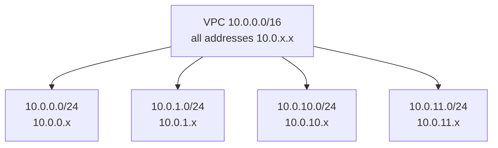

**Why we need it.** Every subnet needs its own range, and ranges must not overlap. One address can only belong to one street. AWS keeps 5 addresses in every subnet for itself, so each of our subnets has 251 usable addresses.

We use `10.0.0.x` and `10.0.1.x` for public subnets, and `10.0.10.x` and `10.0.11.x` for private ones. The gap makes it easy to see the type from the number.

### 3.2 VPC

**What it is.** A **VPC** (Virtual Private Cloud) is your own private, walled-off network inside AWS. Nothing gets in or out unless you build a way. It is the office building.

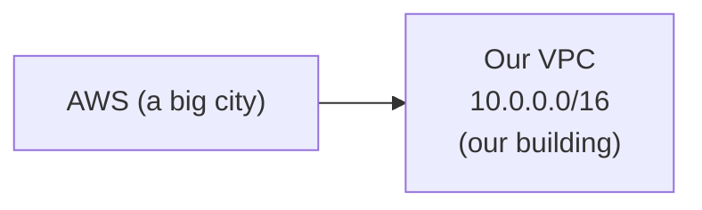

We turn on two DNS options. **DNS** turns names into addresses, like a phone book. "DNS support" lets machines use the phone book. "DNS hostnames" gives machines names. Later, the database will be reached by a name, so both are needed.

**Why we need it.** Every other resource lives inside a VPC. Without our own, we would share AWS's default VPC, which we did not design.

### 3.3 Availability zones (AZs)

**What it is.** An **availability zone** is one separate data centre inside a region. A **region** (ours is `us-east-1`) is a group of AZs in one part of the world. AZs have their own power and cables, so one can fail while another keeps working.

We ask AWS for the zones in the region and take the first two.

**Why we need it.** One subnet lives in exactly one AZ. Spreading across two AZs is how we survive a data centre failure.

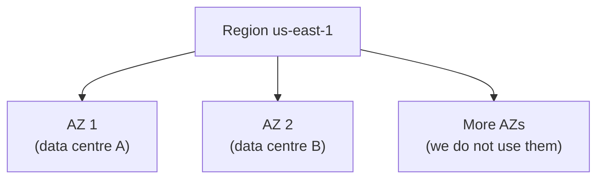

### 3.4 Subnets: public and private

**What it is.** A **subnet** is a slice of the VPC's address range, inside one AZ. It is a floor of the building.

**The only difference between a public and a private subnet is its route table.** If the table has a route to the internet gateway, the subnet is public. If not, it is private. The name does not matter to AWS. It is only our label.

| Subnet    | CIDR          | AZ   | Route to internet gateway? |
| --------- | ------------- | ---- | -------------------------- |
| public-1  | 10.0.0.0/24   | 1st  | Yes                        |
| public-2  | 10.0.1.0/24   | 2nd  | Yes                        |
| private-1 | 10.0.10.0/24  | 1st  | No                         |
| private-2 | 10.0.11.0/24  | 2nd  | No                         |

**Why we need it.** We want two kinds of floors. Public floors for things the internet must reach (a load balancer, later). Private floors for things it must never reach (the database).

### 3.5 Internet gateway

**What it is.** The **internet gateway** (IGW) is the front door of the building. It connects the VPC to the public internet in both directions.

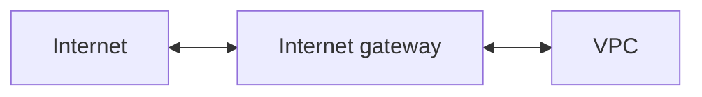

**Why we need it.** Without it, the VPC is a sealed building with no door. Nothing can come in and nothing can go out. By itself it does nothing for a subnet. A route must also point to it (next section).

### 3.6 Route tables

**What it is.** A **route table** is the signboard on a floor. It says: "traffic going to this address range, send it that way." A **route** is one line on that signboard.

Every route table has a built-in `local` route: addresses inside the VPC stay inside the VPC. So all our subnets can talk to each other.

| Route table | Routes                                         |
| ----------- | ---------------------------------------------- |
| public      | `local`, and `0.0.0.0/0` -> internet gateway   |
| private     | `local` only                                   |

`0.0.0.0/0` means "every address that is not matched by a more specific route", in other words "the whole internet".

A route table does nothing until a subnet is linked to it by a **route table association**. We create four associations, one per subnet.

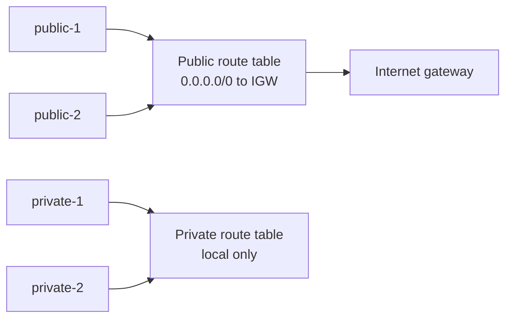

**Why we need it.** This is the one thing that makes public subnets public and private subnets private.

### 3.7 How a request from the internet reaches a public subnet

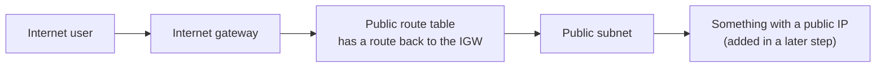

Step by step:

1. The user sends a request to a public IP address in our VPC.
2. It arrives at the internet gateway, which hands it into the VPC.
3. The subnet's route table has the `0.0.0.0/0` -> IGW route, so replies know how to go back out.
4. The request reaches the machine in the public subnet.

Right now there is no machine, and no **security group** (a firewall for one machine, coming in a later step). Even with a public subnet, nothing answers yet. A route only makes it possible.

### 3.8 Why a private subnet cannot be reached from the internet

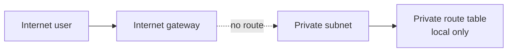

Two things stop the internet:

- The private route table has no route to the IGW. Traffic has no path in or out.
- Things in a private subnet do not get a public IP address (`mapPublicIpOnLaunch` is `false`). With no public address, the internet has nowhere to send the request.

Only machines inside the VPC (for example, our app in a public subnet) can reach the database in a private subnet.

### 3.9 What happens if one AZ goes down

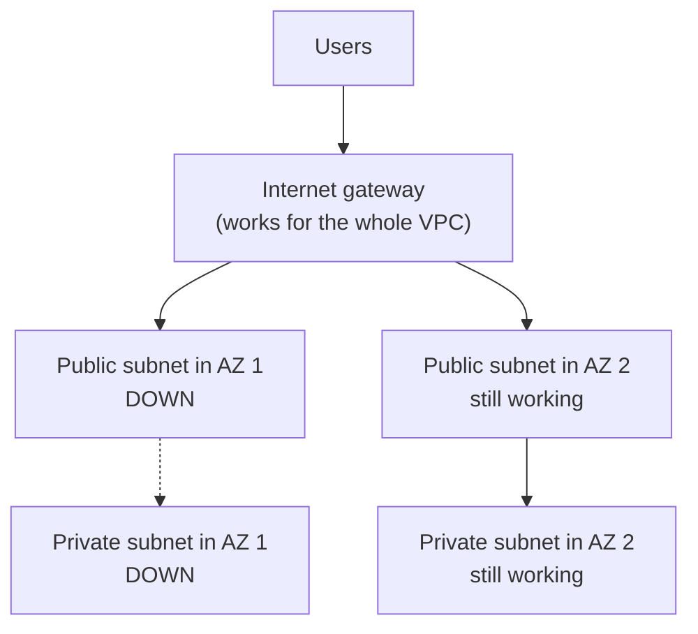

The internet gateway and route tables belong to the whole VPC, not to one AZ, so they keep working. The subnets in the failed AZ stop. The subnets in the other AZ carry on. Later steps will put one copy of the app and the database in each AZ so this actually protects us.

### 3.10 Why there is no NAT gateway

A **NAT gateway** lets machines in a private subnet start connections *out* to the internet (to download things), while the internet still cannot start connections *in*.

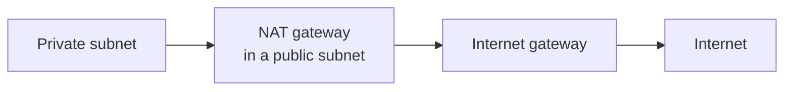

It costs about $30+ per month, plus data fees, even when idle. Our databases in private subnets never need the internet, so we skip it.

In real production we would add one of these, because private app containers must pull their images and call outside services:

- a **NAT gateway** (simple, costs money), or
- **VPC endpoints**: private doorways straight to AWS services such as the image registry, without going over the internet.

### 3.11 How later layers use these outputs

`index.ts` exports three **stack outputs**: `vpcId`, `publicSubnetIds`, `privateSubnetIds`. An output is a value Pulumi saves after `pulumi up`. Later layers (security groups, database, ECS) will be new files in `infra/src/` that import from `network.ts` and use these values.

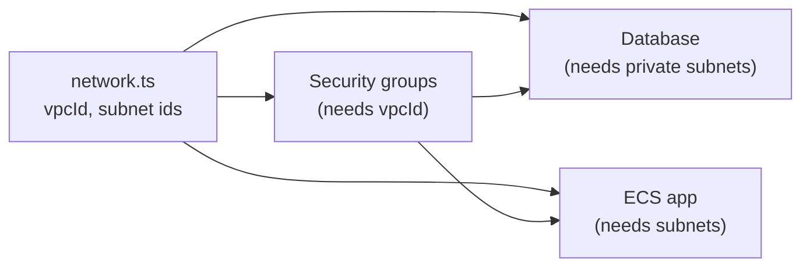

- Security groups are created **inside** a VPC, so they need `vpcId`.
- The database goes in the **private** subnets (always two AZs, because the database service demands it).
- The load balancer goes in the **public** subnets. The app containers go in the subnets we choose then.

### 3.12 How to deploy and check

You run these (Claude only runs `pulumi preview`):

```bash
cd infra
pulumi preview          # see the plan: 12 resources to create
pulumi up               # type "yes" to create them
pulumi stack output     # prints vpcId, publicSubnetIds, privateSubnetIds
```

To remove everything later: `pulumi destroy`. The network itself costs nothing while it is empty.

## 4. Dependency order

Pulumi works out this order by itself, because each resource uses the `id` of another. Things lower down need the things above them to exist first.

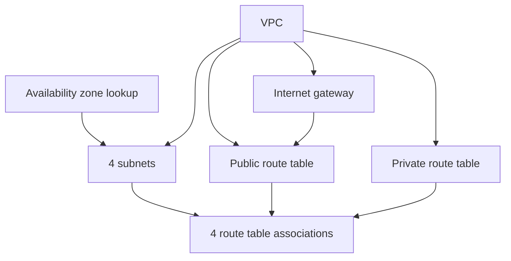

Total created: 1 VPC + 1 internet gateway + 4 subnets + 2 route tables + 4 associations = **12 resources**. (The default route table AWS makes with every VPC is not managed by us.)

Deleting goes in the opposite order. Pulumi handles that too.

## 5. What breaks if this is wrong or missing

| Mistake                                   | What happens                                                              |
| ----------------------------------------- | ------------------------------------------------------------------------- |
| Two subnets with overlapping CIDRs        | AWS refuses to create the second one                                      |
| A subnet CIDR outside `10.0.0.0/16`       | AWS refuses it                                                            |
| No internet gateway                       | Public subnets cannot reach or be reached from the internet               |
| Route to IGW missing in the public table  | "Public" subnets are really private. The app is unreachable               |
| Route to IGW added to the private table   | Private subnets become public. The database could be exposed              |
| Missing route table association           | The subnet silently uses the VPC's default route table, not ours          |
| Both subnets in the same AZ               | One data centre failure takes down everything                             |
| DNS hostnames off                         | Later, things like the database cannot be reached by name                 |
| No NAT gateway and a private app          | Private app containers cannot pull images or call outside APIs            |

## 6. Interview questions

1. **What is a VPC?** Your own private virtual network inside AWS. You choose its IP range, subnets and routes.
2. **What makes a subnet public?** Its route table has a route sending `0.0.0.0/0` to an internet gateway. Nothing else.
3. **What does `/16` mean in `10.0.0.0/16`?** The first 16 bits are fixed, so there are 2^16 = 65,536 addresses. `/24` gives 256.
4. **Why use two availability zones?** An AZ is a separate data centre. With subnets in two, the app survives one failing.
5. **What is the difference between an internet gateway and a NAT gateway?** An IGW allows two-way traffic for things with public IPs. A NAT gateway lets private things start outgoing connections only. The internet cannot start connections to them.
6. **How do private subnets still get updates without NAT?** They need a NAT gateway or VPC endpoints. We have neither yet because only databases are private.
7. **What is `0.0.0.0/0`?** The "default route": every address not matched by a more specific route.
8. **What is infrastructure as code and why use it?** Describing infrastructure in files. It can be reviewed, versioned, repeated and torn down, and nobody has to remember what they clicked.

## 7. Check yourself

1. If you added a route `0.0.0.0/0 -> internet gateway` to the private route table, what would change and why is it risky?
2. A VPC is `10.0.0.0/16`. Could you add a subnet `10.0.5.0/24`? What about `10.1.0.0/24`? Why?
3. Why do the internet gateway and route tables survive an AZ failure while a subnet does not?
