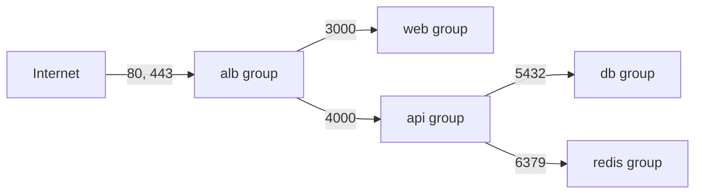
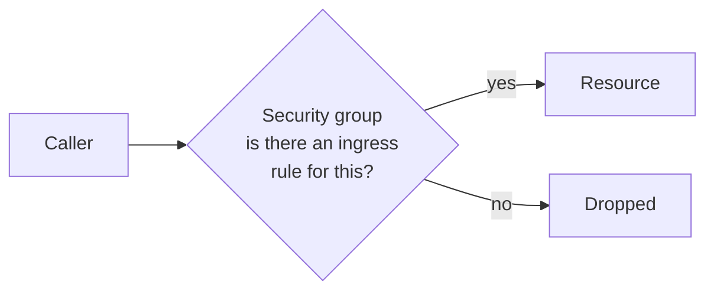
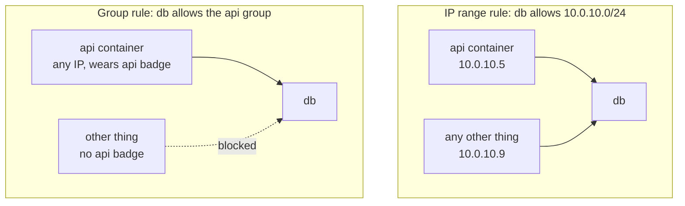
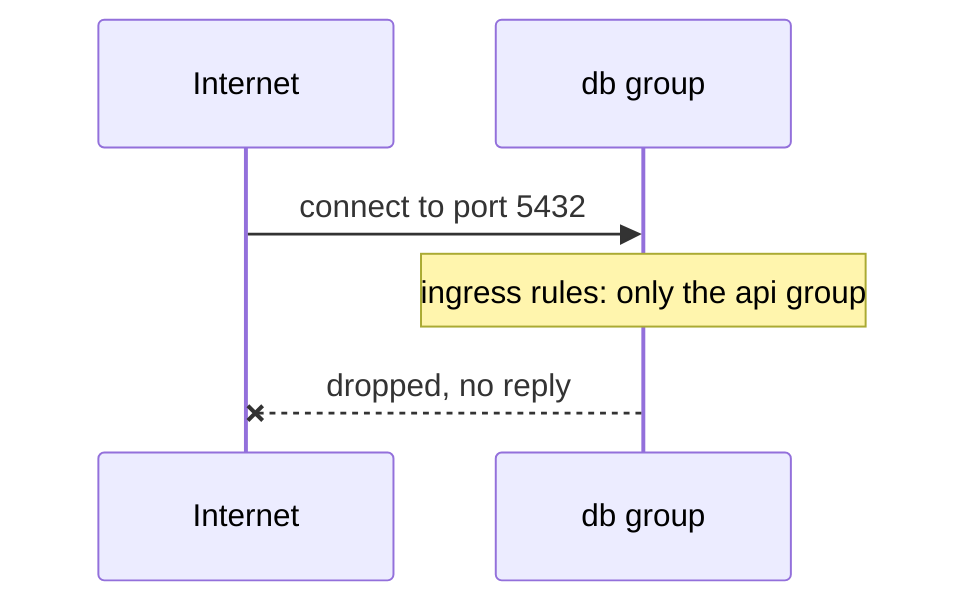
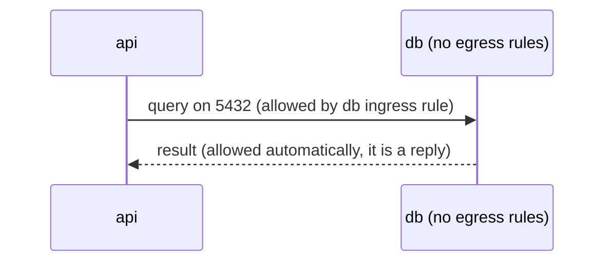
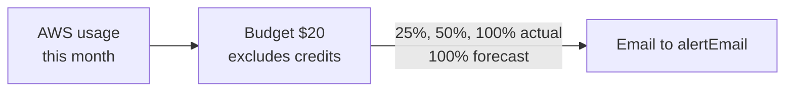
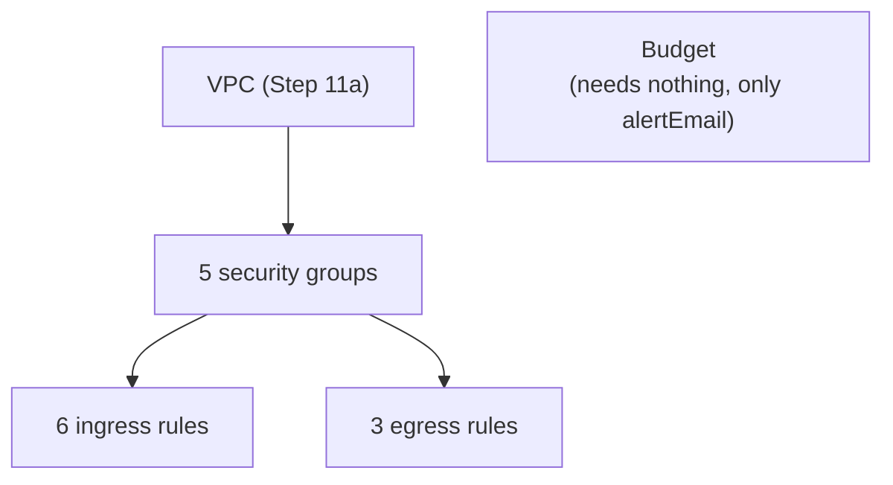

# Step 11b: Security groups and a budget alert

## 1. In one sentence

This step adds **firewalls** (security groups) that decide who may talk to whom inside our AWS network, and a **budget alert** that emails us when AWS spending gets high.

Still nothing runs. The groups are empty badges, waiting for the load balancer, containers and databases of later steps.

## 2. The big picture

Back to the office building from [Step 11a](12-infra-network.md). Subnets were floors and corridors. A **security group** is a **badge reader on a door**. Each kind of thing wears a badge. The reader on each door has a list: "let in only people wearing badge X".



Read it as a chain: the internet reaches only the load balancer. The load balancer reaches web and api. Only the api reaches the database and Redis. Every other path is blocked.

Files:

| File                     | Job                                                  |
| ------------------------ | ---------------------------------------------------- |
| `infra/src/security.ts`  | 5 security groups, 6 ingress rules, 3 egress rules   |
| `infra/src/budget.ts`    | The monthly budget and its 4 email alerts            |
| `infra/index.ts`         | Imports both files, exports the 5 group ids          |

## 3. The concepts

### 3.1 Security group

**What it is.** A **security group** is a firewall attached to a resource (a load balancer, a container, a database). It holds **rules** of two kinds:

- **Ingress** rule: who may come **in**.
- **Egress** rule: where the resource may go **out**.

Everything not allowed by a rule is blocked. There are no "deny" rules. You only list what is allowed.



**Why we need it.** Without groups, anything in the VPC could talk to the database. With them, only the api can.

### 3.2 Our five groups

| Group   | Protects                | Ingress (in)                        | Egress (out)  |
| ------- | ----------------------- | ----------------------------------- | ------------- |
| `alb`   | the load balancer       | 80 and 443 from the internet        | all           |
| `web`   | Next.js containers      | 3000 from the `alb` group           | all           |
| `api`   | Fastify containers      | 4000 from the `alb` group           | all           |
| `db`    | Postgres                | 5432 from the `api` group           | none          |
| `redis` | Redis                   | 6379 from the `api` group           | none          |

A **port** is a numbered door on a machine. Each program listens on one: 80 is web (HTTP), 443 is secure web (HTTPS), 3000 is Next.js, 4000 is our api, 5432 is Postgres, 6379 is Redis.

### 3.3 Why rules point at groups, not IP ranges

**What it is.** An ingress rule needs a **source**: who is allowed. It can be an IP range (`10.0.10.0/24`) or another security group. We always pick the group.



**Why we need it.**

- **Containers change IP addresses.** Every restart or scale-up gives a new one. A rule with an IP would break, or we would have to open a wide range.
- **A range is too wide.** It lets in every machine in it, not just the api.
- **A group rule says what we mean:** "only the api". It stays true whatever the IPs are.

The only IP-based rule is the load balancer's, `0.0.0.0/0` (every address), because the whole internet is allowed to visit it.

### 3.4 Least privilege

**What it is.** Give each thing the **smallest access** it needs, and nothing more.

Here: the database does not need to be reached by web or the internet, so it is not. Redis neither. The web containers do not need to be called by the api, so no rule allows it.

**Why we need it.** If one piece is hacked, the attacker can only reach what that piece could reach. A hacked web container cannot open a connection to Postgres, because no rule allows `web` -> `db`.

### 3.5 One blocked example: internet to database



The request is rejected for two reasons, and either one is enough:

1. The `db` group's only ingress rule says "from the `api` group". The internet does not wear that badge.
2. The database will live in a private subnet (no route from the internet, see [Step 11a](12-infra-network.md)).

Security groups are a second lock on a door that is already hidden. This is called **defence in depth**: several layers, so one mistake is not fatal.

### 3.6 Stateful: replies come back by themselves

**What it is.** Security groups are **stateful**. They remember the requests they allowed. A reply to an allowed request is let through automatically, in either direction.



**Why we need it.** This is why `db` and `redis` have **no egress rules at all**. They never start a conversation. They only answer. The answer is a reply, so it goes out without a rule.

Note: AWS adds an "allow all outbound" rule to every new group. For `db` and `redis` we remove it with `egress: []`, so they truly cannot call anyone.

`alb`, `web` and `api` keep **all outbound**, because they must call other services and AWS APIs (for example, pulling images from the container registry, ECR). Listing every destination would be long and fragile.

### 3.7 Security group vs NACL

- A **NACL** (network ACL) is a firewall on a **subnet**. A security group is a firewall on a **resource**.
- NACLs are **stateless**: you must allow the request and the reply separately. Security groups are stateful.
- NACLs have allow **and** deny rules, checked in number order. Security groups have allow rules only.
- Every subnet already has a default NACL that allows everything. We leave it alone.
- Security groups do most of the work in practice. NACLs are a coarse extra layer.

### 3.8 Separate rule resources

**What it is.** A rule can be written inside the group (`ingress: [...]`, "inline") or as its own resource. We use the second way: `aws.vpc.SecurityGroupIngressRule` and `SecurityGroupEgressRule`. Each rule is one line in the plan.

**Why we need it.**

- A rule that points at another group (like `web` -> `alb`) inline can create loops: group A needs B and B needs A.
- Each rule is its own item, so changing one rule does not touch the group or the other rules.
- Pulumi can show exactly which rule is added or removed.

The one exception: `db` and `redis` set `egress: []` inline. This only says "remove the default outbound rule". We have no separate egress rules for those two, so they do not clash.

### 3.9 The budget alert

**What it is.** An **AWS Budget** watches how much money the account spends and emails us. Ours:

- Type: cost. Limit: **$20 per month**.
- Emails to the `alertEmail` address from Pulumi config.
- Four alerts:

| When                          | Kind         |
| ----------------------------- | ------------ |
| spent 25% of $20 ($5)         | actual       |
| spent 50% of $20 ($10)        | actual       |
| spent 100% of $20 ($20)       | actual       |
| **predicted** to pass $20     | forecasted   |

**Actual** means money already spent. **Forecasted** means AWS looks at the month so far and predicts the month-end total. The forecast gives an early warning before the money is gone.



**How credits are excluded.** AWS credits are free money that pays the bill. By default a budget subtracts them, so it would show $0 while credits last. We set `includeCredit: false`, which means "do not count credits as a discount". The budget then tracks the **real usage cost**. We see what the project would cost when credits run out, and we notice a runaway cost early.

**Limits.** A budget only **warns**. It does not stop anything. And AWS cost data is a few hours late, so an alert is not instant.

The email is not in the code. It is read from Pulumi config (`pulumi config set alertEmail ...`), so each person uses their own address. `config.require` makes the program fail loudly if it is not set.

## 4. Dependency order

Rules need **both** groups to exist: the group they protect and the group they allow. So the order is: VPC, then groups, then rules. Pulumi works this out because each rule uses the `id` of its groups.



Total created: 5 groups + 6 ingress rules + 3 egress rules + 1 budget = **15 resources**.

## 5. How this connects

**Uses from earlier layers**

- `vpcId` from `network.ts` ([Step 11a](12-infra-network.md)). A security group lives inside one VPC.

**Used by later layers**

- `albSgId`: the load balancer.
- `webSgId` and `apiSgId`: the ECS containers.
- `dbSgId`: the RDS Postgres database.
- `redisSgId`: the Redis cache.

See [00-architecture.md](00-architecture.md) for the whole picture.

## 6. How to deploy and check

Set your email once (it is saved in `infra/Pulumi.dev.yaml`):

```bash
cd infra
pulumi config set alertEmail you@example.com
pulumi preview          # expect: 15 to create
pulumi up               # type "yes"
pulumi stack output     # prints the 5 group ids
```

Check in the AWS console (region us-east-1):

- **VPC -> Security groups.** Filter by tag `Project = minitickets`. You should see 5 groups. Open `minitickets-dev-db-sg`: Inbound has one rule (5432 from the api group's id), Outbound is empty.
- **Billing -> Budgets.** You should see `minitickets-dev-monthly-cost` with $20 and 4 alerts.
- AWS also sends a confirmation email to the alert address.

## 7. What breaks if this is wrong or missing

| Mistake                                           | What happens                                                          |
| ------------------------------------------------- | --------------------------------------------------------------------- |
| db ingress uses `0.0.0.0/0`                       | Anyone on the internet could try to log in to the database            |
| db ingress uses an IP range, not the api group    | Breaks when containers change IP, or lets in too many machines        |
| No rule `alb` -> `web` or `api`                   | The load balancer shows "unhealthy targets", the site returns 502/503 |
| Wrong port in a rule (say 3001, not 3000)         | Same: requests are silently dropped, no error message                 |
| `alb`, `web` or `api` has no egress               | Containers cannot reach the database, or pull images from ECR         |
| Forget `egress: []` on db                         | Works, but db can call out to anywhere. Not least privilege           |
| `alertEmail` not set                              | `pulumi up` fails with "missing required configuration"               |
| `includeCredit` left as true                      | The budget shows $0 while credits last, so no early warning           |
| Email subscription never confirmed                | Some budgets send nothing until the address is confirmed              |

## 8. Interview questions

1. **What is a security group?** A stateful firewall on a resource. It has allow rules for inbound and outbound traffic. Anything not allowed is blocked.
2. **What does stateful mean?** The group remembers allowed requests, so the reply is allowed without a rule.
3. **Security group vs NACL?** A security group is on the resource, stateful, allow-only. A NACL is on the subnet, stateless, and has allow and deny rules in order.
4. **Why reference a security group as the source instead of an IP range?** Container IPs change. A group rule follows the badge, not the address, and lets in only the exact callers.
5. **What is least privilege?** Give each component only the access it needs. A hacked web container then cannot reach the database.
6. **Why can the database have no egress rules?** It never starts connections. Replies to allowed requests go out automatically because groups are stateful.
7. **Why use separate rule resources instead of inline rules?** Avoids circular references between groups, and gives one clear plan line per rule.
8. **What is defence in depth?** Several layers of protection (private subnet plus security group), so one mistake does not expose the system.
9. **How do you track real cost while using AWS credits?** Set `includeCredit` to false on the budget, so credits are not subtracted.

## 9. Check yourself

1. The web container needs to call the database directly. What would you add, and why would it be a bad idea?
2. A request to the api is allowed in on port 4000. Does the reply need an egress rule on the api group? What if the api also needs to call the internet first?
3. Your budget alert at 100% forecasted arrives on day 5 of the month. What does it mean, and how is it different from the 100% actual alert?
