# Step 11c: The data layer (RDS Postgres, ElastiCache Valkey, secrets)

## 1. In one sentence

This step adds a **real Postgres database** and a **real Redis-style cache** in AWS, hidden in the private subnets, with their passwords kept in a safe (Secrets Manager), and an **on/off switch** so they only cost money while we use them.

Still no app runs in AWS. The database and cache wait, empty, for the api containers of a later step.

## 2. The big picture

Back to the office building from [Step 11a](12-infra-network.md). The private floors finally get furniture: a filing cabinet (Postgres) and a notice board (the cache). Each sits behind a badge reader from [Step 11b](13-infra-security-groups.md). The keys live in a locked safe in the manager's office (Secrets Manager).

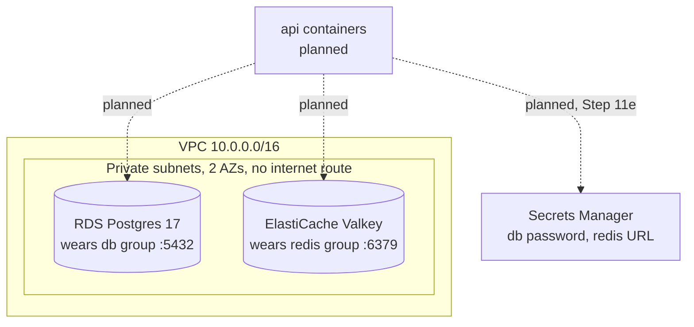

Some words used above:

- **RDS** (Relational Database Service) is AWS running Postgres for us. AWS looks after the machine, the disk, patches and backups. We only use the database.
- **ElastiCache** is AWS running an in-memory store (Redis or Valkey) for us.
- **Valkey** is a free, open-source copy of Redis. It speaks the same language, so our `ioredis` code works unchanged. On ElastiCache it is about 20% cheaper than Redis.
- **Secrets Manager** is a safe inside AWS for passwords. Only callers that are allowed can read a secret, and every read is logged.

### The files

| File                         | Job                                                              |
| ---------------------------- | ---------------------------------------------------------------- |
| `infra/src/data/postgres.ts` | DB subnet group + the RDS Postgres instance                      |
| `infra/src/data/cache.ts`    | Random auth token + cache subnet group + Valkey replication group |
| `infra/src/data/secrets.ts`  | The `minitickets/dev/redis-url` secret and its value             |
| `infra/index.ts`             | The `dataEnabled` switch; calls the three files; exports outputs |

Each data file exports a **function** (like `createPostgres()`) instead of creating things the moment it is imported. That is what lets `index.ts` decide whether to call it.

## 3. The concepts

### 3.1 Where the data lives

**What it is.** Both stores live only in the two **private** subnets. Each wears the security group made for it in Step 11b.

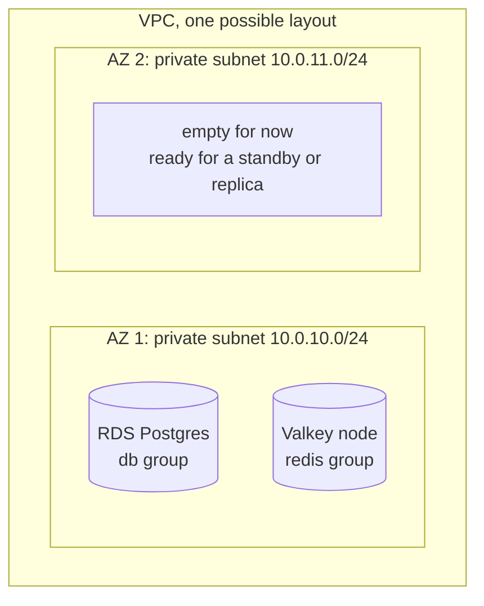

AWS picks which of the two subnets each store lands in. It may put them in different AZs. That is fine: the api can reach both.

**Why we need it.** A private subnet has no route to or from the internet. A database there cannot be reached from outside, even by mistake.

### 3.2 Subnet groups, and why 2 subnets for 1 machine

**What it is.** A **subnet group** is a list of subnets that RDS (or ElastiCache) is allowed to use. It answers: "where in my VPC may you put this database?" We make one for RDS and one for ElastiCache. Both list the two private subnets.

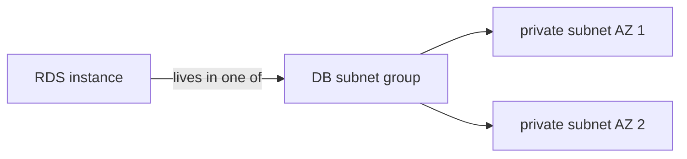

**Why 2 subnets even for a single instance?** AWS **requires** a DB subnet group to cover at least 2 availability zones. The reasons:

- If we later turn on Multi-AZ, the standby copy needs a second AZ ready.
- If one AZ has a long outage, AWS can bring the database back up in the other one.

Think of it as booking two parking spots, in two different car parks, even though you have one car. If one car park closes, you still have somewhere to park.

**Why we need it.** Without a subnet group, RDS would use the VPC's default subnets, which might be public. The subnet group is how we **force** the database into the private floors.

### 3.3 Single-AZ vs Multi-AZ

**What it is.**

- **Single-AZ:** one database machine in one AZ. If that machine or AZ fails, the database is down until AWS repairs or replaces it (minutes to hours).
- **Multi-AZ:** a second, **standby** machine in another AZ. Every write is copied to it. If the main one fails, AWS switches to the standby in about a minute. The api keeps the same address.

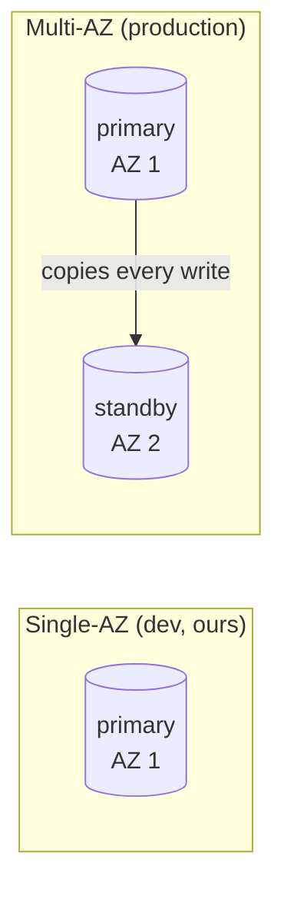

**Why we chose Single-AZ.** Multi-AZ **doubles the cost**, because you pay for two machines and two disks. A dev database can be down for a while and nobody is hurt.

**What production would choose.** Multi-AZ. There, a database outage means real users cannot log in or buy tickets. A few extra dollars a day is far cheaper than that.

The cache is also a single node (`numCacheClusters: 1`, no automatic failover). If it fails, users are logged out until it is back. Production would use 2+ nodes in 2 AZs.

### 3.4 Who can reach them

**What it is.** The security groups from [Step 11b](13-infra-security-groups.md) decide this. The db group allows port 5432 **only from the api group**. The redis group allows 6379 **only from the api group**.

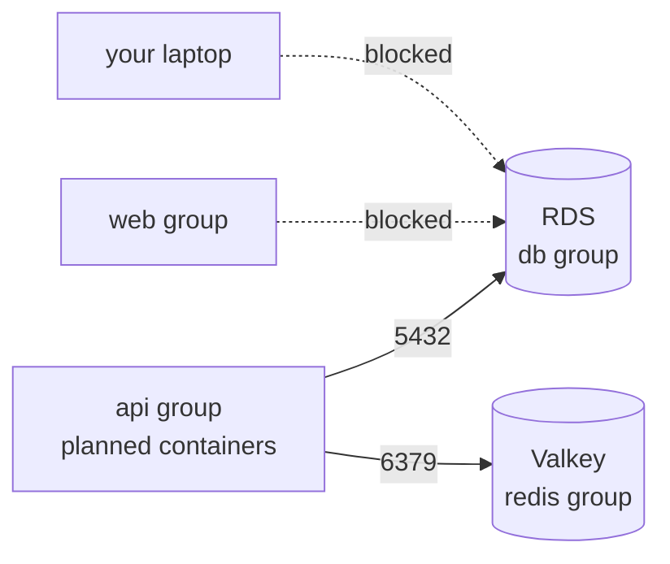

Nothing wears the api badge yet, so right now **nobody** can connect. That changes when the api containers arrive.

### 3.5 Why you CANNOT connect from your laptop (and why that is good)

**What it is.** You cannot run `psql` from your laptop against this database. Three separate locks stop you:

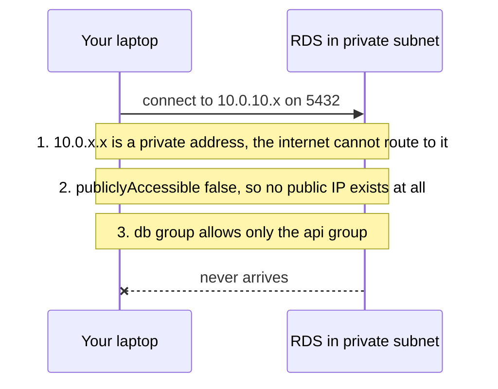

1. **Private subnet.** There is no route from the internet into it.
2. **`publiclyAccessible: false`.** RDS never gives the database a public IP. Its name resolves only to a `10.0.x.x` address, which means nothing outside the VPC.
3. **Security group.** Even from inside the VPC, only the api group may connect.

**Why that is good.** Databases are the most attacked thing on the internet. Bots scan every public IP for open port 5432 all day. Ours has no public IP, so it is not even on their list. This is **defence in depth**: if one lock is set wrong by mistake, the other two still hold.

How do you check it works, then? With the AWS CLI, which talks to AWS's own API, not to the database. See section 7. (If you ever truly need a `psql` session, the usual tools are a "bastion" machine or AWS Systems Manager. We do not build those.)

### 3.6 The master password: RDS-managed vs our own

**What it is.** Every Postgres needs an admin (**master**) user and password. Two ways to create the password:

| Way                                    | Where the password ends up                                   |
| -------------------------------------- | ------------------------------------------------------------ |
| Our own: we generate it, pass it to RDS | in our code or config, **and** in Pulumi state (a file Pulumi stores) |
| RDS-managed (`manageMasterUserPassword: true`) | **only** in Secrets Manager. RDS made it; we never see it |

We use the RDS-managed way.

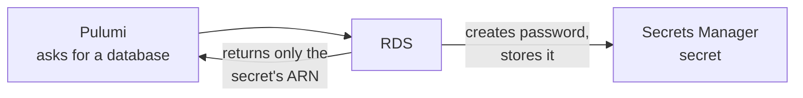

**Why we need it.**

- The password **never** appears in our code, our Git history, Pulumi config or Pulumi state. There is nothing to leak.
- Only callers allowed by IAM can read the secret, and every read is logged.
- RDS **rotates** (changes) the password automatically, every 7 days by default. So the api must always read it from the secret, never from a copy.

An **ARN** (Amazon Resource Name) is the unique address of a thing in AWS, like `arn:aws:secretsmanager:us-east-1:...:secret:rds!db-...`. Knowing an ARN does not let you read the secret. It is like knowing which safe the key is in, without the combination.

### 3.7 The cache's auth token and the redis-url secret

**What it is.** Valkey on ElastiCache has no automatic password feature like RDS. So:

1. Pulumi generates a random 32-character **auth token** (`@pulumi/random`). It uses only letters and digits, so it is safe inside a URL.
2. We give the token to ElastiCache.
3. We build the full URL `rediss://:<token>@<primary endpoint>:6379` and store it in Secrets Manager as `minitickets/dev/redis-url`.

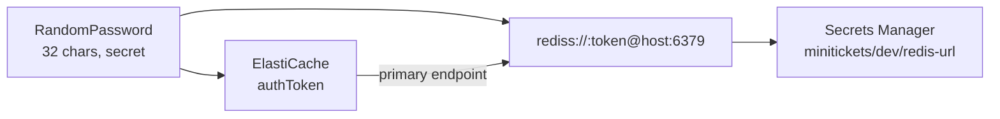

The token **does** sit in Pulumi state, because Pulumi created it. But it is marked **secret**, so Pulumi encrypts it in state and shows `[secret]` in every preview and log. We never export it as a stack output.

**Why the whole URL, not just the token?** The api already reads one value, `REDIS_URL` (see `apps/api/src/config/env.ts`). Storing the full URL means the container gets exactly that, with no extra code.

The secret uses `recoveryWindowInDays: 0`. By default AWS keeps a deleted secret for 7–30 days and **blocks its name**. Then switching the layer back on would fail with "secret is scheduled for deletion". Production keeps the default window, so a deleted secret can be recovered.

### 3.8 TLS in transit, encryption at rest

**What it is.**

- **In transit** = while the data travels over the network. **TLS** (the padlock in your browser) scrambles it so anyone listening in the middle sees noise.
- **At rest** = while the data sits on a disk. Encryption at rest scrambles the disk, so a stolen disk or backup is useless.

| Store    | At rest                          | In transit                                                      |
| -------- | -------------------------------- | --------------------------------------------------------------- |
| Postgres | `storageEncrypted: true`         | SSL is **required** by default on RDS Postgres 15+ (`rds.force_ssl`) |
| Valkey   | `atRestEncryptionEnabled: true`  | `transitEncryptionEnabled: true`: TLS only, `rediss://`         |

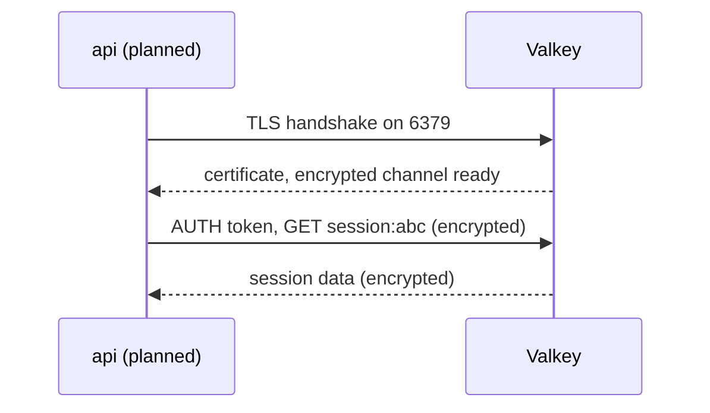

**Why we need it.** Sessions and password hashes are exactly what an attacker wants. Both settings are free. Both **cannot be turned on later** without rebuilding the store, so we turn them on from day one.

The `s` in `rediss://` tells `ioredis` to use TLS. For Postgres, the api must connect with SSL too, or RDS refuses it. We handle that in Step 11e.

### 3.9 How the api will get the credentials (planned, Step 11e)

**What it is.** The api containers will not have passwords baked in. When ECS (the AWS service that runs our containers) starts an api **task** (one running copy of a container), it reads the two secrets and hands them to the container as **environment variables**.

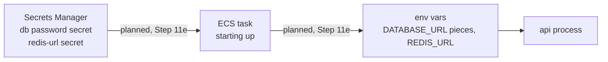

**Why we need it.** The secret values are never in our image, our code or our task definition. Only the ARNs are. Step 11e adds the IAM permission that lets ECS read exactly these two secrets.

### 3.10 The on/off switch

**What it is.** A Pulumi config value, `dataEnabled` (true or false, default false). `index.ts` calls the data functions only when it is `true`.

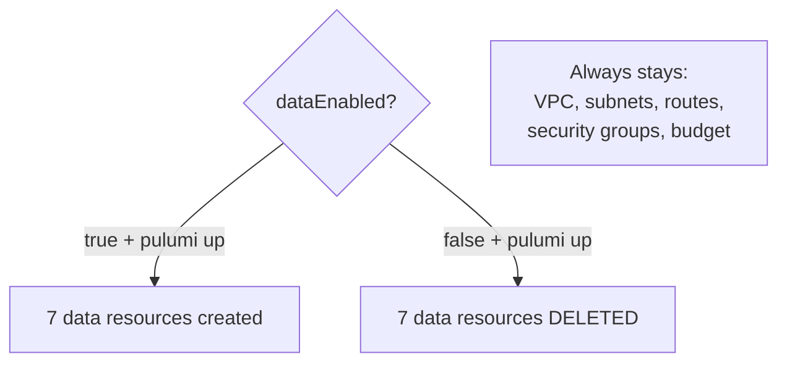

What is deleted when you turn it off, and what stays:

| Deleted when off                        | Stays                                   |
| --------------------------------------- | --------------------------------------- |
| RDS instance (and its password secret)  | VPC, 4 subnets, internet gateway        |
| DB subnet group                         | Route tables and associations           |
| Valkey replication group                | 5 security groups and their rules       |
| Cache subnet group                      | Budget alert                            |
| Auth token, redis-url secret + value    |                                         |

**Why we need it.** RDS and ElastiCache charge **every hour they exist**, used or not. The network and security groups cost nothing. So we keep the cheap part always on and switch the expensive part on only while working.

Think of a light switch for one room: you turn off the lamp, not the whole building.

### 3.11 Cost per hour

Approximate on-demand prices in us-east-1. Check the AWS pricing pages for today's numbers.

| Item                              | Per hour  | Per month if left on |
| --------------------------------- | --------- | -------------------- |
| RDS db.t4g.micro, Single-AZ       | ~$0.016   | ~$11.70              |
| RDS 20 GB gp3 storage             | ~$0.003   | ~$2.30               |
| ElastiCache cache.t4g.micro Valkey | ~$0.013   | ~$9.30               |
| 2 secrets in Secrets Manager      | ~$0.001   | ~$0.80               |
| **Total**                         | **~$0.033** | **~$24**           |

So about **3 cents an hour**, or about **80 cents a day**. Left on for a whole month it would pass our **$20 budget** from Step 11b on its own. That is why the switch exists. A 3-hour work session costs about 10 cents.

Backups are free up to the size of the database. There is no NAT gateway and no public IP, so no hidden network charges.

### 3.12 What happens to the data when the layer is turned off

**It is deleted. For good.**

- `skipFinalSnapshot: true` means RDS does **not** take a last backup before deleting.
- The automatic daily backups (`backupRetentionPeriod: 1`) are deleted with the instance.
- The cache has no backups (`snapshotRetentionLimit: 0`).
- The secrets are deleted at once (`recoveryWindowInDays: 0`).

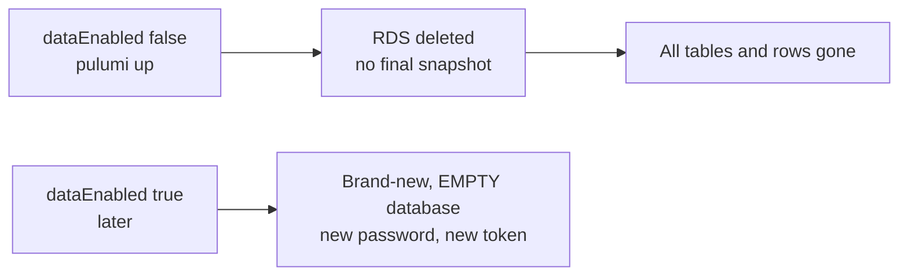

Turning it back on gives you a **new, empty** database with a new endpoint, a new password and a new token. Migrations must run again. In dev that is fine: we only test that things work. Production would set `deletionProtection: true` and `skipFinalSnapshot: false`, so deleting needs a deliberate extra step and a backup is always kept.

### 3.13 The dev-only settings

Each of these trades safety for cheap, fast teardown. Each has a comment in `postgres.ts`.

| Setting                  | Dev (ours) | Production                         | Why production differs                        |
| ------------------------ | ---------- | ---------------------------------- | --------------------------------------------- |
| `deletionProtection`     | false      | true                               | nobody (not even Pulumi) deletes it by mistake |
| `skipFinalSnapshot`      | true       | false + a snapshot name            | the last state can always be restored         |
| `backupRetentionPeriod`  | 1 day      | 7–35 days                          | go back to any minute in that window          |
| `applyImmediately`       | true       | false                              | changes wait for the quiet maintenance window |
| `multiAz`                | false      | true                               | survives an AZ failure in about a minute      |

## 4. Dependency order

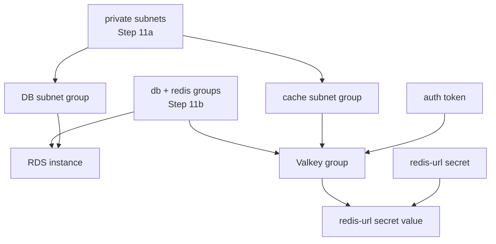

- Subnet groups need the private subnets.
- RDS needs its subnet group and the db security group.
- Valkey needs its subnet group, the redis security group and the token.
- The secret value needs the Valkey endpoint (it is part of the URL) and the empty secret.
- The RDS password secret is created by RDS itself, as part of the instance.

Total created when on: **7 resources**. RDS usually takes 5–10 minutes, Valkey 5–15 minutes. Deleting takes about as long.

## 5. How this connects

**Uses from earlier layers**

- `privateSubnetIds` from the network layer ([Step 11a](12-infra-network.md)): both subnet groups.
- `dbSgId` and `redisSgId` from the security layer ([Step 11b](13-infra-security-groups.md)): the firewalls the stores wear.
- The budget from Step 11b watches the new cost.

**Used by later layers**

- `dbEndpoint`, `dbPort`, `dbMasterSecretArn`: the api's database connection (Step 11e).
- `redisUrlSecretArn`: the api's `REDIS_URL` (Step 11e).
- `redisEndpoint`: for checks and debugging; the api uses the URL in the secret.
- Step 11e also turns on SSL in the api's Postgres connection and adds the IAM permission to read the two secrets.

See [00-architecture.md](00-architecture.md) for the whole picture.

## 6. How to turn it on, verify, and turn it off

All commands run from `infra/`. The AWS CLI needs the same profile Pulumi uses:

```bash
cd infra
export AWS_PROFILE=ticketlite AWS_REGION=us-east-1
```

**Turn on**

```bash
pulumi config set dataEnabled true
pulumi preview            # expect: 7 to create, 28 unchanged
pulumi up                 # type "yes", wait 10-15 minutes
pulumi stack output       # dbEndpoint, dbPort, dbMasterSecretArn, redisEndpoint, redisUrlSecretArn
```

**Verify** (no laptop connection is possible, so we ask AWS instead)

```bash
# 1. Postgres: not public, encrypted. Expect Public False, Encrypted True, MultiAZ False.
aws rds describe-db-instances --db-instance-identifier minitickets-dev-db \
  --query 'DBInstances[0].{Status:DBInstanceStatus,Public:PubliclyAccessible,Encrypted:StorageEncrypted,MultiAZ:MultiAZ,Version:EngineVersion}' \
  --output table

# 2. The db name resolves to a private 10.0.x.x address only.
nslookup "$(pulumi stack output dbEndpoint)"

# 3. Valkey: TLS, at-rest encryption and auth token all on. Expect True, True, True.
aws elasticache describe-replication-groups --replication-group-id minitickets-dev-valkey \
  --query 'ReplicationGroups[0].{Status:Status,TLS:TransitEncryptionEnabled,AtRest:AtRestEncryptionEnabled,Auth:AuthTokenEnabled}' \
  --output table

# 4. Both secrets exist. describe-secret shows the name, NEVER the value.
aws secretsmanager describe-secret --secret-id "$(pulumi stack output dbMasterSecretArn)" --query '{Name:Name,ARN:ARN}'
aws secretsmanager describe-secret --secret-id minitickets/dev/redis-url --query '{Name:Name,ARN:ARN}'
```

Do not use `get-secret-value` just to check. It prints the password to your terminal.

**Turn off** (deletes the data)

```bash
pulumi config set dataEnabled false
pulumi preview            # expect: 7 to delete, 28 unchanged. Nothing else!
pulumi up                 # type "yes"
```

If the off preview shows anything other than the 7 data resources being deleted, stop and check.

## 7. What breaks if this is wrong or missing

| Mistake                                           | What happens                                                               |
| ------------------------------------------------- | -------------------------------------------------------------------------- |
| Subnet group lists public subnets                 | The database could sit on a floor with an internet route                   |
| `publiclyAccessible: true`                        | The database gets a public IP; one wrong security group rule exposes it    |
| Subnet group with only 1 subnet                   | AWS refuses: "must cover at least 2 AZs"                                   |
| Password passed in code instead of RDS-managed    | The password lives in Git or Pulumi state, and anyone who sees it can log in |
| `storageEncrypted` or Valkey encryption off       | Cannot be fixed later without rebuilding and moving the data              |
| api connects to Postgres without SSL              | RDS refuses the connection (`no pg_hba.conf entry ... no encryption`)      |
| api uses `redis://` instead of `rediss://`        | Connection hangs or resets: Valkey only speaks TLS                         |
| Token with `@` or `/` in it                       | The URL is parsed wrongly and auth fails                                   |
| Secret keeps the default recovery window          | Turning the layer back on fails: "secret is scheduled for deletion"        |
| Layer left on all month                           | About $24, more than the $20 budget                                        |
| Expecting data to survive "off"                   | It does not. The next "on" is an empty database                            |

## 8. Interview questions

1. **What is a DB subnet group, and why does it need 2 AZs?** The list of subnets RDS may use. AWS requires 2 AZs so a Multi-AZ standby, or a recovery after an AZ failure, has somewhere to go.
2. **Single-AZ vs Multi-AZ?** Single-AZ is one machine. Multi-AZ adds a standby in another AZ with automatic failover in about a minute, for about double the cost.
3. **Why use `manageMasterUserPassword`?** RDS creates and stores the password in Secrets Manager. It never appears in code or IaC state, access is IAM-controlled and logged, and it rotates automatically.
4. **How do you reach a database in a private subnet?** From inside the VPC only: an app in an allowed security group, or a bastion / Systems Manager session. Never directly from the internet.
5. **Encryption in transit vs at rest?** In transit protects data on the network (TLS). At rest protects data on disk and in backups. Both should be on; at-rest cannot be added later without a rebuild.
6. **Why Valkey instead of Redis?** Same protocol, so clients like ioredis work unchanged, open-source licence, and about 20% cheaper on ElastiCache.
7. **How do you keep dev cloud costs low?** Smallest instance sizes, Single-AZ, no NAT gateway, and a switch that deletes the hourly-billed parts when not in use.
8. **What does `skipFinalSnapshot: true` mean, and when is it OK?** No backup is taken when the database is deleted. OK only for throwaway dev data.

## 9. Check yourself

1. You switch the layer off on Friday and back on Monday. Your old test user is gone and the api cannot log in to Postgres with Friday's password. Explain both.
2. A teammate says "just set `publiclyAccessible: true` so I can use psql from home; the security group still protects it". What is wrong with that argument?
3. Production must survive an AZ failure with no lost sessions. Which settings in `postgres.ts` and `cache.ts` would you change?
