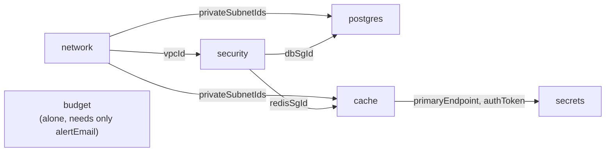
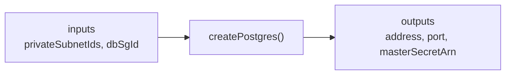
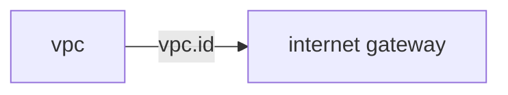
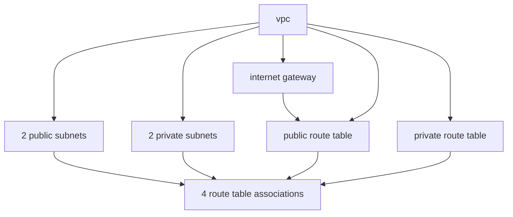
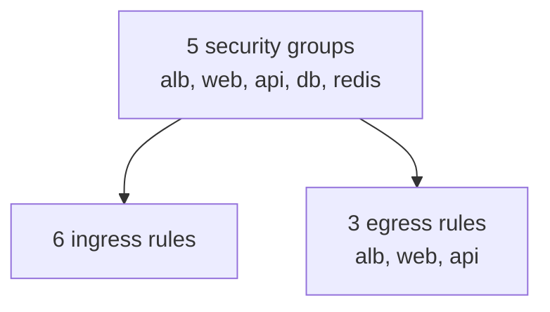
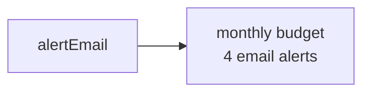
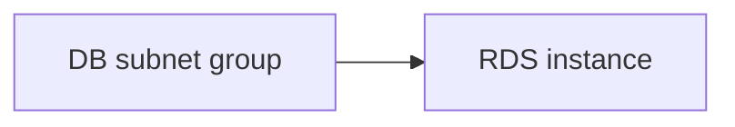
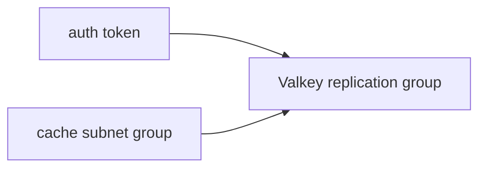
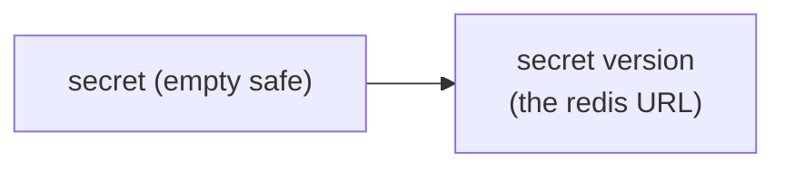
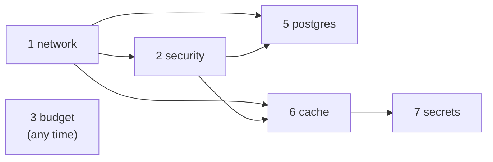

# Step 11d: Making infra dependencies visible

## 1. In one sentence

This step **changes no AWS resource**; it re-organises the infra code so you can see, just by reading, which layer needs which.

## 2. The big picture

Before, layer files imported each other (`security.ts` imported `vpcId` from `network.ts`). To know what depended on what, you had to open every file. Now each layer is a **function**: values go in as arguments and come out as a return value. Only `index.ts` connects them.

Real-life comparison: a kitchen where every cook shouts across the room versus one where a head chef hands each cook a ticket. The cooks no longer need to know each other. The head chef (`index.ts`) is the only one who knows the whole order.



Postgres, cache and secrets together are the **data layer**, the part that `dataEnabled` switches on and off ([Step 11c](14-infra-data.md)).

## 3. How to read dependencies in our code

There are three places to look. Each is a different level of zoom.

### 3a. The function signature

Every layer exports one function. Its **parameter** is what it needs. Its **return type** is what it gives.

```ts
export function createPostgres(inputs: PostgresInputs): PostgresOutputs
```



Why: TypeScript now checks the wiring. If `index.ts` forgets an input, `pnpm typecheck` fails.

### 3b. The header block

The top of every layer file has four lines:

```ts
// LAYER: postgres (part of the data layer)
// NEEDS (inputs):   privateSubnetIds <- from network
//                   dbSgId           <- from security
// CREATES:          DB subnet group, then RDS Postgres instance
// GIVES (outputs):  address, port    -> used by (planned) api containers
```

`<-` means "comes from". `->` means "goes to". One glance tells you the layer's neighbours.

### 3c. Output used as input = a dependency

Inside a file, a resource that uses another resource's output **depends on it**. Pulumi sees this and creates things in the right order by itself.

```ts
const igw = new aws.ec2.InternetGateway("igw", {
  vpcId: vpc.id,   // <- vpc.id is an output of the vpc, so igw depends on vpc
});
```



Every resource also keeps a `DEPENDS ON:` comment, and resources appear in the file **after** the things they depend on. So reading top to bottom is a valid build order.

### The rules

- No layer file imports resources or values from another layer file. Shared helpers (like `tags.ts`) are fine.
- Only `index.ts` connects layers.
- We do **not** wrap resources in Pulumi `ComponentResource`. That would change every resource's identity (its URN), and Pulumi would replace them. This step must change nothing in AWS.

## 4. The layers, one by one

### network

Needs nothing. Gives `vpcId`, `publicSubnetIds`, `privateSubnetIds`.



### security

Needs `vpcId`. Gives the 5 group ids.



### budget

Needs `alertEmail` (a plain value from config, not a resource). Gives nothing.



### postgres

Needs `privateSubnetIds`, `dbSgId`.



### cache

Needs `privateSubnetIds`, `redisSgId`.



### secrets

Needs `redisEndpoint`, `authToken` (both from cache).



## 5. Dependency order

`index.ts` calls the layers in this order. A layer can only be called after the ones it needs.



## 6. How to view the real graph

The code shows the dependencies we **wrote**. Pulumi can also show the dependencies it **found**.

- **In the terminal:** `pnpm infra:graph` runs `pulumi stack graph` and writes `infra/deps.dot` (ignored by Git). A `.dot` file is plain text in the Graphviz format. If you have Graphviz installed, `dot -Tpng infra/deps.dot -o deps.png` draws it.
- **In the browser:** open the stack in Pulumi Cloud (the "View Live" link that `pulumi preview` prints), then choose the **Resources** tab and its graph view.

If both pictures match the diagram in section 2, the refactor is correct.

## 7. What breaks if this is wrong or missing

| Mistake                                              | What happens                                                        |
| ---------------------------------------------------- | ------------------------------------------------------------------- |
| A layer is wrapped in `ComponentResource`            | Resource URNs change; Pulumi plans to delete and re-create them     |
| A resource name or type is edited during the refactor | Same: replacement, and for RDS that means lost data                 |
| A layer imports another layer's file again           | The hidden dependency returns; the header block lies                |
| `index.ts` passes the wrong output (e.g. `redisSgId` as `dbSgId`) | Types match (both are strings), so only the header and review catch it |
| An input is read with `.apply` and used to build a name | Pulumi cannot know the name at preview time                         |
| Header block not updated when inputs change          | Readers trust a wrong map                                           |

The safety check for this whole step is `pulumi preview` showing **0 to create, 0 to update, 0 to delete**.

## 8. How this connects

Uses from earlier layers:

- The resources of [Step 11a](12-infra-network.md) (network), [11b](13-infra-security-groups.md) (security groups and budget) and [11c](14-infra-data.md) (data layer). Their code moved into functions; their AWS resources are identical.

Later layers will use:

- The same pattern. A new layer (containers, IAM) will be one more function with a header block, and one more numbered call in `index.ts`. For example the ECS layer will take `privateSubnetIds`, `apiSgId` and `redisUrlSecretArn`.

## 9. Interview questions

1. **What is a Pulumi `Output`?** A value that is only known after AWS creates the resource (like an id). Passing it to another resource tells Pulumi about a dependency.
2. **How does Pulumi decide creation order?** It builds a graph from outputs used as inputs, then creates independent resources in parallel and dependent ones in order.
3. **Why pass values as function arguments instead of importing them?** The dependency becomes visible in the signature, the file is easier to test and reuse, and there are no hidden links between files.
4. **What is a URN, and why does it matter for refactors?** The unique id Pulumi gives each resource (stack, type, name, parents). If it changes, Pulumi sees a new resource and replaces the old one.
5. **Why avoid `ComponentResource` here?** It adds a parent to the URN of every child, which would replace all of them.
6. **How can you prove a refactor changed nothing?** Run `pulumi preview`: it should say 0 to create, update and delete.
7. **What is the difference between `pulumi.Input<T>` and `pulumi.Output<T>`?** `Input` accepts a plain value, a promise or an output. `Output` is the value a resource gives back. Parameters use `Input`; return types use `Output`.
8. **How do you see the dependency graph Pulumi really built?** `pulumi stack graph`, or the graph view in Pulumi Cloud.

## 10. Check yourself

1. Which layer would break first if `network` stopped giving `privateSubnetIds`, and how would you find out before running `pulumi up`?
2. Why is `budget` called with no inputs from other layers, and what would change if it had to know the VPC?
3. You add an ECS layer that needs `apiSgId`. Which files do you edit, and which files must you not touch?
