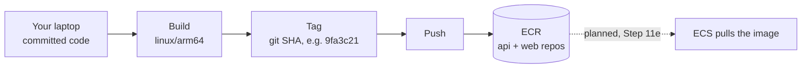
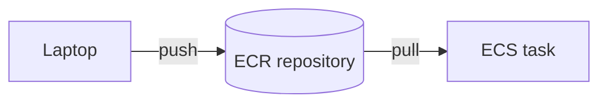
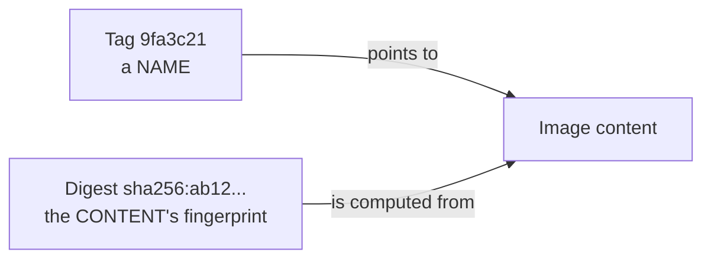
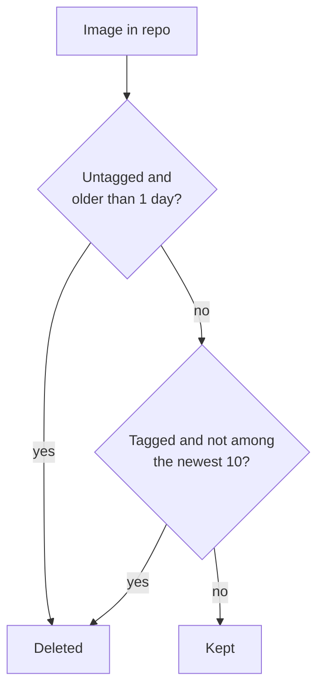
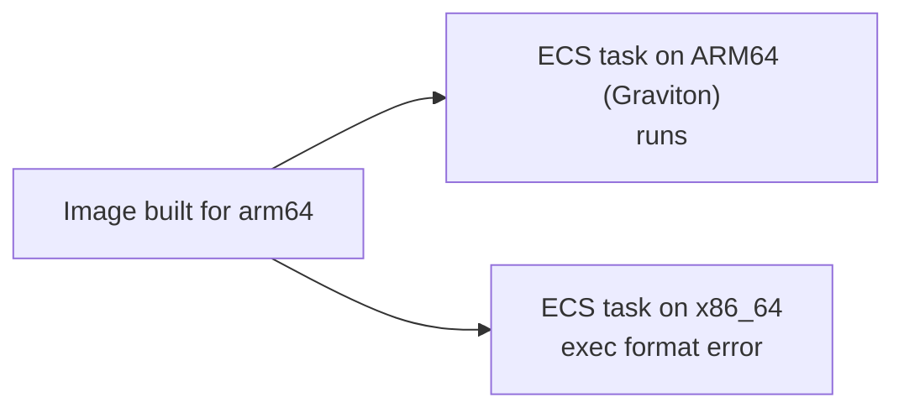
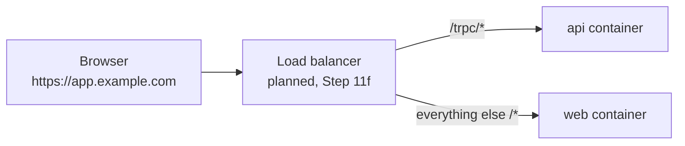
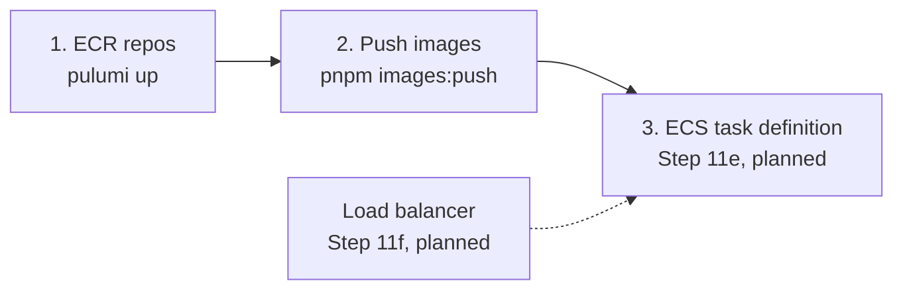

# Step 11d: ECR repositories and pushing images

## 1. In one sentence

This step creates two private shelves in AWS (ECR) for our Docker images, and a script that builds the images for ARM64 and puts them there.

## 2. The big picture



Dotted arrow = planned. Nothing runs these images in AWS yet. This step only stores them.

## 3. Concepts

### 3a. Container registry

**What it is.** A registry is a warehouse for images. A Docker image is a packed box with your app and everything it needs. A registry keeps the boxes and hands them out on request. ECR (Elastic Container Registry) is AWS's registry.

Real-life comparison: your laptop is the kitchen where you cook. ECR is the cold storage. ECS (later) is the restaurant that fetches a meal from storage. The restaurant cannot walk into your kitchen.



**Why we need it.** AWS cannot read images from your laptop. They must be somewhere AWS can reach, and private, because the image holds our code.

We make **two repositories**, `minitickets-dev-api` and `minitickets-dev-web`. One repository holds many versions (tags) of one image.

### 3b. Tag vs digest, and git-SHA tags

**What it is.** A **tag** is a name stuck on an image, like `9fa3c21`. A **digest** is a fingerprint (`sha256:...`) computed from the image's exact content.



A tag is a label, so it can be moved to another image. A digest cannot lie: change one byte and it changes.

**Our tag is the short git SHA.** A SHA names exactly one commit. From a running container's tag, you can find the exact code. We never use `latest`, because `latest` moves: you cannot tell what it holds, and two servers can pull "latest" at different times and run different code.

**Immutable tags.** We set `imageTagMutability: IMMUTABLE`. A tag can be pushed only once, so it can never point to different code later. If you try to push the same tag again, ECR refuses. That is also why the push script refuses to run with uncommitted changes: the tag must match committed code.

### 3c. Scan on push

**What it is.** With `scanOnPush: true`, AWS checks every pushed image against a list of known security holes (CVEs) in its operating-system packages.

**Why we need it.** Old packages inside an image are a common way in for attackers. This basic scan is free and gives an early warning. It only reports; it never blocks a push.

### 3d. Lifecycle policy

**What it is.** Rules that delete old images by themselves.



**Why we need it.** Every push adds an image, and storage is billed per GB. Without rules the bill grows forever.

### 3e. Cost of ECR storage

ECR costs about **$0.10 per GB per month**. Our images are a few hundred MB each, and the policy keeps at most 10 per repository. So the whole thing is a few cents per month. Data going from ECR to ECS in the same region is free. That is why it has no on/off switch like the data layer.

### 3f. `forceDelete`

We set `forceDelete: true`. Normally AWS refuses to delete a repository that still holds images. This is **dev only**: it lets `pulumi destroy` remove everything. In production this stays `false`, so a mistaken destroy cannot wipe the images.

### 3g. ARM64 / Graviton, and why image and task must match

**What it is.** CPUs speak different instruction sets. Intel/AMD machines are **x86_64**. Apple Silicon Macs and AWS **Graviton** chips are **ARM64**. Graviton is cheaper on AWS for the same work.

An image is built for **one** instruction set. An ARM image on an x86 server fails to start with an `exec format error`.



So in Step 11e the ECS task definition must say `ARM64` too. The push script builds with `--platform linux/arm64`. On an Apple Silicon Mac this is native and fast. On Intel/AMD, Docker emulates ARM, which works but is slow, so the script prints a warning.

### 3h. Web image without a baked-in API URL

**The problem.** Next.js copies `NEXT_PUBLIC_*` values into the browser JavaScript at build time. If the API address were baked in, we would need a different image per environment, and we do not know the AWS address before the load balancer exists.

**The fix: same origin.** If `NEXT_PUBLIC_API_URL` is empty, the browser calls `/trpc` on the same address that served the page. A load balancer (Step 11f, planned) looks at the path and sends the request to the right container.



Because the page and the API now share one origin:

- No address is inside the image, so **one image works everywhere**.
- No CORS problem, and the session cookie is a normal same-site cookie.

Local development is unchanged: `.env.local` still sets `http://localhost:4000`, and docker compose still passes `http://localhost:4100` as a build argument. The check in `client.ts` now allows empty or unset, and only fails when a value is set but is not a full `http://` or `https://` address.

## 4. Dependency order



The repositories must exist before you can push. Images must exist before ECS can run them. The registry layer needs nothing from the other layers (see [15](15-infra-dependencies.md)).

## 5. What breaks if this is wrong or missing

| Mistake | What happens |
| ------- | ------------ |
| Push script run with uncommitted changes | It refuses. Otherwise the tag would not match the code |
| Pushing the same tag twice | ECR rejects it (immutable tags). Commit a change to get a new SHA |
| Image built for x86 but ECS task is ARM64 (or the reverse) | Container fails at start with `exec format error` |
| Not logged in to ECR (token lasts 12 hours) | `docker push` says "no basic auth credentials" |
| Wrong AWS profile or region | Push goes to another account, or "repository does not exist" |
| `NEXT_PUBLIC_API_URL` left as `http://localhost:4000` in the AWS image | The browser of every visitor calls its own localhost and fails |
| Load balancer does not route `/trpc/*` to the api | Same-origin calls reach web and return 404 |
| `forceDelete` false in dev | `pulumi destroy` fails while images exist |
| No lifecycle policy | Storage cost grows with every push |

## 6. How this connects

Uses from earlier layers:

- The Dockerfiles from [Step 11](11-docker.md). The web Dockerfile now defaults the API URL to empty.
- The tag helper `tagsFor` (same as in [12](12-infra-network.md)) and the function-style layer from [15](15-infra-dependencies.md).
- It needs **no input** from the network, security or data layers.

Later layers will use:

- ECS (Step 11e) will pull `apiRepoUrl:<sha>` and `webRepoUrl:<sha>`, and its task must be ARM64.
- The load balancer (Step 11f) will do the `/trpc/*` path routing that same-origin needs.
- IAM (Step 11e) will give the ECS execution role permission to pull from these repositories.

## 7. Commands

```bash
# 1. Create the repositories (you run this).
cd infra && pulumi up

# 2. Build for arm64 and push both images (you run this; needs Docker running and a clean git tree).
pnpm images:push

# 3. Verify. Use your AWS profile if it is not the default (the script reads it from Pulumi config).
TAG=$(git rev-parse --short HEAD)
for S in api web; do
  aws ecr describe-images --repository-name minitickets-dev-$S --image-ids imageTag=$TAG \
    --query 'imageDetails[0].{tags:imageTags,digest:imageDigest,scan:imageScanStatus.status,findings:imageScanFindingsSummary.findingSeverityCounts,pushed:imagePushedAt}'
done

# 4. Confirm the architecture is arm64 (ECR does not show it directly; read the image config).
docker buildx imagetools inspect $(cd infra && pulumi stack output apiRepoUrl):$TAG | grep -i "platform"
```

## 8. Interview questions

1. **What is a container registry?** A storage service for container images. You push images in and runtimes such as ECS pull them out.
2. **Why immutable tags?** A tag can then never be moved to different code, so a tag always means one build and deploys are traceable.
3. **Why a git SHA tag instead of `latest`?** A SHA names exactly one commit. `latest` moves, so you cannot tell what is running, and rollbacks are guesswork.
4. **Tag vs digest?** A tag is a movable name. A digest is a hash of the exact content and cannot change.
5. **What does scan on push do?** It checks the image for known vulnerabilities and reports them. It does not block the push.
6. **What does a lifecycle policy do and why?** It deletes old or untagged images automatically, which controls storage cost.
7. **Why must the image architecture match the ECS task?** An image only runs on the CPU type it was built for. ARM image on x86 gives `exec format error`.
8. **Why call the API on the same origin?** No URL is baked into the image, so one image works in every environment, and there is no CORS or cross-site cookie problem. A load balancer routes by path.

## 9. Check yourself

1. You push tag `abc1234`, then fix a typo without committing and run the push again. What happens, and why is that good?
2. The web image runs fine on your Mac but the ECS task shows `exec format error`. What do you check first?
3. In production, you want a rollback to last week's version. Why is a git-SHA tag easier than `latest`?
