# Step 11f: Load balancer, web service and path routing

## 1. In one sentence

This step puts an **Application Load Balancer (ALB)** in front of our app, runs the **web (Next.js) container** in AWS next to the api, and sends `/trpc/*` to the api and everything else to web, all behind a third **on/off switch** called `entryEnabled`.

After this step you can open `http://<albDnsName>` in a browser and see the landing page. Logging in does **not** work yet (section 3.10 explains why). That is Step 11g.

## 2. The big picture

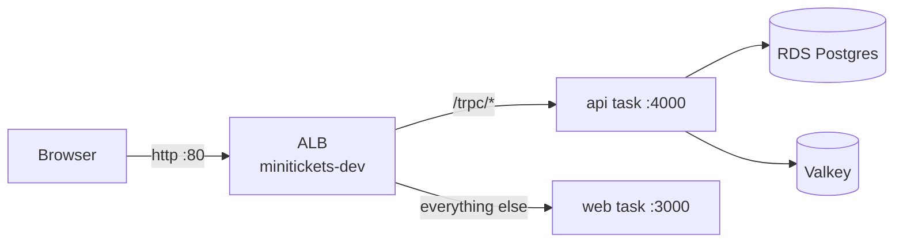

Back to the office building from [Step 11a](12-infra-network.md). Until now the building had staff (the api), but the **front door was locked** and there was no receptionist. This step hires a **receptionist** (the ALB) who stands at the front door, reads what each visitor asks for, and walks them to the right desk. It also hires a second worker, the **web** app, who shows visitors the pages.

### The files

| File                                 | Job                                                                   |
| ------------------------------------ | --------------------------------------------------------------------- |
| `infra/src/entry/alb.ts`             | The ALB: internet-facing, in the public subnets, wears the alb group  |
| `infra/src/entry/target-groups.ts`   | Two target groups: api (4000, `/health`) and web (3000, `/`)          |
| `infra/src/entry/listener.ts`        | HTTP :80 listener: default -> web, rule `/trpc/*` -> api              |
| `infra/src/compute/web-iam.ts`       | The web execution role (no secrets)                                   |
| `infra/src/compute/web-task.ts`      | The web task definition (ARM64, 256/512, `PORT`, `HOSTNAME`)          |
| `infra/src/compute/web-service.ts`   | The web service (Spot, public subnet, circuit breaker, in the ALB)    |
| `infra/src/compute/logs.ts`          | Now makes one log group per app: `/minitickets/dev/api` and `/web`    |
| `infra/src/compute/service.ts`       | The api service joins the api target group when entry is on           |
| `infra/index.ts`                     | The `entryEnabled` switch and `webImageTag`; wires the new functions  |

## 3. The concepts

### 3.1 ALB vs NLB (in 5 lines)

AWS has two main load balancers:

- An **ALB** (Application Load Balancer) understands **HTTP**. It reads the path, host and headers of each request and can route by them.
- An **NLB** (Network Load Balancer) only forwards **TCP/UDP connections**. It never reads the request, so it cannot route by path.
- An NLB is faster, gives fixed IP addresses, and handles any protocol (databases, games, MQTT).
- An ALB can check health with an HTTP path, hold HTTPS certificates, and redirect.
- We need "`/trpc/*` goes to the api", which means reading the path. So: **ALB**.

### 3.2 Listener, rule, target group

Three words that sit between the ALB and our containers:

| Word             | Office comparison                                  | What it really is                                                   |
| ---------------- | -------------------------------------------------- | ------------------------------------------------------------------- |
| **Listener**     | The receptionist's ear on one door                 | "Accept connections on port 80, using HTTP"                         |
| **Rule**         | A line on the signboard: "/trpc/ -> api desk"      | A condition (path matches `/trpc/*`) and an action (forward to ...) |
| **Default action** | "Everyone else -> web desk"                      | What the listener does when no rule matches                         |
| **Target group** | A desk, with a list of who is sitting there today  | A list of task IP addresses + how to check that each one is healthy |

One request, step by step:

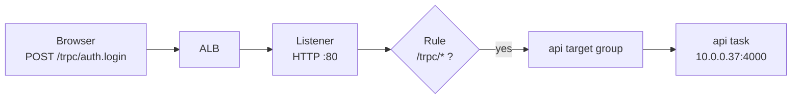

**Why we need all of them.** The ALB is just the machine at the door. The listener says which door (port) and which language (HTTP). The rules say where each kind of request goes. The target group says **which tasks** are there right now and whether each is healthy. Tasks come and go (deploys, crashes, Spot); the ECS service keeps the target group's list up to date, so the rules never need to change.

### 3.3 Path routing (same origin)

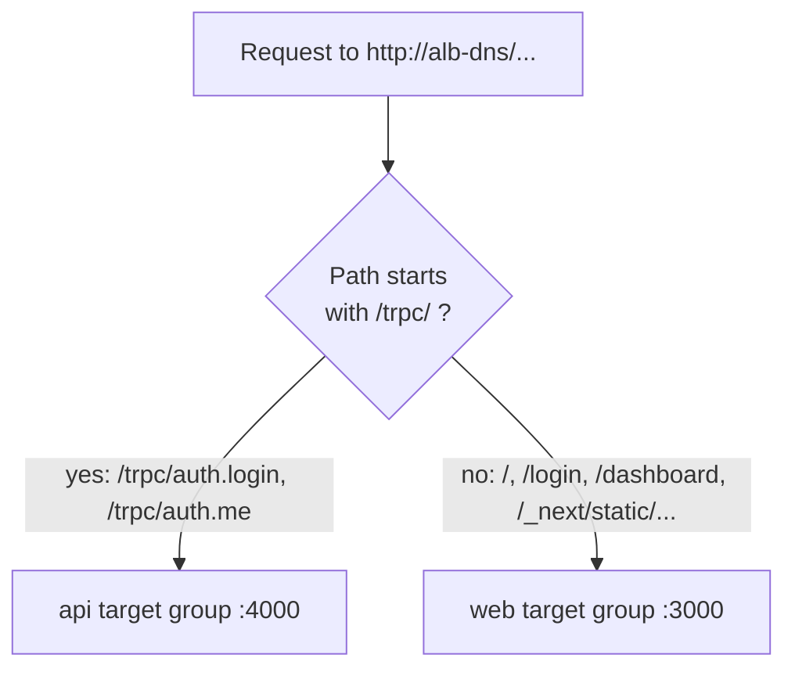

This is the **same-origin** routing promised in [Step 11d (ECR)](16-infra-ecr.md). The web image was built with an **empty** `NEXT_PUBLIC_API_URL`, so the browser calls `/trpc/...` on **the same address that served the page**. The ALB splits by path. So:

- no API address is baked into the web image, one image works everywhere,
- the browser never makes a cross-origin call, so there is no CORS and no cross-site cookie problem.

**Why `/trpc/*` and not `/trpc*`.** tRPC always calls `/trpc/<procedure>`, so the slash is always there. The pattern without the slash would also send a page called `/trpcfoo` to the api.

### 3.4 Target type "ip"

**What it is.** A target group can list **EC2 machines** (type `instance`) or **IP addresses** (type `ip`). Ours list IP addresses.

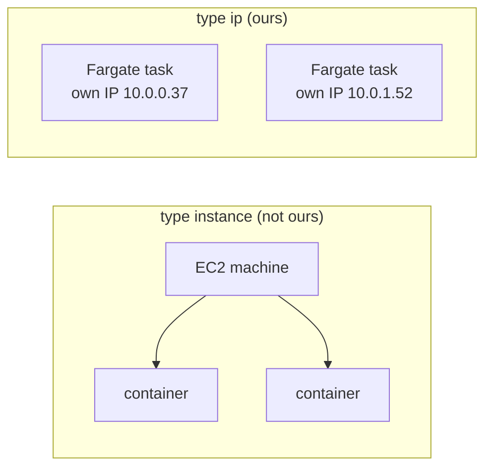

**Why we need it.** Fargate tasks use the `awsvpc` network mode: **every task gets its own network card and its own IP** in our VPC ([Step 11e](17-infra-ecs-api.md)). There is no EC2 machine of ours to point at. So the list must hold task IPs, and only type `ip` allows that. With the wrong type, ECS refuses to create the service.

### 3.5 Health checks

**What it is.** Every 15 seconds the ALB sends `GET /health` (api) or `GET /` (web) to **every task** in the target group. HTTP 200 within 5 seconds = pass.

- 2 passes in a row -> **healthy**: the task gets traffic.
- 3 failures in a row -> **unhealthy**: the ALB stops sending it traffic, and the ECS service replaces it.

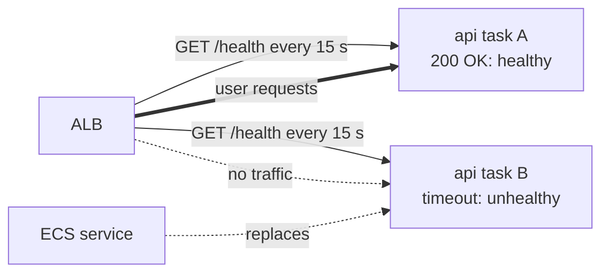

**Why we need it.** Without health checks, the ALB would happily send users to a task that crashed or hangs. Users would get errors while a healthy task sat idle next to it.

**Why `/health` and not `/ready` for the api.** Same reason as the container health check in [Step 11e](17-infra-ecs-api.md): `/ready` also checks the database. A 30-second database blip would mark **every** api task unhealthy and take them all out of the ALB, which turns a small blip into a full outage.

**Why `/` for web.** The landing page needs no database and no api. It answers 200 whenever Next.js itself is running.

**Two health checks on the api now.** The container check (ECS runs `node` **inside** the container) proves the process works. The ALB check comes from **outside**, so it also proves the network path works: the api security group really lets the ALB in on port 4000.

### 3.6 Health check grace period

**What it is.** For the first **60 seconds** after a task starts, the ECS service **ignores** failed ALB health checks for that task.

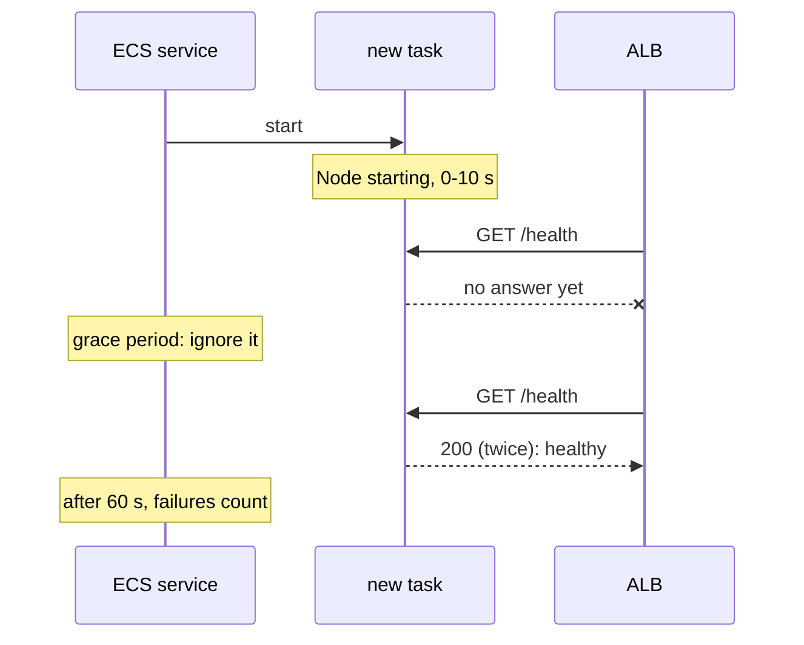

**Why we need it.** Node and Next.js need a few seconds to start. Without a grace period, the first failed checks could make ECS decide the task is broken and kill it, start a new one, kill that one too, and so on. The ALB itself still sends **no traffic** until the task passes 2 checks; the grace period only stops ECS from **killing** it too early.

The setting only exists on a service that has a load balancer. That is why the api service gets it only when entry is on.

### 3.7 Deploys with draining

**What it is.** When a task must stop (a new version, a scale-in, a Spot interruption), the ALB first stops sending it **new** requests but lets the requests already in flight finish. This is called **draining**. Our **deregistration delay** is **30 seconds** (AWS's default is 300).

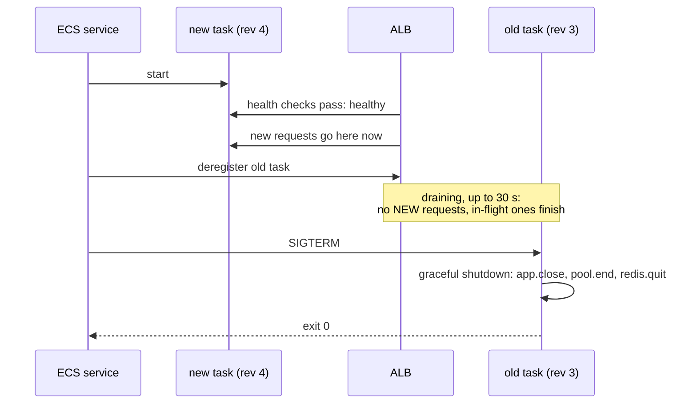

**Why we need it.** Without draining, a user whose request was half done when the old task stopped would get an error. The last two steps are the graceful shutdown we wrote in [Step 5](05-database.md) and made reach node in [Step 11 (Docker)](11-docker.md): by the time SIGTERM arrives, the ALB has already stopped sending new requests, so the api only has to finish what it has.

**Why 30 seconds and not 300.** Our requests take milliseconds. 300 seconds would make every deploy wait 5 minutes for nothing.

Real-life comparison: a shop closing for the night. First the door sign flips to "closed" (no new customers), then the customers already inside finish paying, and only then are the lights switched off.

### 3.8 The web service

The web app follows the same pattern as the api ([Step 11e](17-infra-ecs-api.md)): log group, role, task definition, service. It is simpler:

| | api | web |
| --- | --- | --- |
| Size | ARM64, 0.25 vCPU, 512 MB | same |
| Capacity | FARGATE_SPOT | same |
| Network | public subnet + public IP, api group | public subnet + public IP, web group |
| Env vars | `NODE_ENV`, `HOST`, `PORT`, `DB_*`, `WEB_ORIGIN` | `PORT=3000`, `HOSTNAME=0.0.0.0` |
| Secrets | `DB_USER`, `DB_PASSWORD`, `REDIS_URL` | **none** |
| Task role | yes (ECS Exec only) | **none** |
| Container health check | `node` fetches `/health` | none (the ALB check on `/` decides) |
| Circuit breaker + rollback | yes | yes |
| Logs | `/minitickets/dev/api` | `/minitickets/dev/web` |

**Why `HOSTNAME=0.0.0.0` again, when the Dockerfile already sets it?** Next.js listens on whatever `HOSTNAME` says. Container runtimes like to set `HOSTNAME` to the machine's own name; a value in the task definition wins over both. `0.0.0.0` means "every network card", so the ALB can reach port 3000 from outside the task.

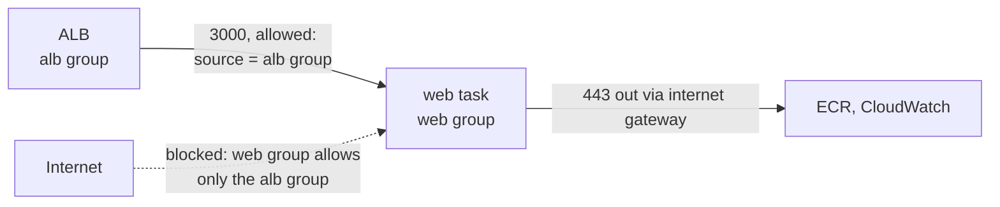

The security group rules have existed since [Step 11b](13-infra-security-groups.md). Until now nothing wore the alb or web badges. Now the ALB wears the alb badge and the web task wears the web badge, so the rules finally do something.

### 3.9 The web execution role

**(1) Web execution role** (`minitickets-dev-web-execution-role`), new in this step:

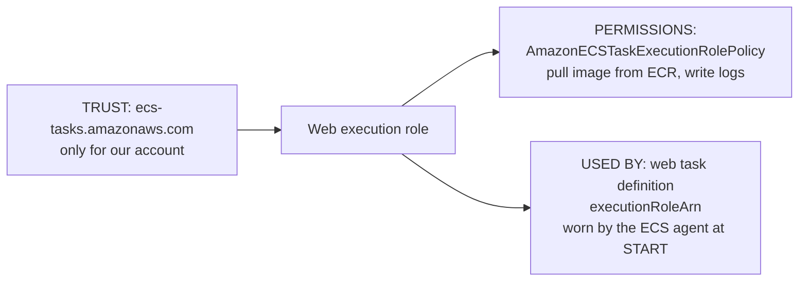

**(2) Api execution role** (`minitickets-dev-api-execution-role`), from Step 11e, for comparison:

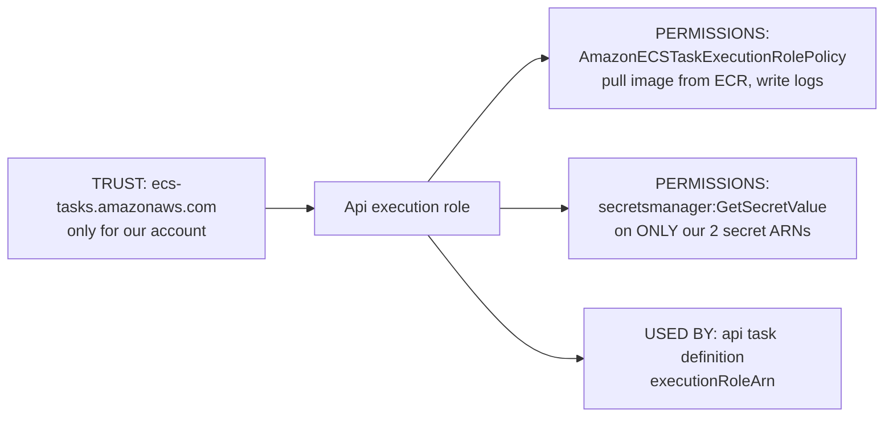

Side by side:

| | Api execution role | Web execution role |
| --- | --- | --- |
| Trust policy | ECS tasks, only for our account | same |
| ECR pull + CloudWatch Logs write | yes | yes |
| Read the 2 secrets | **yes** | **no** |
| Used by | api task definition | web task definition |

**Why a separate role (least privilege).** The web app needs **no secrets**: it renders pages, and the browser talks to the api itself. If web reused the api's execution role, it would **be able to** read the database password and the redis URL. One mistake in the web task definition (say, someone copies the api's `secrets` block) would then put them inside the web container. With its own role, that mistake fails at start with "unable to pull secrets" instead of silently working.

**Why no task role for web.** The task role is what our **running code** may do with AWS. The web code calls no AWS API, and we did not turn on ECS Exec for web. No task role = the web container has **no AWS permissions at all**.

The trust policy has the same `aws:SourceAccount` condition as the api roles, against the confused deputy problem ([Step 11e](17-infra-ecs-api.md), section 3.5).

### 3.10 Why HTTP only for now, and why login needs HTTPS

**What it is.** Our listener accepts plain **HTTP** on port 80. There is no HTTPS listener yet. HTTPS needs a **certificate** for a domain name, and the ALB's own name (`minitickets-dev-123.us-east-1.elb.amazonaws.com`) belongs to Amazon: we cannot get a certificate for it. Step 11g puts **CloudFront** in front of the ALB. CloudFront gives us an `https://...cloudfront.net` address that already has a certificate, so no domain purchase is needed.

(The alb security group already opens 443 since Step 11b, but nothing listens there yet, so it does nothing.)

**What breaks until then: login.** The api runs with `NODE_ENV=production`, which makes the session cookie **Secure** (`apps/api/src/procedures/auth.ts`). Secure means "only send this cookie over HTTPS". Browsers also **refuse to save** a Secure cookie that arrives over plain HTTP.

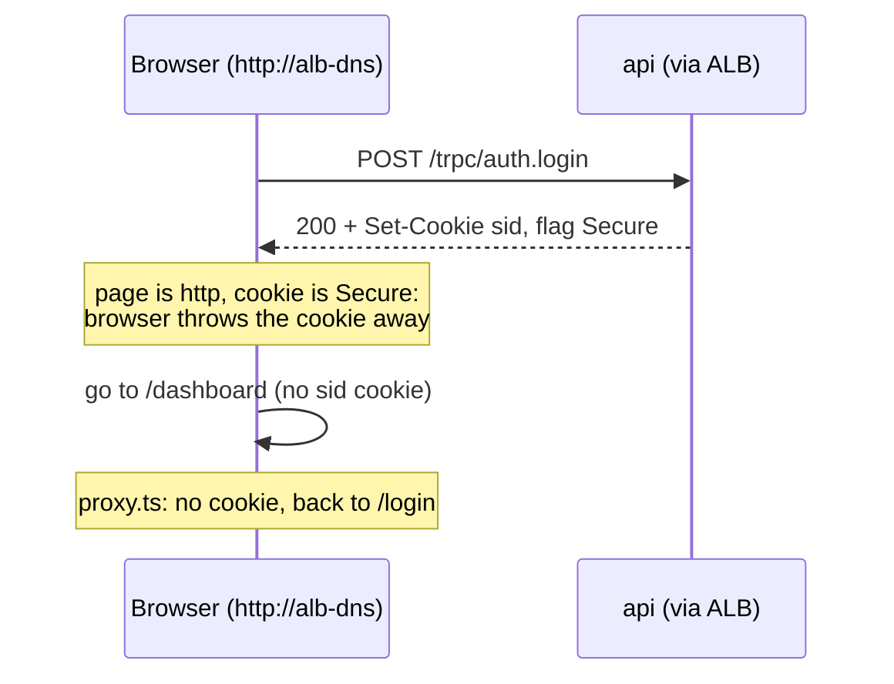

So with this step: the landing page, signup page and login page **load**, and the api answers, but **login does not stick**.

**Why not just turn Secure off?** Then the session id would travel over the internet in plain text. Anyone on the same café Wi-Fi could read it and **be you** (session hijacking). The right fix is HTTPS, which is Step 11g.

### 3.11 `WEB_ORIGIN` stays a placeholder

[Step 11e](17-infra-ecs-api.md) set the api's `WEB_ORIGIN` to `https://placeholder.invalid`. The only thing that reads it is **CORS**: the browser's check for calls to **another** origin. Behind the ALB, the page and `/trpc` share **one** origin, so the browser never asks a CORS question and the value is never used. The real public address is the HTTPS CloudFront address, which only exists in Step 11g. Changing it now to the http ALB address would be changed again one step later.

### 3.12 The entry switch

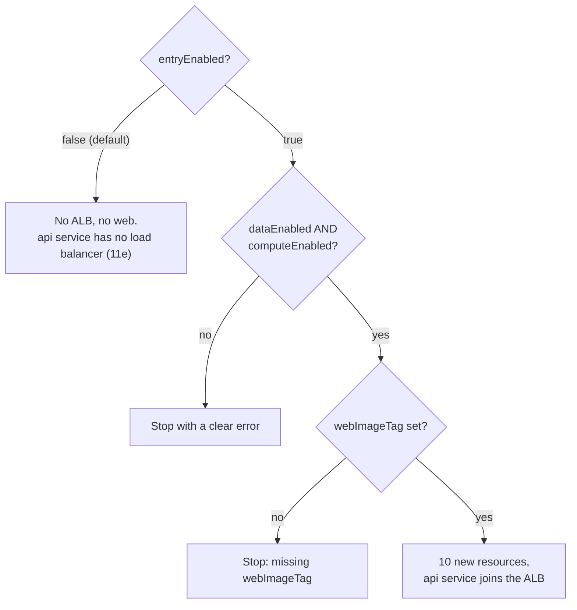

- `entryEnabled` (default `false`) creates or deletes **10 resources**: ALB, 2 target groups, listener, rule, web log group, web role, its policy attachment, web task definition, web service. It also connects the api service to the api target group.
- **One switch for ALB and web together:** web is useless without the ALB (its security group lets in only the ALB), and the ALB is useless without web (its default action sends pages there).
- It needs **both** `dataEnabled` and `computeEnabled`: the ALB sends traffic to tasks in the compute layer, and the api needs the data layer.
- `webImageTag` has **no default**, like `apiImageTag`: a git SHA you pushed with `pnpm images:push`.
- With `computeEnabled=true` and `entryEnabled=false`, the plan is **exactly** the one from Step 11e. We checked this: the preview's resource list and every input are identical.

### 3.13 Cost per hour

Approximate prices in us-east-1. Check the AWS pricing pages for today's numbers.

| Item                                                      | Per hour      |
| --------------------------------------------------------- | ------------- |
| ALB, fixed hourly price                                   | $0.0225       |
| ALB capacity units (LCU), dev traffic is a tiny fraction of one | ~$0.001 |
| ALB public IPv4 addresses (one per subnet: 2 x $0.005)     | $0.010        |
| Web task, Fargate Spot ARM, 0.25 vCPU + 0.5 GB            | ~$0.003       |
| Web task public IPv4 address                              | $0.005        |
| Target groups, listener, rule, role, log group            | $0            |
| **Entry total**                                           | **~$0.04**    |
| Compute layer ([Step 11e](17-infra-ecs-api.md))           | ~$0.008       |
| Data layer ([Step 11c](14-infra-data.md))                 | ~$0.033       |
| **Everything on**                                         | **~$0.08**    |

So about **8 cents an hour** with everything on: a 3-hour session costs about 25 cents. The ALB is now the most expensive single item. It is billed every hour it **exists**, even with zero visitors, which is why it sits behind a switch.

## 4. Dependency order

The entry layer:

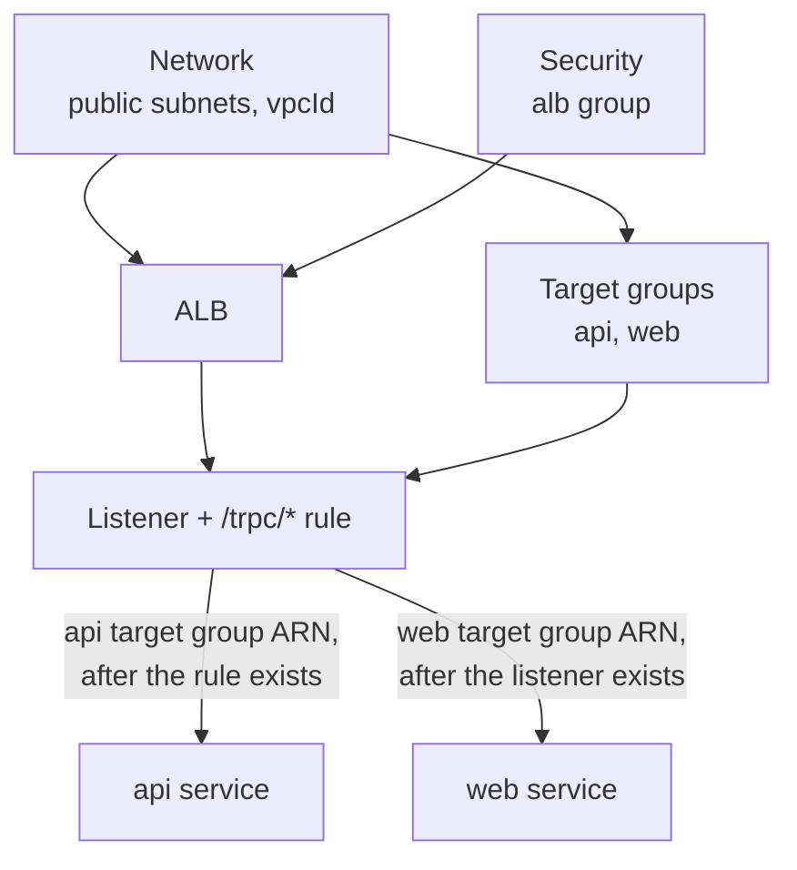

The web app:

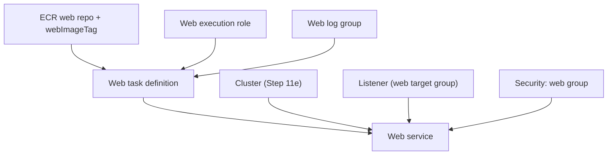

- The ALB needs the public subnets and the alb group. The target groups need the VPC.
- The listener needs the ALB and both target groups. The **rule** needs the listener.
- The services need the target groups **attached to the ALB**. ECS refuses to register a service in a target group that no load balancer uses ("target group ... does not have an associated load balancer"). The web group is attached by the listener's default action, the api group only by the rule. So `listener.ts` hands the ARNs back **only after** the listener and the rule exist (the same trick as the cluster name in Step 11e).
- In `index.ts`, entry (steps 15-17) now comes **before** the api service (step 18), because the api service uses the listener's output.

## 5. What breaks if this is wrong or missing

| Mistake                                                       | What happens                                                                   |
| ------------------------------------------------------------- | ------------------------------------------------------------------------------ |
| No `/trpc/*` rule                                             | Every api call reaches web and returns 404; pages load but nothing works       |
| Rule `/trpc/*` points at the web target group                 | Same: 404 from Next.js                                                         |
| Target type `instance` instead of `ip`                        | ECS refuses to create the service (Fargate tasks are not instances)            |
| Service created before the target group is attached           | `target group ... does not have an associated load balancer`                   |
| api health check on `/ready`                                  | A database blip takes every api task out of the ALB: full outage               |
| Health check port blocked (web group does not allow the alb group) | Every task unhealthy, ALB answers 503, circuit breaker rolls back         |
| `HOSTNAME` not `0.0.0.0`                                      | Next.js listens only inside the container; health checks time out             |
| No health check grace period                                  | ECS may kill slow-starting tasks again and again                              |
| Deregistration delay left at 300 s                            | Every deploy waits 5 minutes before the old task stops                         |
| Deregistration delay 0                                        | Requests in flight are cut off during a deploy                                |
| ALB in the private subnets                                    | It has no route to the internet gateway: nobody can reach it                  |
| Web reuses the api execution role                             | Works, but web could read the database password: not least privilege           |
| Login over `http://alb-dns`                                   | Login "succeeds" but the Secure cookie is thrown away (section 3.10)          |
| Secure cookie turned off "to make it work"                    | Session id travels in plain text: anyone on the network can steal the session  |
| Entry on with compute or data off                             | Pulumi refuses with a clear error                                              |

## 6. How this connects

**Uses from earlier layers**

- `publicSubnetIds` and `vpcId` from the network layer ([Step 11a](12-infra-network.md)): where the ALB and the web task live, and the VPC the target groups belong to.
- The **alb**, **web** and **api** security groups and their rules from [Step 11b](13-infra-security-groups.md): 80 open to the internet on the ALB, 3000 and 4000 open only to the ALB.
- `webRepoUrl` and the same-origin web image from [Step 11d (ECR)](16-infra-ecr.md).
- The cluster, the api task definition and the api service from [Step 11e](17-infra-ecs-api.md). The api service now registers in the api target group.
- The data layer from [Step 11c](14-infra-data.md), indirectly: the api behind the ALB uses it.
- The graceful shutdown from [Step 5](05-database.md) and [Step 11 (Docker)](11-docker.md): it is what runs after draining.
- The function-per-layer wiring from [Step 11d (dependencies)](15-infra-dependencies.md): three new entry functions and three new web functions, connected only in `index.ts`.

**Used by later layers**

- Step 11g (CloudFront + HTTPS) puts CloudFront in front of this ALB, using `albDnsName` as its **origin** (where it fetches from). That gives an HTTPS address, so the Secure cookie and login work. Then `WEB_ORIGIN` gets its real value.
- `albDnsName`, `webServiceName` and `webLogGroup` are what you use to test and debug on deploy day.

See [00-architecture.md](00-architecture.md) for the whole picture.

## 7. Deploy day: commands in order

You run all of these. Set the AWS profile once per terminal:

```bash
cd infra
export AWS_PROFILE=ticketlite AWS_REGION=us-east-1
```

**1. Push images and set both tags** (both tags are the same git SHA)

```bash
cd ..                      # repo root; the working tree must be clean
pnpm images:push           # builds arm64 api AND web images, tag = short git SHA
cd infra
pulumi config set apiImageTag "$(git rev-parse --short HEAD)"
pulumi config set webImageTag "$(git rev-parse --short HEAD)"
```

**2. Turn on data, wait**

```bash
pulumi config set dataEnabled true
pulumi up                  # 10-15 minutes
```

**3. Turn on compute and entry together, wait for both services**

```bash
pulumi config set computeEnabled true
pulumi config set entryEnabled true
pulumi preview             # expect: 20 to create (10 compute + 10 entry)
pulumi up
aws ecs wait services-stable --cluster minitickets-dev --services minitickets-dev-api minitickets-dev-web
```

If compute was **already on** before you turned entry on, the preview shows the api service as `~ update` (it gains a load balancer). Read that line: it should say update, not replace.

**4. Run the migrations, expect exit code 0** (as in Step 11e)

```bash
cd .. && pnpm infra:migrate && cd infra
```

**5. Verify**

```bash
ALB=$(pulumi stack output albDnsName)

# a. Both target groups have a healthy target. (Their names end in a random suffix, see
#    target-groups.ts, so we find them by the name's start.)
for TG in $(aws elbv2 describe-target-groups \
  --query "TargetGroups[?starts_with(TargetGroupName,'minitickets-dev-')].TargetGroupArn" --output text); do
  aws elbv2 describe-target-health --target-group-arn "$TG" \
    --query 'TargetHealthDescriptions[].{ip:Target.Id,port:Target.Port,state:TargetHealth.State}'
done
#    expect: one target on port 4000 and one on port 3000, both "healthy"

# b. Default action -> web: expect 200 and the landing page HTML
curl -s -o /dev/null -w '%{http_code}\n' "http://$ALB/"

# c. Rule /trpc/* -> api: expect {"result":{"data":null}} (not logged in)
curl -s "http://$ALB/trpc/auth.me"

# d. Anything else goes to web: expect 404 from Next.js (the api is NOT reachable on other paths)
curl -s -o /dev/null -w '%{http_code}\n' "http://$ALB/health"

# e. In a browser: open http://$ALB, the landing page and the signup page should load.
#    Login will not stick yet (section 3.10).

# f. Web logs
aws logs tail /minitickets/dev/web --since 30m
```

**6. Turn everything off, confirm only those are deleted**

```bash
pulumi config set entryEnabled false
pulumi config set computeEnabled false
pulumi config set dataEnabled false
pulumi preview             # expect: 27 to delete, 32 unchanged. Nothing else!
pulumi up
```

Turn entry off **first** (or all together, as above). Turning compute or data off while entry is on is refused by the program.

## 8. Interview questions

1. **ALB or NLB, and why?** ALB when you need HTTP features: path or host routing, HTTP health checks, HTTPS certificates. NLB for raw TCP/UDP, very high throughput, or fixed IPs.
2. **Listener vs rule vs target group?** The listener accepts connections on a port and protocol. Rules on the listener match conditions (like a path) and pick an action. A target group is the list of backends plus their health check.
3. **Why target type `ip` for Fargate?** In `awsvpc` mode every task has its own IP, and there is no EC2 instance of ours to register. So the target group lists task IPs.
4. **What is connection draining (deregistration delay)?** When a target is removed, the ALB stops sending it new requests but lets in-flight requests finish for up to the delay. ECS sends SIGTERM only after that, so a graceful shutdown has little left to finish.
5. **What does the health check grace period do?** ECS ignores failed load-balancer health checks for that many seconds after a task starts, so slow starters are not killed before they are ready.
6. **Why is the api's ALB health check `/health` and not `/ready`?** `/ready` depends on the database; a short database problem would mark every api task unhealthy and take the whole api offline.
7. **Why give web its own execution role?** Least privilege: web needs no secrets, so its role should not be able to read any. It also turns a copy-paste mistake into a visible failure instead of a silent leak.
8. **Why does login fail over plain HTTP here?** The session cookie is `Secure`; browsers will not store a Secure cookie set over HTTP. The fix is HTTPS (CloudFront in Step 11g), not turning Secure off.

## 9. Check yourself

1. You deploy a new web image whose `/` returns 500 because of a bug. Walk through what the ALB, the ECS service and the circuit breaker each do. Do users see the broken version?
2. A teammate changes the rule to `/trpc` (no `/*`). Which requests now reach the api, and what do users see?
3. During a deploy, a user's request takes 45 seconds (a slow report). What happens to it with a 30-second deregistration delay, and what would you change if such requests were normal?
