# Step 11g: CloudFront, HTTPS and origin protection

## 1. In one sentence

This step puts **CloudFront** (Amazon's CDN) in front of the load balancer, so the app gets a free **HTTPS** address (`https://<id>.cloudfront.net`), and it **locks the load balancer** so that only our CloudFront distribution can reach it.

After this step, login works on AWS: the Secure session cookie finally has the HTTPS it needs. Everything stays behind the same `entryEnabled` switch from [Step 11f](18-infra-alb-web.md).

## 2. The big picture

One request, all the way from the browser to a container:

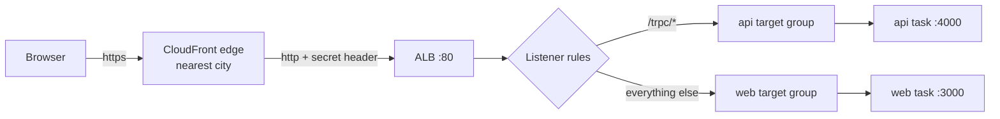

Back to the office building from [Step 11a](12-infra-network.md). In [Step 11f](18-infra-alb-web.md) we hired a receptionist (the ALB) at the front door. Now the company opens **branch offices in many cities** (CloudFront edge locations). Visitors go to the branch nearest to them. The branch has a copy of the brochures (static files) and hands those out itself. For anything else it phones head office on a **private line**, and says a **password** first. Head office has **no public front door any more**: the receptionist only answers the private line, and only when the caller knows the password.

### The files

| File                                  | Job                                                                              |
| ------------------------------------- | -------------------------------------------------------------------------------- |
| `infra/src/entry/cdn.ts`              | **New.** The CloudFront distribution: HTTPS, 3 cache behaviors, the ALB as origin |
| `infra/src/entry/origin-secret.ts`    | **New.** The random `X-Origin-Verify` value (a Pulumi secret)                    |
| `infra/src/entry/listener.ts`         | Default action is now a **403**; 2 rules check the secret header                 |
| `infra/src/security.ts`               | The alb group: port 80 **only from CloudFront**; the 443 rule is gone            |
| `infra/src/compute/task.ts`           | Api env: `WEB_ORIGIN` = the CloudFront address, `TRUST_PROXY_HOPS` = 2           |
| `infra/index.ts`                      | Wires the two new functions; the api task now comes **after** the entry layer; exports `appUrl` |
| `apps/api/src/config/trust-proxy.ts`  | **New.** Which proxies the api trusts for `X-Forwarded-For` (+ a unit test)      |
| `apps/api/src/app.ts`                 | Turns on Fastify's `trustProxy`                                                  |
| `apps/web/e2e/dashboard.spec.ts`      | The fake-cookie test sets its cookie for `baseURL`, so e2e also runs against AWS |

## 3. The concepts

### 3.1 What a CDN is, and edge locations

**What it is.** A **CDN** (content delivery network) is a large set of servers spread around the world. Each site is an **edge location** ("edge" = the edge of Amazon's network, close to the users). CloudFront has hundreds of them. A **distribution** is our own configuration on that network: "for this address, fetch from that **origin**, cache like this".

The **origin** is the server that has the real content. Ours is the ALB.

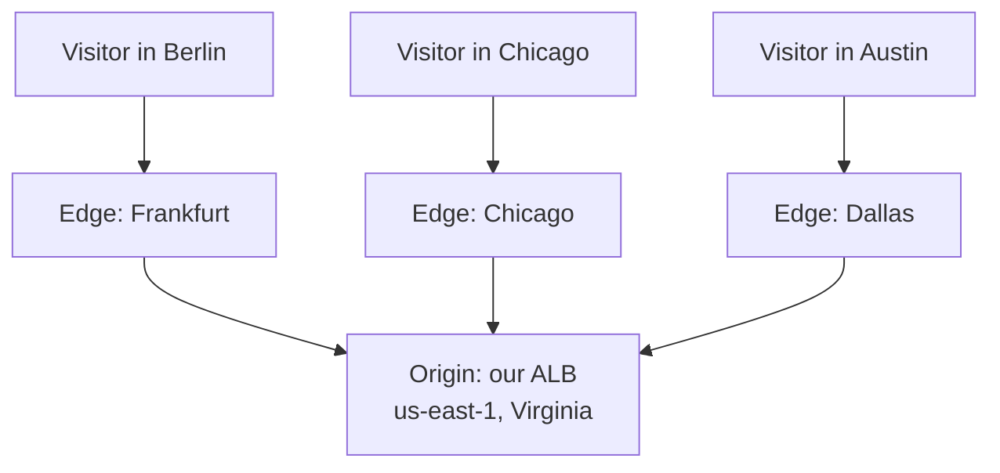

**Why we need it.** For us, mainly for **HTTPS** (3.4). The caching (3.2) is a bonus: the JS and CSS files are served from a city near the visitor instead of from Virginia.

**PriceClass_100.** We use only the cheapest group of edge locations (North America, Europe and Israel). Visitors elsewhere still work; they are served from the nearest of those.

### 3.2 Cache hit vs cache miss

**What it is.** When a request reaches an edge:

- **Cache hit:** the edge has a fresh copy. It answers by itself. The ALB never sees the request.
- **Cache miss:** no copy (or an old one). The edge asks the origin, sends the answer to the visitor, and keeps a copy if the cache rules allow it.

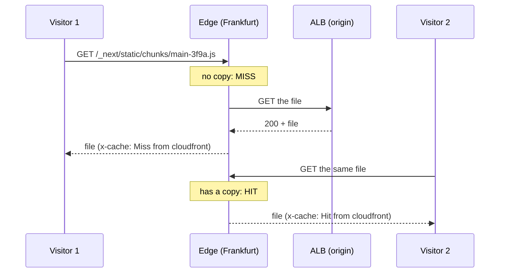

You can see which one happened in the response header **`x-cache`**. Every edge has its **own** cache, so the first visitor near each edge still causes a miss.

**Why it matters.** A hit is faster (the file comes from a nearby city) and costs our servers nothing.

### 3.3 The three cache behaviors

**What it is.** A **cache behavior** is a rule in the distribution: "requests whose path matches X are handled like this". Each one picks two AWS **managed policies** (ready-made by AWS, free):

- a **cache policy**: how long to keep a copy, and what makes two requests "the same" (the **cache key**),
- an **origin request policy**: what to pass on to the origin (headers, cookies, query string).

CloudFront checks the behaviors in order; the first match wins; `*` (the default) catches the rest.

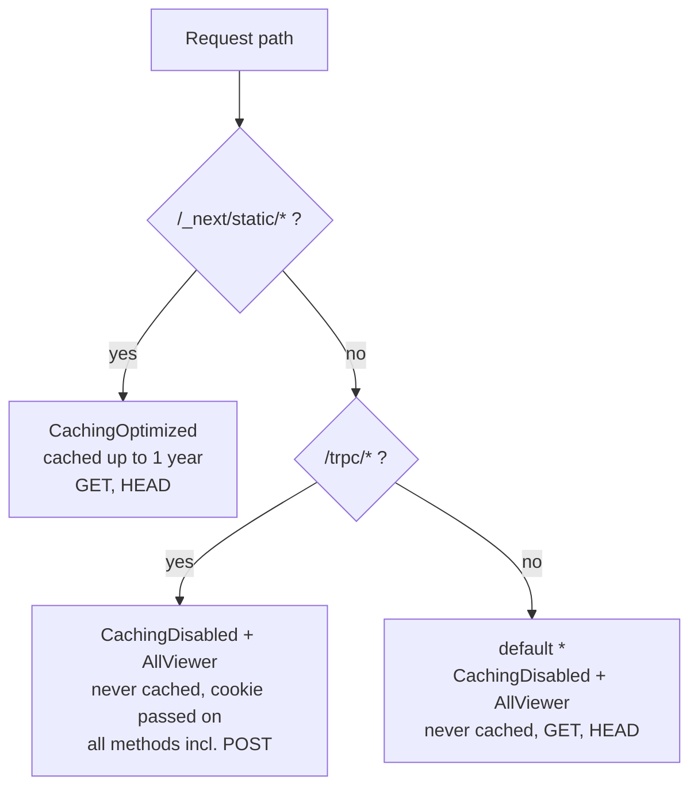

| Behavior          | Cache policy       | Origin request policy | Methods        | Why                                                                 |
| ----------------- | ------------------ | --------------------- | -------------- | ------------------------------------------------------------------- |
| `/_next/static/*` | `CachingOptimized` | none                  | GET, HEAD      | File names contain a **content hash**, so a name never changes content. Safe to cache for long. |
| `/trpc/*`         | `CachingDisabled`  | `AllViewer`           | all 7          | API answers are **per user**. Never cache them. POST for login, signup, logout. |
| default `*`       | `CachingDisabled`  | `AllViewer`           | GET, HEAD      | Pages are dynamic for now (the header shows who is logged in).     |

**Content hash.** Next.js names its built files after their content, like `main-3f9a1c.js`. Change one character of code and the next build makes a **new** name. So the old name always means the same bytes, and a copy can be kept for a year. Next.js even says so itself: `Cache-Control: public, max-age=31536000, immutable`.

**`AllViewer`** passes on **everything** the browser sent: all headers (including `Host` and `Cookie`), all cookies and the query string. The api needs the `sid` cookie; Next.js needs the cookie (for the dashboard guard) and the `Host`.

**Why GET and HEAD only for pages.** Pages are only read. Every write goes through `/trpc/*`. A POST to a page is refused by CloudFront itself and never reaches the ALB.

### 3.4 Why API responses are never cached

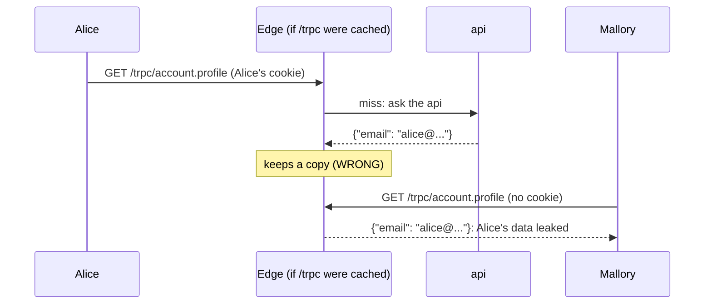

An api answer depends on **who asks** (the session cookie). If the cache key does not contain the cookie, one user's answer is handed to the next user. Even with the cookie in the key, there is nothing to gain: no two users share a session. So `/trpc/*` uses **CachingDisabled**: every request goes to the api.

### 3.5 Where HTTPS ends

**What it is.** **HTTPS** is HTTP inside an encrypted **TLS** connection. To make one, the server shows a **certificate**: a document that proves "I really am `d1a2b3.cloudfront.net`", signed by an authority the browser trusts. Every CloudFront distribution gets a free certificate for its `*.cloudfront.net` name, so we need **no domain name**.

But HTTPS covers only **one connection**: browser to edge. From the edge to the ALB is a **second** connection, and ours is plain **http**.

**Dev (what we build):**

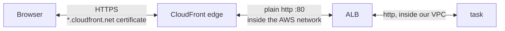

**Production (later):**

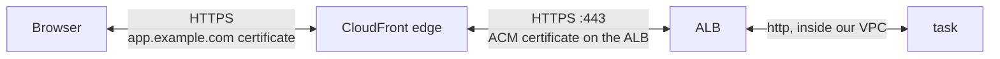

**Why http in dev.** The ALB's name (`...elb.amazonaws.com`) belongs to Amazon, so we cannot get a certificate for it. HTTPS to the ALB needs a **domain we own** (say `origin.example.com`) and a free **ACM** (AWS Certificate Manager) certificate for it. That is a dev compromise: the hop runs on AWS's network, but it is **not encrypted**. The secret header (3.7) travels on that hop too. Production buys a domain and uses HTTPS on both hops.

### 3.6 Why the Secure cookie now works

[Step 11f](18-infra-alb-web.md) (section 3.10) showed the problem: the api runs with `NODE_ENV=production`, so the `sid` cookie is **Secure** ("send only over HTTPS"), and a browser on `http://alb-dns` throws it away.

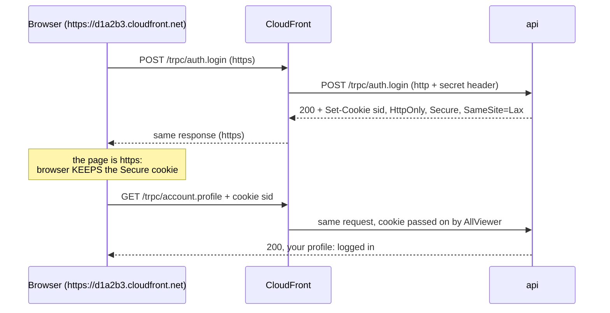

The browser only judges **its own** connection, and that one is HTTPS. It never sees the http hop behind CloudFront. So the cookie is kept, and sent back on every later request to the same address.

### 3.7 Origin protection: two locks

**The problem.** The ALB still has a public DNS name. If anyone can call it directly, they skip CloudFront: no HTTPS, no edge cache, and later no edge protections either. So we lock it, twice.

**Lock 1: the security group allows only CloudFront.** The alb group's port 80 rule no longer says `0.0.0.0/0` (everyone). It points at the AWS **managed prefix list** `com.amazonaws.global.cloudfront.origin-facing`. A **prefix list** is a named list of IP ranges. This one holds the ranges CloudFront uses to call origins, and **AWS keeps it up to date** for us.

**Lock 2: the secret header.** CloudFront adds `X-Origin-Verify: <32 random characters>` to every request it sends to the ALB. The listener's **default action** is now a fixed **403 Forbidden**. Two rules forward a request only if the header is right:

| Priority | Conditions (all must match)          | Action                    |
| -------- | ------------------------------------ | ------------------------- |
| 100      | header is right **and** path `/trpc/*` | forward to api target group |
| 200      | header is right                      | forward to web target group |
| default  | (no rule matched)                    | **403 Forbidden**         |

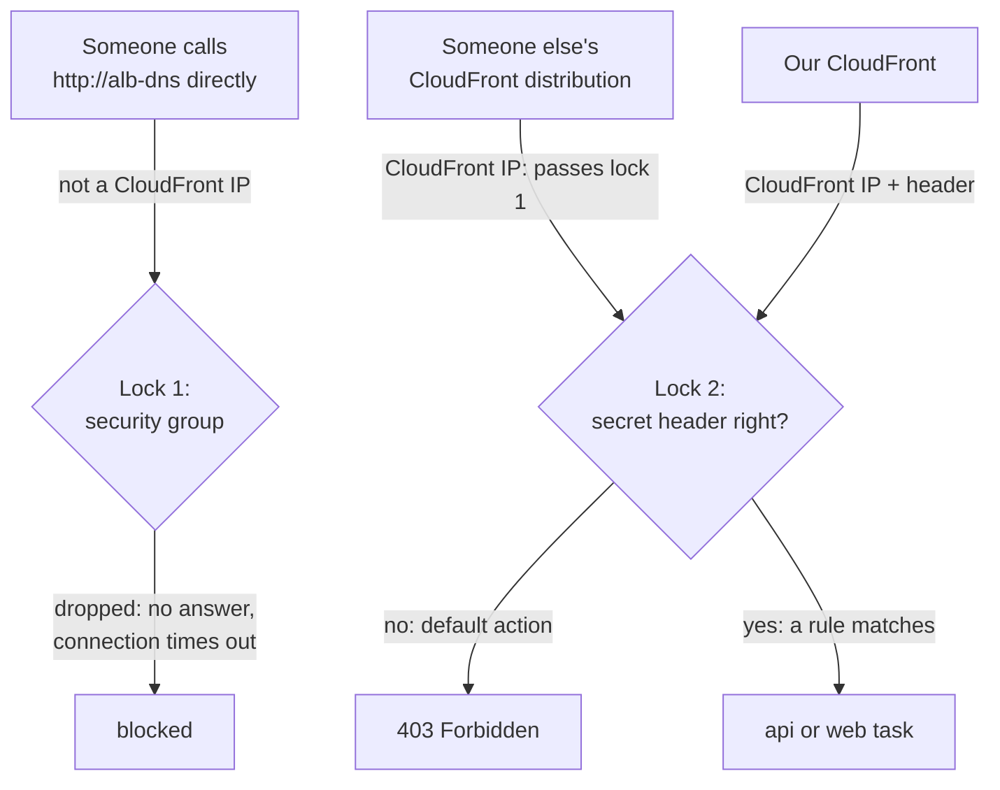

**Why two locks.** Lock 1 only proves "this comes **from CloudFront**". But CloudFront is shared: **every** AWS customer's distributions use the same IP ranges. Anyone can create a distribution with our ALB as its origin and get through lock 1. Lock 2 proves "this comes from **our** distribution", because only ours knows the header value.

**Why both, and not only the header.** The security group stops strangers **before** they reach the ALB at all, so the ALB does no work for them. The header alone would still let everyone open connections and collect 403s.

**The secret value.** `origin-secret.ts` makes it with `random.RandomPassword`: Pulumi stores it **encrypted** in its state and prints `[secret]` in previews. It has only letters and digits, because the ALB treats `*` and `?` in a header condition as wildcards. It is not perfectly hidden: anyone who can read our CloudFront or listener settings in the AWS console can see it. That is fine for its job (stopping strangers), not for protecting data.

**Health checks are not affected.** The ALB's target group health checks go **straight from the ALB to the tasks**. They never pass through the listener, so the 403 default does not touch them.

#### This changes the Step 11b security layer

The alb group's rules come from [Step 11b](13-infra-security-groups.md). This step changes them:

| Rule in the alb group | Before (11b)                 | After (11g)                                    |
| --------------------- | ---------------------------- | ---------------------------------------------- |
| `alb-in-80`           | port 80 from `0.0.0.0/0`     | port 80 from prefix list `pl-3b927c52` (CloudFront) |
| `alb-in-443`          | port 443 from `0.0.0.0/0`    | **removed**                                    |

- **Why 443 goes:** nothing listens on 443. CloudFront talks to the ALB on port 80 (3.5).
- **Rule quota.** A security group may have **60 inbound rules**. A rule that points at a prefix list counts as **as many rules as the list's maximum size**, not as one. AWS counts the CloudFront list as **55** (today it holds 46 ranges; AWS counts the size it reserves). So our one rule already uses 55 of the 60. A second CloudFront rule (say, for 443) would not fit.
- **The group's description** still says "open to the internet on 80 and 443". We left it on purpose: AWS cannot edit a security group's description, so changing it would **replace** the whole group, and everything that wears it. The rules are the truth.
- **Replace, not edit.** Changing a rule's source from an IP range to a prefix list is a **replace** in Pulumi: it creates the new rule, then deletes the old one.

### 3.8 X-Forwarded-For and `trustProxy`

**What it is.** Behind CloudFront and the ALB, the api's TCP connection always comes from the **ALB**. Without help, `request.ip` would be the ALB's private address for every visitor. Each proxy therefore writes down who it got the request from in the **`X-Forwarded-For`** header (XFF), adding to the end of the list:

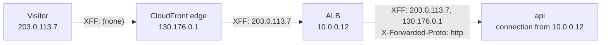

Fastify reads the addresses **nearest first**: hop 0 is the connection itself (the ALB), hop 1 is the last XFF entry (the edge), hop 2 is the one before (the visitor). `trustProxy` says which hops to believe. We trust exactly **2 hops**, so `request.ip` = hop 2 = the real visitor.

**Why exactly 2, and not "trust everything".** A visitor can send their **own** fake header, `X-Forwarded-For: 6.6.6.6`. CloudFront keeps it and adds the real address after it: `6.6.6.6, 203.0.113.7, 130.176.0.1`. Trusting everything would pick the leftmost one, the fake. Counting 2 hops from our side always lands on what CloudFront wrote. The unit test `trust-proxy.test.ts` checks exactly this.

**Why a function, not the number 2.** Fastify refuses a plain number (it treats it as "trust nobody"): counting hops is only safe if you **know** who hop 0 is. We do: the api security group accepts connections **only from the ALB**. So `trust-proxy.ts` returns a small function, `hop < 2`.

**Where the 2 comes from.** The env var `TRUST_PROXY_HOPS`. The task definition sets it to `2` only when the entry layer is on (`0` otherwise). Locally it is not set, so it is `0`: trust nobody, exactly as before.

**Why we need it.** The real visitor IP appears in every request log line now (`remoteAddress`), and later steps can rate-limit per visitor. Without it, every visitor looks like the same ALB address, and a rate limit would block everyone at once.

**And `request.protocol`?** With hop 0 trusted, Fastify also reads `X-Forwarded-Proto`. In dev it says **`http`**, which is honest: the ALB writes the protocol of **its own** listener, and CloudFront talks to it over http. In production (HTTPS to the ALB) it would say `https`.

### 3.9 `WEB_ORIGIN` gets its real value

The api's `WEB_ORIGIN` was a placeholder since [Step 11e](17-infra-ecs-api.md). Now it is the CloudFront address, `https://d1a2b3.cloudfront.net` (the stack output `appUrl`).

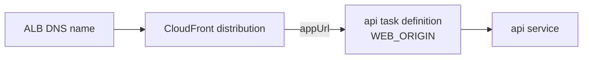

That is why `index.ts` now creates the api task definition **after** the entry layer. It also means the api task definition waits for CloudFront to finish deploying (3.11).

Today only CORS reads it, and behind CloudFront the page and `/trpc` share one origin, so CORS never comes into play. Step 13 adds a **CSRF** check (CSRF = another website tricking your browser into sending a request to ours with your cookie). It compares each request's `Origin` header with `WEB_ORIGIN`, so it needs the real value.

With the entry layer **off**, `WEB_ORIGIN` keeps the placeholder and `TRUST_PROXY_HOPS` is 0, exactly as in Step 11e.

### 3.10 A small dev quirk: one extra redirect on `/dashboard`

When a logged-out visitor opens `/dashboard`, the Next.js proxy (`apps/web/src/proxy.ts`) redirects to `/login`. Next.js builds that address from `X-Forwarded-Proto`, which the ALB sets to `http` (3.8). So the browser gets **two** redirects:

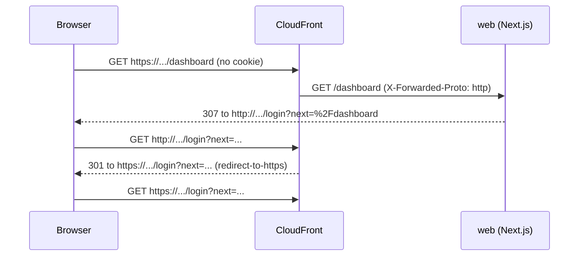

It works, and no cookie travels in the http request (the `sid` cookie is Secure, and this visitor has none anyway). It goes away in production, when the ALB listener is HTTPS.

### 3.11 Why CloudFront is slow to create and even slower to delete

**Create: about 5-15 minutes.** The settings are copied to **every** edge location. CloudFront says "Deployed" only when all of them have it. `pulumi up` waits for that, so `appUrl` works as soon as `up` finishes.

**Delete: longer, often 15-25 minutes.** AWS refuses to delete a distribution that is still **enabled**. So Pulumi first **disables** it, waits until every edge has dropped it (another full roll-out), and only then deletes it.

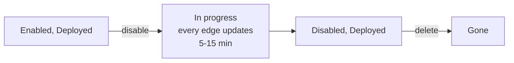

Plan for it: turning the entry layer off is now the slowest part of the evening.

### 3.12 Cost

CloudFront has **no hourly price**. You pay per request and per GB sent to visitors, and the **free tier** covers 1 TB and 10 million requests **every month**, forever. Data from the ALB to CloudFront is free (AWS origin). For dev traffic that is **$0**.

| Item                                             | Per hour                |
| ------------------------------------------------ | ----------------------- |
| CloudFront distribution                          | $0 (free tier)          |
| Origin secret (a value in Pulumi state)          | $0                      |
| Entry layer from [Step 11f](18-infra-alb-web.md) | ~$0.04                  |
| Compute ([11e](17-infra-ecs-api.md)) + data ([11c](14-infra-data.md)) | ~$0.04 |
| **Everything on**                                | **~$0.08**, unchanged   |

So there is still a reason for the switch: the ALB is billed every hour it **exists**. CloudFront goes on and off with it, because without the ALB it has nothing to serve.

### 3.13 The entry switch now

`entryEnabled` now creates **13** resources (11f had 10): the 10 from Step 11f, plus the **origin secret**, the **web rule** (web used to be the listener's default action) and the **CloudFront distribution**. It still needs `dataEnabled`, `computeEnabled` and a `webImageTag`.

**No new IAM roles in this step.** CloudFront and the listener need no role: Pulumi creates them with your own AWS login, and neither of them calls other AWS services on our behalf.

## 4. Dependency order

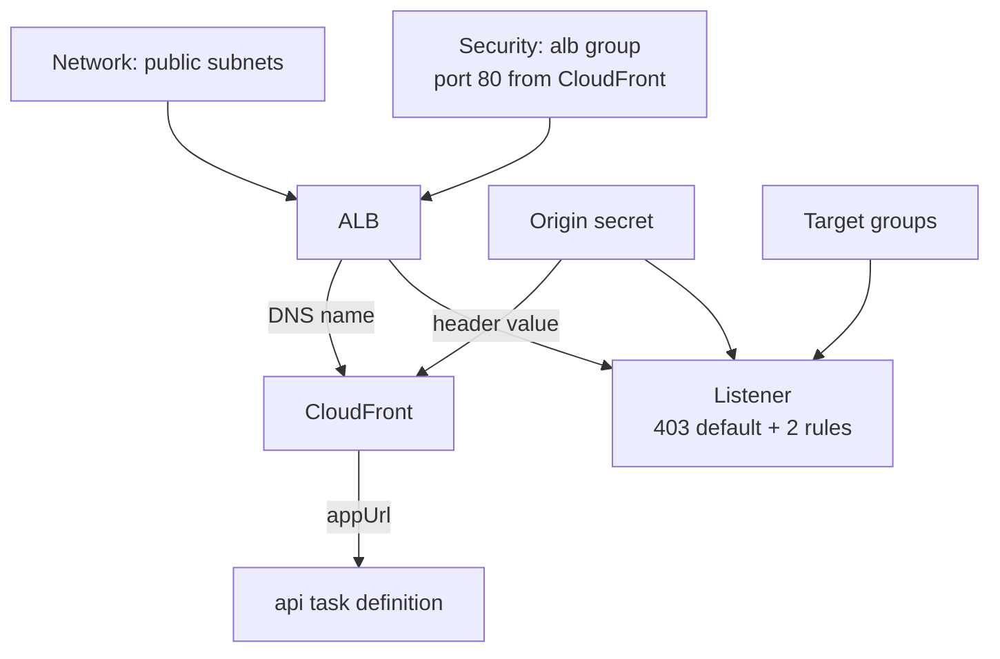

- The **security group rule** exists always (the network and security layers are always on), so the ALB is locked from the first second it exists.
- The **origin secret** must exist before the listener (its rules check it) and before CloudFront (it sends it).
- **CloudFront** needs the ALB's DNS name: its origin.
- The **api task definition** needs `appUrl`, so it now comes **after** CloudFront. In `index.ts` the entry steps (14-18) now come before the api task (19) and api service (20).
- The **services** still get their target group ARNs from the listener, but only after the matching **rule** exists. Each target group is now attached to the ALB **only by its rule** (the default action is the 403), so `listener.ts` waits for the web rule too.

## 5. What breaks if this is wrong or missing

| Mistake                                                        | What happens                                                                   |
| -------------------------------------------------------------- | ------------------------------------------------------------------------------ |
| alb group still open to `0.0.0.0/0`                            | Anyone can call the ALB directly over http and skip CloudFront                 |
| Only the prefix list, no secret header                         | Anyone can make their own CloudFront distribution pointing at our ALB          |
| Header value in CloudFront and in the rules differ             | Every request gets the ALB's plain-text **403 Forbidden**                      |
| Listener default still "forward to web"                        | Requests without the header still reach web (lock 2 does nothing)            |
| Web rule has the lower priority number than the `/trpc/*` rule  | Every request, api calls too, goes to web: api calls get 404                  |
| Prefix list rule for 80 **and** 443                            | Quota: 2 x 55 > 60 rules, AWS refuses the second rule                         |
| `/trpc/*` cached                                               | One user's data shown to another user (3.4)                                   |
| `/trpc/*` allows only GET and HEAD                             | Login, signup and logout (POST) get a 403 from CloudFront                      |
| `/trpc/*` or default without `AllViewer`                       | The `sid` cookie is not passed on: nobody is ever logged in                    |
| `trustProxy: true`                                             | A visitor fakes `X-Forwarded-For` and chooses their own `request.ip`          |
| No `trustProxy`                                                | Every visitor has the ALB's IP in the logs; a rate limit would block everyone  |
| `TRUST_PROXY_HOPS=2` locally                                   | Anyone who can reach your local api can fake their IP (locally: harmless)      |
| `WEB_ORIGIN` still the placeholder                             | Works today; Step 13's CSRF check would reject every POST                      |
| Changing the alb group's description                           | The whole security group is replaced, with everything that wears it            |
| `originProtocolPolicy: https-only` without a certificate       | The ALB has no 443 listener: every request fails with 502                     |

## 6. How this connects

**Uses from earlier layers**

- The **alb group** from [Step 11b](13-infra-security-groups.md). This step changes its rules (3.7): port 80 from CloudFront only, 443 removed.
- The **ALB**, both **target groups** and the **listener** from [Step 11f](18-infra-alb-web.md). `albDnsName` becomes CloudFront's origin. The listener's default action moves into a rule.
- The **api task definition** from [Step 11e](17-infra-ecs-api.md): `WEB_ORIGIN` gets its real value, and `TRUST_PROXY_HOPS` is new.
- The **Secure session cookie** from [Step 7](07-login-session.md): it finally works on AWS.
- The **same-origin** web image from [Step 11d (ECR)](16-infra-ecr.md): the browser calls `/trpc` on the CloudFront address, and CloudFront sends it on to the same ALB.
- `random.RandomPassword` as a Pulumi secret, as for the Valkey token in [Step 11c](14-infra-data.md).
- The function-per-layer wiring from [Step 11d (dependencies)](15-infra-dependencies.md): two new entry functions, connected only in `index.ts`.

**Used by later layers**

- **Step 13** (CSRF origin check) compares each request's `Origin` with `WEB_ORIGIN`, which is now `appUrl`.
- **Rate limiting** (later) uses `request.ip`, which is now the real visitor.
- A **custom domain** later replaces the `*.cloudfront.net` certificate with an ACM certificate, and puts HTTPS on the ALB too (3.5, production).
- **[Deploy day (20)](20-deploy-day.md)** is the full runbook for the whole stack, using `appUrl`.

See [00-architecture.md](00-architecture.md) for the whole picture.

## 7. Deploy day

All commands, in order, with the expected output after each one: **[20-deploy-day.md](20-deploy-day.md)**.

## 8. Interview questions

1. **What is a CDN and what does it give you?** A worldwide network of edge servers. Visitors connect to a nearby edge, which serves cached copies or fetches from the origin. You get lower latency, less load on the origin, and (with CloudFront) free HTTPS and edge protection.
2. **Cache hit vs miss, and how do you see which one happened?** A hit is served from the edge's copy; a miss is fetched from the origin. CloudFront's `x-cache` response header says `Hit from cloudfront` or `Miss from cloudfront`.
3. **Why can you cache `/_next/static/*` for a year but never cache `/trpc/*`?** Static file names contain a content hash, so a name never gets new content. API answers depend on the user's session; caching them could serve one user's data to another.
4. **How do you stop people from skipping CloudFront and calling the ALB directly?** Allow only CloudFront's managed prefix list in the ALB's security group, and add a secret header in CloudFront that the ALB's listener rules require (default action 403). The prefix list blocks non-CloudFront traffic; the header blocks other people's distributions.
5. **Why is the prefix list alone not enough?** All CloudFront distributions, from every AWS customer, share those IP ranges.
6. **What does `trustProxy` do, and why not just set it to `true`?** It tells the server to read the client IP and protocol from `X-Forwarded-*` headers. `true` trusts the leftmost XFF value, which the client controls. Trust exactly the number of proxies you have, and make sure only those can connect.
7. **Where does HTTPS end in this setup, and what would you change for production?** At the CloudFront edge; the edge-to-ALB hop is plain http. For production: a custom domain, an ACM certificate on the ALB, an HTTPS listener and `https-only` from CloudFront.
8. **Why does deleting a CloudFront distribution take so long?** It must be disabled first, and that change has to reach every edge location before AWS allows the delete.

## 9. Check yourself

1. A teammate changes the `/trpc/*` behavior to `CachingOptimized` "for speed". You log in, then a colleague on the same office network opens the dashboard. What can they see, and why?
2. You rotate the secret header by giving `RandomPassword` a new name. During `pulumi up`, the listener rules update a minute before CloudFront finishes deploying. What do visitors see in that minute, and how could you avoid it?
3. Your api logs show `remoteAddress: 130.176.x.x` for every request. Which part of this step is missing or wrong, and how do you check?
