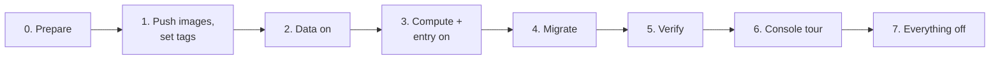
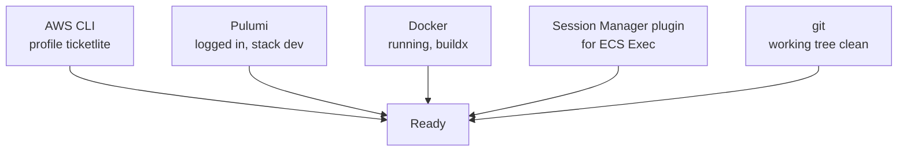
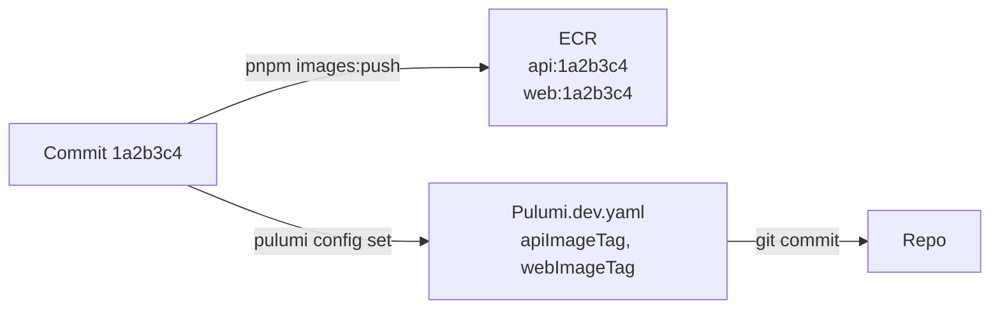
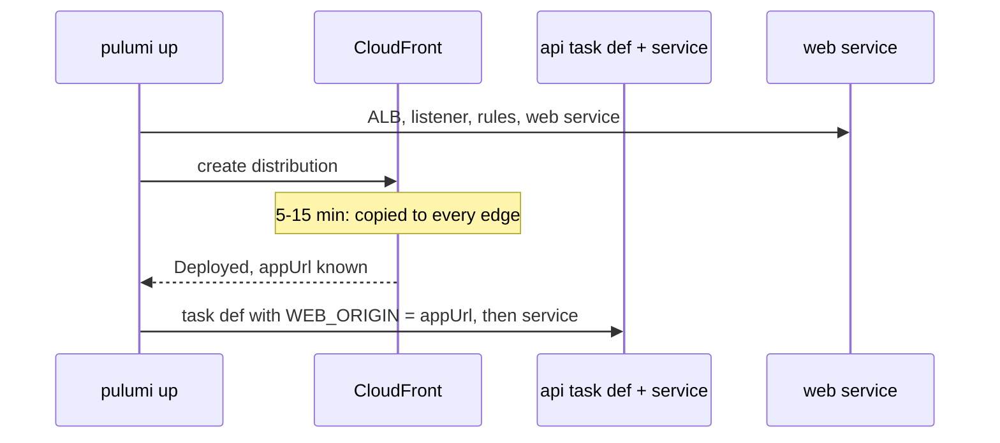
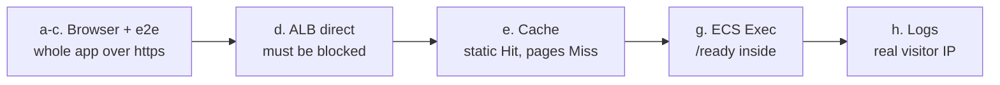
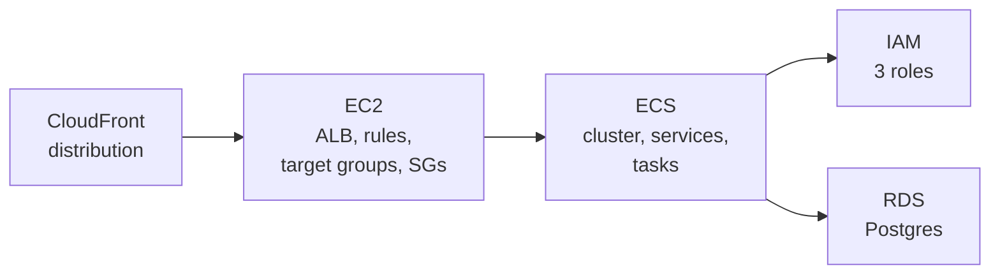
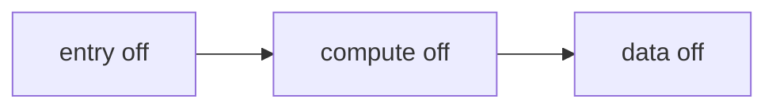
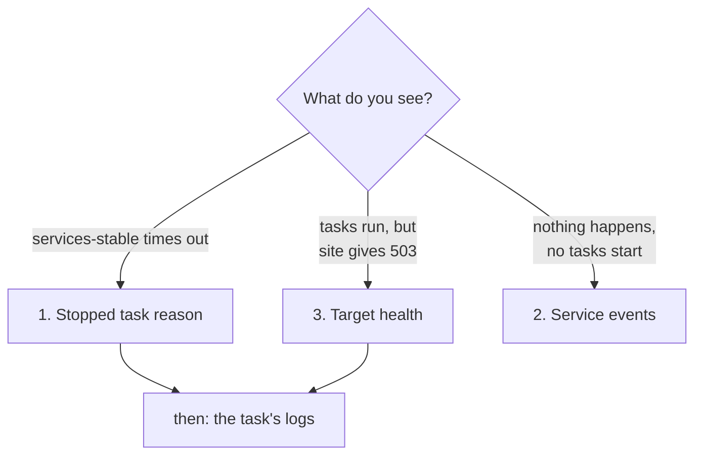
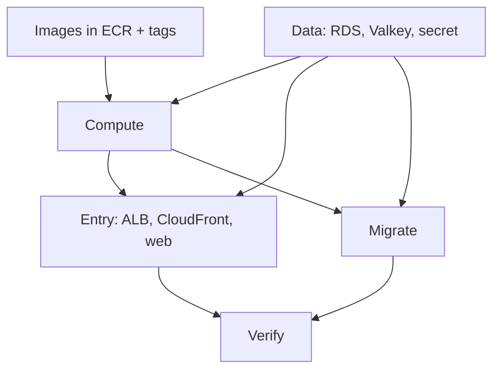

# Deploy day: the whole stack, start to finish

## 1. In one sentence

This is **one runbook** (a list of commands to follow in order) that takes the whole app from "everything off" to "running on AWS at an https address", checks that it really works, shows you around the AWS console, and turns everything off again.

Nothing new is built in this step. It uses everything from [Step 11a](12-infra-network.md) to [Step 11g](19-infra-cloudfront.md).

## 2. The big picture



Real-life comparison: opening a shop for the day. Check you have your keys (prepare). Bring the goods (images). Switch on the fridges first, because they take longest to cool (data). Open the doors and the till (compute + entry). Stock the shelves (migrate). Test the till with one purchase (verify). Walk around once (console tour). Close everything at night, so you do not pay for an empty shop (off).

**Time and money.** Plan about **2 hours** for the first run: ~15 min for data, ~20 min for compute + entry, ~25 min to turn everything off, the rest for checking. Everything on costs about **8 cents an hour** ([Step 11g](19-infra-cloudfront.md), section 3.12).

**How to read this page.** Each command is followed by **Expect:**, what you should see. Names like `d1a2b3c4` and `1a2b3c4` are made-up examples; yours differ. If what you see is different, stop and go to [section 3.9, Troubleshooting](#39-troubleshooting).

## 3. The steps

### 3.0 Prepare

**What it is.** Check that every tool works and is logged in to the right place **before** creating anything.



Open a terminal at the repo root and set the AWS profile once for this terminal:

```bash
cd ~/Code/minitickets
export AWS_PROFILE=ticketlite AWS_REGION=us-east-1
```

```bash
aws sts get-caller-identity
```

**Expect:** your account, not someone else's:

```json
{
    "UserId": "AIDA...",
    "Account": "<your 12-digit account id>",
    "Arn": "arn:aws:iam::<your account id>:user/<your user>"
}
```

If it says `Unable to locate credentials` or `expired`, log in again the way you set the profile up.

```bash
pulumi whoami
cd infra && pulumi stack --show-name && cd ..
```

**Expect:** your Pulumi user name, then `dev`.

```bash
docker info --format '{{.ServerVersion}}'
docker buildx version
```

**Expect:** a version number (like `28.4.0`), then a line starting with `github.com/docker/buildx`. If the first one says `Cannot connect to the Docker daemon`, start Docker Desktop.

```bash
session-manager-plugin --version
```

**Expect:** a version number like `1.2.707.0`. If it says `command not found`: `brew install --cask session-manager-plugin`. You need it only for ECS Exec (3.5 g).

```bash
git status --porcelain
```

**Expect:** **no output** (a clean working tree). `pnpm images:push` refuses to run otherwise, because the image tag is the git SHA ([Step 11d](16-infra-ecr.md)).

```bash
cd infra
pulumi config get dataEnabled; pulumi config get computeEnabled; pulumi config get entryEnabled
cd ..
```

**Expect:** `false` three times: we start from "everything off".

**Why we need it.** A wrong profile would create everything in the wrong account. A missing plugin is easy to install now, and annoying to discover with the meter running.

### 3.1 Push both images, set the tags, commit

**What it is.** Build the api and web images for ARM64, push them to ECR, and tell Pulumi which tag to run.



```bash
pnpm images:push
```

**Expect** (after a few minutes of build output):

```text
Pushed (tag = git SHA):
  minitickets-dev-api  tag=1a2b3c4  digest=sha256:...
  minitickets-dev-web  tag=1a2b3c4  digest=sha256:...
```

If it fails with `tag ... already exists`: this commit is already pushed (the repositories are **immutable**). Skip the push and just set the tags below.

```bash
TAG=$(git rev-parse --short HEAD)
cd infra
pulumi config set apiImageTag "$TAG"
pulumi config set webImageTag "$TAG"
git add Pulumi.dev.yaml
git commit -m "deploy: images $TAG"
```

**Expect:** no output from `pulumi config set`, then `[main 9f8e7d6] deploy: images 1a2b3c4` and `1 file changed`.

**Why commit.** The repo should always say **which code** runs on AWS. The tag is the SHA of the code commit; the new commit only changes `Pulumi.dev.yaml`, so the tag still points at the right code.

You stay in `infra/` for the next steps.

### 3.2 Data on

**What it is.** RDS Postgres, Valkey and the redis-url secret ([Step 11c](14-infra-data.md)). They are the slowest to create, so they go first, alone.

```bash
pulumi config set dataEnabled true
pulumi preview
```

**Expect:** `+ 7 to create`. The **first** time after Step 11g it also shows `- 1 to delete` and `+-1 to replace`: the alb security group rules changing to "CloudFront only" ([Step 11g](19-infra-cloudfront.md), section 3.7). Nothing else.

```bash
pulumi up
```

**Expect:** after **10-15 minutes**, `Resources: + 7 created` (plus the 2 rule changes the first time), and outputs like `dbEndpoint: "minitickets-dev-db.xxxx.us-east-1.rds.amazonaws.com"`.

### 3.3 Compute + entry on, wait for both services

**What it is.** The cluster, roles, both task definitions and services ([Step 11e](17-infra-ecs-api.md), [Step 11f](18-infra-alb-web.md)), the ALB, and CloudFront in front of it ([Step 11g](19-infra-cloudfront.md)).



```bash
pulumi config set computeEnabled true
pulumi config set entryEnabled true
pulumi preview
```

**Expect:** `+ 23 to create` (10 compute + 13 entry), `31 unchanged`. Nothing to update, replace or delete.

```bash
pulumi up
```

**Expect:** after **15-25 minutes** (CloudFront takes most of it, and the api waits for its address), `Resources: + 23 created` and outputs including:

```text
appUrl        : "https://d1a2b3c4.cloudfront.net"
albDnsName    : "minitickets-dev-123456789.us-east-1.elb.amazonaws.com"
apiServiceName: "minitickets-dev-api"
webServiceName: "minitickets-dev-web"
```

```bash
aws ecs wait services-stable --cluster minitickets-dev --services minitickets-dev-api minitickets-dev-web
echo "exit: $?"
```

**Expect:** a quiet wait of 1-5 minutes, then `exit: 0`. If it fails after 10 minutes with `Max attempts exceeded`, a task keeps failing: go to [3.9](#39-troubleshooting).

### 3.4 Migrate

**What it is.** Create the tables in RDS by running the migration as a one-off task ([Step 11e](17-infra-ecs-api.md)).

```bash
cd .. && pnpm infra:migrate && cd infra
```

**Expect:** within 2 minutes:

```text
Stopped reason: Essential container in task exited
Exit code:      0
Migrations applied.
```

The log lines above it include `migrations applied` (printed by the migration runner). "Essential container in task exited" is normal here: the task did its job and stopped.

### 3.5 Verify

**What it is.** Prove each part works, from the outside in.



```bash
APP=$(pulumi stack output appUrl)
ALB=$(pulumi stack output albDnsName)
echo "$APP"
```

**Expect:** `https://d1a2b3c4.cloudfront.net`.

**a. The app in the browser.** `open "$APP"`, then:

| Do this                                         | Expect                                                                 |
| ----------------------------------------------- | ---------------------------------------------------------------------- |
| Look at the address bar                         | `https://`, with the lock icon                                         |
| Landing page                                    | Loads, with **Get started**                                            |
| **Sign up** with a new email                    | "Account created. Login comes next."                                   |
| **Log in** with it                              | Back on `/`, header says **Signed in as** your email                   |
| **Dashboard**                                   | Your email and "Member since ..."                                     |
| Reload the page                                 | Still logged in                                                        |
| **Log out**                                     | Header shows **Login** and **Sign up** again                           |
| Open `/dashboard` again                         | Sent to `/login?next=%2Fdashboard`                                     |

This is the login that did **not** work in Step 11f. It works now because the page is HTTPS ([Step 11g](19-infra-cloudfront.md), section 3.6).

**b. The cookie in DevTools.** Log in again. Open DevTools -> **Application** -> **Cookies** -> your `https://d1a2b3c4.cloudfront.net`.

**Expect** one cookie `sid` with: **HttpOnly** ✓, **Secure** ✓, **SameSite** `Lax`, Path `/`, expiry about 7 days from now.

**c. The end-to-end tests against AWS.**

```bash
cd .. && E2E_BASE_URL="$APP" pnpm test:e2e; cd infra
```

**Expect:** `9 passed`. The same tests as locally, now over the internet, through CloudFront, the ALB and both tasks. (They create a few test users in RDS. Those are deleted when data goes off.)

**d. The ALB directly: must be blocked.**

```bash
curl -sS -m 10 -o /dev/null -w '%{http_code}\n' "http://$ALB/"
```

**Expect:** after 10 seconds, `curl: (28) Connection timed out after 10002 milliseconds` and `000`. The alb security group lets in only CloudFront, so your laptop gets **no answer at all** (not even a "no"). This is lock 1 from [Step 11g](19-infra-cloudfront.md), section 3.7.

**e. The cache.** Find one static file in the landing page, ask for it twice:

```bash
FILE=$(curl -s "$APP/" | grep -o '/_next/static/[^"]*\.js' | head -1); echo "$FILE"
curl -s -o /dev/null -D - "$APP$FILE" | grep -i '^x-cache'
curl -s -o /dev/null -D - "$APP$FILE" | grep -i '^x-cache'
```

**Expect:** a path like `/_next/static/chunks/main-3f9a1c.js`, then `x-cache: Miss from cloudfront`, then `x-cache: Hit from cloudfront`. (The first can already be a Hit if your browser fetched that file through the same edge.)

Pages are never cached, so this one says `Miss` every time:

```bash
curl -s -o /dev/null -D - "$APP/" | grep -i '^x-cache'
```

**f. http goes to https, and the api answers through CloudFront.**

```bash
curl -s -o /dev/null -w '%{http_code} %{redirect_url}\n' "http://${APP#https://}/"
curl -s "$APP/trpc/auth.me"; echo
```

**Expect:** `301 https://d1a2b3c4.cloudfront.net/`, then `{"result":{"data":null}}` (curl is not logged in).

**g. ECS Exec: `/ready` from inside the api.**

```bash
TASK=$(aws ecs list-tasks --cluster minitickets-dev --service-name minitickets-dev-api --query 'taskArns[0]' --output text)
aws ecs execute-command --cluster minitickets-dev --task "$TASK" --container api --interactive --command "sh"
```

**Expect:** `Starting session with SessionId: ...` and a `#` prompt. Inside:

```bash
node -e "fetch('http://localhost:4000/ready').then(async (r) => console.log(r.status, await r.text()))"
exit
```

**Expect:** `200 {"status":"ready"}` (Postgres and Valkey both answered), then `Exiting session with sessionId: ...`.

**h. Logs for both services.**

```bash
curl -s https://checkip.amazonaws.com
aws logs tail /minitickets/dev/api --since 15m | grep '"incoming request"' | tail -3
aws logs tail /minitickets/dev/web --since 30m
```

**Expect:**

- Your public IP address.
- api request lines (JSON) with `"host":"d1a2b3c4.cloudfront.net"` and `"remoteAddress":"<your public IP>"`: the real visitor, thanks to `trustProxy` ([Step 11g](19-infra-cloudfront.md), section 3.8). Lines with `"url":"/health"` and a `10.0.x.x` address are the ALB's health checks: they come straight from the ALB, so that is correct.
- web: the Next.js start-up lines (`▲ Next.js ...`, `✓ Ready in ...`) and no errors.

**i. Both target groups healthy** (same as [Step 11f](18-infra-alb-web.md)):

```bash
for TG in $(aws elbv2 describe-target-groups \
  --query "TargetGroups[?starts_with(TargetGroupName,'minitickets-dev-')].TargetGroupArn" --output text); do
  aws elbv2 describe-target-health --target-group-arn "$TG" \
    --query 'TargetHealthDescriptions[].{ip:Target.Id,port:Target.Port,state:TargetHealth.State}' --output text
done
```

**Expect:** one line with port `4000` and one with `3000`, both `healthy`.

### 3.6 Console tour

**What it is.** Open the [AWS console](https://console.aws.amazon.com/) (region **N. Virginia, us-east-1**) and find, in the real thing, what the docs drew.



| Where                                    | Look at                                                                                         | It shows                                    |
| ---------------------------------------- | ----------------------------------------------------------------------------------------------- | ------------------------------------------- |
| **CloudFront** -> Distributions          | **Origins**: the ALB name, HTTP only, and the `X-Origin-Verify` custom header                   | The origin and lock 2 (11g)                 |
|                                          | **Behaviors**: `/_next/static/*`, `/trpc/*`, `Default (*)` and their policies                   | The 3 cache behaviors (11g)                 |
|                                          | **Monitoring** (after some traffic): requests, cache hit rate                                  | Hits vs misses                              |
| **EC2** -> Load Balancers -> listener    | **Rules**: priority 100 (header + `/trpc/*`), 200 (header), default **403**                     | Routing + lock 2 (11f, 11g)                 |
| **EC2** -> Target Groups                 | **Targets** tab: one healthy IP each; **Health checks** tab                                     | 11f                                         |
| **EC2** -> Security Groups -> alb group  | **Inbound rules**: one rule, port 80, source `pl-3b927c52`                                      | Lock 1 (11g)                                |
| **ECS** -> Clusters -> minitickets-dev   | **Services**: api and web, 1/1 tasks; **Deployments** and **Events** tabs                       | 11e, 11f                                    |
|                                          | A task -> **Configuration**: CPU ARM64, Spot; env vars `WEB_ORIGIN` = the https address, `TRUST_PROXY_HOPS` = 2 | 11e, 11g             |
|                                          | A task -> **Logs** tab                                                                          | The CloudWatch logs                         |
| **IAM** -> Roles                         | `minitickets-dev-api-execution-role`, `-api-task-role`, `-web-execution-role`: **Trust relationships** tab (who may use it) and **Permissions** tab (what it may do) | 11e, 11f |
| **RDS** -> Databases -> minitickets-dev-db | **Connectivity & security**: not publicly accessible, the db security group; **Configuration**: encrypted | 11c                         |
| **Secrets Manager**                      | The RDS master secret and `minitickets/dev/redis-url` (do not click "Retrieve secret value" on a shared screen) | 11c                          |

**Why we need it.** The console is where you will debug real problems later. Knowing where each piece lives makes the troubleshooting section below much faster.

### 3.7 Everything off

**What it is.** Delete everything that costs money by the hour. Keep the network, security groups, budget and ECR.

```bash
pulumi config set entryEnabled false
pulumi config set computeEnabled false
pulumi config set dataEnabled false
pulumi preview
```

**Expect:** `- 30 to delete`, `31 unchanged`. **Nothing** to create, update or replace. Read the list: only data, compute and entry resources (RDS, Valkey, the secret, the cluster, roles, task definitions, services, ALB, target groups, listener, rules, the origin secret and the CloudFront distribution).

```bash
pulumi up
```

**Expect:** after **20-30 minutes**, `Resources: - 30 deleted`. CloudFront is the slow one: it must be **disabled** and the change must reach every edge before AWS lets Pulumi delete it ([Step 11g](19-infra-cloudfront.md), section 3.11). Do not close the terminal while it runs.

```bash
git add Pulumi.dev.yaml && git commit -m "deploy: everything off"
```

The image tags stay in the config. They are only read when a switch is on, and the next deploy day sets new ones.

**Order matters.** Turn entry off **first** (or all three together, as above). The program refuses "compute off while entry is on" and "data off while compute is on", with a clear message.



### 3.8 What "off" leaves behind

| Still there          | Costs                                    |
| -------------------- | ---------------------------------------- |
| VPC, subnets, routes | $0                                       |
| Security groups      | $0                                       |
| Budget alert         | $0                                       |
| ECR images           | cents per month (lifecycle policy keeps it small) |

### 3.9 Troubleshooting

**What it is.** Three places to look, in this order: the **stopped task reason**, the **service events**, and the **target health**.



**1. Why did the last task stop?**

```bash
SVC=minitickets-dev-api   # or minitickets-dev-web
STOPPED=$(aws ecs list-tasks --cluster minitickets-dev --service-name "$SVC" --desired-status STOPPED --query 'taskArns[0]' --output text)
aws ecs describe-tasks --cluster minitickets-dev --tasks "$STOPPED" \
  --query 'tasks[0].{stoppedReason:stoppedReason,exitCode:containers[0].exitCode,containerReason:containers[0].reason}'
```

| Reason contains                                   | Usually means                                                              |
| ------------------------------------------------- | -------------------------------------------------------------------------- |
| `CannotPullContainerError ... not found`          | The tag in `Pulumi.dev.yaml` was never pushed. Check 3.1                    |
| `ResourceInitializationError: unable to pull secrets` | The execution role cannot read a secret ([17](17-infra-ecs-api.md), 3.5) |
| `Essential container in task exited`, exit code 1 | The app crashed at start: read its logs (often `Invalid environment variables`) |
| `Task failed container health checks`             | `/health` did not answer: read the logs                                   |
| `Task failed ELB health checks`                   | The ALB could not reach the task: see 3 below                             |
| `Your Spot Task was interrupted`                  | AWS took the Spot capacity back. The service starts a new task by itself  |
| `exec format error` in the logs                   | The image is not ARM64 ([16](16-infra-ecr.md))                            |

**2. What does the service say?**

```bash
aws ecs describe-services --cluster minitickets-dev --services minitickets-dev-api minitickets-dev-web \
  --query 'services[].{name:serviceName,running:runningCount,events:events[:5].message}'
```

The newest event is first. `has reached a steady state` is good. `unable to place a task` or `rolling back` tell you what ECS tried.

**3. Is each target healthy?**

```bash
for TG in $(aws elbv2 describe-target-groups \
  --query "TargetGroups[?starts_with(TargetGroupName,'minitickets-dev-')].TargetGroupArn" --output text); do
  aws elbv2 describe-target-health --target-group-arn "$TG" \
    --query 'TargetHealthDescriptions[].{port:Target.Port,state:TargetHealth.State,reason:TargetHealth.Reason}' --output text
done
```

`Target.Timeout` = the security group or `HOSTNAME` (web) is wrong. `Target.ResponseCodeMismatch` = the health check path answers, but not 200.

**What the browser shows, and where it comes from:**

| You see                                                     | From       | Usually means                                                                 |
| ----------------------------------------------------------- | ---------- | ----------------------------------------------------------------------------- |
| `502 ERROR. The request could not be satisfied`             | CloudFront | It cannot connect to the ALB: alb security group rule, or the listener is missing |
| `403 ERROR. The request could not be satisfied`             | CloudFront | That method is not allowed on that path (e.g. a POST to a page)              |
| Plain text `Forbidden`                                      | ALB        | The secret header did not match (e.g. CloudFront is still deploying a change) |
| `503 Service Temporarily Unavailable`                       | ALB        | No healthy target in that target group: see 3 above                          |
| `504`                                                       | CloudFront or ALB | The task answered too slowly                                           |
| Login "works" but you are logged out again at once          | browser    | You opened `http://<albDnsName>` or an `http://` address, not `appUrl`        |

## 4. Dependency order



- **Images before compute:** a task definition points at a tag that must already exist in ECR.
- **Data before compute:** the api's task definition contains the database address and the secret ARNs.
- **Compute and entry together:** the program requires data + compute for entry; in one `pulumi up` Pulumi creates them in the right order by itself.
- **Migrate after compute:** the migration runs from the api task definition, in the cluster.
- **Verify last:** login needs the tables (migrate) and HTTPS (entry).
- **Off in reverse:** entry, then compute, then data (or all at once).

## 5. What breaks if this is wrong or missing

| Mistake                                              | What happens                                                                |
| ---------------------------------------------------- | --------------------------------------------------------------------------- |
| Wrong `AWS_PROFILE`                                  | Everything is created in another account (or nothing works)                  |
| Uncommitted changes before `images:push`             | The script refuses: the tag would not describe the code                     |
| Tag set but not pushed                               | `CannotPullContainerError`; the circuit breaker gives up                    |
| Entry on before data and compute                     | Pulumi refuses with a clear error                                           |
| Skipping the migration                               | Pages load, but signup and login fail with a 500 (no tables)                |
| Testing at `http://<albDnsName>`                     | Times out: the ALB only answers CloudFront                                  |
| Closing the laptop during "off"                      | `pulumi up` stops halfway; run it again, it continues where it stopped      |
| Forgetting "off"                                     | About $2 a day for nothing; the budget alert emails you eventually          |
| Not reading the "off" preview                        | A wrong switch could delete or replace something you meant to keep        |

## 6. How this connects

**Uses from earlier layers:** everything.

- Network and security groups ([12](12-infra-network.md), [13](13-infra-security-groups.md)): always on, the base of it all.
- Data ([14](14-infra-data.md)): `dataEnabled`, 3.2.
- ECR and the push script ([16](16-infra-ecr.md)): 3.1.
- Compute and the migration script ([17](17-infra-ecs-api.md)): `computeEnabled`, 3.3, 3.4, ECS Exec.
- ALB and web ([18](18-infra-alb-web.md)): `entryEnabled`, target health, 3.5 i.
- CloudFront and origin protection ([19](19-infra-cloudfront.md)): `appUrl`, the blocked ALB, the cache, `trustProxy`.
- The e2e tests ([04](04-signup-form.md) to [09](09-dashboard.md)) with `E2E_BASE_URL`: 3.5 c.

**Used by later steps:** every later AWS step adds its own checks to this runbook, so there is always **one** page to follow on deploy day. A CI deploy (later) will automate steps 3.1 to 3.4.

See [00-architecture.md](00-architecture.md) for the whole picture.

## 7. Interview questions

1. **Why push images tagged with the git SHA and not `latest`?** A SHA names exactly one commit, so you always know what runs and can roll back to a known version. `latest` moves, and immutable repositories do not allow overwriting it anyway.
2. **Why create the data layer first, on its own?** It takes the longest (10-15 min) and everything else depends on it; doing it alone keeps failures easy to read.
3. **How do you run database migrations on ECS?** As a one-off task from the same task definition, with the command overridden, before using the new version; only that one process migrates.
4. **A service never becomes stable. Where do you look first?** The stopped task's `stoppedReason` and exit code, then the service events, then target health and the container logs.
5. **How do you prove the origin is protected?** Call the ALB directly from outside: it must time out (security group), while the CloudFront address works.
6. **How do you check that CloudFront caches what it should?** Request the same static file twice and look at `x-cache`: `Miss` then `Hit`. Pages and API calls must always be `Miss`.
7. **What is ECS Exec and what does it need?** A shell inside a running container through SSM. It needs `enableExecuteCommand` on the service, a task role with the `ssmmessages` permissions, and the Session Manager plugin on your laptop.
8. **Why turn dev infrastructure off every night?** Load balancers, databases and running tasks cost money every hour they exist, even with no users. Infrastructure as code makes "off" and "on" one command each.

## 8. Check yourself

1. `aws ecs wait services-stable` fails. The stopped reason says `Task failed ELB health checks` for web, but the web logs show `✓ Ready`. Which two settings do you check, and in which docs?
2. During 3.5 d, `curl` to the ALB returns `200` instantly instead of timing out. What does that tell you about the alb security group, and what would you check in `pulumi preview`?
3. The "off" preview shows `+-1 to replace` on a security group. Should you run `pulumi up`? What would you do instead?
