# Deploy day: the whole stack, start to finish

## 1. In one sentence

This is **one runbook** (a list of commands to follow in order) that takes the whole app from "everything off" to "running on AWS at an https address", checks that it really works, shows you around the AWS console, and turns everything off again.

Nothing new is built in this step. It uses everything from [Step 11a](12-infra-network.md) to [Step 11g](19-infra-cloudfront.md), plus Service Connect (Step 11h) and the own-domain mode (Step 11i).

**Two paths.** The config value `cdnEnabled` picks how visitors reach the app:

| | Path A: CloudFront (`cdnEnabled = true`, the default) | Path B: own domain, no CloudFront (`cdnEnabled = false`) |
| --- | --- | --- |
| Address | `https://d1a2b3c4.cloudfront.net` | `https://minitickets.theversehub.in` (your `domainName`) |
| Who does HTTPS | CloudFront | the ALB, with an ACM certificate for your domain |
| Who may reach the ALB | only CloudFront (+ secret header) | `allowedCidrs` (default: everyone), ports 80 and 443 |
| Extra work | none | **days before:** one DNS record for the certificate (3.0b); **on the day:** one CNAME to the ALB (3.3) |
| `TRUST_PROXY_HOPS` | 2 (CloudFront, ALB) | 1 (ALB) |

Steps marked **Path A** or **Path B** apply only to that path; everything else is the same. Change `cdnEnabled` only while `entryEnabled` is `false` (both paths have a listener on port 80, and AWS allows one per port).

## 2. The big picture

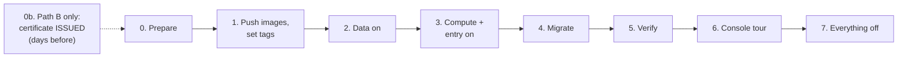

Real-life comparison: opening a shop for the day. Check you have your keys (prepare). Bring the goods (images). Switch on the fridges first, because they take longest to cool (data). Open the doors and the till (compute + entry). Stock the shelves (migrate). Test the till with one purchase (verify). Walk around once (console tour). Close everything at night, so you do not pay for an empty shop (off).

**Time and money.** Plan about **2 hours** for the first run: ~15 min for data, ~20 min for compute + entry, ~25 min to turn everything off, the rest for checking. Everything on costs about **8 cents an hour** ([Step 11g](19-infra-cloudfront.md), section 3.12).

**How to read this page.** Each command is followed by **Expect:**, what you should see. Names like `d1a2b3c4` and `1a2b3c4` are made-up examples; yours differ. If what you see is different, stop and go to [section 3.9, Troubleshooting](#39-troubleshooting).

## 3. The steps

### 3.0 Prepare

**What it is.** Check that every tool works and is logged in to the right place **before** creating anything.

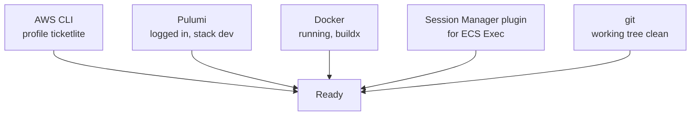

Open a terminal at the repo root and set the AWS profile once for this terminal:

```bash
cd ~/Code/minitickets
export AWS_PROFILE=ticketlite AWS_REGION=us-east-1
```

```bash
aws sts get-caller-identity
```

**Expect:** your account, not someone else's:

```json
{
    "UserId": "AIDA...",
    "Account": "<your 12-digit account id>",
    "Arn": "arn:aws:iam::<your account id>:user/<your user>"
}
```

If it says `Unable to locate credentials` or `expired`, log in again the way you set the profile up.

```bash
pulumi whoami
cd infra && pulumi stack --show-name && cd ..
```

**Expect:** your Pulumi user name, then `dev`.

```bash
docker info --format '{{.ServerVersion}}'
docker buildx version
```

**Expect:** a version number (like `28.4.0`), then a line starting with `github.com/docker/buildx`. If the first one says `Cannot connect to the Docker daemon`, start Docker Desktop.

```bash
session-manager-plugin --version
```

**Expect:** a version number like `1.2.707.0`. If it says `command not found`: `brew install --cask session-manager-plugin`. You need it only for ECS Exec (3.5 g).

```bash
git status --porcelain
```

**Expect:** **no output** (a clean working tree). `pnpm images:push` refuses to run otherwise, because the image tag is the git SHA ([Step 11d](16-infra-ecr.md)).

```bash
cd infra
pulumi config get dataEnabled; pulumi config get computeEnabled; pulumi config get entryEnabled
cd ..
```

**Expect:** `false` three times: we start from "everything off".

```bash
cd infra
pulumi config get cdnEnabled; pulumi config get domainName
cd ..
```

**Expect:** Path A: `true` (or "not found": the default is `true`). Path B: `false`, then your domain, e.g. `minitickets.theversehub.in`. Path B also needs the certificate to be **ISSUED** already: check it with the `describe-certificate` command in 3.0b. If it is not, stop here and do 3.0b first.

**Why we need it.** A wrong profile would create everything in the wrong account. A missing plugin is easy to install now, and annoying to discover with the meter running.

### 3.0b Path B only: the certificate (days before deploy day)

**What it is.** A free TLS certificate from ACM for your domain. Amazon issues it only after it sees a DNS record that proves you control the domain. Your DNS is **not** in Route 53, so you add that record by hand at your DNS provider. The certificate is **not** behind any switch: you create it once, and it stays (and renews itself) while the record stays.

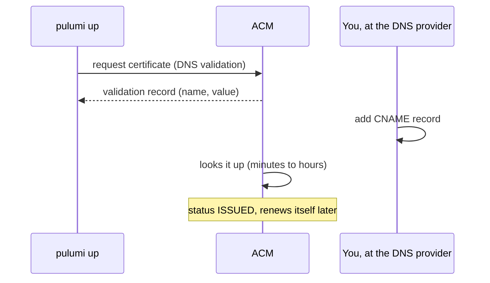

```bash
cd infra
pulumi config set cdnEnabled false
pulumi config set domainName minitickets.theversehub.in
pulumi preview
```

**Expect:** with all three switches off: `+ 1 to create` (the certificate) and `- 1 to delete`: the alb security group's "HTTP from CloudFront only" rule. It has no job without CloudFront; the ALB's own doors for Path B (80 and 443 from `allowedCidrs`) are only opened while the ALB exists. Nothing else.

Optional, for dev: let only your own IP reach the ALB (the default is the whole internet):

```bash
curl -s https://checkip.amazonaws.com            # your public IP, e.g. 203.0.113.7
pulumi config set --path 'allowedCidrs[0]' 203.0.113.7/32
```

Your home IP can change; if the site suddenly times out for you, check this first (3.9).

```bash
pulumi up
pulumi stack output certificateValidationRecord
```

**Expect:** `Resources: + 1 created, - 1 deleted` within a minute (nothing waits for the certificate), then something like:

```json
{
  "name": "_3f9a1c2b4d5e6f7a8b9c0d1e2f3a4b5c.minitickets.theversehub.in.",
  "type": "CNAME",
  "value": "_7a8b9c0d1e2f3a4b5c6d7e8f9a0b1c2d.xlfgrmvvlj.acm-validations.aws."
}
```

**Add the record at your DNS provider**, in the zone `theversehub.in`:

| Field | What to type |
| --- | --- |
| Type | `CNAME` |
| Name / Host | the `name` **without** the zone and the final dot: `_3f9a…4b5c.minitickets`. (Most providers add `.theversehub.in` themselves; typing the full name gives `…theversehub.in.theversehub.in`, which never validates.) |
| Value / Target | the `value`, exactly. Keep the final dot if the provider accepts it; some want it removed. |
| TTL | anything (e.g. 300 or "auto") |
| Proxy (Cloudflare only) | **off** ("DNS only", grey cloud) |

**Never delete this record.** ACM uses it again to renew the certificate (about every 13 months) by itself.

Check that the record is public, then wait for ACM:

```bash
dig +short CNAME _3f9a1c2b4d5e6f7a8b9c0d1e2f3a4b5c.minitickets.theversehub.in   # your real name
aws acm describe-certificate --certificate-arn "$(pulumi stack output certificateArn)" \
  --query 'Certificate.{status:Status,validation:DomainValidationOptions[0].ValidationStatus}'
cd ..
```

**Expect:** `dig` prints the `value`. Then first `PENDING_VALIDATION`, and after a few minutes (sometimes up to an hour or two) `"status": "ISSUED", "validation": "SUCCESS"`. To wait in the terminal: `aws acm wait certificate-validated --certificate-arn "$(pulumi stack output certificateArn)"` (it gives up after about 40 minutes; just run it again). If it says `FAILED` or stays pending for many hours, see 3.9.

**Why days before.** On deploy day `pulumi up` creates the HTTPS listener only after the certificate is ISSUED (it waits at most 10 minutes, then fails). An ISSUED certificate makes that wait instant.

### 3.1 Push both images, set the tags, commit

**What it is.** Build the api and web images for ARM64, push them to ECR, and tell Pulumi which tag to run.

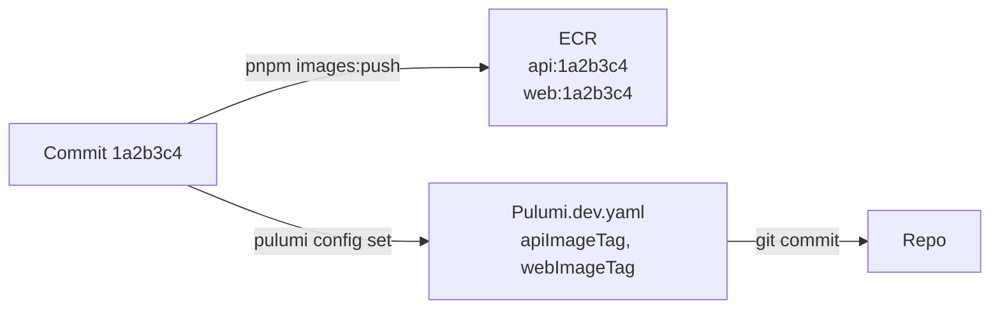

```bash
pnpm images:push
```

**Expect** (after a few minutes of build output):

```text
Pushed (tag = git SHA):
  minitickets-dev-api  tag=1a2b3c4  digest=sha256:...
  minitickets-dev-web  tag=1a2b3c4  digest=sha256:...
```

If it fails with `tag ... already exists`: this commit is already pushed (the repositories are **immutable**). Skip the push and just set the tags below.

```bash
TAG=$(git rev-parse --short HEAD)
cd infra
pulumi config set apiImageTag "$TAG"
pulumi config set webImageTag "$TAG"
git add Pulumi.dev.yaml
git commit -m "deploy: images $TAG"
```

**Expect:** no output from `pulumi config set`, then `[main 9f8e7d6] deploy: images 1a2b3c4` and `1 file changed`.

**Why commit.** The repo should always say **which code** runs on AWS. The tag is the SHA of the code commit; the new commit only changes `Pulumi.dev.yaml`, so the tag still points at the right code.

You stay in `infra/` for the next steps.

### 3.2 Data on

**What it is.** RDS Postgres, Valkey and the redis-url secret ([Step 11c](14-infra-data.md)). They are the slowest to create, so they go first, alone.

```bash
pulumi config set dataEnabled true
pulumi preview
```

**Expect:** `+ 7 to create`, `34 unchanged`. Nothing else. (Path A with a `domainName` set: `35 unchanged`, the certificate is one more.)

```bash
pulumi up
```

**Expect:** after **10-15 minutes**, `Resources: + 7 created` (plus the 2 rule changes the first time), and outputs like `dbEndpoint: "minitickets-dev-db.xxxx.us-east-1.rds.amazonaws.com"`.

### 3.3 Compute + entry on, wait for both services

**What it is.** The cluster, roles, both task definitions and services ([Step 11e](17-infra-ecs-api.md), [Step 11f](18-infra-alb-web.md)), the ALB, Service Connect between web and api (Step 11h), and in front of the ALB either CloudFront ([Step 11g](19-infra-cloudfront.md), Path A) or the HTTPS listener with your certificate (Step 11i, Path B).

**Path A** (CloudFront):

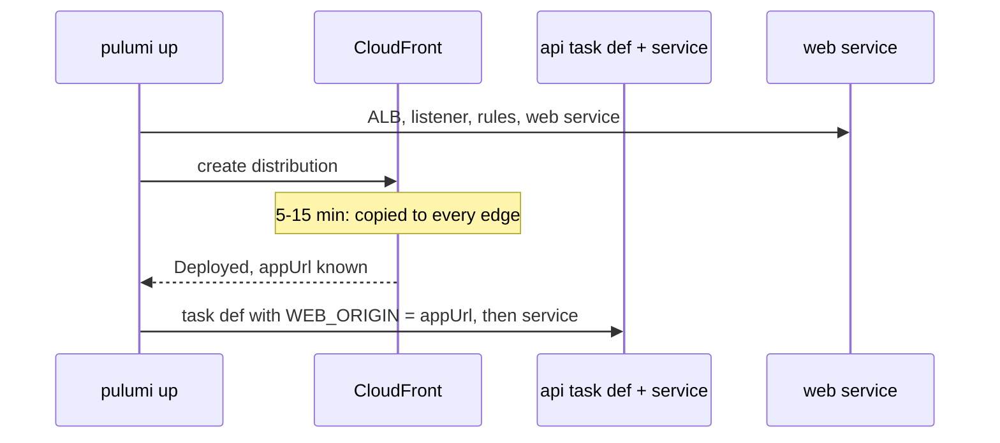

```bash
pulumi config set computeEnabled true
pulumi config set entryEnabled true
pulumi preview
```

**Expect:** `+ 31 to create`, `41 unchanged`. Nothing to update, replace or delete. Read the list:

- **Path A:** it contains `aws:cloudfront:Distribution`, a `CachePolicy`, the origin-verify password, the `-http` listener and two rules.
- **Path B:** **no** CloudFront resources and no origin-verify password. Instead: `CertificateValidation` (only a wait), the `-https` listener, the `-http-redirect` listener, one rule (`-https-trpc-rule`) and two alb security group rules (`-alb-in-443-0`, `-alb-in-80-0`; two more for each extra `allowedCidrs` entry).

```bash
pulumi up
```

**Expect:** Path A: after **15-25 minutes** (CloudFront takes most of it, and the api waits for its address). Path B: after about **10 minutes** (no CloudFront). Then `Resources: + 31 created` and outputs including:

```text
appUrl        : "https://d1a2b3c4.cloudfront.net"        # Path B: "https://minitickets.theversehub.in"
albDnsName    : "minitickets-dev-123456789.us-east-1.elb.amazonaws.com"
apiServiceName: "minitickets-dev-api"
webServiceName: "minitickets-dev-web"
appDnsRecord  : null                                      # Path B: { name, type: "CNAME", value: <albDnsName> }
```

**Path B: point your domain at the ALB.** Every new ALB gets a **new** DNS name, so do this on **every** deploy day:

```bash
pulumi stack output appDnsRecord
```

At your DNS provider, in the zone `theversehub.in`, create (or edit) **one** record:

| Field | What to type |
| --- | --- |
| Type | `CNAME` |
| Name / Host | `minitickets` |
| Value / Target | the `value` above, e.g. `minitickets-dev-123456789.us-east-1.elb.amazonaws.com` |
| TTL | short, e.g. `60` or `300`: next deploy day the value changes again |
| Proxy (Cloudflare only) | **off** ("DNS only"): the ALB must see the browser's TLS connection for its certificate |

```bash
dig +short minitickets.theversehub.in
```

**Expect** (after a minute or a few): the ALB name, then two or more IP addresses. Until then the browser says "can't find server": wait, and try again.

```bash
aws ecs wait services-stable --cluster minitickets-dev --services minitickets-dev-api minitickets-dev-web
echo "exit: $?"
```

**Expect:** a quiet wait of 1-5 minutes, then `exit: 0`. If it fails after 10 minutes with `Max attempts exceeded`, a task keeps failing: go to [3.9](#39-troubleshooting).

**Both paths: restart the api once** (Step 11h). Pulumi creates the api service before the web service, so the first api tasks started before the Service Connect name `web` existed and cannot call the web app's revalidate hook yet. A fresh deployment starts tasks that know both names:

```bash
aws ecs update-service --cluster minitickets-dev --service minitickets-dev-api --force-new-deployment \
  --query 'service.deployments[0].status' --output text
aws ecs wait services-stable --cluster minitickets-dev --services minitickets-dev-api
echo "exit: $?"
```

**Expect:** `PRIMARY`, then after 2-5 minutes `exit: 0`. Skip this and a new event shows up on `/events` only after about 30 s instead of at once (check 3.5 j).

### 3.4 Migrate

**What it is.** Create the tables in RDS by running the migration as a one-off task ([Step 11e](17-infra-ecs-api.md)).

```bash
cd .. && pnpm infra:migrate && cd infra
```

**Expect:** within 2 minutes:

```text
Stopped reason: Essential container in task exited
Exit code:      0
Migrations applied.
```

The log lines above it include `migrations applied` (printed by the migration runner). "Essential container in task exited" is normal here: the task did its job and stopped.

### 3.5 Verify

**What it is.** Prove each part works, from the outside in.

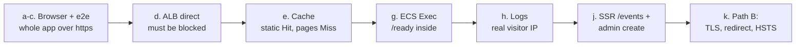

```bash
APP=$(pulumi stack output appUrl)
ALB=$(pulumi stack output albDnsName)
echo "$APP"
```

**Expect:** `https://d1a2b3c4.cloudfront.net`. Path B: `https://minitickets.theversehub.in`. Checks a to c are the same for both paths (in b, the cookie is listed under your own domain in Path B).

**a. The app in the browser.** `open "$APP"`, then:

| Do this                                         | Expect                                                                 |
| ----------------------------------------------- | ---------------------------------------------------------------------- |
| Look at the address bar                         | `https://`, with the lock icon                                         |
| Landing page                                    | Loads, with **Get started**                                            |
| **Sign up** with a new email                    | "Account created. Login comes next."                                   |
| **Log in** with it                              | Back on `/`, header says **Signed in as** your email                   |
| **Dashboard**                                   | Your email and "Member since ..."                                     |
| Reload the page                                 | Still logged in                                                        |
| **Log out**                                     | Header shows **Login** and **Sign up** again                           |
| Open `/dashboard` again                         | Sent to `/login?next=%2Fdashboard`                                     |

This is the login that did **not** work in Step 11f. It works now because the page is HTTPS ([Step 11g](19-infra-cloudfront.md), section 3.6).

**b. The cookie in DevTools.** Log in again. Open DevTools -> **Application** -> **Cookies** -> your `https://d1a2b3c4.cloudfront.net`.

**Expect** one cookie `sid` with: **HttpOnly** ✓, **Secure** ✓, **SameSite** `Lax`, Path `/`, expiry about 7 days from now.

**c. The end-to-end tests against AWS.**

```bash
cd .. && E2E_BASE_URL="$APP" pnpm test:e2e; cd infra
```

**Expect:** all tests `passed`, a few `skipped`: the production-build-only checks and the admin tests (they need the local database to make an admin; 3.5 j does that check by hand). The same tests as locally, now over the internet, through CloudFront (Path A) or straight to the ALB (Path B), and both tasks. (They create a few test users and events in RDS. Those are deleted when data goes off.)

**d. Path A: the ALB directly: must be blocked.** (Path B: skip. There the ALB **is** the front door; see 3.5 k.)

```bash
curl -sS -m 10 -o /dev/null -w '%{http_code}\n' "http://$ALB/"
```

**Expect:** after 10 seconds, `curl: (28) Connection timed out after 10002 milliseconds` and `000`. The alb security group lets in only CloudFront, so your laptop gets **no answer at all** (not even a "no"). This is lock 1 from [Step 11g](19-infra-cloudfront.md), section 3.7.

**e. Path A: the cache.** (Path B: skip. No CloudFront, so no `x-cache` header and no edge cache.) Find one static file in the landing page, ask for it twice:

```bash
FILE=$(curl -s "$APP/" | grep -o '/_next/static/[^"]*\.js' | head -1); echo "$FILE"
curl -s -o /dev/null -D - "$APP$FILE" | grep -i '^x-cache'
curl -s -o /dev/null -D - "$APP$FILE" | grep -i '^x-cache'
```

**Expect:** a path like `/_next/static/chunks/main-3f9a1c.js`, then `x-cache: Miss from cloudfront`, then `x-cache: Hit from cloudfront`. (The first can already be a Hit if your browser fetched that file through the same edge.)

Pages are never cached, so this one says `Miss` every time:

```bash
curl -s -o /dev/null -D - "$APP/" | grep -i '^x-cache'
```

**f. http goes to https, and the api answers through CloudFront.**

```bash
curl -s -o /dev/null -w '%{http_code} %{redirect_url}\n' "http://${APP#https://}/"
curl -s "$APP/trpc/auth.me"; echo
```

**Expect:** `301 https://d1a2b3c4.cloudfront.net/`, then `{"result":{"data":null}}` (curl is not logged in). Path B: the same, but the 301 comes from the ALB's port-80 listener and points at `https://minitickets.theversehub.in/` (possibly written as `…theversehub.in:443/`: 443 is the https default, so it is the same address).

**g. ECS Exec: `/ready` from inside the api.**

```bash
TASK=$(aws ecs list-tasks --cluster minitickets-dev --service-name minitickets-dev-api --query 'taskArns[0]' --output text)
aws ecs execute-command --cluster minitickets-dev --task "$TASK" --container api --interactive --command "sh"
```

**Expect:** `Starting session with SessionId: ...` and a `#` prompt. Inside:

```bash
node -e "fetch('http://localhost:4000/ready').then(async (r) => console.log(r.status, await r.text()))"
exit
```

**Expect:** `200 {"status":"ready"}` (Postgres and Valkey both answered), then `Exiting session with sessionId: ...`.

**h. Logs for both services.**

```bash
curl -s https://checkip.amazonaws.com
aws logs tail /minitickets/dev/api --since 15m | grep '"incoming request"' | tail -3
aws logs tail /minitickets/dev/web --since 30m
```

**Expect:**

- Your public IP address.
- api request lines (JSON) with `"host":"d1a2b3c4.cloudfront.net"` and `"remoteAddress":"<your public IP>"`: the real visitor, thanks to `trustProxy` ([Step 11g](19-infra-cloudfront.md), section 3.8). Lines with `"url":"/health"` and a `10.0.x.x` address are the ALB's health checks: they come straight from the ALB, so that is correct.
- Path B: `"host":"minitickets.theversehub.in"` and again `"remoteAddress":"<your public IP>"`, now with `TRUST_PROXY_HOPS = 1` (only the ALB in front). If you see a `10.0.x.x` address on **your** requests, the hop count is too low; if you can make it show an address you typed (k, last command), it is too high.
- web: the Next.js start-up lines (`▲ Next.js ...`, `✓ Ready in ...`) and no errors.

**i. Both target groups healthy** (same as [Step 11f](18-infra-alb-web.md)):

```bash
for TG in $(aws elbv2 describe-target-groups \
  --query "TargetGroups[?starts_with(TargetGroupName,'minitickets-dev-')].TargetGroupArn" --output text); do
  aws elbv2 describe-target-health --target-group-arn "$TG" \
    --query 'TargetHealthDescriptions[].{ip:Target.Id,port:Target.Port,state:TargetHealth.State}' --output text
done
```

**Expect:** one line with port `4000` and one with `3000`, both `healthy`.

**j. Both paths: SSR `/events` and "admin creates an event" (Step 11h).** The web **server** fetches the events from the api over Service Connect, so the HTML itself already contains them:

```bash
curl -s "$APP/events" | grep -o '<li class="rounded-lg' | wc -l
```

**Expect:** a number above 0: one event card per upcoming event, in the HTML the server sent. A brand-new database has no events yet; then do the admin part below first and run this again. No events and the web logs say `fetch failed` / `API_INTERNAL_URL`: Service Connect is broken (3.9).

Making an admin needs the database, and there is no UI for roles. Sign up in the browser first (a), then make that account admin from inside the api task (ECS Exec, like g):

```bash
TASK=$(aws ecs list-tasks --cluster minitickets-dev --service-name minitickets-dev-api --query 'taskArns[0]' --output text)
aws ecs execute-command --cluster minitickets-dev --task "$TASK" --container api --interactive --command "sh"
```

Inside (replace the email with the one you signed up with):

```bash
node -e 'const {Client}=require("pg");const c=new Client({host:process.env.DB_HOST,port:Number(process.env.DB_PORT),database:process.env.DB_NAME,user:process.env.DB_USER,password:process.env.DB_PASSWORD,ssl:{rejectUnauthorized:true}});c.connect().then(()=>c.query("update users set role = $1 where email = $2 returning email, role",["admin",process.argv[1]])).then(r=>{console.log(r.rows);return c.end()})' you@example.com
exit
```

**Expect:** `[ { email: 'you@example.com', role: 'admin' } ]`. `[]` = no user with that email (typo, or not signed up yet).

In the browser: reload; the header now shows **New event** (the role is read on every admin request, so no new login is needed). Create an event there, then **at once** open `/events` in a new tab (or `curl -s "$APP/events" | grep -c '<your event title>'`).

**Expect:** the new event is there immediately. It only appears after about 30 s? Then the revalidate hook did not reach web: you skipped the one-time api restart (3.3), or the api logs show `web cache revalidate failed` (a 401 in that line = the two tasks read different secrets).

**k. Path B only: TLS, redirect, HSTS, and the hop count.**

```bash
HOST=${APP#https://}
curl -sS -o /dev/null -w '%{http_code} %{ssl_verify_result}\n' "$APP/"
curl -sS -o /dev/null -w '%{http_code} %{redirect_url}\n' "http://$HOST/events?venue=pune"
curl -sSI "$APP/" | grep -i '^strict-transport-security'
curl -sS -o /dev/null --tls-max 1.1 "$APP/"; echo "exit: $?"
curl -sS -o /dev/null -w '%{http_code}\n' "https://$ALB/"
```

**Expect**, line by line:

- `200 0`: https works and the certificate checks out (`0` = no verify error).
- `301 https://minitickets.theversehub.in/events?venue=pune` (maybe with `:443`): http goes to https, with path and query kept.
- `strict-transport-security: max-age=86400`: HSTS, 1 day (apps/web/next.config.ts).
- an SSL error (e.g. `tlsv1 alert protocol version`) and a non-zero exit: TLS 1.0/1.1 are refused by the policy `ELBSecurityPolicy-TLS13-1-2-2021-06`.
- `curl: (60) SSL: no alternative certificate subject name matches target host name` and `000`: the ALB's own name is not on the certificate. (With `-k` it would answer: in Path B the ALB is reachable on purpose; `allowedCidrs` decides by whom.)

The hop count: send a fake visitor IP and check the api did **not** believe it:

```bash
curl -s -o /dev/null -H 'X-Forwarded-For: 6.6.6.6' "$APP/trpc/auth.me"
sleep 5; aws logs tail /minitickets/dev/api --since 2m | grep '"url":"/trpc/auth.me' | tail -1
```

**Expect:** `"remoteAddress":"<your public IP>"`, **not** `6.6.6.6`. (With CloudFront's 2 hops and only an ALB in front it **would** say `6.6.6.6`: infra/src/entry/mode.ts.)

### 3.6 Console tour

**What it is.** Open the [AWS console](https://console.aws.amazon.com/) (region **N. Virginia, us-east-1**) and find, in the real thing, what the docs drew.

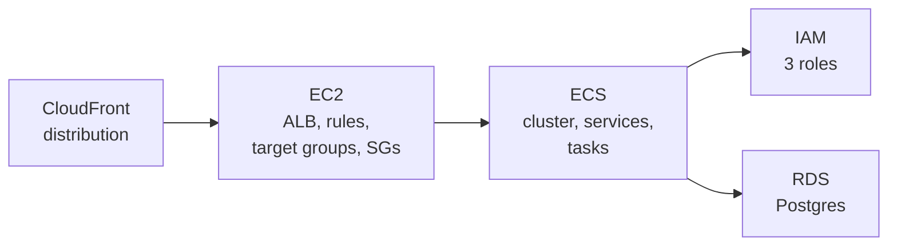

| Where                                    | Look at                                                                                         | It shows                                    |
| ---------------------------------------- | ----------------------------------------------------------------------------------------------- | ------------------------------------------- |
| **CloudFront** -> Distributions          | **Origins**: the ALB name, HTTP only, and the `X-Origin-Verify` custom header                   | The origin and lock 2 (11g)                 |
|                                          | **Behaviors**: `/_next/static/*`, `/trpc/*`, `Default (*)` and their policies                   | The 3 cache behaviors (11g)                 |
|                                          | **Monitoring** (after some traffic): requests, cache hit rate                                  | Hits vs misses                              |
| **EC2** -> Load Balancers -> listener    | **Rules**: priority 100 (header + `/trpc/*`), 200 (header), default **403**                     | Routing + lock 2 (11f, 11g)                 |
| **EC2** -> Target Groups                 | **Targets** tab: one healthy IP each; **Health checks** tab                                     | 11f                                         |
| **EC2** -> Security Groups -> alb group  | **Inbound rules**: one rule, port 80, source `pl-3b927c52`                                      | Lock 1 (11g)                                |
| **ECS** -> Clusters -> minitickets-dev   | **Services**: api and web, 1/1 tasks; **Deployments** and **Events** tabs                       | 11e, 11f                                    |
|                                          | A task -> **Configuration**: CPU ARM64, Spot; env vars `WEB_ORIGIN` = the https address, `TRUST_PROXY_HOPS` = 2 | 11e, 11g             |
|                                          | A task -> **Logs** tab                                                                          | The CloudWatch logs                         |
| **IAM** -> Roles                         | `minitickets-dev-api-execution-role`, `-api-task-role`, `-web-execution-role`: **Trust relationships** tab (who may use it) and **Permissions** tab (what it may do) | 11e, 11f |
| **RDS** -> Databases -> minitickets-dev-db | **Connectivity & security**: not publicly accessible, the db security group; **Configuration**: encrypted | 11c                         |
| **Secrets Manager**                      | The RDS master secret and `minitickets/dev/redis-url` (do not click "Retrieve secret value" on a shared screen) | 11c                          |

**Path B** has no CloudFront. Look at these instead of the CloudFront and listener rows:

| Where | Look at | It shows |
| --- | --- | --- |
| **Certificate Manager (ACM)** | Your certificate: status **Issued**, **Renewal eligibility: Eligible**, and the CNAME under **Domains** | DNS validation (11i) |
| **EC2** -> Load Balancers -> **Listeners** | `HTTPS:443`: security policy `ELBSecurityPolicy-TLS13-1-2-2021-06`, default certificate = yours, rule `/trpc/*`, default -> web. `HTTP:80`: redirect to `HTTPS://#{host}:443/#{path}?#{query}`, 301 | TLS termination + redirect (11i) |
| **EC2** -> Security Groups -> alb group | **Inbound rules**: port 80 and port 443 from your `allowedCidrs` (no `pl-…` prefix list) | Who may reach the ALB (11i) |
| **ECS** -> a api task -> **Configuration** | `TRUST_PROXY_HOPS` = **1**, `WEB_ORIGIN` = `https://minitickets.theversehub.in` | One proxy hop (11i) |

**Why we need it.** The console is where you will debug real problems later. Knowing where each piece lives makes the troubleshooting section below much faster.

### 3.7 Everything off

**What it is.** Delete everything that costs money by the hour. Keep the network, security groups, budget and ECR.

```bash
pulumi config set entryEnabled false
pulumi config set computeEnabled false
pulumi config set dataEnabled false
pulumi preview
```

**Expect:** `- 38 to delete`, `34 unchanged`. **Nothing** to create, update or replace. Read the list: only data, compute and entry resources (RDS, Valkey, the secrets, the cluster, roles, task definitions, services, Service Connect, ALB, target groups, listeners, rules, and in Path A the origin secret and the CloudFront distribution, in Path B the two alb security group rules and the certificate wait). **The certificate itself must NOT be in the list**: it stays for next time.

```bash
pulumi up
```

**Expect:** Path A: after **20-30 minutes**, `Resources: - 38 deleted`. CloudFront is the slow one: it must be **disabled** and the change must reach every edge before AWS lets Pulumi delete it ([Step 11g](19-infra-cloudfront.md), section 3.11). Path B is faster (no CloudFront): RDS is the slow one. Do not close the terminal while it runs.

**Path B, at your DNS provider:** delete the `minitickets` CNAME (or leave it: it points at an ALB name that no longer exists and that nobody else can get, so it is merely dead; next deploy day you change its value anyway). **Keep** the certificate's `_…` validation record.

```bash
git add Pulumi.dev.yaml && git commit -m "deploy: everything off"
```

The image tags stay in the config. They are only read when a switch is on, and the next deploy day sets new ones.

**Order matters.** Turn entry off **first** (or all three together, as above). The program refuses "compute off while entry is on" and "data off while compute is on", with a clear message.

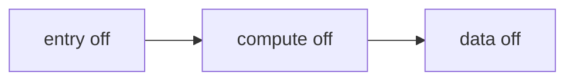

### 3.8 What "off" leaves behind

| Still there          | Costs                                    |
| -------------------- | ---------------------------------------- |
| VPC, subnets, routes | $0                                       |
| Security groups      | $0                                       |
| Budget alert         | $0                                       |
| ECR images           | cents per month (lifecycle policy keeps it small) |
| ACM certificate (if `domainName` is set) | $0 (public ACM certificates are free) |
| Jobs queue + DLQ, processed-jobs table, SES identities, worker ECR repo (S1c, section 3.10) | $0 while idle (billed per request / per email) |

### 3.9 Troubleshooting

**What it is.** Three places to look, in this order: the **stopped task reason**, the **service events**, and the **target health**.

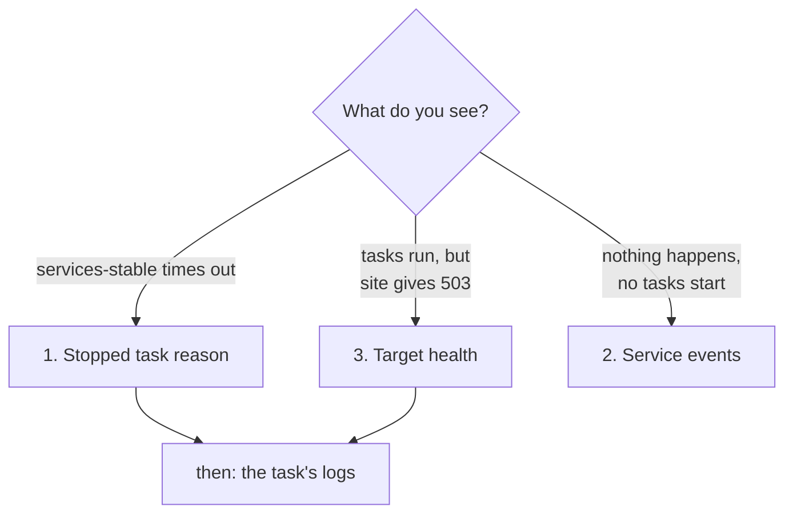

**1. Why did the last task stop?**

```bash
SVC=minitickets-dev-api   # or minitickets-dev-web
STOPPED=$(aws ecs list-tasks --cluster minitickets-dev --service-name "$SVC" --desired-status STOPPED --query 'taskArns[0]' --output text)
aws ecs describe-tasks --cluster minitickets-dev --tasks "$STOPPED" \
  --query 'tasks[0].{stoppedReason:stoppedReason,exitCode:containers[0].exitCode,containerReason:containers[0].reason}'
```

| Reason contains                                   | Usually means                                                              |
| ------------------------------------------------- | -------------------------------------------------------------------------- |
| `CannotPullContainerError ... not found`          | The tag in `Pulumi.dev.yaml` was never pushed. Check 3.1                    |
| `ResourceInitializationError: unable to pull secrets` | The execution role cannot read a secret ([17](17-infra-ecs-api.md), 3.5) |
| `Essential container in task exited`, exit code 1 | The app crashed at start: read its logs (often `Invalid environment variables`) |
| `Task failed container health checks`             | `/health` did not answer: read the logs                                   |
| `Task failed ELB health checks`                   | The ALB could not reach the task: see 3 below                             |
| `Your Spot Task was interrupted`                  | AWS took the Spot capacity back. The service starts a new task by itself  |
| `exec format error` in the logs                   | The image is not ARM64 ([16](16-infra-ecr.md))                            |

**2. What does the service say?**

```bash
aws ecs describe-services --cluster minitickets-dev --services minitickets-dev-api minitickets-dev-web \
  --query 'services[].{name:serviceName,running:runningCount,events:events[:5].message}'
```

The newest event is first. `has reached a steady state` is good. `unable to place a task` or `rolling back` tell you what ECS tried.

**3. Is each target healthy?**

```bash
for TG in $(aws elbv2 describe-target-groups \
  --query "TargetGroups[?starts_with(TargetGroupName,'minitickets-dev-')].TargetGroupArn" --output text); do
  aws elbv2 describe-target-health --target-group-arn "$TG" \
    --query 'TargetHealthDescriptions[].{port:Target.Port,state:TargetHealth.State,reason:TargetHealth.Reason}' --output text
done
```

`Target.Timeout` = the security group or `HOSTNAME` (web) is wrong. `Target.ResponseCodeMismatch` = the health check path answers, but not 200.

**What the browser shows, and where it comes from:**

| You see                                                     | From       | Usually means                                                                 |
| ----------------------------------------------------------- | ---------- | ----------------------------------------------------------------------------- |
| `502 ERROR. The request could not be satisfied`             | CloudFront | It cannot connect to the ALB: alb security group rule, or the listener is missing |
| `403 ERROR. The request could not be satisfied`             | CloudFront | That method is not allowed on that path (e.g. a POST to a page)              |
| Plain text `Forbidden`                                      | ALB        | The secret header did not match (e.g. CloudFront is still deploying a change) |
| `503 Service Temporarily Unavailable`                       | ALB        | No healthy target in that target group: see 3 above                          |
| `504`                                                       | CloudFront or ALB | The task answered too slowly                                           |
| Login "works" but you are logged out again at once          | browser    | You opened `http://<albDnsName>` or an `http://` address, not `appUrl`        |

**Path B: domain and certificate problems:**

| You see | Usually means |
| --- | --- |
| `pulumi up` fails at `cert-issued` after 10 minutes | The certificate is not ISSUED yet. `aws acm describe-certificate` (3.0b): still `PENDING_VALIDATION` = the record is missing or wrong (`dig` it; the name typed twice, `…theversehub.in.theversehub.in`, is the usual mistake). Fix it, wait for ISSUED, run `pulumi up` again: it continues |
| Certificate status `FAILED`, reason `CAA_ERROR` | `theversehub.in` has CAA records (lists of who may issue certificates) that do not include Amazon. Add a CAA record `0 issue "amazon.com"`. A FAILED certificate never retries: ask for a new one with `pulumi up --replace <urn>` (the URN of `minitickets-dev-cert`, from `pulumi stack --show-urns`), then add the NEW validation record it prints |
| Browser: "can't find server" / `Could not resolve host` | The `minitickets` CNAME is missing, still has last time's ALB name, or has not spread yet (`dig +short minitickets.theversehub.in`) |
| Connection times out on `https://minitickets…` | The alb security group does not let **you** in: `allowedCidrs` has an old IP of yours (`curl -s https://checkip.amazonaws.com`) |
| Browser: "Your connection is not private", `NET::ERR_CERT_COMMON_NAME_INVALID` | You opened the ALB's own name, or the CNAME points somewhere else. Only `https://<domainName>` is on the certificate |
| Browser refuses the site with **no** "continue anyway" button | HSTS: the browser saw `Strict-Transport-Security` before and now insists on a working https. Fix the certificate/DNS problem; the promise ends by itself after 1 day (max-age) |
| `curl` shows `x-cache` or `cloudfront` | You are on Path A (`cdnEnabled` is not `false`) |

### 3.10 The job pipeline: booking emails (S1c)

**What it is.** After a booking, the api puts a "booking confirmed" message on an SQS queue (a waiting line for messages) and answers the browser at once. A Lambda function (code AWS runs only when there is work) reads the queue in batches and sends the email through SES (Amazon's email service). A message that fails 3 times moves to a dead-letter queue (DLQ), where a person looks at it. CD deploys all of it; this section is the one-time setup and the checks. Code: `infra/src/jobs/`, `apps/worker/`.

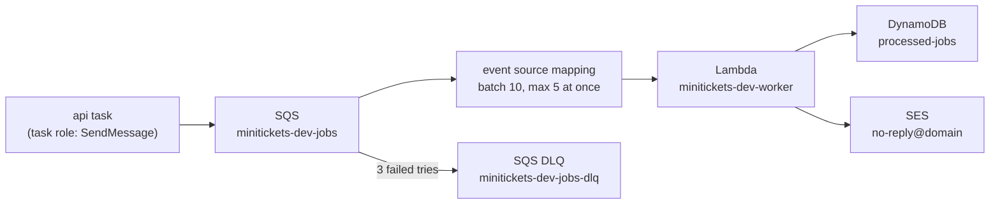

Real-life comparison: the shop takes your order and hands you a receipt at once; the order slip goes into a tray (the queue). A clerk in the back (the Lambda) works through the tray and posts the letters (SES). A slip that keeps failing goes into a "problems" box (the DLQ) for the manager.

**One time, before the first deploy that contains S1c.** In this order:

1. **Your address as the SES test recipient** (the SES "sandbox" only sends to verified addresses; `infra/src/jobs/email.ts` explains it). From `infra/`:

   ```bash
   pulumi config set --secret sesTestRecipient you@example.com
   git add Pulumi.dev.yaml && git commit -m "chore(infra): SES test recipient"
   ```

   **Expect:** `Pulumi.dev.yaml` gains `minitickets:sesTestRecipient: secure: …` (encrypted, safe to commit).

2. **Bootstrap the worker repository and the CD roles' new permissions** (a targeted `pulumi up`, only these 6 resources). WHY: CD's publish job pushes the worker image BEFORE the deploy job runs `pulumi up`, so the repository and the publish permission must exist first; and the deploy role needs its new permissions (SQS, DynamoDB, Lambda, SES) before it can create those. With the committed config, from `infra/`:

   ```bash
   pulumi up \
     --target 'urn:pulumi:dev::minitickets::aws:ecr/repository:Repository::minitickets-dev-worker' \
     --target 'urn:pulumi:dev::minitickets::aws:ecr/lifecyclePolicy:LifecyclePolicy::minitickets-dev-worker-lifecycle' \
     --target 'urn:pulumi:dev::minitickets::aws:ecr/repositoryPolicy:RepositoryPolicy::minitickets-dev-worker-lambda-pull' \
     --target 'urn:pulumi:dev::minitickets::aws:iam/role:Role::minitickets-dev-gh-publish' \
     --target 'urn:pulumi:dev::minitickets::aws:iam/rolePolicy:RolePolicy::minitickets-dev-gh-publish-ecr' \
     --target 'urn:pulumi:dev::minitickets::aws:iam/rolePolicy:RolePolicy::minitickets-dev-gh-deploy-policy'
   ```

   **Expect:** `+ 3 to create, ~ 3 to update`, nothing else; confirm with `yes`.

3. **Push, then approve the CD deploy.** **Expect** in the run: publish pushes 3 images (api, web, worker); the deploy's "Read the committed config" step says the current tag has no worker image, so phase A starts the worker with the new tag; "Wait for the services" ends with `minitickets-dev-worker runs …:<tag> (Active, Successful), queue trigger Enabled`.

4. **DKIM records at Cloudflare** (they prove to mail servers that SES may send for the domain):

   ```bash
   pulumi stack output sesDkimRecords
   ```

   Add the 3 CNAME records it lists, **DNS only** (grey cloud, not proxied). Then:

   ```bash
   aws sesv2 get-email-identity --email-identity minitickets.theversehub.in \
     --query '{dkim: DkimAttributes.Status, verified: VerifiedForSendingStatus}'
   ```

   **Expect:** `"dkim": "SUCCESS", "verified": true`. `PENDING` = SES has not seen the records yet (it checks by itself, usually within minutes, at most 72 hours).

5. **Click the link** in the email "Amazon Web Services – Email Address Verification Request" sent to your address. **Expect:** `aws sesv2 get-email-identity --email-identity you@example.com --query VerifiedForSendingStatus` says `true`.

**Verify (after every deploy that touches it).** Sign up in the app with **your verified address**, then book a ticket.

```bash
aws logs tail /minitickets/dev/api --since 5m | grep 'booking.confirmed'
aws logs tail /minitickets/dev/worker --since 5m
```

**Expect:** the api line `published booking.confirmed messageId=… bookingId=…`, then in the worker: `SES accepted email … to *@<your domain>: "Your booking is confirmed: …"` and `email sent [booking.confirmed:<bookingId>]`. The email arrives within seconds (check spam the first time).

```bash
cd infra
aws sqs get-queue-attributes --queue-url "$(pulumi stack output jobsQueueUrl)" \
  --attribute-names ApproximateNumberOfMessages ApproximateNumberOfMessagesNotVisible
aws sqs get-queue-attributes --queue-url "$(pulumi stack output jobsDlqUrl)" --attribute-names ApproximateNumberOfMessages
aws dynamodb get-item --table-name minitickets-dev-processed-jobs \
  --key '{"jobKey":{"S":"booking.confirmed:<bookingId>"}}'
```

**Expect:** both queues `"0"`; the item exists with `doneAt` and `expiresAt` (30 days ahead).

**The DLQ, live.** Book once with an account whose address is **not** verified. **Expect** in the worker log: 3 tries about 10 s and 40 s apart, each `failed: Email address is not verified…`; after ~3 minutes the DLQ count is `1`. Clear it: SQS console -> `minitickets-dev-jobs-dlq` -> **Start DLQ redrive** (it would just fail again while the address is unverified), or **Purge** it.

**Console tour.**

| Where | Look at | It shows |
| --- | --- | --- |
| **SQS** -> `minitickets-dev-jobs` | **Dead-letter queue** tab: the DLQ, max receives 3; **Encryption**: SSE-SQS; **Lambda triggers** tab: the worker, Enabled | queue + redrive |
| **SQS** -> `minitickets-dev-jobs-dlq` | **Monitoring**: messages; **Start DLQ redrive** button | where failures wait |
| **Lambda** -> `minitickets-dev-worker` | **Image**: `…/minitickets-dev-worker:<tag>`, arm64; **Configuration** -> General (256 MB, 10 s), Environment variables (`MAILER=ses`, `MAIL_FROM`), Triggers (batch 10, report batch item failures, max concurrency 5), Permissions (the role) | the function |
| **CloudWatch** -> Log groups -> `/minitickets/dev/worker` | one stream per Lambda instance; `REPORT` lines with duration and memory | the logs, 7 days |
| **DynamoDB** -> Tables -> `minitickets-dev-processed-jobs` | **Explore items**; **Additional settings**: TTL on `expiresAt`, on-demand | the "already done" memory |
| **SES** -> Identities | the domain (DKIM: Successful) and your address (Verified); **Account dashboard**: "sandbox", 200/day, 1/s | who may send |
| **ECR** -> `minitickets-dev-worker` | **Permissions**: the policy that lets `lambda.amazonaws.com` pull | the pull permission |
| **IAM** -> Roles -> `minitickets-dev-worker-role` | **Trust relationships**: `lambda.amazonaws.com`; **Permissions**: the inline policy `worker` (one queue, one table, SES from `no-reply@`, one log group) | least privilege |

**Troubleshooting.**

| You see | Usually means |
| --- | --- |
| Messages pile up in the queue, nothing in the worker log | The trigger is off or failing: `aws lambda list-event-source-mappings --function-name minitickets-dev-worker --query 'EventSourceMappings[].[State,StateTransitionReason,LastProcessingResult]'` |
| Worker log: `Email address is not verified. The following identities failed the check…: no-reply@…` | The DOMAIN is not verified yet: DKIM records missing or proxied (step 4) |
| Worker log: `Email address is not verified…: <someone>@…` | Sandbox: that recipient is not verified. Expected for every address except yours |
| Worker log: `not authorized to perform: ses:SendEmail on resource …identity/…` | The role's SES statement does not cover that identity (`infra/src/jobs/worker-iam.ts` 2c) |
| Lambda create/update fails: image manifest or media type "not supported" | The image was pushed with an attestation; it must be built with `provenance: false` (cd.yml 17b) |
| `Specified ReservedConcurrentExecutions … below its minimum value` | `workerReservedConcurrency` is set, but the account's Lambda quota is still 10 (`infra/src/jobs/worker-lambda.ts` 2e) |

**Cost.** Idle: about $0. SQS bills per request (first 1 million a month free, then about $0.40 per million), DynamoDB on demand per read/write, Lambda per millisecond, SES about $0.10 per 1,000 emails. One thing runs while compute is on: the trigger's pollers long-poll the queue all the time, and those receives count as SQS requests (watch the queue's `NumberOfEmptyReceives` metric in CloudWatch; expected to stay inside the free tier). Turning compute off removes the Lambda and its trigger; the queues, table and identities stay.

## 4. Dependency order

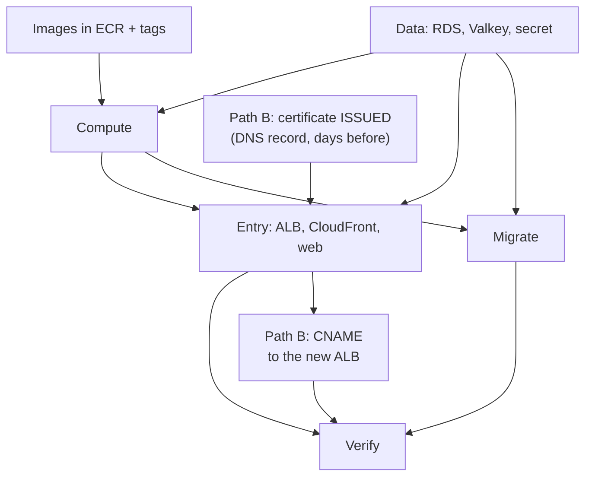

- **Images before compute:** a task definition points at a tag that must already exist in ECR.
- **Data before compute:** the api's task definition contains the database address and the secret ARNs.
- **Compute and entry together:** the program requires data + compute for entry; in one `pulumi up` Pulumi creates them in the right order by itself.
- **Migrate after compute:** the migration runs from the api task definition, in the cluster.
- **Verify last:** login needs the tables (migrate) and HTTPS (entry).
- **Path B: certificate before entry:** the HTTPS listener can only use an ISSUED certificate. **CNAME after entry:** the ALB's DNS name exists only once the ALB does, and is new every time.
- **Off in reverse:** entry, then compute, then data (or all at once).

## 5. What breaks if this is wrong or missing

| Mistake                                              | What happens                                                                |
| ---------------------------------------------------- | --------------------------------------------------------------------------- |
| Wrong `AWS_PROFILE`                                  | Everything is created in another account (or nothing works)                  |
| Uncommitted changes before `images:push`             | The script refuses: the tag would not describe the code                     |
| Tag set but not pushed                               | `CannotPullContainerError`; the circuit breaker gives up                    |
| Entry on before data and compute                     | Pulumi refuses with a clear error                                           |
| Skipping the migration                               | Pages load, but signup and login fail with a 500 (no tables)                |
| Testing at `http://<albDnsName>`                     | Times out: the ALB only answers CloudFront                                  |
| Closing the laptop during "off"                      | `pulumi up` stops halfway; run it again, it continues where it stopped      |
| Forgetting "off"                                     | About $2 a day for nothing; the budget alert emails you eventually          |
| Not reading the "off" preview                        | A wrong switch could delete or replace something you meant to keep        |
| Path B: certificate requested on deploy day          | `pulumi up` waits for ISSUED, gives up after 10 min; you pay for idle RDS meanwhile |
| Path B: validation record deleted later              | ACM cannot renew; the certificate expires about 13 months after issue and https breaks |
| Path B: forgot to update the `minitickets` CNAME     | The domain points at last deploy day's (deleted) ALB: "can't find server" |
| Changing `cdnEnabled` with entry on                  | `pulumi up` fails: "A listener already exists on this port" (both paths use port 80) |
| `TRUST_PROXY_HOPS` too high for the path             | Anyone can choose the IP the api logs (and later rate-limits) by sending X-Forwarded-For |

## 6. How this connects

**Uses from earlier layers:** everything.

- Network and security groups ([12](12-infra-network.md), [13](13-infra-security-groups.md)): always on, the base of it all.
- Data ([14](14-infra-data.md)): `dataEnabled`, 3.2.
- ECR and the push script ([16](16-infra-ecr.md)): 3.1.
- Compute and the migration script ([17](17-infra-ecs-api.md)): `computeEnabled`, 3.3, 3.4, ECS Exec.
- ALB and web ([18](18-infra-alb-web.md)): `entryEnabled`, target health, 3.5 i.
- CloudFront and origin protection ([19](19-infra-cloudfront.md)): `appUrl`, the blocked ALB, the cache, `trustProxy` (Path A).
- Service Connect (Step 11h, `infra/src/compute/service-connect.ts`): SSR `/events`, the revalidate hook, the one-time api restart, 3.3 and 3.5 j.
- Own domain without CloudFront (Step 11i, `infra/src/certificate.ts`, `infra/src/entry/https-listener.ts`): `cdnEnabled`, `domainName`, `allowedCidrs`, 3.0b, 3.3, 3.5 k (Path B).
- The e2e tests ([04](04-signup-form.md) to [09](09-dashboard.md)) with `E2E_BASE_URL`: 3.5 c.

**Used by later steps:** every later AWS step adds its own checks to this runbook, so there is always **one** page to follow on deploy day. A CI deploy (later) will automate steps 3.1 to 3.4.

See [00-architecture.md](00-architecture.md) for the whole picture.

## 7. Interview questions

1. **Why push images tagged with the git SHA and not `latest`?** A SHA names exactly one commit, so you always know what runs and can roll back to a known version. `latest` moves, and immutable repositories do not allow overwriting it anyway.
2. **Why create the data layer first, on its own?** It takes the longest (10-15 min) and everything else depends on it; doing it alone keeps failures easy to read.
3. **How do you run database migrations on ECS?** As a one-off task from the same task definition, with the command overridden, before using the new version; only that one process migrates.
4. **A service never becomes stable. Where do you look first?** The stopped task's `stoppedReason` and exit code, then the service events, then target health and the container logs.
5. **How do you prove the origin is protected?** Call the ALB directly from outside: it must time out (security group), while the CloudFront address works.
6. **How do you check that CloudFront caches what it should?** Request the same static file twice and look at `x-cache`: `Miss` then `Hit`. Pages and API calls must always be `Miss`.
7. **What is ECS Exec and what does it need?** A shell inside a running container through SSM. It needs `enableExecuteCommand` on the service, a task role with the `ssmmessages` permissions, and the Session Manager plugin on your laptop.
8. **Why turn dev infrastructure off every night?** Load balancers, databases and running tasks cost money every hour they exist, even with no users. Infrastructure as code makes "off" and "on" one command each.
9. **What does ACM's DNS validation prove, and why create the certificate days early?** That you control the domain's DNS (only you can add the record ACM asks for). Validation waits for you and for DNS, so it is done before the meter runs; ACM then renews by itself while the record stays.
10. **Why must the trusted proxy count match the path exactly?** Each of our proxies appends the address it saw to X-Forwarded-For. Trusting one hop too many reads an address the client wrote itself, so anyone can fake their IP. With only an ALB in front that number is 1, with CloudFront + ALB it is 2.

## 8. Check yourself

1. `aws ecs wait services-stable` fails. The stopped reason says `Task failed ELB health checks` for web, but the web logs show `✓ Ready`. Which two settings do you check, and in which docs?
2. During 3.5 d, `curl` to the ALB returns `200` instantly instead of timing out. What does that tell you about the alb security group, and what would you check in `pulumi preview`?
3. The "off" preview shows `+-1 to replace` on a security group. Should you run `pulumi up`? What would you do instead?
