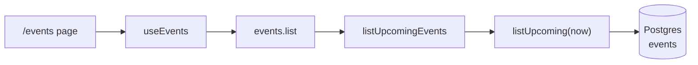
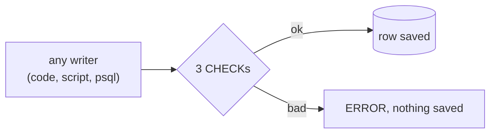
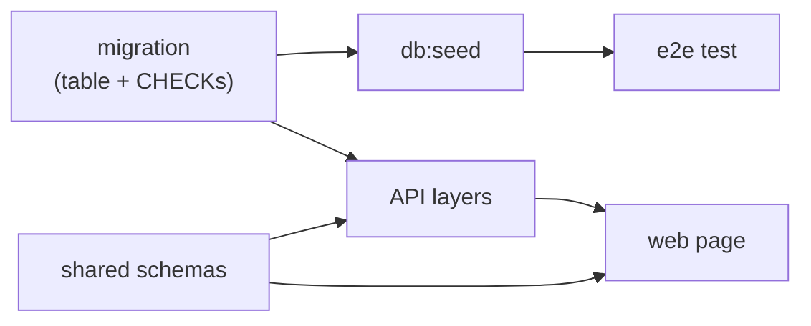

# Step 21: Events list (read path baseline)

## 1. In one sentence

This step adds a public `/events` page that lists upcoming events from a new `events` table, with
**no caching at all**, so later steps (an index, a cache, server rendering) can be measured against it.

## 2. The big picture



Each layer only calls the one below it. A "layer" is just a folder with one job.

## 3. The concepts

### The events table and CHECK constraints

A **CHECK constraint** is a rule inside the table. Postgres tests it on every insert and update.
Ours: `total_seats > 0`, `seats_left >= 0`, `seats_left <= total_seats`.



Why: the database is the last guard. If a bug in the code ever sets `seats_left` to 11 of 10, the
database says no. Real-life picture: a turnstile that checks every ticket, whichever door you use.
Proof, run in psql (output copied from our machine):

```
insert into events (title,venue,starts_at,total_seats,seats_left) values ('Bad','X',now(),10,11);
ERROR:  new row for relation "events" violates check constraint "events_seats_left_within_total"
```

There is **no index** besides the primary key on purpose. A later step adds one and compares the
`EXPLAIN` output before and after.

The table is in `apps/api/src/db/schema/events.ts`. The migration was made with
`pnpm --filter @minitickets/api db:generate` (never `push`) and is `apps/api/drizzle/0001_salty_shard.sql`.

### Seed data

**Seed data** is sample rows put into a fresh database by a script. Run it after the migrations:

```bash
pnpm db:up
pnpm --filter @minitickets/api db:migrate
pnpm --filter @minitickets/api db:seed     # 12 events: 3 past, 9 upcoming, 2 sold out (1 past, 1 upcoming)
```

The ids are fixed and the insert says `on conflict do nothing`, so running it twice is safe: the
first run printed `12 new events, 0 already there`, the second `0 new events, 12 already there`.
Dates are "days from now"; they are set when the row is first created, so after about 40 days
empty the `events` table (`truncate events`) and seed again. The CI e2e job runs the seed after the
migrations. The seed is a laptop and CI tool: it is not in the production image.

### The API: three layers

- `queries/events.ts` → `listUpcoming(now)`: `starts_at > now`, oldest first, `limit 50`. The only code that runs SQL.
- `services/events.ts` → `listUpcomingEvents()`: decides that "upcoming" means "after right now" and turns dates into ISO text.
- `procedures/events.ts` → `events.list`: a **public** query (no login), no input, and `.output(ListEventsOutput)` so only the public fields leave.

The shared schemas `EventSchema` and `ListEventsOutput` are in `packages/shared`.

### The web: client-side rendering (CSR)

With **CSR** the browser gets the page frame first and then fetches the data. That is what
`/events` does, on purpose, so we can compare with server rendering later. `curl localhost:3000/events`
returns the loading skeleton and none of the event titles.

- `app/events/page.tsx` is thin: heading + `<EventList />`.
- `features/events/hooks/use-events.ts` → `useEvents`: the only place that calls tRPC.
- `event-list.tsx`: loading skeleton, "No upcoming events", an error message with a **Retry** button.
- `event-card.tsx`: title, date, venue, seats left, and a **Sold out** badge when `seatsLeft` is 0.
- Dates: the database stores time in UTC. `Intl.DateTimeFormat` shows it in the viewer's own timezone.
- The header has a new **Events** link.

## 4. Dependency order



## 5. What breaks if this is wrong or missing

- Migration not applied: the api returns an error and the page shows "Something went wrong" with Retry.
- Seed not run: "No upcoming events", and `e2e/events.spec.ts` fails.
- A CHECK removed: bad seat counts can be saved.
- `.output(...)` removed: any new column (for example a future internal one) would leave the API.

## 6. Baseline measurement: no cache

Measured locally. The API ran from this code on port 4010 (a separate instance), against local
Postgres in Docker with the 12 seeded events. I called `GET /trpc/events.list` 10 times with `curl`
and read `responseTime` from Fastify's request log.

| Call | 1 | 2 | 3 | 4 | 5 | 6 | 7 | 8 | 9 | 10 |
| --- | - | - | - | - | - | - | - | - | - | - |
| responseTime (ms) | 23.8 | 2.0 | 2.2 | 1.3 | 1.6 | 1.8 | 3.2 | 1.5 | 1.8 | 3.3 |

**Baseline, no cache: about 1.8 ms typical (median of calls 2-10; range 1.3 to 3.3 ms). The first call took 23.8 ms because the connection pool was cold.**

What this does and does not tell us: it is the time inside the API only (not the browser or the
network), on a laptop, with 12 rows and no load. It will look much better than a real deployment, so
only compare it with numbers measured the same way.

## 7. How this connects

Uses from earlier steps: the Postgres container and migrations ([05](05-database.md)), the
procedure → service → query layers and the hook-per-feature pattern ([09](09-dashboard.md)), the
tRPC client and TanStack Query ([04](04-signup-form.md)), the CI e2e job ([10](10-ci.md)).
Later steps will use this: an index on `starts_at` (measured with `EXPLAIN`), a cache in front of the
query, server rendering of the page, and booking (which changes `seats_left`, guarded by the CHECKs).
On AWS, the new migration must be run (`pnpm infra:migrate`, see [20](20-deploy-day.md)); the page will say "No upcoming events" there because the seed is not part of the deploy.

Handbook: [app story 10b](handbook/app-story.md#10b-reading-events), cards
[csr-vs-ssr](handbook/concepts/csr-vs-ssr.md), [db-check-constraints](handbook/concepts/db-check-constraints.md),
[seed-data](handbook/concepts/seed-data.md).

## 8. Interview questions

1. **What is a CHECK constraint and why use one when the app already validates?** A rule in the table that Postgres enforces for every writer. The app is one door; scripts and humans use others.
2. **Why is the seed safe to run twice?** Fixed ids and `on conflict do nothing`: existing rows are skipped.
3. **What does `/events` being client-side rendered mean?** The server sends a frame and skeleton; the browser fetches the events afterwards.
4. **Why store time in UTC and format in the browser?** One unambiguous moment in the database; each viewer sees their own timezone.
5. **Why `limit 50`?** A cap so one request cannot return an unbounded list.
6. **Why pass `now` into the query?** The service decides what "upcoming" means; tests can fix the clock.
7. **Why record a baseline before optimising?** Without a "before" number you cannot show an index or a cache helped.
8. **Why is `events.list` a public procedure?** Browsing events needs no account; only the output fields are exposed.

## 9. Check yourself

1. What happens if you insert an event with `seats_left` larger than `total_seats`, and which layer stops it?
2. Why does the page HTML from the server contain no event titles?
3. What would you compare, and how, after adding an index on `starts_at`?
