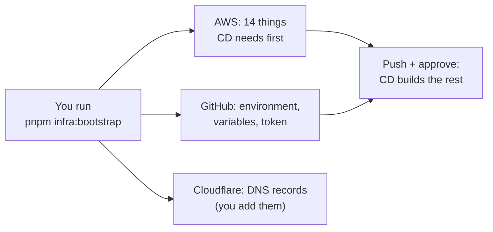

# Set up MiniTickets in a new AWS account

One command does the setup, and this page is the checklist that goes with it. Use it for a new
AWS account, or for a second copy of MiniTickets (a new **stack**).

A **stack** is one copy of the infrastructure, with its own name, for example `dev` or `prod`.
Every AWS name comes from the stack name: stack `prod` gets `minitickets-prod-api`,
`/minitickets/prod/image-tag`, and the GitHub environment `prod`
([infra/src/names.ts](../infra/src/names.ts)).



## Before you start

- [ ] **An AWS account** you can log in to as an admin user (not the root user).
- [ ] **MFA** is on for the root user and for your admin user (IAM -> Users -> Security credentials).
- [ ] **An AWS CLI profile** for that account, in `~/.aws/config`, for example `newacct`.
      Check it: `aws sts get-caller-identity --profile newacct` prints the right account number.
- [ ] **Pulumi** is logged in: `pulumi whoami` prints your user.
- [ ] **GitHub CLI** is logged in: `gh auth status` says "Logged in".
- [ ] **dig** and **git** work (`dig -v`, `git --version`; both come with macOS).
- [ ] **A domain at Cloudflare** that you can add records to, for example `minitickets.example.com`.
- [ ] **A Pulumi access token** ready to paste: app.pulumi.com -> your avatar -> Personal access
      tokens -> Create token. (Skip it if the repo already has the secret `PULUMI_ACCESS_TOKEN`.)

## The command

Try it first without changing anything:

```bash
pnpm infra:bootstrap --stack prod --profile newacct --dry-run
```

Then run it for real (it asks before every change):

```bash
pnpm infra:bootstrap --stack prod --profile newacct
```

`--region eu-west-1` picks the region. Without it, the script uses the stack's region, or else the
profile's region, or else it asks.

## What each step does, and why

1. **AWS account and region.** It shows the account number and the region, then asks "right
   account?". *Why:* a wrong profile would build everything in the wrong account. It also looks for
   another MiniTickets stack in the account. If it finds one, it explains what the two would share
   and asks you to type the stack name again.
2. **Pulumi stack and config.** It creates the stack if it is new, then asks only for what is
   missing: the domain, the alert email and the SES test address (both hidden while you type). It
   reads the GitHub OIDC subject itself, and it sets the four switches (`dataEnabled`,
   `computeEnabled`, `entryEnabled`, `cdnEnabled`) to `false`. *Why:* nothing that costs money by
   the hour exists yet. Values that are already set are never changed.
3. **What CD needs first.** CD can build almost everything, but not the things it needs in order to
   *start*: the GitHub login (OIDC provider), the two roles, the three image repositories and the two
   SSM notes. The script previews exactly those 14, shows the counts, asks "Apply?", then runs
   `pulumi up` for only those. *Why:* the rest comes from CD, after your approval, like every later
   deploy. If the account already has a GitHub OIDC provider, the script **imports** it, because
   AWS allows only one per account.
4. **GitHub.** It creates the environment named after the stack, with you as the required
   reviewer. Then it sets the variables `cd.yml` reads (role ARNs, repository names, SSM names) and
   asks you to paste the Pulumi token (hidden). It shows the full list and asks once.
   *Why:* `cd.yml` has no names written into it; it reads them all from these variables.
5. **DNS.** It prints the certificate record and the 3 SES DKIM records in Cloudflare's format
   (name without the domain, **DNS only**). Then it checks them every 60 s until they are live.
   *Why:* our DNS is not in AWS, so nobody but you can add them. Before the first deploy there are
   no records yet; rerun after it.
6. **Checks.** It checks the SES status, the alert email confirmation, the Lambda limit and
   CloudFront, and says exactly what to click for each.
7. **Next steps.** It tells you what to commit, push and approve.

## By hand (the script cannot do these)

- [ ] **Commit** `infra/Pulumi.<stack>.yaml`. CD uses the committed file. The secrets in it are
      encrypted.
- [ ] **Push**, then go to Actions -> CD -> the run -> **Review deployments** -> your environment ->
      **Approve**. With all switches off, this creates the parts that are always on (network, queues,
      certificate, SES, alarms).
- [ ] **Rerun the bootstrap.** Now it prints the DNS records. Add each one at Cloudflare as
      **DNS only** (grey cloud).
- [ ] **Click the two emails**: "Email Address Verification Request" (SES) and "Subscription
      Confirmation" (alerts).
- [ ] **Lambda limit**: a new account often gets 10. Ask for 1000: Service Quotas -> AWS Lambda ->
      Concurrent executions -> Request increase.
- [ ] **SES production access** (only for emails to real visitors): SES -> Account dashboard ->
      Request production access.
- [ ] **CloudFront** (only if you set `cdnEnabled` true): a new account may be refused until AWS
      verifies it. Then open a case in the AWS Support Center.
- [ ] **Go live**: set the three switches to `true` in the stack file, then commit, push and approve.
      Then point the CNAME for your domain at the new ALB (`pulumi stack output appDnsRecord`, or the
      deploy summary), **DNS only**.

## Stopped halfway? Run it again

The script looks first and only adds what is missing. After Ctrl+C, an error or a DNS record that
is not live yet, run **the same command** again. Steps that are done show `✓` and are skipped.
While it waits for DNS, Ctrl+C stops only the waiting; the checks still run.

**One repo, one account for images.** The publish job has no environment, so it reads the *repo*
variables. Those point at one account. If you move them to a new account, the old stack gets no
new images. The script warns you before it changes them.

See also: [20. Deploy day](20-deploy-day.md) (turning the stack on and off),
[`scripts/infra-bootstrap.ts`](../scripts/infra-bootstrap.ts) (the script, step by step).
