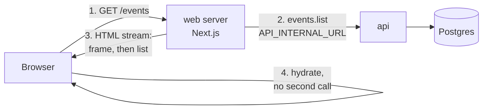
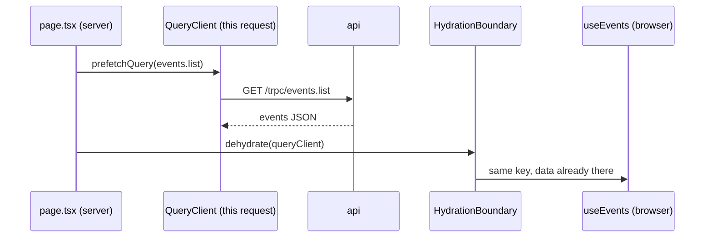
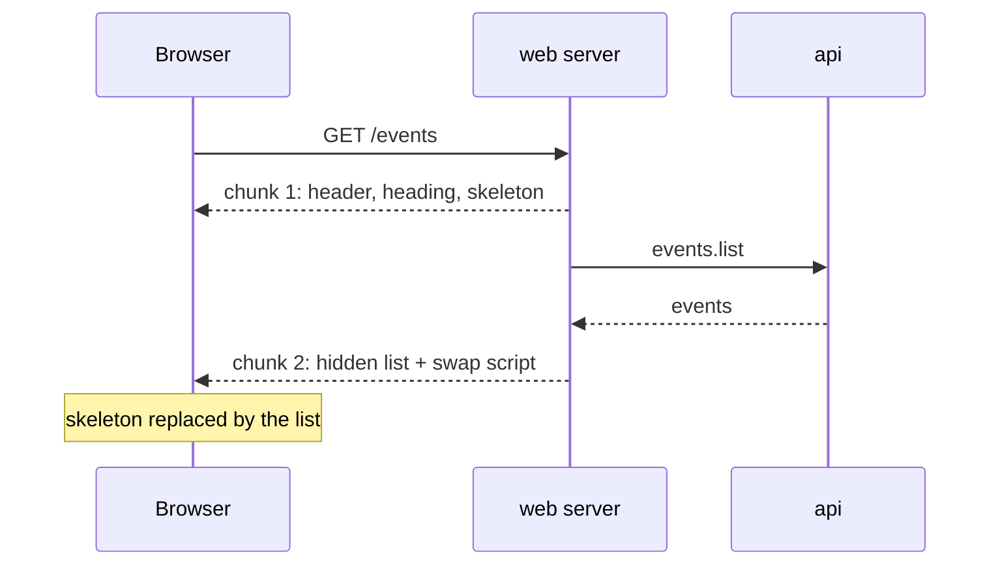
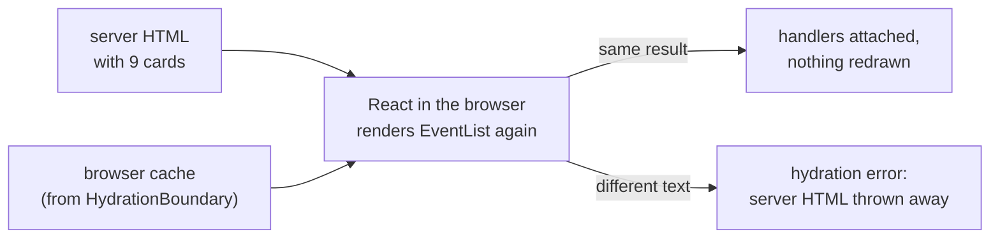
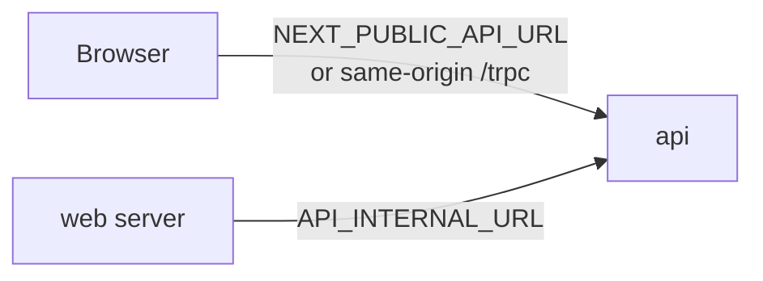
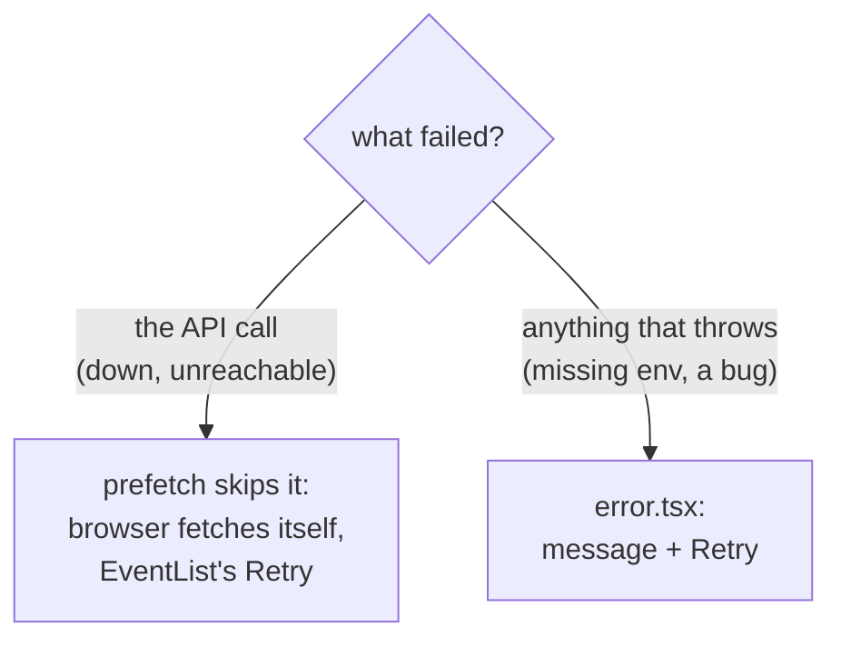
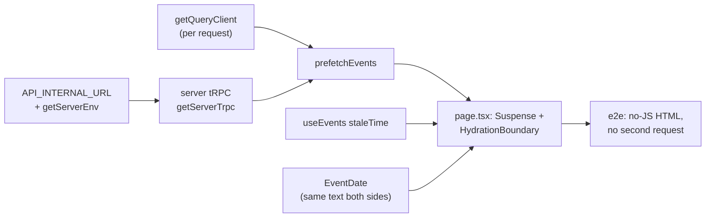
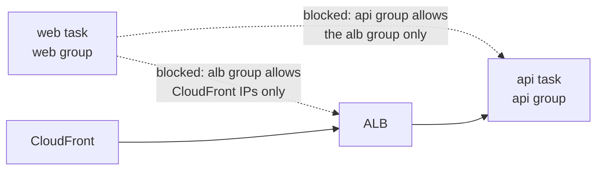
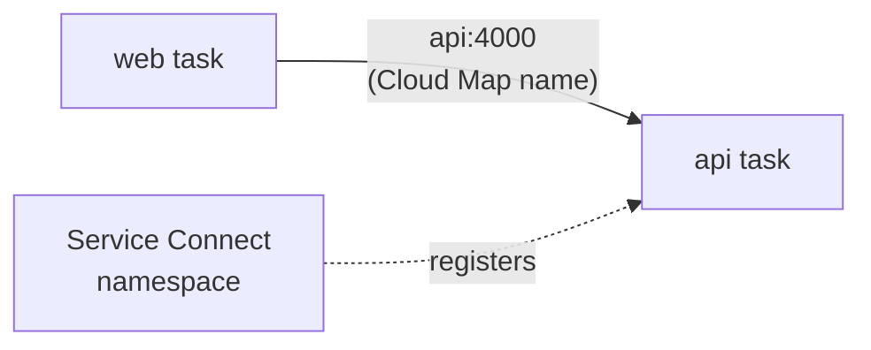

# Step 22: Events page rendered on the server, with streaming

## 1. In one sentence

`/events` now fetches the events **on the web server** and sends them inside the first HTML
response (server-side rendering), streaming the page frame first and the list a moment later, and
the browser reuses that data instead of asking the API again.

## 2. The big picture

Before (Step 21, client-side rendering) the browser needed two round trips: one for the page, one
for the data. Now the web server makes the data call itself, close to the API, and the browser gets
one response that already contains the events.



Words used here:

- **Server-side rendering (SSR):** the server builds the HTML with the data already in it.
- **Client-side rendering (CSR):** the server sends an empty frame; the browser fetches the data and
  builds the page. That is what Step 21 did.
- **Streaming:** sending one HTTP response in pieces. The first piece goes out before the last one
  is ready.
- **Hydration:** React, in the browser, takes the HTML the server made and connects it to the
  JavaScript (state, click handlers), without drawing it again.

## 3. The concepts

### 3.1 Prefetch on the server, hand over the cache

**What it is.** The page is a Server Component (it runs only on the server). Before it renders the
list, it asks the API for `events.list` and puts the answer into a TanStack Query cache, the same
kind of cache the browser uses. Then it turns that cache into plain JSON ("dehydrate", like
freeze-drying food for transport) and sends it along with the HTML. In the browser,
`HydrationBoundary` puts the JSON back into the browser's cache ("hydrate", adding water again).



The pieces, and where they live:

| Piece | File | What it does |
| ----- | ---- | ------------ |
| `getQueryClient` | `apps/web/src/lib/trpc/server.ts` | One `QueryClient` **per request** (React's `cache()`), never shared between visitors |
| `getServerTrpc` | `apps/web/src/lib/trpc/server.ts` | A typed tRPC helper for the server. Same query keys as the browser's `useTRPC()` |
| `prefetchEvents` | `apps/web/src/features/events/server/prefetch-events.ts` | `prefetchQuery` + `dehydrate`: the server-side twin of `useEvents` |
| `EventListWithServerData` | `apps/web/src/app/events/page.tsx` | Awaits `prefetchEvents()`, wraps `<EventList />` in `<HydrationBoundary>` |
| `useEvents` | `apps/web/src/features/events/hooks/use-events.ts` | Unchanged call, plus `staleTime: 30_000` (see 3.3) |

**Why we need it.** The events are in the first HTML. Search engines and link previews see them,
and the browser does not have to wait for a second round trip before it can show content.

`prefetchQuery` never throws. If the API call fails, the query is simply not included, and the
browser fetches the list itself, exactly like Step 21. The old client-side path is the safety net.
`prefetchEvents` logs the failure (`prefetchEvents: events.list failed on the server …`), otherwise
nobody would notice the slower fallback.

### 3.2 Streaming with `<Suspense>`

**What it is.** `<Suspense fallback={<EventListSkeleton />}>` marks the part of the page that may
have to wait. React sends everything outside it (header, heading, footer) at once, with the skeleton
in the list's place. When the data is ready, the server sends the finished list **in the same
response**, plus a tiny inline script that swaps it in. Real-life picture: the waiter brings bread
and water as soon as you sit down, and the main course when the kitchen is done. One visit to your
table, not two.



We watched the chunks arrive with a small script that reads the response as a stream (the method
from the Next.js streaming guide). With a normal API (about 2 ms):

```
chunk 0 (+21.9 ms) 10422 bytes: heading, skeleton
chunk 1 (+22.3 ms)  2531 bytes: event titles
chunk 2 (+23.1 ms)  4866 bytes: event titles, hidden S:0 (streamed list)
```

With the API made 500 ms slower on purpose (a delay proxy between web and API):

```
chunk 0 (+22.2 ms)  10422 bytes: heading, skeleton
chunk 1 (+530.4 ms)  2531 bytes: event titles
chunk 2 (+531.0 ms)  4866 bytes: event titles, hidden S:0 (streamed list)
```

**Why we need it.** Without streaming, the server could not send a single byte until the API
answered, so a slow API would make the whole page look dead. With it, the frame appears at once and
only the list waits.

The existing skeleton moved into its own file, `event-list-skeleton.tsx`, because two places use it
now: the `<Suspense>` fallback and `EventList`'s loading state (when the browser fetches by itself).

**A surprise with JavaScript turned off.** The streamed list arrives in a `<div hidden>`, and the
swap script needs JavaScript. A visitor without JavaScript therefore sees the skeleton, even though
the titles are in the HTML. Next.js handles bots differently: for known "HTML-limited" bots (for
example `Twitterbot`, `Slackbot`, `Bingbot`) it waits for the page metadata before streaming, so the
title is in `<head>` for link previews. Our e2e test checks that the titles are *in the page*
(`toBeAttached`), not that they are *visible*, for this reason.

### 3.3 Hydration, and two traps it brings

**What it is.** `EventList` is still a Client Component. On the server it renders to HTML with the
prefetched data. In the browser React hydrates it: it renders the same component again, checks that
the result matches the server's HTML, and attaches the event handlers.



**Trap 1: the browser re-fetches anyway.** TanStack Query treats data as "stale" (old) the moment
it arrives (`staleTime` 0 by default) and re-fetches stale data when a component mounts. The
server's data is milliseconds old, but the browser would still ask for it again. So `useEvents` now
sets `staleTime: 30_000` (30 seconds). We proved this matters: with `staleTime` removed, the new
e2e test failed because the browser sent `GET /trpc/events.list`.

**Trap 2: dates.** Step 21 formatted dates with the viewer's timezone. On the server that would be
the *server's* timezone (UTC on AWS), so the server HTML would say 6:30 PM and a browser in Chicago
12:30 PM. React would see the difference and throw the server HTML away. The new `EventDate`
component (`event-date.tsx`) renders one fixed format, in UTC with "UTC" written after it, on the
server and during hydration, then switches to the viewer's timezone right after. It uses
`useSyncExternalStore`, React's tool for "a value that differs between server and browser". On our
machine the first HTML says `Thursday, November 26, 2026 at 6:30 PM UTC` and the hydrated page says
`Thursday, November 26, 2026 at 12:30 PM`.

**Why we need it.** Hydration is what makes server HTML interactive without drawing it twice. If the
two renders differ, or if the browser fetches again, we pay for SSR and lose its benefits.

### 3.4 Server-to-server calls: `API_INTERNAL_URL`

**What it is.** A new setting that only the web *server* reads: where to reach the API from inside
the server. The browser keeps using `NEXT_PUBLIC_API_URL` (or the same origin's `/trpc` on AWS).



Real-life picture: customers use the front entrance; staff use the corridor behind the counters.
Same building, different door.

| Where | `NEXT_PUBLIC_API_URL` (browser) | `API_INTERNAL_URL` (web server) |
| ----- | ------------------------------- | ------------------------------- |
| `pnpm dev` | `http://localhost:4000` | `http://localhost:4000` |
| docker compose | `http://localhost:4100` (published port) | `http://api:4000` (service name) |
| CI e2e job | `http://localhost:4000` | `http://localhost:4000` |
| AWS | empty (same origin) | **not set yet** (see section 7) |

It is checked with Zod in `apps/web/src/lib/server-env.ts` (`getServerEnv`), the first time a page
needs it, not when the file is imported. WHY: `next build` imports every page, and the Docker image is
built without run-time settings. It has no `NEXT_PUBLIC_` prefix, so it never ends up in browser
JavaScript. The web package now depends on `zod` (the same version the other packages use).

**Why we need it.** The web server is not a browser: it cannot use a relative URL like `/trpc`, and
the address that works for the browser (for example `localhost:4100` in docker compose) is often
wrong from inside the server.

### 3.5 Errors: two safety nets

**What it is.** `app/events/error.tsx` is an error boundary: Next.js wraps the page in it, and if
anything throws while the page renders, it shows "Something went wrong while loading the events"
with a **Retry** button (`retry()` asks the server to render the page again). In production the
message from a Server Component is hidden; `error.digest` is an id that matches the full error in
the web server's log.



Both were checked by hand, in headless Chromium, on a separate server (port 3110):

- `API_INTERNAL_URL=http://localhost:4119` (nothing listens there): the HTML had no titles, the web
  server logged `prefetchEvents: events.list failed on the server … ECONNREFUSED`, the browser sent
  `GET /trpc/events.list` itself, and all 9 events appeared. No console errors.
- `API_INTERNAL_URL` not set: the page showed the error boundary with `Error id: 3224816531`; the
  web server logged `Invalid web server environment: {"API_INTERNAL_URL":[…]}`. Clicking Retry made
  the server render again (and fail again, as expected).

**Why we need it.** Without a boundary, an error thrown mid-stream leaves a half-drawn page. With it,
the user always gets a message and a way out.

### 3.6 The page stays dynamic

`export const dynamic = "force-dynamic"` makes Next.js render `/events` on every request. No Next.js
data cache, no `"use cache"`. The build output shows the change: `○ /events` (static, made at build
time) in Step 21 became `ƒ /events` (rendered on demand). This step only changes *where* the page is
rendered, so the comparison stays fair. Caching comes in later steps. `generateMetadata` sets the tab
title to "Upcoming events" (shown as "Upcoming events | MiniTickets" through the layout's template).

## 4. Dependency order



The API needs no change: the web server calls the same public `events.list` the browser calls.

## 5. What breaks if this is wrong or missing

- `API_INTERNAL_URL` missing: `/events` shows the error boundary (every other page still works).
  **This includes AWS today**: the web task definition does not set it (section 7).
- `API_INTERNAL_URL` wrong or API down: the page still works, but slower (CSR fallback), and the
  web server logs `prefetchEvents: events.list failed on the server`.
- `staleTime` removed: the browser asks for the list again right after hydration (the e2e test
  catches this).
- Dates formatted with the machine's timezone on both sides: hydration errors whenever server and
  visitor are in different timezones.
- One global `QueryClient` on the server instead of `cache()`: one visitor's data could be served to
  another (with private data, a data leak).
- `<Suspense>` removed: the server waits for the API before sending any byte, so a slow API means a
  blank page.
- `force-dynamic` removed: Next.js would try to render `/events` once at build time, calling the API
  during `next build`.

## 6. Measurements: CSR vs SSR

**How we measured.** Production builds only (`next build` + `next start`). Never measure in dev
mode (`pnpm dev`): it compiles pages on the fly, adds debugging code and skips optimisations, so its
numbers are meaningless. Both versions ran on the same laptop against our own API instance on port
4110 with the 12 seeded events (web on port 3110, so the owner's dev servers were not touched).

- HTML: `curl -s localhost:3110/events` and look for the seeded titles.
- TTFB (time to first byte: how long until the first byte of the response arrives): 2 warm-up
  requests, then 20 with `curl -w "%{time_starttransfer}"`, median.
- Lighthouse 13.5.0 CLI, default mobile preset (simulated slow 4G and a slower CPU), performance
  category only, 3 runs, median. LCP (Largest Contentful Paint) is when the biggest text block or image
  on screen was drawn.

| | CSR (Step 21) | SSR + streaming (Step 22) |
| --- | --- | --- |
| Event titles in the raw HTML | **no** (0 of 3 checked titles; skeleton only) | **yes** (3 of 3) |
| TTFB, median of 20 | **0.6 ms** (0.5 to 0.7) | **2.1 ms** (1.6 to 3.2) |
| Lighthouse LCP, median of 3 | **3012 ms** (runs: 3025, 3012, 2452) | **2457 ms** (runs: 2460, 1953, 2457) |
| Lighthouse performance score, median of 3 | **93** (93, 93, 96) | **98** (98, 98, 98) |
| Lighthouse CLS (layout shift), median of 3 | 0.084 (all 3 runs) | 0 (runs: 0, 0.084, 0) |
| `events.list` requests from the browser | 1 (batched with `auth.me`) | 0 (only `auth.me`) |

**What the results mean, honestly.**

- **The clear win is the HTML.** The events are in the first response. Crawlers, link previews and
  the browser all get content without a second round trip, and the browser makes one request fewer.
- **TTFB got worse: 0.6 ms → 2.1 ms.** In Step 21 `/events` was a static file made at build time
  (`○`), so the server only had to send it. Now the server renders it on every request (`ƒ`). Both
  numbers are tiny on a laptop, but the direction is real and it grows with load: every visitor now
  costs the web server a render and the API a database read.
- **Streaming stops TTFB from waiting for data.** With the API 500 ms slower, TTFB stayed at about
  6 ms (median of 5 `curl` runs: 4.4 to 6.9 ms) while the full response took about 513 ms. The
  frame arrives at once; only the list waits. We did not build a non-streaming version to compare
  against, so we do not quote a number for it.
- **LCP: read it carefully.** The LCP element is the heading "Upcoming events" in *every* run, CSR
  and SSR, because it is the biggest text block on screen; the event cards' text is smaller. Without
  throttling, Lighthouse observed the heading drawn at 37 to 328 ms (CSR) and 40 to 53 ms (SSR), and
  observed LCP equalled first paint in all six runs. The 3012 → 2457 ms change is Lighthouse's
  *simulated* mobile number, and one CSR run also gave 2452 ms. So do not read it as "the events
  appear half a second sooner".
- **Layout shift (CLS) improved.** In CSR the 3-card skeleton is always replaced by 9 real cards,
  which pushes the footer down (Lighthouse names the footer as the moving element). In SSR the list
  usually arrives before the first paint, so nothing moves. In 1 of 3 runs the browser drew the
  skeleton first and the same shift happened. The score went from 93 to 98 mostly because of LCP
  and CLS.
- **Lighthouse is treated as a bot by Next.js.** Its user agent contains `Chrome-Lighthouse`,
  which is on Next.js's list of "HTML-limited bots". We checked with the stream script: Lighthouse
  still gets the frame first and the list after (2 chunks instead of 3), because in our setup the
  bot rule only holds back the metadata.
- **The `next start` warning.** `next start` prints that it "does not work with output: standalone".
  It served the pages normally in both runs; the Docker image uses `node server.js` instead. Same
  setup for both measurements, so the comparison is fair.

## 7. AWS: not done yet (🟡)

On AWS the web task **cannot** reach the API through our load balancer. The ALB's security group
lets in only CloudFront's IP ranges, and the listener answers 403 without CloudFront's secret
`X-Origin-Verify` header ([19](19-infra-cloudfront.md)). The api's security group lets in only the
ALB (rule `api-in-4000`), not the web group ([13](13-infra-security-groups.md)). And the web task
definition does not set `API_INTERNAL_URL` yet.

**So until an infra step fixes this, deploying this web image would show the error page on
`/events` on AWS.** All paid layers are off right now, so nothing is broken today. "SSR on AWS" is
🟡 until that step.



The options:

| Option | How the web server reaches the API | Pros | Cons |
| ------ | ---------------------------------- | ---- | ---- |
| **ECS Service Connect / Cloud Map** (planned) | a private name like `http://api:4000` inside the VPC; one new rule: api group allows the web group on 4000 | short path, stays inside the VPC, no new load balancer to pay for | more ECS settings (a namespace, port names); new to learn |
| Internal ALB | a second load balancer, private, in front of the api | familiar ALB health checks and routing | about the price of another ALB every hour; one more hop |
| The API's public URL | `https://<id>.cloudfront.net/trpc`, out to the internet and back in | works with today's infra, only `API_INTERNAL_URL` to set | slowest path, leaves the VPC, pays CloudFront requests, counts against the public edge |



Service Connect is the planned choice (card: [service-connect](handbook/concepts/service-connect.md)).
Real-life picture: an internal phone directory. Instead of calling the company's public number
and going through reception, staff dial the extension.

## 8. Tests

`apps/web/e2e/events.spec.ts`:

- **Kept, unchanged:** "/events shows upcoming seeded events, not past ones, and the sold out badge".
- **New, JavaScript disabled:** loads `/events` with `javaScriptEnabled: false` and checks that the
  response HTML contains the titles and the heading element exists. Nothing can fetch in the
  browser, so this proves the server rendered them.
- **New, no second request:** records every request the browser sends, waits for the header's
  `auth.me` (sent after hydration), and checks that no URL contains `events.list`.
- **Removed:** "a failing API shows the error message and a Retry button that recovers". It made
  the *browser's* `events.list` call fail with `page.route()`, but the browser no longer makes that
  call, and Playwright cannot touch the web server's call to the API. Both failure paths were
  checked by hand instead (section 3.5). `EventList`'s Retry button still exists for the fallback.

All 12 e2e tests passed against a production build on ports 3110/4110.

## 9. How this connects

Uses from earlier steps: the events list, hook and baseline ([21](21-events-list.md)); TanStack Query
and the tRPC client ([04](04-signup-form.md)); Server vs Client Components ([03](03-landing.md));
config validation with Zod ([01](01-setup.md)); docker compose and the web image ([11](11-docker.md));
the CI e2e job ([10](10-ci.md)); the security groups and origin protection that block the web task
today ([13](13-infra-security-groups.md), [19](19-infra-cloudfront.md)).

Later steps will use this: an infra step adds Service Connect and `API_INTERNAL_URL` to the web task
(then "SSR on AWS" becomes ✅); caching steps can cache the server's `events.list` call or the
rendered page, measured against both rows of the table above; a private page could prefetch too, by
forwarding the visitor's `sid` cookie on purpose.

Handbook: [app story 10b](handbook/app-story.md#10b-reading-events), cards
[csr-vs-ssr](handbook/concepts/csr-vs-ssr.md), [streaming-suspense](handbook/concepts/streaming-suspense.md),
[hydration](handbook/concepts/hydration.md), [server-to-server-calls](handbook/concepts/server-to-server-calls.md),
[service-connect](handbook/concepts/service-connect.md), [server-client-components](handbook/concepts/server-client-components.md).
Decision record: [ADR 0001](handbook/decisions/0001-ssr-calls-api-over-http.md) (why HTTP, why fall back to CSR).

## 10. Interview questions

1. **What does `HydrationBoundary` do?** It takes the cache the server dehydrated (plain JSON) and
   puts it into the browser's QueryClient, so hooks find the data without fetching.
2. **Why one QueryClient per request on the server?** A shared one would keep one visitor's data
   for the next visitor. React's `cache()` gives each request its own.
3. **Why did TTFB go up?** The page used to be a static file; now it is rendered per request. Streaming
   keeps the data call out of TTFB, but not the render.
4. **Why `staleTime` with SSR?** With the default 0, the browser treats the server's fresh data as
   old and fetches it again on mount.
5. **What is a hydration mismatch and how did we avoid one?** Server and browser render different
   text (here: timezones). We render a fixed UTC format on both sides first, then switch to local time.
6. **What happens if the API is down during SSR?** `prefetchQuery` does not throw; the list is not
   sent, the browser fetches it and shows its own error and Retry if that fails too.
7. **Why a separate `API_INTERNAL_URL`?** The server cannot use a relative URL, and the browser's
   address is often wrong from inside the server (ports, DNS names, firewalls).
8. **Why can't the web task call the API through the ALB on AWS?** The ALB only accepts CloudFront
   (prefix list + secret header), and the api only accepts the ALB.

## 11. Check yourself

1. In which order do the bytes of `/events` arrive, and what does the browser show after the first chunk?
2. If you remove `<Suspense>` but keep the prefetch, what changes for a visitor when the API is slow?
3. Which two places must agree on the query key `[["events","list"],{"type":"query"}]`, and what happens if they don't?
