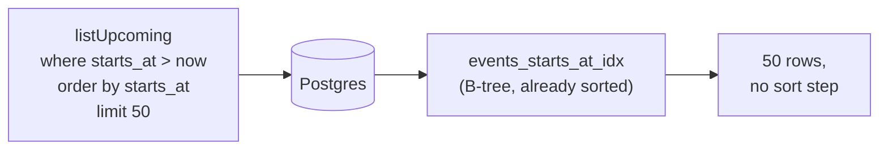
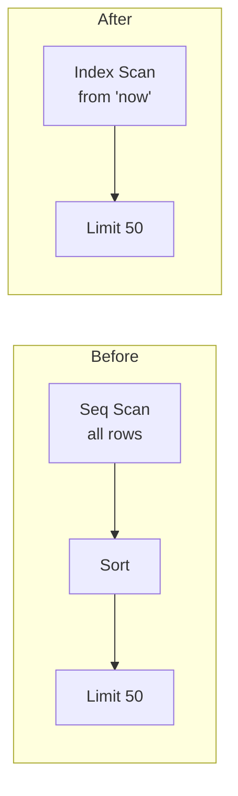
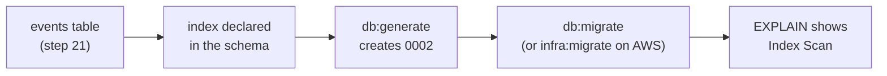

# Step 23: An index on events.starts_at

## 1. In one sentence

We add one **database index** on `events (starts_at)` so the `/events` query can jump to "now" and
stop after 50 rows, instead of reading and sorting the whole table.

## 2. The big picture

[Step 21](21-events-list.md) recorded the query with no index on purpose, as a baseline. Now we add
the index and show how to measure the difference.

Words used here:

- **Index:** a sorted lookup structure kept next to the table, like the index of a book.
- **B-tree:** the usual kind of index: a tree of sorted pages. Postgres walks down to the right spot
  and then along the sorted leaves.
- **Seq Scan:** "sequential scan": reading every row of a table.
- **Migration:** a numbered SQL file that changes the database ([step 5](05-database.md)).

## 3. The concepts

### The index (B-tree on starts_at)

- **What it is:** a second, sorted copy of the `starts_at` column with pointers to the rows.
- **Picture:** a diary sorted by date. Open it at today and read the next 50 entries.

- **Why we need it:** `listUpcoming` filters, sorts and limits on the same column. The index is
  already in the right order, so there is no sort and the scan stops early.

Where: `index("events_starts_at_idx").on(table.startsAt)` in `apps/api/src/db/schema/events.ts`,
the generated migration `apps/api/drizzle/0002_mixed_karen_page.sql`, and the query
`listUpcoming` in `apps/api/src/queries/events.ts`.

### EXPLAIN ANALYZE (the way to check)

- **What it is:** a Postgres command that shows the plan for a query and, with `ANALYZE`, runs it and
  reports real rows, time and pages read.
- **Why we need it:** to see whether an index is used, and to compare before and after.
- **How to run it:** the handbook card [explain-analyze](handbook/concepts/explain-analyze.md) has
  copy-paste commands (200 000 generated rows, before and after, reset). **We record no timings in
  the docs: run it to see yours.**

### Why plain CREATE INDEX

Drizzle runs each migration inside a transaction, and `CREATE INDEX CONCURRENTLY` cannot run in a
transaction. `events` has 12 rows, so a plain `CREATE INDEX` is instant. On a big live table you
would run the `CONCURRENTLY` version by hand, outside the migration runner
([indexing](handbook/concepts/indexing.md#10-what-breaks-and-how-wed-notice)).

## 4. Dependency order

## 5. What breaks if this is wrong or missing

- Migration not applied: `/events` still works, but the query reads and sorts the whole table.
  You only feel it with many rows.
- Index on the wrong column (for example `seats_left`): never used by this query, and it slows every
  booking write.
- Postgres still shows a Seq Scan on 12 rows: normal, one page is cheaper than an index walk.
- `CONCURRENTLY` put in a drizzle migration: the migration fails ("cannot run inside a transaction
  block").

## 6. How this connects

- **Uses:** the `events` table and `listUpcoming` from [21](21-events-list.md); the migration
  workflow from [05](05-database.md); on AWS the migration runs with `pnpm infra:migrate`
  ([17](17-infra-ecs-api.md)); the page that calls it is [22](22-events-ssr.md).
- **Later steps will use:** the same measure-first habit for a cache in front of the query, and
  composite indexes or keyset pagination when tickets and paged lists exist.
- **Handbook:** [indexing](handbook/concepts/indexing.md), [explain-analyze](handbook/concepts/explain-analyze.md),
  [app story 10b](handbook/app-story.md#10b-reading-events).

## 7. Interview questions

1. **What does a B-tree index give you?** A sorted structure: fast lookup of the start of a range, then an in-order walk.
2. **Why does `starts_at` fit `listUpcoming`?** Filter, order by and limit all use that column, so Postgres reads 50 index entries and stops.
3. **What does it cost?** Every insert/delete (and update of that column) also updates the index, plus disk space.
4. **Why might Postgres ignore it?** Tiny table, low selectivity, stale statistics, or a function wrapped around the column.
5. **Why can't `CREATE INDEX CONCURRENTLY` run in a migration transaction?** It needs several commits and waits for other transactions.
6. **How do you check the index helps?** `EXPLAIN (ANALYZE, BUFFERS)` before and after, on realistic data.
7. **OFFSET vs keyset pagination?** OFFSET produces and discards skipped rows; keyset seeks from the last row seen.

## 8. Check yourself

1. What two plan nodes disappear when the index is used, and why?
2. Why did we not index `seats_left`?
3. Your `EXPLAIN` shows `rows=10` estimated but `actual rows=100000`. What do you do first?
