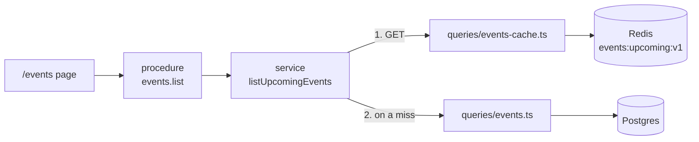
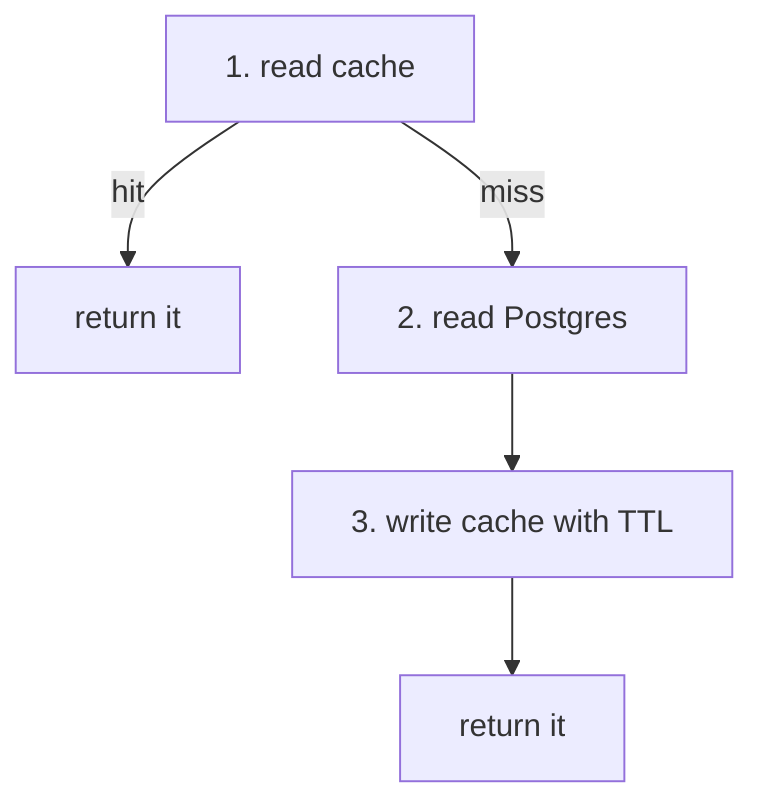
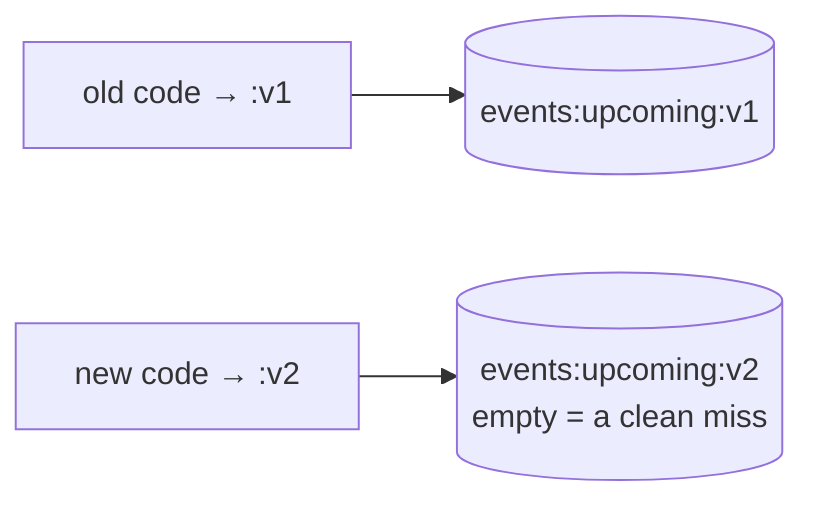
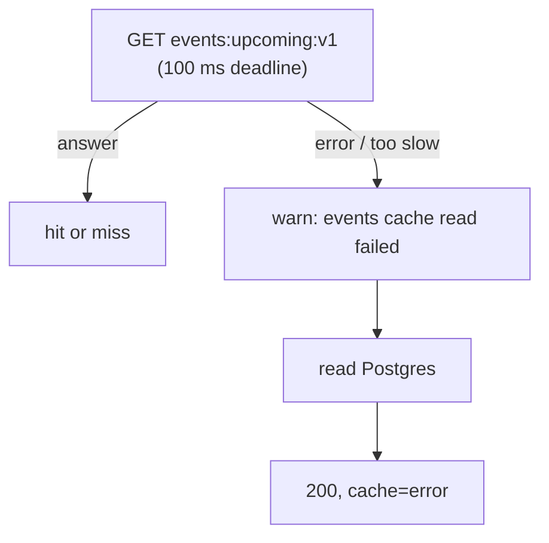
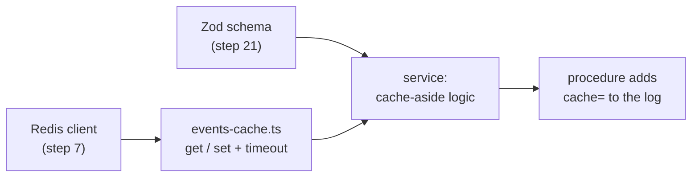

# Step 24: A Redis cache for events.list

## 1. In one sentence

We make `events.list` check **Redis** first (a **cache-aside**), so Postgres is asked about once per
30 seconds instead of once per visitor, and so a broken Redis can never break the page.

## 2. The big picture

[Step 21](21-events-list.md) measured the no-cache baseline, [step 22](22-events-ssr.md) moved the
rendering to the server, [step 23](23-events-index.md) added an index. This step adds the cache in the
api, between the service and Postgres.



Words used here:

- **Cache:** a fast copy of an answer, kept so we do not have to compute it again.
- **Cache-aside:** our own code checks the cache, and fills it when the answer is missing.
- **Hit / miss:** the answer was / was not in the cache.
- **TTL:** time to live. Redis deletes the key by itself when it ends.
- **Jitter:** a few random seconds added, so keys do not all expire together.
- **Stale:** a little out of date.

## 3. The concepts

### Cache-aside (the three steps)

- **What it is:** the service asks Redis first. On a miss it asks Postgres, then stores the answer.
- **Picture:** a waiter reads today's specials from a notepad. If the page is blank, they ask the
  kitchen once, write it down, and answer everyone else from the notepad.



- **Why we need it:** most visitors ask for the same list. Postgres should not repeat the same work.

Where: `listUpcomingEvents` in `apps/api/src/services/events.ts` (the logic, each step commented), and
`getUpcomingFromCache`, `setUpcomingInCache` in `apps/api/src/queries/events-cache.ts` (the only code that
touches Redis). The layer rule still holds: procedure → service → query → data store.

### The key, and its version

- **What it is:** the Redis key is `events:upcoming:v1`.
- **Why the `v1`:** if a deploy changes the shape of an event, we change it to `v2`. New code then
  starts with an empty key and never reads old-shaped data. The old key expires by itself.



### TTL with jitter

- **What it is:** each write uses 30 seconds plus 0 to 3 random seconds (`SET key value EX 30..33`).
- **Why:** the TTL limits how old the list can be. The jitter spreads expiry when there are many keys.
  (We have one key today, so this is a habit, not a fix for a measured problem.)

### What is stored, and how it is checked

- We store JSON text. Dates are already ISO strings, because the service turns `startsAt` into one
  before it caches.
- On a read we `JSON.parse` the text and check it with the **same shared Zod schema** the procedure uses
  for its output (`ListEventsOutput`). If the text is cut off, or has an old shape, the check fails: we
  log a warning, treat it as a miss, read Postgres, and write a good value over it.

### Staleness, and why it cannot oversell

- The list can be up to about 33 seconds old. For example `seatsLeft` may be a bit too high.
- That is fine for **browsing**. **Booking will always check the database**, never this cache, so a stale
  list can never cause overselling. Making the list fresher sooner (**invalidation**) is a later step.

### Measured: miss vs hit

Same method as [step 21](21-events-list.md): my own api instance on port 4010 (not your dev server),
against local Postgres (12 seeded events) and local Redis in Docker. I called
`GET /trpc/events.list` with `curl` 10 times for each case and read `responseTime` from Fastify's
`request completed` log line (which now also has `"cache":"miss"` or `"cache":"hit"`). For the misses I
ran `redis-cli DEL events:upcoming:v1` before every call.

| Call | 1 | 2 | 3 | 4 | 5 | 6 | 7 | 8 | 9 | 10 | Median |
| --- | - | - | - | - | - | - | - | - | - | - | - |
| miss (ms) | 4.82 | 3.02 | 2.62 | 2.16 | 2.07 | 2.05 | 2.14 | 1.88 | 2.35 | 2.05 | **2.15** |
| hit (ms) | 0.72 | 0.80 | 0.69 | 1.07 | 0.62 | 0.69 | 0.96 | 0.78 | 0.92 | 0.75 | **0.77** |

`redis-cli TTL events:upcoming:v1` right after a fill showed **32** (and 31 on another fill): the TTL is set
to 30-33 and counts down.

What this does and does not tell us:

- It is the time inside the api only, on a laptop, with 12 rows and no load. Compare it only with numbers
  measured the same way.
- The step 21 baseline (no cache) was about 1.8 ms. **A miss (2.15 ms) is not faster than no cache**: it
  does the same query plus a `GET` and a `SET`. A hit is about 2.8 times faster than a miss here.
- With 12 rows the saving is small in absolute terms. The real gain is that a hit does **no** database work, so it
  stays flat when the table and the traffic grow. I did not measure that.
- The three runs were not repeated, so I cannot give a spread beyond the 10 numbers above.

### What happens when Redis fails

- **What it is:** graceful degradation. Redis is only a speed-up, so its failure must not fail the request.
- **Down:** the redis client (set up to fail fast in [step 7](07-login-session.md)) throws at once. The
  service catches it, logs a warning, reads Postgres and answers 200. It does **not** try to write the cache
  (Redis is probably still sick, and that would add another wait).
- **Slow:** the redis client only fails fast when it is disconnected. A connected but slow Redis would make
  every page wait, so every cache call has a **100 ms deadline** (`withTimeout`). After that, same as "down".
  A healthy Redis answers in about 1 ms.



I did not stop your Docker Redis (it is shared with your dev servers). Instead I started my own api on
port 4011 with `REDIS_URL=redis://localhost:6399` (nothing listens there) and called it:

```text
200 in 0.043093s     (first call, cold)
200 in 0.004350s
200 in 0.002640s
{"level":40,...,"err":{"message":"Stream isn't writeable and enableOfflineQueue options is false"...}}   <- warning log
{"level":30,...,"cache":"error","res":{"statusCode":200},"responseTime":2.0867...,"msg":"request completed"}
```

The page-level check (the Next.js page with a dead Redis) was **not** done: the api answered 200 with
the full list, and the web page only reads that answer. A real slow Redis was also not tested live; the
timeout is covered by a unit test with a fake Redis that never answers.

### The request log field

The procedure adds `cache` (`hit`, `miss` or `error`) to the request's logger, so the `request completed`
line carries it:

```text
{"reqId":"req-m","cache":"miss","res":{"statusCode":200},"responseTime":4.82,"msg":"request completed"}
{"reqId":"req-15","cache":"hit","res":{"statusCode":200},"responseTime":0.75,"msg":"request completed"}
```

## 4. Dependency order



## 5. What breaks if this is wrong or missing

- No TTL (`SET` without `EX`): the list would never refresh and stay stale forever.
- No validation on read: after a deploy that changes the shape, new code could send old-shaped data.
- No deadline: a slow Redis slows every page, and a cache outage becomes a site slowdown.
- Redis error not caught: a cache problem becomes a 500 on a public page.
- Booking reading from this cache: overselling. Booking must read Postgres.
- Redis down for a long time: every request hits Postgres (still correct, but Postgres carries the full load),
  and nothing alerts us yet. Look for `cache=error` in the log.
- Not handled yet (next steps): **invalidation** (fresher than 30 s after a change) and a **cache stampede**
  (many requests missing at the same moment the key expires).

## 6. How this connects

- **Uses:** the Redis client and its fail-fast settings ([07](07-login-session.md)), the `listUpcoming`
  query and its index ([21](21-events-list.md), [23](23-events-index.md)), the shared Zod schema from
  [21](21-events-list.md), the page from [22](22-events-ssr.md), the layered API from [09](09-dashboard.md).
- **Later steps will use:** invalidation when events change, stampede protection, and booking, which reads the
  database. On AWS the same code uses ElastiCache Valkey ([14](14-infra-data.md)); nothing in the infra changes.
- **Handbook:** [cache-aside](handbook/concepts/cache-aside.md), [ttl](handbook/concepts/ttl.md),
  [cache-key-versioning](handbook/concepts/cache-key-versioning.md),
  [graceful-degradation](handbook/concepts/graceful-degradation.md), [fail-fast](handbook/concepts/fail-fast.md),
  [ADR 0002](handbook/decisions/0002-events-cache-aside-fail-open.md),
  [app story 10b](handbook/app-story.md#10b-reading-events).

## 7. Interview questions

1. **What is cache-aside?** The app checks the cache; on a miss it reads the database and fills the cache.
2. **Why validate what you read from the cache?** It may have been written by older code with another shape, or be cut off.
3. **Why a version in the key?** A deploy that changes the data shape starts with a fresh key instead of reading old-shaped data.
4. **Why jitter on the TTL?** So keys written together do not all expire together and hit the database at once.
5. **What if Redis is down? What if it is slow?** Down: the error is caught, we log a warning and read Postgres. Slow: a short deadline, then the same.
6. **Can a stale list cause overselling?** No. Booking checks the database, never the cache.
7. **What is a cache stampede?** Many requests miss at once when a popular key expires, and all hit the database. Fix: a lock, request coalescing, or refreshing early.
8. **Where does cache logic belong in a layered API?** In the service (rules); the query layer only moves data in and out of Redis.

## 8. Check yourself

1. In `listUpcomingEvents`, why do we skip the cache write after a Redis read error?
2. A new field is added to events and the code is deployed. Which constant do you change, and what happens if you forget?
3. Redis is down for an hour and nobody notices. What did we build that lets users stay happy, and what is still missing to notice it?
