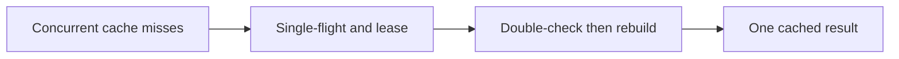
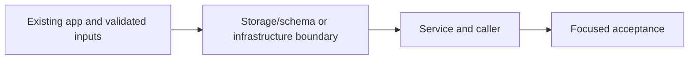

# 25. Cache stampede protection

## 1. In one sentence

A fast cache can amplify database load when many entries expire together.

## 2. The big picture

## 3. Concepts and current behavior

The cache lock protects duplicate public-list rebuilds, not booking correctness. Single-flight is per process, the Redis lease is cross-process, and every new lock holder double-checks.

### How do you stop a cache miss stampede across instances?

Use single-flight inside one process and a short distributed rebuild lock across processes. Recheck the cache after taking the lock: another holder may have filled it while this request waited. Release only with the owner token. Bound waiting and fall back to Postgres so a broken cache does not hang the request.

`apps/api/src/services/single-flight.ts` shares a promise with cleanup on both success/error. `queries/events-cache.ts` uses SET NX PX and Lua compare/delete. `pnpm demo:stampede` previously measured 100 concurrent requests as 1 DB query, including two instances after the double-check fix.

Why: A fast cache can amplify database load when many entries expire together.

Trade-offs: The 5 s lease and bounded wait permit duplicate rebuilds if slow or evicted. That is acceptable for public reads, never scarce-seat correctness.

## 4. Dependency order

The concrete prerequisites are the source files and current settings named above. Migrations precede the consuming image rollout; IAM permissions precede the job that uses them.

## 5. What breaks and how we notice

Why random owner token? A late old holder must not delete a newer lease. 10x: TTL jitter and refresh metrics. 100x: hot-key partitioning, stale serving and bounded rebuild queues.

Current limits: The cache lock protects duplicate public-list rebuilds, not booking correctness. Single-flight is per process, the Redis lease is cross-process, and every new lock holder double-checks.

## 6. Interview questions with short answers

1. **How do you stop a cache miss stampede across instances?** Use single-flight inside one process and a short distributed rebuild lock across processes. Recheck the cache after taking the lock: another holder may have filled it while this request waited. Release only with the owner token. Bound waiting and fall back to Postgres so a broken cache does not hang the request.

2. **What must happen after acquiring a rebuild lock?** Recheck the cache

3. **Why does this boundary exist?** A fast cache can amplify database load when many entries expire together.

4. **Which alternative would you compare?** The 5 s lease and bounded wait permit duplicate rebuilds if slow or evicted. That is acceptable for public reads, never scarce-seat correctness.

5. **What changes at 10x or 100x?** 10x: TTL jitter and refresh metrics. 100x: hot-key partitioning, stale serving and bounded rebuild queues.

6. **What is the important counter-question?** Why random owner token? A late old holder must not delete a newer lease.

## 7. Check yourself

1. Trace the exact source path and identify the invariant it protects.
2. What must happen after acquiring a rebuild lock?
3. Which failure requires live AWS acceptance rather than local evidence?

## How this connects

Uses the [architecture](00-architecture.md) and [cache-aside baseline](24-events-cache.md). Continue with [next step](26-cache-invalidation-rbac.md). Practice the [scenario](handbook/guides/interview-scenarios.md#cache-stampede) and [explorer tour](handbook/guides/infra-explorer.html?tour=search).

## Historical evidence and open limits

The following is the implementation-time record, preserved from PENDING. Measurements describe that earlier local run, not a fresh benchmark. Later behavior is stated above; old “not built” statements may be superseded. Owner setup recipes are intentionally replaced by the current [deploy runbook](20-deploy-day.md). No old preview is a promise about today’s stack.

### Feature 1, Step 5: cache stampede protection for `events.list` (would be `docs/25-*`).

- **Concepts:** cache stampede (many misses → many identical DB queries); single-flight (in-process, shares one promise; cleanup on success AND error); distributed lock in Redis (`SET NX PX` + random token, release via Lua compare-and-delete); double-check after taking the lock; bounded wait + fallback; lock limits (TTL expiry, Redis restart → extra query) and why that's fine for a cache but never for seats (two holders = double-sold seat; seats need DB guarantees). Also new: `LOG_LEVEL` env var.
- **Key files:** `apps/api/src/services/single-flight.ts` `singleFlight`; `services/events.ts` `listUpcomingEvents`, `rebuild`, `waitForCache`, `recheckCache`, `releaseLock`; `queries/events-cache.ts` `tryLockUpcomingRebuild`, `releaseUpcomingRebuildLock` (`RELEASE_IF_OWNER`); `queries/events.ts` `listUpcoming` (debug line); `config/env.ts` `LOG_LEVEL`; `scripts/stampede-demo.ts` (`pnpm demo:stampede`, RESP `DEL` over `node:net`).
- **Measured (local, 2026-10-12, DB queries = "db query" debug lines):** before fix: 1 instance × 100 req → **100** (2/2 runs). Level 1: 1 × 100 → **1** (3/3); 2 instances × 50 → **2** (3/3). Level 1+2 without double-check: 2 × 50 → 1 or **2** (2 of 5 runs gave 2). Level 1+2 with double-check: 1 × 100 → **1** (3/3); 2 × 50 → **1** (10/10), no warnings. All responses 200; waiting instance's max ≈ 65 ms (one 50 ms re-check).
- **Unsure / for the docs:** the Lua script is only unit-tested against a fake; it was checked by hand on the real Redis (wrong token → 0, key kept; right token → 1). Wait settings (5 × 50 ms, lock TTL 5 s) are judgement calls, not measured under real load. A waiter whose holder is slow still reads Postgres after ~250 ms.
