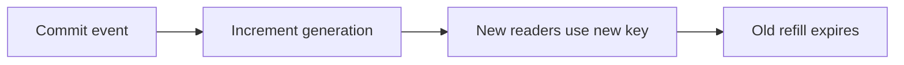
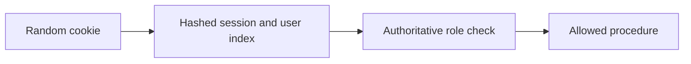
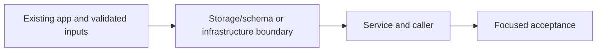

# 26. Generation invalidation and admin authorization

## 1. In one sentence

DEL alone allows an in-flight old reader to repopulate the same key.

## 2. The big picture

## 3. Concepts and current behavior

Authorization is lazy: only admin middleware reads the role from Postgres. Context verifies the Redis session without making every public request depend on Postgres. P10 additionally revokes sessions around role changes. Invalidation uses the current v3 generation/filter keys.

### How do you prevent a stale refill after a write?

Commit the write, then increment a cache generation. A reader captures the generation before its database read and stores only under that generation. A slow pre-write reader can fill its old key, but new readers use the new generation. TTL bounds stale data if invalidation fails; errors are logged instead of undoing a committed event.

`apps/api/src/services/events.ts` → `invalidateUpcomingList` runs after event creation. `queries/events-cache.ts` builds generation/filter keys. `queries/web-cache.ts` calls signed Next revalidation. Run `pnpm demo:stampede`; inspect cache invalidation unit tests for late refill and failure.

Why: DEL alone allows an in-flight old reader to repopulate the same key.

Trade-offs: Generation keys increase transient cardinality. Redis and Next/browser caches have separate stale windows; one invalidation does not instantly refresh every tab.

### Sessions versus JWTs, rotation, revocation and roles

Opaque session cookies keep revocation server-side; JWTs reduce lookup dependence but revocation/role changes need expiry or another authoritative version. MiniTickets hashes random tokens in Redis, rotates login sessions, indexes at most 20 devices and checks membership on every read. Admin authorization reads Postgres; role changes revoke sessions before and after the update.

`apps/api/src/queries/sessions.ts` implements indexed creation/read/revokeAll; `services/users.ts` revokes around makeAdmin. `pnpm demo:security` checks old-cookie, all-device and role revocation. Cookies are HttpOnly/SameSite with Secure in production. An in-flight authorized request cannot be recalled; two-store role/revocation is not a global transaction.

Why: A role embedded forever in a session becomes stale after a privilege change.

Trade-offs: Redis/index eviction fails closed and forces login. The 20-device bound makes revoke work bounded. Session-versioning/transactional role changes are proposed improvements for larger deployments.

## 4. Dependency order

The concrete prerequisites are the source files and current settings named above. Migrations precede the consuming image rollout; IAM permissions precede the job that uses them.

## 5. What breaks and how we notice

Why read generation before SQL? Reading after SQL could place old rows in the new generation. 10x: watch invalidation failures/key churn. 100x: outbox-driven invalidation and explicit freshness SLOs.

Is the presence cookie authorization? No; it only avoids a predictable redirect flash; API verifies the real session. 10x: monitor auth-store failures and session churn. 100x: coordinated auth versioning, device management and key/credential rotation.

Current limits: Authorization is lazy: only admin middleware reads the role from Postgres. Context verifies the Redis session without making every public request depend on Postgres. P10 additionally revokes sessions around role changes. Invalidation uses the current v3 generation/filter keys.

## 6. Interview questions with short answers

1. **How do you prevent a stale refill after a write?** Commit the write, then increment a cache generation. A reader captures the generation before its database read and stores only under that generation. A slow pre-write reader can fill its old key, but new readers use the new generation. TTL bounds stale data if invalidation fails; errors are logged instead of undoing a committed event.

2. **Which order protects against stale refill?** Read generation before database

3. **Why does this boundary exist?** DEL alone allows an in-flight old reader to repopulate the same key.

4. **Which alternative would you compare?** Generation keys increase transient cardinality. Redis and Next/browser caches have separate stale windows; one invalidation does not instantly refresh every tab.

5. **What changes at 10x or 100x?** 10x: watch invalidation failures/key churn. 100x: outbox-driven invalidation and explicit freshness SLOs.

6. **What is the important counter-question?** Why read generation before SQL? Reading after SQL could place old rows in the new generation.

## 7. Check yourself

1. Trace the exact source path and identify the invariant it protects.
2. Which order protects against stale refill?
3. Which failure requires live AWS acceptance rather than local evidence?

## How this connects

Uses the [architecture](00-architecture.md) and [previous step](25-cache-stampede.md). Continue with [next step](27-stale-while-revalidate.md). Practice the [scenario](handbook/guides/interview-scenarios.md#cache-invalidation) and [explorer tour](handbook/guides/infra-explorer.html?tour=search).

## Historical evidence and open limits

The following is the implementation-time record, preserved from PENDING. Measurements describe that earlier local run, not a fresh benchmark. Later behavior is stated above; old “not built” statements may be superseded. Owner setup recipes are intentionally replaced by the current [deploy runbook](20-deploy-day.md). No old preview is a promise about today’s stack.

### Feature 1, Step 6: cache invalidation for `events.list` + admin role to create events (would be `docs/26-*`).

- **Concepts:** cache invalidation; write-then-invalidate order (INCR only after the insert commits; readers read the generation BEFORE Postgres); DEL vs generation key (`events:upcoming:gen`, cache key `events:upcoming:v1:g<gen>`, lock key `lock:…:g<gen>`); the stale-refill race (slow reader writes late → lands in the old generation, expires by TTL); bounded staleness (INCR fails → logged error, stale ≤ one TTL ~33 s, request still succeeds); RBAC (`users.role` + CHECK); 401 vs 403 (authn vs authz); per-layer staleness (Redis fixed at once, other browsers' React Query up to 30 s staleTime).
- **Key files:** `queries/events-cache.ts` `getUpcomingGeneration`, `bumpUpcomingGeneration`, `upcomingKey`, `upcomingLockKey`; `services/events.ts` `listUpcomingEvents` (gen first; single-flight key per gen), `createEvent`, `invalidateUpcomingList`; `queries/events.ts` `create`; `trpc/init.ts` `isAdmin`/`adminProcedure`; `trpc/context.ts` (role from Postgres every request; MOVED to `isAdmin` in Step 7); `services/users.ts` `makeAdmin` + `scripts/make-admin.ts` (`pnpm user:make-admin <email>`); `drizzle/0003_users_role.sql`; shared `CreateEventInput`, `UserRole`, `EmailSchema`; web `features/events/components/create-event-form.tsx`, `hooks/use-create-event.ts`, `app/admin/events/new/page.tsx`, `proxy.ts` (/admin), `header-nav.tsx`; `e2e/admin-events.spec.ts`; `scripts/stampede-demo.ts` now INCRs the gen key instead of DEL.
- **Measured (local, 2026-10-12, own API on :4101, LOG_LEVEL=debug):** create → "generation is now 2" (6.4 ms) → next `events.list` cache=miss, 1 db query, has the new event (4.3 ms) → next cache=hit (1.8 ms). Redis after: `g1` orphaned (TTL 26 s, expiring), `g2` live, gen key TTL -1. `pnpm demo:stampede -n 50` after a bump: 1 db query. Race unit test fails if the late write goes to the CURRENT generation (DEL-like), checked by mutation.
- **Unsure / for the docs:** (SUPERSEDED in Step 7, see there: the role lookup moved from `createContext` to `isAdmin`.) role is read from Postgres in `createContext` on EVERY request with a session (one PK lookup), so role changes count at once; cost: logged-in cache hits now touch Postgres once. Alternative (role copied into the Redis session) was rejected: demotion would lag up to 7 days. Gen key has no TTL; under an `allkeys-*` eviction policy it could be evicted and restart at 0 (harmless unless an old g0 key is still alive). The INCR-fails path is unit-tested only (didn't stop the owner's Redis). make-admin is a dev tool (not in the image); on AWS the first admin would need a one-off task or psql (not built). Each e2e run adds one event + two users to the local DB (no delete API).
