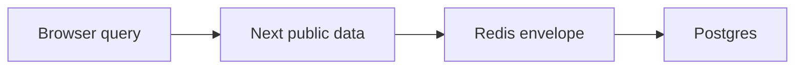
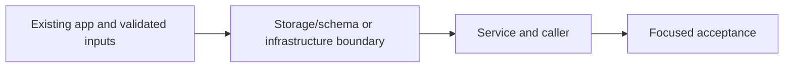

# 27. Stale-while-revalidate and stale-if-error

## 1. In one sentence

Bounded stale public listings trade freshness for latency/availability.

## 2. The big picture

## 3. Concepts and current behavior

Current list envelopes have data, fetchedAt and staleAt. Soft TTL defaults to 30 s with 0–10% jitter; hard TTL is 300 s. No old-generation fallback is allowed. A quiet list can be served once near the hard age limit. Search uses a separate uncached path.

### SWR, stale-if-error and stacked caches: how stale can a user see?

SWR serves a bounded stale value while one background refresh runs; stale-if-error serves a previous good value during a bounded outage. Each cache layer has its own clock: Redis, Next public data and browser queries. Fresh at one layer does not force another layer to refetch. Seat purchase always checks the writer.

`apps/api/src/services/events.ts` applies fresh/stale/error windows and tracks in-flight refreshes. `apps/web/src/features/events/server/cached-events.ts` and `hooks/use-events.ts` add separate caches. Run `pnpm test` for fake-clock SWR/error cases. P10 disables shared HTML caching while retaining explicit public data caching.

Why: Bounded stale public listings trade freshness for latency/availability.

Trade-offs: Never use stale data for authorization or seats. Long independent TTLs can compound staleness. A failing refresh must not reset old data to fresh.

## 4. Dependency order

The concrete prerequisites are the source files and current settings named above. Migrations precede the consuming image rollout; IAM permissions precede the job that uses them.

## 5. What breaks and how we notice

Does a successful admin write refresh all open tabs? No; they refetch on their own query policy. 10x: expose age/hit telemetry. 100x: consolidate overlapping caches and define end-to-end freshness budgets.

Current limits: Current list envelopes have data, fetchedAt and staleAt. Soft TTL defaults to 30 s with 0–10% jitter; hard TTL is 300 s. No old-generation fallback is allowed. A quiet list can be served once near the hard age limit. Search uses a separate uncached path.

## 6. Interview questions with short answers

1. **SWR, stale-if-error and stacked caches: how stale can a user see?** SWR serves a bounded stale value while one background refresh runs; stale-if-error serves a previous good value during a bounded outage. Each cache layer has its own clock: Redis, Next public data and browser queries. Fresh at one layer does not force another layer to refetch. Seat purchase always checks the writer.

2. **Can stale listings authorize booking?** No

3. **Why does this boundary exist?** Bounded stale public listings trade freshness for latency/availability.

4. **Which alternative would you compare?** Never use stale data for authorization or seats. Long independent TTLs can compound staleness. A failing refresh must not reset old data to fresh.

5. **What changes at 10x or 100x?** 10x: expose age/hit telemetry. 100x: consolidate overlapping caches and define end-to-end freshness budgets.

6. **What is the important counter-question?** Does a successful admin write refresh all open tabs? No; they refetch on their own query policy.

## 7. Check yourself

1. Trace the exact source path and identify the invariant it protects.
2. Can stale listings authorize booking?
3. Which failure requires live AWS acceptance rather than local evidence?

## How this connects

Uses the [architecture](00-architecture.md) and [previous step](26-cache-invalidation-rbac.md). Continue with [next step](28-filter-aware-cache-keys.md). Practice the [scenario](handbook/guides/interview-scenarios.md#swr-caches) and [explorer tour](handbook/guides/infra-explorer.html?tour=search).

## Historical evidence and open limits

The following is the implementation-time record, preserved from PENDING. Measurements describe that earlier local run, not a fresh benchmark. Later behavior is stated above; old “not built” statements may be superseded. Owner setup recipes are intentionally replaced by the current [deploy runbook](20-deploy-day.md). No old preview is a promise about today’s stack.

### Feature 1, Step 7: stale-while-revalidate (SWR) + stale-if-error for `events.list` (would be `docs/27-*`).

- **Concepts:** SWR (serve stale now, refresh in the background); soft vs hard TTL (fresh < soft ≤ stale < hard = Redis expiry, env `EVENTS_CACHE_SOFT_TTL_MS`/`_HARD_TTL_MS`, defaults 30 s / 5 min, Zod refine soft < hard); cache value `{ data, fetchedAt }` (Zod-checked) and key bump v1 → v2 (shape version); fire-and-forget background refresh (why safe: nobody needs the result, errors caught inside the single-flight work; limits: in-memory only, lost on exit, not a job queue); one refresh for many stale readers (reuses single-flight + Redis lock; a refresh never waits for another holder; double-check accepts only FRESH); stale-if-error (availability over freshness, hard TTL caps age); why invalidation overrides SWR (new generation = empty key = miss; never fall back to an older generation); request-log `cache` = fresh | stale | stale-if-error | miss | error. BUG FIX in this step: lazy authorization lookup — `createContext` no longer reads the role from Postgres (it made EVERY logged-in request depend on Postgres, so logged-in visitors got an error on `events.list` with Postgres down although stale-if-error had a copy); only `isAdmin` reads it, per admin request (role changes still count at once). Principle for the docs: a route must not depend on a lookup only other routes need (failure domains / blast radius). Links for the docs: React Query `staleTime` (same idea in the browser, already used for /events) and HTTP `Cache-Control: max-age=30, stale-while-revalidate=270, stale-if-error=…` (RFC 5861).
- **Key files:** `services/events.ts` `listUpcomingEvents` (steps 5c-e), `refreshInBackground`, `refresh`, `rebuildAsLockHolder` (shared by miss + refresh), `freshList`, `CachedUpcoming`, `lastFailedRefreshGen`, `writeCache` (PX = hard TTL); `queries/events-cache.ts` `upcomingKey`/`upcomingLockKey` (v2), `setUpcomingInCache` (EX s → PX ms); `config/env.ts`; `.env.example`; `procedures/events.ts` (comment); tests: `services/events.test.ts` (SWR / refresh failure / stale-if-error / invalidation blocks; module re-imported per test because it keeps state), `queries/events-cache.test.ts`. Bug fix: `trpc/context.ts` `createContext` (session = `{ userId }` only), `trpc/init.ts` `isAdmin` (async; `usersService.getRole`; null → 401, not admin → 403, lookup fails → 500), `services/users.ts` `getRole`; tests `procedures/events.test.ts` (NEW: real `createContext` + real `eventsRouter`, session cookie, `findById` rejects → `events.list` still works and `findById` is never called; `events.create` → 500, service not called), `trpc/init.test.ts` (role from mocked `getRole`: 401/403/admin/deleted user/demotion counts at once/lookup fails → 500).
- **Measured (local, 2026-10-12, own API :4101, soft 3 s / hard 60 s, LOG_LEVEL=debug):** miss 29.7 ms (1 db query) → fresh 4.1 ms → at 4.1 s stale 3.7 ms, response logged BEFORE its background db query, refresh done ~10 ms later → fresh 3.8 ms. 10 concurrent stale reads: 6 stale + 4 fresh, **1** db query. stale-if-error (2nd own instance :4102 with DATABASE_URL on closed port 5499, same Redis): fresh → stale (refresh fails, warn) → stale-if-error ×6, all HTTP 200, 2.5-5.9 ms, for 60 s → then miss → HTTP 500 (copy expired). No crash, no unhandled rejection. Mutation-checked: removing single-flight, the catch, the label, the fresh-only double-check, the hard cap, or awaiting the refresh each fails ≥1 test. e2e 15/15 on owner's :3000/:4000. Bug fix: with the OLD `context.ts` put back, all 3 new `procedures/events.test.ts` tests fail; with the fix 83/83 unit tests pass, e2e 15/15 again. Live (own :4101 DB ok + :4102 DB on closed port, same Redis; signed up + logged in a throwaway user on :4101, then logged out after): with the session cookie on :4102 `events.list` → 200 fresh (5.4 ms), 200 stale (7.3 ms), 200 stale-if-error (4.6 ms); `auth.me` → 500 and `events.create` → 500 (both really need Postgres); normal user `events.create` on :4101 → 403.
- **Unsure / for the docs:** (1) Spec said "on a MISS, if Postgres fails and a stale copy exists, serve it": on our miss path no copy of the current generation can exist (missing key, or a new generation that must not fall back), so a miss + Postgres down stays an error; stale-if-error happens via the background refresh, and the `stale-if-error` LABEL marks stale answers after this process's last refresh failed (the first stale answer after Postgres dies is still labelled `stale`; per process, other instances learn on their own first failure). (2) Jitter (`MAX_JITTER_SECONDS`, `BASE_TTL_SECONDS`) removed: SWR refreshes busy keys long before the hard TTL, and the hard TTL is an exact age cap (age ≥ hard → treated as missing even if Redis still has it). The `ttl` card still describes 30 s + jitter: update it. (3) During a Postgres outage every stale read past the soft TTL starts a refresh (one at a time per process, lock across instances): ~1 failing query per request burst, no backoff. (4) A failed request (500) has no `cache` field in its log line (the procedure throws before `setBindings`), same as before. (5) A list nobody read for a while can be served once at up to 5 min old. (6) Bug fix side effects: a session whose user was deleted now passes `protectedProcedure` (it used to be treated as logged out); `account.getProfile` → 404 and `auth.me` → null already handle it, `isAdmin` → 401. With Postgres down a logged-in visitor still gets a 500 from `auth.me` (the header needs the email); how the web header behaves then was NOT checked in a browser. Admin requests now cost one PK lookup each; logged-in non-admin requests cost none. (7) Test gotcha for the docs: `beforeEach(() => mock.mockReset())` RETURNS the mock, and vitest runs a function returned from `beforeEach` as a cleanup after the test; with a rejecting mock that failed the test after its assertions passed. Use braces.
