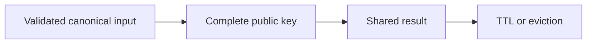
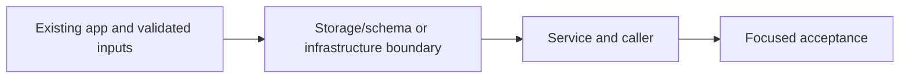

# 28. Canonical filters and cache keys

## 1. In one sentence

Missing a venue/date/user dimension can return wrong or private data.

## 2. The big picture

## 3. Concepts and current behavior

Exact venue filtering trims/lowercases; dates use UTC days. The date-range cap only applies with both bounds. Literal title/venue substring search is separate P7 functionality, not a change of venue filter semantics. Local Redis allkeys-lru is a committed setting; actual running/AWS eviction settings require inspection.

### How do hot keys, cache keys and privacy interact?

A cache key must include every input that changes the result. Canonicalize dates/venue so equivalent filters share a key; keep authenticated data out of public keys. A very hot event or generation key still concentrates load. Redis eviction is acceptable for reconstructible public data, but sessions should fail closed and quotas are only advisory under eviction.

`apps/api/src/services/event-filters.ts` normalizes filters; `queries/events-cache.ts` hashes complete inputs. `queries/sessions.ts` requires session-index membership and never caches private pages. Run `pnpm test` for canonical filter/key and session eviction cases. Dedicated Redis isolation is explain-only.

Why: Missing a venue/date/user dimension can return wrong or private data.

Trade-offs: Hashing bounds key size but does not fix omitted input. One cache used for sessions/results/quotas shares failure and eviction behavior.

## 4. Dependency order

The concrete prerequisites are the source files and current settings named above. Migrations precede the consuming image rollout; IAM permissions precede the job that uses them.

## 5. What breaks and how we notice

Is hashing a key encryption? No; do not put secrets into it assuming privacy. 10x: hot-key and eviction metrics. 100x: separate security-critical stores/policies and shard only measured bottlenecks.

Current limits: Exact venue filtering trims/lowercases; dates use UTC days. The date-range cap only applies with both bounds. Literal title/venue substring search is separate P7 functionality, not a change of venue filter semantics. Local Redis allkeys-lru is a committed setting; actual running/AWS eviction settings require inspection.

## 6. Interview questions with short answers

1. **How do hot keys, cache keys and privacy interact?** A cache key must include every input that changes the result. Canonicalize dates/venue so equivalent filters share a key; keep authenticated data out of public keys. A very hot event or generation key still concentrates load. Redis eviction is acceptable for reconstructible public data, but sessions should fail closed and quotas are only advisory under eviction.

2. **What must a result cache key include?** All result-changing inputs

3. **Why does this boundary exist?** Missing a venue/date/user dimension can return wrong or private data.

4. **Which alternative would you compare?** Hashing bounds key size but does not fix omitted input. One cache used for sessions/results/quotas shares failure and eviction behavior.

5. **What changes at 10x or 100x?** 10x: hot-key and eviction metrics. 100x: separate security-critical stores/policies and shard only measured bottlenecks.

6. **What is the important counter-question?** Is hashing a key encryption? No; do not put secrets into it assuming privacy.

## 7. Check yourself

1. Trace the exact source path and identify the invariant it protects.
2. What must a result cache key include?
3. Which failure requires live AWS acceptance rather than local evidence?

## How this connects

Uses the [architecture](00-architecture.md) and [previous step](27-stale-while-revalidate.md). Continue with [next step](29-next-data-cache.md). Practice the [scenario](handbook/guides/interview-scenarios.md#hot-keys-privacy) and [explorer tour](handbook/guides/infra-explorer.html?tour=search).

## Historical evidence and open limits

The following is the implementation-time record, preserved from PENDING. Measurements describe that earlier local run, not a fresh benchmark. Later behavior is stated above; old “not built” statements may be superseded. Owner setup recipes are intentionally replaced by the current [deploy runbook](20-deploy-day.md). No old preview is a promise about today’s stack.

### Feature 1, Step 8: filters for `events.list` (venue, from, to) + filter-aware cache keys (would be `docs/28-*`).

- **Concepts:** canonical keys (one form for "the same question": venue trimmed + lowercased, dates rounded to the start of the UTC day, fields sorted, empty ones left out; the SAME form feeds the SQL, the cache key, single-flight and the lock, else two different questions would share one answer); hashed keys (`events:upcoming:v3:g<gen>:<16 hex of SHA-256>`: short + safe from `:`/`*`/spaces; collision ≈ 1 in 37 M at 1 M keys; canonical text kept in a debug line `events cache key <key> = <canonical>`); key explosion and its bounds (canonical form, day rounding, range ≤ 1 year, hard TTL 5 min, one generation for all filters; venue is free text so NOT bounded: rate limiting would be the real fix, not built); eviction policies (`maxmemory 256mb` + `allkeys-lru` in docker-compose; noeviction = writes refused; trade-off: sessions share this Redis and can be evicted too; the gen key is read on every request so LRU practically never picks it); jitter BACK on the SOFT TTL (0-10%, stored per value as `staleAt`, clamped ≤ hard TTL; why now: many keys refilled together after a bump would all refresh together; why not in Step 7: one key = one refresh); one INCR invalidates every filter key (vs SCAN + DEL one by one: slow, not atomic, stale-refill race per key); URL as state (shareable, reload/back keep it, server renders it; GET form works without JS); React Query key includes the input, so the page passes ONE input object to both prefetch and `useEvents`; explain-only: user/locale/currency MUST be in the key once responses depend on them (no prices or per-user list yet).
- **Key files:** shared `schemas/events.ts` `ListEventsInput` (+ `events.test.ts`); api `services/event-filters.ts` `canonicalFilters`, `canonicalString` (+ test); `services/events.ts` steps 1a (jitter), 1b (key explosion), 4 (`lastRefreshFailed`), 4b, `writeCache` (`staleAt`), `invalidateUpcomingList` (filters comment); `queries/events-cache.ts` `upcomingKey(gen, canonical)`, `shortHash`, `upcomingLockKey(key)`, get/set/lock/release now take the KEY; `queries/events.ts` `listUpcoming(now, filters, log)` (venue `lower(venue) = lower($1)`, `to` = < next day; index note: `(lower(venue), starts_at)` expression index, not added); `procedures/events.ts` `.input(ListEventsInput.optional())`; web `features/events/lib/filter-params.ts` (+ test), `components/event-filters.tsx`, `event-list.tsx`, `hooks/use-events.ts`, `server/prefetch-events.ts`, `app/events/page.tsx`, `hooks/use-create-event.ts` (comment: queryKey() partially matches all inputs); `docker-compose.yml`; `e2e/events.spec.ts` (filter test).
- **Measured (local, 2026-10-12, own API :4101, LOG_LEVEL=debug, after INCR to gen 13):** 22 inputs (20 valid, many differing only by case/spaces/time of day or field order; 2 invalid → 400). Expected 9 keys, actual **9** (`redis-cli --scan --pattern 'events:upcoming:v3:g13:*'`), 9 db queries, 9 miss + 11 fresh, 0 lock keys left. Debug lines map key → canonical: `{}` ×4, `{"venue":"pune"}` ×4, `{"venue":"the foundry"}` ×3, … Stored soft TTLs 30019–32637 ms (jitter in 30–33 s). One more INCR → same 22 inputs: +9 db queries, 9 new keys in g14, the 9 g13 keys left to expire. Unit 122/122, e2e 16/16 on owner's :3000/:4000. Mutation-checked: no lowercase, no day rounding, no gen in key, ignoring `staleAt`, no jitter, 2-year range: each fails ≥1 test.
- **Unsure / for the docs:** (1) The running Redis still says `noeviction` until the owner runs `pnpm db:up` (recreates the container; data kept in the volume); CI's Redis and AWS Valkey were NOT changed (Valkey's default parameter group is `volatile-lru`: worth a sentence). (2) Days are UTC days, not the viewer's: someone in India picking 20 Nov gets 20 Nov 00:00 UTC (05:30 their time). (3) The range check only applies when BOTH dates are set (`to` alone may be years away; `from` alone is open-ended). A `from` in the past is redundant with "upcoming" but still makes its own key (could be dropped by canonicalisation; not done). (4) Venue = EXACT match ignoring case ("pune" ≠ "Pune Central"); a "contains" search would need ILIKE escaping + pg_trgm. No Unicode normalisation (NFC) or inner-space collapsing. (5) `stale-if-error` label changed from "last failed gen" to one per-process flag for all filters (any successful refresh clears it). (6) Bug found while testing: form and `<Suspense>` siblings both had `key={href}` → React duplicated the form; fixed with `form:`/`list:` prefixes (page.tsx comment). (7) Not unit-tested: the `staleAt ≤ hard TTL` clamp (env is fixed in the test mock). The real SQL was checked via curl + e2e only.
