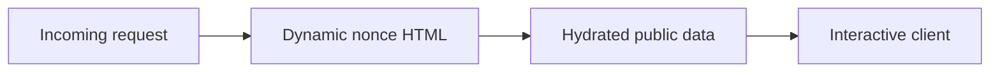
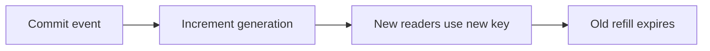
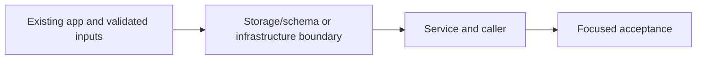

# 29. Public Next data cache and revalidation

## 1. In one sentence

Initial content and interactivity have different latency and security constraints.

## 2. The big picture

## 3. Concepts and current behavior

The explicit unstable_cache helper and signed fixed-tag revalidation endpoint remain. P7 current catalogue SSR calls events.search and bypasses the list data cache to avoid cursor/text key explosion. P10 makes nonce HTML dynamic/no-store. Do not assume the older events.list cache is the current search request path.

### SSR, CSR or static rendering for an event catalogue?

SSR sends useful initial HTML, CSR handles interactive changes and static output suits public content that tolerates rebuilds. MiniTickets combines server-prefetched catalogue data with client queries. P10 nonce security makes HTML dynamic and no-store; explicit public data caching remains a separate choice.

`apps/web/src/app/layout.tsx` waits for a request; `apps/web/src/features/events/server/prefetch-events.ts` hydrates public data. `apps/web/src/features/events/server/cached-events.ts` provides an explicit public-data cache; the current search-prefetch path bypasses that helper to avoid unbounded cursor/text keys. Run `pnpm demo:security` for production HTML/cache acceptance; there is no static-site export.

Why: Initial content and interactivity have different latency and security constraints.

Trade-offs: Static HTML has cheap delivery but cannot reuse a fresh per-request nonce. CSR adds client work. Dynamic HTML costs server work even when data is cached.

### How do you prevent a stale refill after a write?

Commit the write, then increment a cache generation. A reader captures the generation before its database read and stores only under that generation. A slow pre-write reader can fill its old key, but new readers use the new generation. TTL bounds stale data if invalidation fails; errors are logged instead of undoing a committed event.

`apps/api/src/services/events.ts` → `invalidateUpcomingList` runs after event creation. `queries/events-cache.ts` builds generation/filter keys. `queries/web-cache.ts` calls signed Next revalidation. Run `pnpm demo:stampede`; inspect cache invalidation unit tests for late refill and failure.

Why: DEL alone allows an in-flight old reader to repopulate the same key.

Trade-offs: Generation keys increase transient cardinality. Redis and Next/browser caches have separate stale windows; one invalidation does not instantly refresh every tab.

## 4. Dependency order

The concrete prerequisites are the source files and current settings named above. Migrations precede the consuming image rollout; IAM permissions precede the job that uses them.

## 5. What breaks and how we notice

Does dynamic HTML forbid cached data? No. Cache only public results with complete keys. 10x: measure TTFB/cache hit rate. 100x: evaluate hash-based static CSP or separating public/static routes as a deliberate redesign.

Why read generation before SQL? Reading after SQL could place old rows in the new generation. 10x: watch invalidation failures/key churn. 100x: outbox-driven invalidation and explicit freshness SLOs.

Current limits: The explicit unstable_cache helper and signed fixed-tag revalidation endpoint remain. P7 current catalogue SSR calls events.search and bypasses the list data cache to avoid cursor/text key explosion. P10 makes nonce HTML dynamic/no-store. Do not assume the older events.list cache is the current search request path.

## 6. Interview questions with short answers

1. **SSR, CSR or static rendering for an event catalogue?** SSR sends useful initial HTML, CSR handles interactive changes and static output suits public content that tolerates rebuilds. MiniTickets combines server-prefetched catalogue data with client queries. P10 nonce security makes HTML dynamic and no-store; explicit public data caching remains a separate choice.

2. **Can public data still be cached inside dynamic HTML rendering?** Yes with correct data keys

3. **Why does this boundary exist?** Initial content and interactivity have different latency and security constraints.

4. **Which alternative would you compare?** Static HTML has cheap delivery but cannot reuse a fresh per-request nonce. CSR adds client work. Dynamic HTML costs server work even when data is cached.

5. **What changes at 10x or 100x?** 10x: measure TTFB/cache hit rate. 100x: evaluate hash-based static CSP or separating public/static routes as a deliberate redesign.

6. **What is the important counter-question?** Does dynamic HTML forbid cached data? No. Cache only public results with complete keys.

## 7. Check yourself

1. Trace the exact source path and identify the invariant it protects.
2. Can public data still be cached inside dynamic HTML rendering?
3. Which failure requires live AWS acceptance rather than local evidence?

## How this connects

Uses the [architecture](00-architecture.md) and [previous step](28-filter-aware-cache-keys.md). Continue with [next step](30-cache-privacy.md). Practice the [scenario](handbook/guides/interview-scenarios.md#rendering-models) and [explorer tour](handbook/guides/infra-explorer.html?tour=search).

## Historical evidence and open limits

The following is the implementation-time record, preserved from PENDING. Measurements describe that earlier local run, not a fresh benchmark. Later behavior is stated above; old “not built” statements may be superseded. Owner setup recipes are intentionally replaced by the current [deploy runbook](20-deploy-day.md). No old preview is a promise about today’s stack.

### Feature 1, Step 9a: Next.js data cache for `/events` + on-demand revalidation from the API (would be `docs/29-*`).

- **Concepts:** Next.js data cache vs the page's HTML (page stays `force-dynamic`, only the data is cached); API choice for Next 16.4: `unstable_cache` (docs' "Caching (Previous Model)"; `"use cache"`/`cacheLife`/`cacheTag` need `cacheComponents`, an app-wide model change: no `dynamic` exports, request data only in Suspense, `new Date()` in the root layout fails the build; `fetch` `next.tags` is off under force-dynamic and keys on the raw tRPC URL); cache tags; time-based (`revalidate: 30` is SOFT, i.e. SWR: no hard expiry, a quiet page serves ONE visitor an arbitrarily old copy) vs on-demand (`revalidateTag("events", { expire: 0 })`: `"max"` would serve the old list once more; docs name `{ expire: 0 }` for webhooks from another service); stacked caches add up their staleness (browser 30 s → Next 30 s → Redis 30-33 s/5 min → Postgres), and stacked SWR COMPOUNDS (the upper layer's refresh can get the lower layer's stale copy); invalidate bottom-up (hook only AFTER the INCR has finished, same rule as write-then-invalidate); cross-service invalidation, fire-and-forget (admin request not slowed or failed; warn on failure; 30 s is the safety net; no retries; lost if the API exits mid-call; ms window where a reload still sees the old list); shared-secret webhook (POST only, header not URL, Zod min 32 in both apps via shared `RevalidateSecretSchema`, constant-time compare: SHA-256 both sides + `timingSafeEqual`, no length leak; caller cannot choose the tag = least privilege; a missing web secret breaks only this endpoint, never `/events`); canonical key on the web side (same rules as the API's `canonicalFilters`, rewritten: no runtime import across apps).
- **Key files:** web `features/events/server/cached-events.ts` (`getCachedEvents`, `revalidateEventsCache`), `features/events/lib/canonical-input.ts` `canonicalListInput` (+ test), `server/prefetch-events.ts` (RQ key = raw input, data-cache key = canonical), `app/api/revalidate/route.ts` `POST` (+ `route.test.ts`), `lib/secret-equals.ts`, `lib/server-env.ts` `getRevalidateSecret`, `lib/trpc/server.ts` `makeServerTrpcClient`, `app/events/page.tsx` (comment); api `queries/web-cache.ts` `revalidateEventsPages` (1 s `AbortSignal.timeout`), `services/events.ts` `createEvent` step 17 + `revalidateWebCache`, `config/env.ts` (`WEB_INTERNAL_URL` + `REVALIDATE_SECRET`, optional as a PAIR), `server.ts` (startup warning when off); shared `schemas/revalidate.ts`; `docker-compose.yml`, `.env.example` ×3, `.github/workflows/ci.yml`, `vitest.config.mts` (`@` alias); `e2e/admin-events.spec.ts` (new test).
- **Measured (local, 2026-10-13, own prod build web :3101 + API :4101, LOG_LEVEL=debug):** hit vs miss: 6 loads of one filter (2 spellings) → **1** API call, 1 "next data cache miss" line; warm miss 9-19 ms vs hit 2.7-4.3 ms (curl, whole HTML). Hook on: new event in the server HTML after **8, 8, 68 ms** (the 68 ms run: first poll at ~0 ms saw the old list = the fire-and-forget window; first revalidate took 27 ms, cold route). Hook off: **30.2 s, 30.7 s**. Hook off + nobody visits for 75 s: visit 1 at 75.0 s gets the OLD list (SWR), visit 2 at 75.3 s the new one. Row edited in Postgres (no INCR, no hook), Redis filled t=0, Next filled t=29 s, 1 visit/s: visible after **90.6 s** (API log: fresh at 29 s, stale at ~59 s = Next's refresh got Redis's stale copy, fresh at ~90 s). Worst case for a busy page ≈ 33 + 30 + 30 ≈ 93 s, +30 s browser staleTime on client-side navigation (computed, not measured); quiet page: unbounded once (Next has no hard expiry). Web down: create 200 in 26 ms, API warn "web cache revalidate failed … fetch failed". Endpoint: no header 401, wrong 401, GET 405, right 200. Secret value and name absent from `.next/static`. Unit 137/137; mutations (hook before INCR, awaited hook, `"max"`, missing header accepted) each fail ≥1 test. e2e 17/17 on own instances; with the hook off, both admin tests fail (the Step 6 reload test now also depends on the hook).
- **Unsure / for the docs:** (1) AWS: needs API → web networking (same Service Connect gap as SSR's `API_INTERNAL_URL`), a Secrets Manager secret in BOTH task defs, and the env pair on the api task; that's why the pair is optional (a required var would crash the AWS api). Not built. `/api/revalidate` is also publicly reachable through CloudFront/ALB (secret-protected; could be blocked at the edge). (2) Several web tasks: the cache is per process (memory + `.next/cache` on the task's disk), so the hook reaches ONE task and the others stay stale ≤30 s (+SWR); fix = shared cache handler (`cacheHandlers`/Redis) or calling every task. (3) Stale-refill race one layer up: a render that read the API BEFORE the INCR and writes into the Next cache AFTER `revalidateTag` keeps the old list for 30 s (Next has no generations); window = one API call, not reproduced. (4) Where the HTTP call lives: put in `queries/` (the "store" is the web's cache); a `clients/` folder would be the alternative. (5) The shared header name is written twice (api `queries/web-cache.ts`, web `route.ts`): shared allows only schemas/types. (6) `next dev` skips the data cache when a request has `cache-control: no-cache` (hard reload). (7) Measurement + e2e left ~10 events in the local DB (venues "Measure Hall"/"Test Hall", starting within 3 h, so they leave "upcoming" today) and 1 admin `measure-9a-…@example.com`. (8) `pnpm db:up` now warns "REVALIDATE_SECRET variable is not set" until the root `.env` has it.
