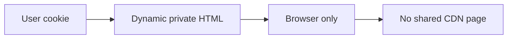
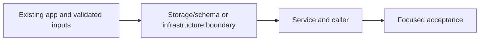

# 30. HTTP cache privacy after nonce CSP

## 1. In one sentence

A cross-user cache leak exposes private data, and cached nonce HTML breaks CSP assumptions.

## 2. The big picture

## 3. Concepts and current behavior

P10 supersedes the earlier public /events HTML caching experiment: all HTML/RSC responses use private,no-store and fresh CSP nonces. Static assets retain their normal caching. CloudFront code is implemented but inactive (cdnEnabled=false); its minimum/default events TTL is zero.

### caching Next pages that must not be shared (Next server, CloudFront)

Cache public data, never a shared personalized page. P10 generates a nonce for every HTML/RSC request and explicitly sends private,no-store for those responses. Keep user-bound queries out of shared server caches. A CDN must honor no-store; a positive CloudFront minimum TTL can override origin privacy directives.

`apps/web/src/proxy.ts` and `apps/web/next.config.ts` guard HTML caching. `apps/web/src/features/events/server/cached-events.ts` only stores public catalogue data. `infra/src/entry/cdn.ts` has zero minimum/default TTL on the events policy. CloudFront is inactive: `cdnEnabled=false`. Run `pnpm demo:security`.

Why: A cross-user cache leak exposes private data, and cached nonce HTML breaks CSP assumptions.

Trade-offs: Per-user edge keys are difficult to audit and multiply cache entries. No-store simplifies privacy at server cost. Static JS/images can still be cached.

## 4. Dependency order

The concrete prerequisites are the source files and current settings named above. Migrations precede the consuming image rollout; IAM permissions precede the job that uses them.

## 5. What breaks and how we notice

Does Vary: Cookie make every policy safe? No; the CDN cache key and minimum TTL must also agree. 10x: inspect headers on HTML and RSC. 100x: centralize cache policy tests and keep any public HTML strategy separate.

Current limits: P10 supersedes the earlier public /events HTML caching experiment: all HTML/RSC responses use private,no-store and fresh CSP nonces. Static assets retain their normal caching. CloudFront code is implemented but inactive (cdnEnabled=false); its minimum/default events TTL is zero.

## 6. Interview questions with short answers

1. **caching Next pages that must not be shared (Next server, CloudFront)** Cache public data, never a shared personalized page. P10 generates a nonce for every HTML/RSC request and explicitly sends private,no-store for those responses. Keep user-bound queries out of shared server caches. A CDN must honor no-store; a positive CloudFront minimum TTL can override origin privacy directives.

2. **Which CloudFront setting can override no-store?** A positive minimum TTL

3. **Why does this boundary exist?** A cross-user cache leak exposes private data, and cached nonce HTML breaks CSP assumptions.

4. **Which alternative would you compare?** Per-user edge keys are difficult to audit and multiply cache entries. No-store simplifies privacy at server cost. Static JS/images can still be cached.

5. **What changes at 10x or 100x?** 10x: inspect headers on HTML and RSC. 100x: centralize cache policy tests and keep any public HTML strategy separate.

6. **What is the important counter-question?** Does Vary: Cookie make every policy safe? No; the CDN cache key and minimum TTL must also agree.

## 7. Check yourself

1. Trace the exact source path and identify the invariant it protects.
2. Which CloudFront setting can override no-store?
3. Which failure requires live AWS acceptance rather than local evidence?

## How this connects

Uses the [architecture](00-architecture.md) and [previous step](29-next-data-cache.md). Continue with [next step](31-oidc-publish.md). Practice the [scenario](handbook/guides/interview-scenarios.md#private-page-cache) and [explorer tour](handbook/guides/infra-explorer.html?tour=security-layers).

## Historical evidence and open limits

The following is the implementation-time record, preserved from PENDING. Measurements describe that earlier local run, not a fresh benchmark. Later behavior is stated above; old “not built” statements may be superseded. Owner setup recipes are intentionally replaced by the current [deploy runbook](20-deploy-day.md). No old preview is a promise about today’s stack.

### Feature 1, Step 9b: HTTP cache headers, CloudFront page caching for `/events`, cache privacy (would be `docs/30-*`).

- **Concepts:** Cache-Control directives (no-store vs no-cache vs private; public, max-age vs s-maxage = browser vs shared cache; stale-while-revalidate); privacy first (API default `no-store` hook; private pages `private, no-store`; Set-Cookie answers never cacheable); what Next 16.4 really sends (prod build: dynamic `/events` = `private, no-cache, no-store, max-age=0, must-revalidate`; STATIC `/dashboard`, `/admin/events/new`, `/`, `/login`, `/signup` = `s-maxage=31536000`; `next dev` = always `no-store`) and that it CAN be changed: Next sets its value only if none is set yet (`send-payload.js` "allow users to customize it via next.config"), so `headers()` in next.config wins in prod; CloudFront TTL semantics (minTtl 0 = respect no-store/private, minTtl > 0 stores even no-store; defaultTtl = no header; maxTtl caps s-maxage AND ends the SWR window); cache key vs Vary (CloudFront ignores Vary); THE RSC TRAP (same URL, HTML vs `text/x-component`; key must hold RSC/Next-Router-*/Next-Url; Next 16 `validateRSCRequestHeaders` (default true) 307s when `_rsc` ≠ hash of those headers → dropping `_rsc` or a header at the edge = redirect loop); query-string allowlist vs key explosion (Step 8); no cookies forwarded = HTML provably the same for all; invalidation API vs short TTL.
- **Key files:** api `http/no-store.ts` `addNoStoreDefault` (+ `no-store.test.ts`), `app.ts` step 1c (registered before CORS); web `next.config.ts` `headers()` (`/events` rule has `missing: rsc`); `e2e/cache-headers.spec.ts` (`E2E_PRODUCTION_BUILD=1` or CI = exact prod values; dev = only the everywhere-true rules); infra `entry/cdn.ts` 2b `eventsPagePolicy` (min 0 / default 0 / max 330; query `venue,from,to,_rsc`; headers `RSC, Next-Router-State-Tree, Next-Router-Prefetch, Next-Router-Segment-Prefetch, Next-Url`; cookies none; gzip+br) + `/events` behavior (no origin request policy).
- **Measured (local, 2026-10-13, own prod build web :3101 + API :4101):** `/events` HTML → `public, max-age=0, s-maxage=30, stale-while-revalidate=300` (also with `?utm_source=x`, HEAD); `/events` with `RSC: 1` + prefetch → 307 `?_rsc=<hash>` (no Cache-Control!) then 200 `text/x-component` `private, no-cache, no-store, max-age=0, must-revalidate`; `/events/` → 308. `/dashboard`, `/admin/events/new` (fake sid) → `private, no-store` (was `s-maxage=31536000`), proxy's 307 to /login too, RSC too. API `auth.me`, `/health`, 401 login → `no-store`; real login → `no-store` + `set-cookie: sid=…; HttpOnly; SameSite=Lax`. `/events` HTML logged-in vs logged-out: byte-identical after masking `dehydratedAt` (same 29 229 bytes; two anonymous renders differ the same way); nav is `<nav aria-label="Main">` empty. Unit 142/142; e2e 24/24 on own prod build (hook on); on owner's dev servers 19 passed, 3 skipped (prod-only), 2 failed = the two admin hook tests (owner's env has no `WEB_INTERNAL_URL`/`REVALIDATE_SECRET`; known since 9a). Mutations caught: hook body removed (4 fail), hook after CORS (preflight test fails), `missing: rsc` removed (RSC test fails: Next keeps the public header on the payload).
- **Unsure / for the docs:** (1) `pulumi preview` NOT run: AWS SSO session expired. (2) Not tested on real CloudFront (cache hits, SWR, `_rsc` forwarding, Host = ALB name since no origin request policy, User-Agent = "Amazon CloudFront" so Next never takes its bot path). (3) Browsers may apply `stale-while-revalidate=300` despite `max-age=0` (RFC 5861 applies to any cache); Next's client navigation is RSC (uncached) so it mostly affects plain link/typed visits. (4) A cached HTML copy keeps its render's `dehydratedAt`; when older than `useEvents`' 30 s staleTime the browser refetches events.list after hydration (self-heals, one API call; reasoned, not measured). (5) Worst-case staleness for a new event via CloudFront: ~30 s busy page; quiet page: one visitor up to 330 s (+ Next data cache 30 s on AWS while the hook isn't wired). (6) `/`, `/login`, `/signup` still send `s-maxage=31536000` (static, same for all, default behavior has caching off): harmless now, worth a sentence. (7) Free-text `venue` and junk `_rsc` values (without RSC header) still make new edge entries. (8) Invalidation API: first 1,000 paths/month free then $0.005/path, seconds-to-minutes, needs IAM + SDK in the api task → short TTL chosen. (9) `next start` warns it doesn't fit `output: standalone` (works). The local `.next` is now a prod build pointing at API :4101.

| Route / procedure | Browser | CloudFront | Next.js | React Query | Redis | Why |
|---|---|---|---|---|---|---|
| `/events` HTML | no (max-age=0) | yes, 30 s + 5 min SWR | data cache 30 s (page HTML not) | yes, 30 s staleTime | yes (events.list) | same for everyone; key = venue/from/to only |
| `/events` RSC (`RSC: 1`) | no | no (private, no-store) | data cache only | yes | yes | depends on the visitor's router state |
| `/`, `/login`, `/signup` | no | no (default behavior) | prerendered at build | – | – | static; nothing to gain at the edge yet |
| `/dashboard*`, `/admin/*` | no | no | no | profile/me in memory only | – | private pages: `private, no-store` |
| `/api/revalidate` (POST) | no | no (POST not allowed on default) | – | – | – | state-changing webhook |
| `/_next/static/*` | yes, 1 year immutable | yes | – | – | – | hashed file names never change |
| `auth.me`, `account.profile` | no | no | no | yes (per tab, in memory) | session lookup only | per-user data |
| `auth.login` / `signup` / `logout` | no | no | no | no (mutations) | sessions (not a cache) | Set-Cookie / writes |
| `events.list` (tRPC) | no (no-store) | no (/trpc/* disabled) | via data cache | yes | yes, SWR | Redis is the shared cache; HTTP stays no-store by default |
| `events.create` | no | no | invalidates (hook) | invalidates queries | invalidates (gen bump) | write |
| API `/health`, `/ready` | no | not routed | – | – | – | live status |
