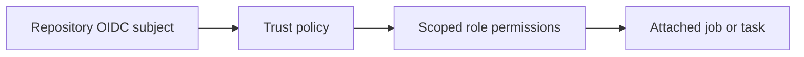
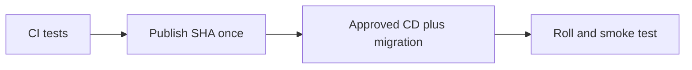
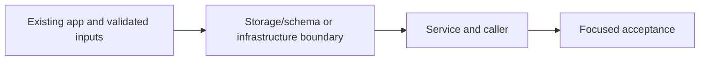
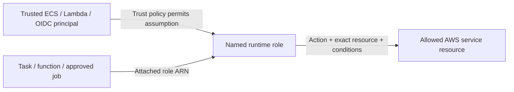

# 31. Publish once with GitHub OIDC

## 1. In one sentence

A reachable AWS endpoint is not permission to invoke it.

## 2. The big picture

## 3. Concepts and current behavior

Publish and deploy are jobs in .github/workflows/cd.yml. Publish now covers three repositories (api, web, worker). The immutable OIDC subject is configured from owner/repo ids; deploy uses the environment:dev subject. Only CD writes the SSM image tag. There is no separate publish.yml.

### IAM roles and OIDC: who can wear which badge?

A trust policy says who can assume a role; a permission policy says which actions/resources it can access; attachment says which runtime uses it. GitHub OIDC exchanges an approved repository/environment identity for short-lived AWS credentials. Task execution retrieves images/secrets; application roles authorize runtime AWS calls.

`infra/src/cicd.ts` restricts OIDC subjects and PassRole. `infra/src/publish-policy.ts` includes ECR read/write actions needed by publish; `compute/iam.ts` separates API execution/application roles. Read the D1 Every IAM badge tour and runbook §3.11. Live deploy acceptance remains owner work.

Why: A reachable AWS endpoint is not permission to invoke it.

Trade-offs: Resource wildcards needed for APIs without resource scoping require conditions where supported. Broad deploy capability is dangerous; do not let old infrastructure runs apply.

### How does build-once delivery and rollback work?

Publish API/web/worker images once with the git SHA after CI, then deploy that immutable release. The environment switches live in committed Pulumi YAML; deployed image tag lives in SSM and is written by CD. Migration runs before rollout. Roll back app images to a known tag while respecting current schema and current infrastructure.

The publish job in `.github/workflows/cd.yml` builds/pushes; its deploy job resolves release and runs two-phase deploy/migrate/smoke checks. `infra/src/image-tag.ts` reads the tag; `release.ts` tracks last deployed commit. See runbook §3.11–3.18. No publish, AWS write or live rollback was performed by this documentation work.

Why: Rebuilding on deploy can ship bytes that were never reviewed or tested.

Trade-offs: Rolling deployment overlaps versions. Blue/green gives a switchable target but costs overlap and still needs compatible migrations. Secrets/config are part of release compatibility.

## 4. Dependency order

The concrete prerequisites are the source files and current settings named above. Migrations precede the consuming image rollout; IAM permissions precede the job that uses them.

## 5. What breaks and how we notice

Why did worker publish need BatchGetImage? Publishing tooling reads image manifests as well as uploading layers. 10x: environment protection/expiry and policy review. 100x: separate accounts, policy-as-code and change approvals tied to exact SHA.

Should rollback run old Pulumi code? No; image rollback and infrastructure rollback are different risks. 10x: expired approvals and automated rollback criteria. 100x: canary analysis, immutable manifests and cross-service compatibility.

Current limits: Publish and deploy are jobs in .github/workflows/cd.yml. Publish now covers three repositories (api, web, worker). The immutable OIDC subject is configured from owner/repo ids; deploy uses the environment:dev subject. Only CD writes the SSM image tag. There is no separate publish.yml.

## 6. Interview questions with short answers

1. **IAM roles and OIDC: who can wear which badge?** A trust policy says who can assume a role; a permission policy says which actions/resources it can access; attachment says which runtime uses it. GitHub OIDC exchanges an approved repository/environment identity for short-lived AWS credentials. Task execution retrieves images/secrets; application roles authorize runtime AWS calls.

2. **What answers who may assume a role?** Trust policy

3. **Why does this boundary exist?** A reachable AWS endpoint is not permission to invoke it.

4. **Which alternative would you compare?** Resource wildcards needed for APIs without resource scoping require conditions where supported. Broad deploy capability is dangerous; do not let old infrastructure runs apply.

5. **What changes at 10x or 100x?** 10x: environment protection/expiry and policy review. 100x: separate accounts, policy-as-code and change approvals tied to exact SHA.

6. **What is the important counter-question?** Why did worker publish need BatchGetImage? Publishing tooling reads image manifests as well as uploading layers.

## 7. Check yourself

1. Trace the exact source path and identify the invariant it protects.
2. What answers who may assume a role?
3. Which failure requires live AWS acceptance rather than local evidence?

## How this connects

Uses the [architecture](00-architecture.md) and [previous step](30-cache-privacy.md). Continue with [next step](32-service-connect.md). Practice the [scenario](handbook/guides/interview-scenarios.md#iam-oidc) and [explorer tour](handbook/guides/infra-explorer.html?tour=iam-badges).

## Historical evidence and open limits

The following is the implementation-time record, preserved from PENDING. Measurements describe that earlier local run, not a fresh benchmark. Later behavior is stated above; old “not built” statements may be superseded. Owner setup recipes are intentionally replaced by the current [deploy runbook](20-deploy-day.md). No old preview is a promise about today’s stack.

### Step 12a: CD part 1, publish images to ECR from GitHub Actions with OIDC, no deploy yet (would be `docs/31-*`).

- **Concepts:** CI vs CD (CI = "is this commit good?", CD = "ship the commit CI approved"); workflow_run gating (`types: [completed]` also fires on failure → `conclusion == 'success'`; `branches: [main]` matches the BRANCH NAME, so a fork PR from a branch called "main" would match → also require `event == 'push'`; cd.yml is read from main only); OIDC vs stored keys (short-lived JWT → `sts:AssumeRoleWithWebIdentity` → 1 h credentials; nothing to leak or rotate); trust conditions (`aud` = sts.amazonaws.com; `sub` = `<githubSubjectPrefix>:ref:refs/heads/main`, immutable subject format `repo:maheshnd@63289193/minitickets@1412723955:ref:refs/heads/main` (owner/repo IDs, so a renamed or re-created repo with the same name can't match); without `sub` ANY GitHub repo could assume the role, since the provider trusts all of GitHub; StringEquals, not StringLike); least privilege (publish role = ECR login + 7 push/pull actions on 2 repo ARNs; no delete, no ECS; the deploy step gets its OWN role); build once / promote (the CD image is the only build of a commit; web has no baked-in API URL, so one image fits every environment); immutable tags + idempotent re-runs (check with `imagetools inspect` = `ecr:BatchGetImage`, so no `DescribeImages` needed; skip if present; concurrency group per SHA so two runs cannot race); repo variable vs secret (an ARN is an address, not a password); native ARM runner vs QEMU (free for public repos; emulation is several times slower); GHA build cache per arch (`api-arm64` vs CI's `api`); checkout `workflow_run.head_sha`, not "main".
- **Key files:** `.github/workflows/cd.yml` (read first: flow diagram at top, steps 1-18); `infra/src/cicd.ts` `createCicd` (provider, trust policy step 4, permission policy step 6); `infra/src/registry.ts` (now also returns `apiRepoArn`/`webRepoArn`); `infra/index.ts` 8b + 27b (`publishRoleArn` output); `infra/Pulumi.dev.yaml` (`githubSubjectPrefix`; replaced `githubOwner`/`githubRepo`, which built the old names-only `sub` that never matched this repo's tokens); `ci.yml` (docker job comment only).
- **Measured (local, 2026-10-13):** `pnpm typecheck` + `pnpm lint` OK; actionlint 1.7.7 (Docker, with shellcheck 0.10.0, proven active on a bad sample) → 0 errors on cd.yml and ci.yml. `docker buildx imagetools inspect` on Docker Hub: existing tag → digest + exit 0; missing → "…: not found" + exit 1. Repo visibility = PUBLIC (so `ubuntu-24.04-arm` is free).
- **Unsure / for the docs:** (1) `pulumi preview` NOT run: AWS SSO session expired. Expected: + OIDC provider, + role, + role policy, new output `publishRoleArn`, nothing else. (2) Not checked whether the account already has a GitHub OIDC provider (only one per URL is allowed; `pulumi up` would fail with EntityAlreadyExists → then `pulumi import` it instead). (3) The "not found" text was tested on Docker Hub, not ECR. (4) Nothing ran on GitHub yet: workflow_run only fires once cd.yml is on main. (5) A manual run skips the CI gate (builds main's newest commit). (6) RISK for the deploy step: the ECR lifecycle keeps only the newest 10 tagged images; with CD on every push to main, the tag pinned in Pulumi config (`8510e1f`) is deleted after 10 more pushes, and ECS then can't pull it on a task restart. (7) CI's docker job builds x86 only; an ARM-only build failure would show up first in CD. (8) Tag = `--short=7`; push-images.sh uses `--short` (auto length, 7 today). (9) A custom OIDC `sub` template, or adding `environment:` to the job, changes `sub` → the role refuses.
- **For Step 12b (deploy role):** its trust policy `sub` must be `${githubSubjectPrefix}:environment:dev` (the deploy job uses `environment: dev`, so GitHub writes `:environment:dev`, not `:ref:...`). Reuse the same `githubSubjectPrefix` config; never build `sub` from names (`repo:<owner>/<repo>`): this repo uses immutable subjects (`gh api repos/<owner>/<repo>/actions/oidc/customization/sub` → `use_immutable_subject: true`).

## IAM: WHO / WHAT / ATTACHED

The phase's historical resource/permission record above lists exact actions and scopes. The [current IAM badge table](handbook/guides/infra-build-along.md#every-iam-badge-who--what--attached) separates API execution, API application, web execution, email, ticket, publish and deploy roles. Execution secret injection is not application authorization. Queue resource policy source-topic/account conditions are separate from the runtime role. Review the actual inline statements before granting an action; local emulator success does not validate IAM.
