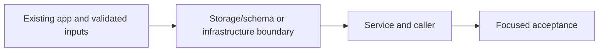
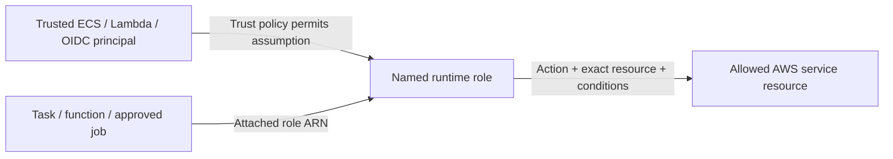

# 32. Private calls with ECS Service Connect

## 1. In one sentence

A valid password cannot repair a missing route or blocked SG.

## 2. The big picture

## 3. Concepts and current behavior

Service Connect is implemented with api and web aliases and proxy ingress 14000/13000. ALB traffic stays on app ports 4000/3000. Loopback peers are never trusted for forwarded-header identity. Initial endpoint discovery can require an API rollout after web is created; CD handles this.

### Routes, SGs, NACLs, ENIs and private DNS: what actually connects?

First prove reach: address, route, subnet and listener. Then prove allowed: SG source/port and IAM for service APIs. Finally prove credentials. SGs are stateful; NACLs are subnet-level/stateless. An ENI is the task’s network interface. Service Connect gives web/api private names and ports without exposing internal traffic through a public browser URL.

`infra/src/network.ts` defines routes; `security.ts` allows ALB→web/API and API→Postgres/Valkey. `compute/service-connect.ts` defines namespace aliases. API_INTERNAL_URL is for web server code; browser tRPC uses same-origin ALB routing. Read `infra/src/compute/service-connect.ts` and follow the private-name console tour.

Why: A valid password cannot repair a missing route or blocked SG.

Trade-offs: Public ECS task IPs avoid NAT in this small design but require strict inbound SGs. Private subnets with NAT/endpoints change cost and reach.

## 4. Dependency order

The concrete prerequisites are the source files and current settings named above. Migrations precede the consuming image rollout; IAM permissions precede the job that uses them.

## 5. What breaks and how we notice

Can browser JS call the Service Connect hostname? No; it is private service discovery for tasks. 10x: map all egress and proxy trust. 100x: segmentation, IPv6/endpoints and flow logs after a concrete need.

Current limits: Service Connect is implemented with api and web aliases and proxy ingress 14000/13000. ALB traffic stays on app ports 4000/3000. Loopback peers are never trusted for forwarded-header identity. Initial endpoint discovery can require an API rollout after web is created; CD handles this.

## 6. Interview questions with short answers

1. **Routes, SGs, NACLs, ENIs and private DNS: what actually connects?** First prove reach: address, route, subnet and listener. Then prove allowed: SG source/port and IAM for service APIs. Finally prove credentials. SGs are stateful; NACLs are subnet-level/stateless. An ENI is the task’s network interface. Service Connect gives web/api private names and ports without exposing internal traffic through a public browser URL.

2. **Which control is stateful?** Security group

3. **Why does this boundary exist?** A valid password cannot repair a missing route or blocked SG.

4. **Which alternative would you compare?** Public ECS task IPs avoid NAT in this small design but require strict inbound SGs. Private subnets with NAT/endpoints change cost and reach.

5. **What changes at 10x or 100x?** 10x: map all egress and proxy trust. 100x: segmentation, IPv6/endpoints and flow logs after a concrete need.

6. **What is the important counter-question?** Can browser JS call the Service Connect hostname? No; it is private service discovery for tasks.

## 7. Check yourself

1. Trace the exact source path and identify the invariant it protects.
2. Which control is stateful?
3. Which failure requires live AWS acceptance rather than local evidence?

## How this connects

Uses the [architecture](00-architecture.md) and [previous step](31-oidc-publish.md). Continue with [next step](33-alb-https.md). Practice the [scenario](handbook/guides/interview-scenarios.md#network-boundaries) and [explorer tour](handbook/guides/infra-explorer.html?tour=database-reach).

## Historical evidence and open limits

The following is the implementation-time record, preserved from PENDING. Measurements describe that earlier local run, not a fresh benchmark. Later behavior is stated above; old “not built” statements may be superseded. Owner setup recipes are intentionally replaced by the current [deploy runbook](20-deploy-day.md). No old preview is a promise about today’s stack.

### Step 11h: ECS Service Connect, so web and api tasks call each other inside AWS (SSR `API_INTERNAL_URL`, revalidate `WEB_INTERNAL_URL`); would be `docs/32-*`.

- **Concepts:** service discovery (Cloud Map HTTP namespace `minitickets.internal` = the phone book); Service Connect = names + sidecar proxy (Envoy, added by ECS, shares task CPU/mem; client proxy → server proxy → `127.0.0.1:<port>`); client vs server (both services are both); named port + `appProtocol: http`; `ingressPortOverride` (14000/13000) keeps the ALB path OFF the proxy (by default ALB traffic in awsvpc goes THROUGH it); source-group rules on the PROXY ports (web→api 14000, api→web 13000), not 4000/3000; shared secret via ONE Secrets Manager secret read by both execution roles (web role: only that ARN); endpoint ordering (a task learns names at start → web waits for api; api needs a one-time `--force-new-deployment`). Trade-off table for the docs:

  | | Service Connect (chosen) | Cloud Map DNS (service discovery) | Internal ALB |
  |---|---|---|---|
  | How a caller finds it | proxy in own task, names from Cloud Map API | DNS A records per task (Route 53 private zone) | one fixed DNS name |
  | Cost (dev) | proxy CPU/mem in each task (here: task size ×2); Cloud Map cents | ~$0.50/month hosted zone + queries | ~$16+/month per ALB, hourly |
  | Failover / retries | proxy retries (2), outlier detection, per-request timeouts | DNS caching: dead IPs until TTL/expiry | ALB health checks |
  | Metrics | per-service request/error metrics in ECS | none | ALB metrics |
  | Catch | new names only reach NEW tasks; sidecar resources | client must handle DNS TTLs | another hop + SG + listener to run |

- **Key files:** `infra/src/compute/service-connect.ts` `createServiceConnect` (read first: WHY + diagram), `compute/revalidate-secret.ts` `createRevalidateSecret`, `compute/service.ts` 1g, `compute/web-service.ts` 1f (waits for api), `compute/task.ts` 2b/2e/2f/2g, `compute/web-task.ts` 2b/2e/2f, `compute/web-iam.ts` 4, `compute/iam.ts` 5, `infra/index.ts` 12b/18b/19/22-24; `apps/api/src/config/trust-proxy.ts` (localhost rule) + test.
- **Trust proxy:** ALB traffic unchanged (hop 0 = ALB IP, 2 hops → visitor). Direct web→api arrives from 127.0.0.1 (the api's proxy). MEASURED before the fix: hops=2, remote 127.0.0.1, forged `XFF: 6.6.6.6, 7.7.7.7` + `XFP: https` → `ip 6.6.6.6, https`. Fix: hop 0 on localhost is never trusted → `ip 127.0.0.1, http`. Was not exploitable today (only web tasks reach port 14000 and the web server forwards no headers), now it does not depend on that.
- **Measured (2026-10-13):** typecheck, lint OK; unit 143/143 (+1). `pulumi preview` all off: 34 unchanged, 0 changes. data+compute+entry on (tags `8510e1f`): **+38 create, 34 unchanged** (7 new vs 11g: namespace, random value, secret, secret version, 2 ingress rules, web role policy); planned: both tasks 512/1024, api SC `{api, clientAlias 4000, ingress 14000}`, web `{web, 3000, 13000}`. data+compute only: +17, api task 256/512, no SC resources. Switches reset to false (Pulumi.dev.yaml byte-identical).
- **Cost:** Fargate ARM us-east-1 on demand: 0.25 vCPU/0.5 GB = $0.0099/h → 0.5/1 GB = $0.0198/h per task (2 tasks: +$0.02/h; Spot ≈ ⅓). Secrets Manager +$0.40/month (prorated). Cloud Map: cents.
- **Unsure / for the docs:** (1) Container env/secrets are `[unknown]` in a preview (they depend on new ARNs), checked only by types + code reading. (2) Whether the Service Connect Envoy appends to XFF is NOT documented; the override makes it irrelevant for ALB traffic. (3) Nothing ran on AWS yet. (4) `HOSTNAME=0.0.0.0` / `HOST=0.0.0.0` also covers the proxy's 127.0.0.1. (5) No proxy log config (`logConfiguration`) added; add if 503s from the proxy need debugging. (6) The api SG's AWS description still says "reachable only from the load balancer" (can't change without replacing the group).
- **Deploy-day checks:** after `pulumi up` with all three on: `aws ecs update-service --cluster minitickets-dev --service minitickets-dev-api --force-new-deployment` (once, so api learns "web"). Then (a) `curl -s $(pulumi stack output appUrl)/events | grep -c <event title>` → SSR HTML contains events (web logs: no `API_INTERNAL_URL` / fetch errors); (b) admin creates an event → reload `/events` at once → it is there (api logs: no "web revalidate hook" error; a 401 = secrets differ). In the ECS console both services show Service Connect "api"/"web" with healthy endpoints.

## IAM: WHO / WHAT / ATTACHED

The phase's historical resource/permission record above lists exact actions and scopes. The [current IAM badge table](handbook/guides/infra-build-along.md#every-iam-badge-who--what--attached) separates API execution, API application, web execution, email, ticket, publish and deploy roles. Execution secret injection is not application authorization. Queue resource policy source-topic/account conditions are separate from the runtime role. Review the actual inline statements before granting an action; local emulator success does not validate IAM.
