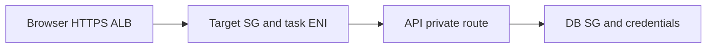
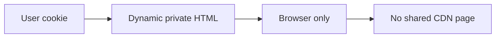
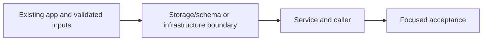

# 33. HTTPS directly on the ALB

## 1. In one sentence

A valid password cannot repair a missing route or blocked SG.

## 2. The big picture

## 3. Concepts and current behavior

The committed shape is ALB HTTPS on minitickets.theversehub.in, with cdnEnabled=false. ACM DNS validation records must remain for renewal. Do not promise a fixed certificate lifetime/renewal month. Domain CNAME and allowedCidrs are owner operations; switching CDN mode requires entry off first.

### Routes, SGs, NACLs, ENIs and private DNS: what actually connects?

First prove reach: address, route, subnet and listener. Then prove allowed: SG source/port and IAM for service APIs. Finally prove credentials. SGs are stateful; NACLs are subnet-level/stateless. An ENI is the task’s network interface. Service Connect gives web/api private names and ports without exposing internal traffic through a public browser URL.

`infra/src/network.ts` defines routes; `security.ts` allows ALB→web/API and API→Postgres/Valkey. `compute/service-connect.ts` defines namespace aliases. API_INTERNAL_URL is for web server code; browser tRPC uses same-origin ALB routing. Read `infra/src/compute/service-connect.ts` and follow the private-name console tour.

Why: A valid password cannot repair a missing route or blocked SG.

Trade-offs: Public ECS task IPs avoid NAT in this small design but require strict inbound SGs. Private subnets with NAT/endpoints change cost and reach.

### caching Next pages that must not be shared (Next server, CloudFront)

Cache public data, never a shared personalized page. P10 generates a nonce for every HTML/RSC request and explicitly sends private,no-store for those responses. Keep user-bound queries out of shared server caches. A CDN must honor no-store; a positive CloudFront minimum TTL can override origin privacy directives.

`apps/web/src/proxy.ts` and `apps/web/next.config.ts` guard HTML caching. `apps/web/src/features/events/server/cached-events.ts` only stores public catalogue data. `infra/src/entry/cdn.ts` has zero minimum/default TTL on the events policy. CloudFront is inactive: `cdnEnabled=false`. Run `pnpm demo:security`.

Why: A cross-user cache leak exposes private data, and cached nonce HTML breaks CSP assumptions.

Trade-offs: Per-user edge keys are difficult to audit and multiply cache entries. No-store simplifies privacy at server cost. Static JS/images can still be cached.

## 4. Dependency order

The concrete prerequisites are the source files and current settings named above. Migrations precede the consuming image rollout; IAM permissions precede the job that uses them.

## 5. What breaks and how we notice

Can browser JS call the Service Connect hostname? No; it is private service discovery for tasks. 10x: map all egress and proxy trust. 100x: segmentation, IPv6/endpoints and flow logs after a concrete need.

Does Vary: Cookie make every policy safe? No; the CDN cache key and minimum TTL must also agree. 10x: inspect headers on HTML and RSC. 100x: centralize cache policy tests and keep any public HTML strategy separate.

Current limits: The committed shape is ALB HTTPS on minitickets.theversehub.in, with cdnEnabled=false. ACM DNS validation records must remain for renewal. Do not promise a fixed certificate lifetime/renewal month. Domain CNAME and allowedCidrs are owner operations; switching CDN mode requires entry off first.

## 6. Interview questions with short answers

1. **Routes, SGs, NACLs, ENIs and private DNS: what actually connects?** First prove reach: address, route, subnet and listener. Then prove allowed: SG source/port and IAM for service APIs. Finally prove credentials. SGs are stateful; NACLs are subnet-level/stateless. An ENI is the task’s network interface. Service Connect gives web/api private names and ports without exposing internal traffic through a public browser URL.

2. **Which control is stateful?** Security group

3. **Why does this boundary exist?** A valid password cannot repair a missing route or blocked SG.

4. **Which alternative would you compare?** Public ECS task IPs avoid NAT in this small design but require strict inbound SGs. Private subnets with NAT/endpoints change cost and reach.

5. **What changes at 10x or 100x?** 10x: map all egress and proxy trust. 100x: segmentation, IPv6/endpoints and flow logs after a concrete need.

6. **What is the important counter-question?** Can browser JS call the Service Connect hostname? No; it is private service discovery for tasks.

## 7. Check yourself

1. Trace the exact source path and identify the invariant it protects.
2. Which control is stateful?
3. Which failure requires live AWS acceptance rather than local evidence?

## How this connects

Uses the [architecture](00-architecture.md) and [previous step](32-service-connect.md). Continue with [next step](34-approved-delivery.md). Practice the [scenario](handbook/guides/interview-scenarios.md#network-boundaries) and [explorer tour](handbook/guides/infra-explorer.html?tour=database-reach).

## Historical evidence and open limits

The following is the implementation-time record, preserved from PENDING. Measurements describe that earlier local run, not a fresh benchmark. Later behavior is stated above; old “not built” statements may be superseded. Owner setup recipes are intentionally replaced by the current [deploy runbook](20-deploy-day.md). No old preview is a promise about today’s stack.

### Step 11i: HTTPS on the ALB with our own subdomain + `cdnEnabled` switch (deploy without CloudFront); would be `docs/33-*`. Config: `cdnEnabled` (default true), `domainName`, `allowedCidrs` (default `["0.0.0.0/0"]`), validated in `entry/mode.ts`.

- **Concepts:** TLS termination at the ALB; ACM + DNS validation (proves DNS control; auto-renew while the record stays; free; regional, us-east-1 = ALB = CloudFront's region); cert ALWAYS on (not behind entry) so it's ISSUED before deploy day, `CertificateValidation` (a wait, 10 min timeout) lives in the entry layer; TLS policy `ELBSecurityPolicy-TLS13-1-2-2021-06` (TLS 1.2+1.3, RFC 8996); 301 http→https; HSTS (1 day, no includeSubDomains, no preload, never localhost, prod + `x-forwarded-proto: https` only); trust-proxy hop count per mode (2/1/0; one too many = client picks its IP); ALB SG rules for `allowedCidrs` exist only while the ALB exists; external DNS (not Route 53): CNAME to a NEW ALB name every deploy day.
- **Key files:** `infra/src/certificate.ts` `createCertificate`; `entry/https-listener.ts` `createHttpsListener`; `entry/alb-public-ingress.ts`; `entry/mode.ts` `trustedProxyHops`/`parseDomainName`/`parseAllowedCidrs` (+ `mode.test.ts`, vitest now includes `infra/src`); `security.ts` rule 6 behind `cdnEnabled`; `index.ts` 0, 3b, 10a2, 14b, 16-18a, 19, 29-30 (`routing` = whichever listener exists; outputs `appDnsRecord`, `certificateArn`, `certificateValidationRecord`); api `config/trust-proxy.ts` comment + 3 tests (1 hop; 2 hops behind ALB-only → forged `6.6.6.6` believed); web `next.config.ts` `hstsRules`, `e2e/hsts.spec.ts`; `docs/20-deploy-day.md` (Path A/B, 3.0b, 3.3 CNAME + 11h restart, 3.5 j/k, counts refreshed).
- **Measured (2026-10-13):** typecheck, lint OK; unit 154/154. Own prod build web :3101 + API :4101: HSTS `max-age=86400` on `/`, `/events`, a static JS file with `XFP: https` + Host `minitickets.example.com`; absent with XFP http, Host localhost/127.0.0.1, no XFP. e2e `hsts` + `cache-headers` 10/10. `pulumi preview`: all off + cdn=false + domain: **+1 (cert), −1 (CloudFront SG rule)**, 33 unchanged; data+compute+entry on, cdn=false: **+39, −1**, 33 unchanged, no CloudFront/origin secret; regression cdn=true, no domain, all on: **+38, 34 unchanged** (same as 11h). TLS policy name checked with `aws elbv2 describe-ssl-policies`. Switches back to false; `cdnEnabled=false` + `domainName` kept in `Pulumi.dev.yaml`.
- **Later (not built): HTTPS CloudFront → ALB.** Origin protocol `https-only`; CloudFront checks the origin cert against the ORIGIN name, and `*.elb.amazonaws.com` is not on ours → add `origin.minitickets.theversehub.in` (SAN on the cert + CNAME to the ALB) as the origin domain; ALB :443 listener WITH the secret-header rules; SG 443 from the CloudFront prefix list; optional custom domain on CloudFront (alias + this us-east-1 cert); hops stay 2. Also HSTS in Path A would come from a CloudFront response headers policy (the web app sees `XFP: http` there).
- **Unsure / for the docs:** (1) The all-off preview is +1/−1, not "only the cert": the CloudFront-only rule is dropped whenever cdnEnabled=false (it'd let any CloudFront distribution in). (2) Switching `cdnEnabled` with entry ON fails (two port-80 listeners; Pulumi creates before deleting) → documented "switch only with entry off", not enforced. (3) Container env is `[unknown]` in a preview, so `TRUST_PROXY_HOPS=1` / `WEB_ORIGIN` on AWS rest on unit tests + code reading. (4) Nothing ran on AWS; not checked: real cert issuance, whether ALB's redirect writes `:443`, the ALB overwriting a client's `X-Forwarded-Proto`. (5) ALB can add HSTS itself (listener response-header attributes) — alternative not used. (6) Admin on AWS = `node -e` pg one-liner via ECS Exec (runbook 3.5 j; dry-run tested locally: `[]`).
