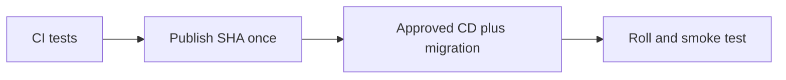
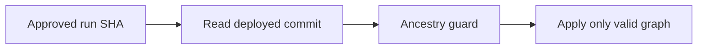
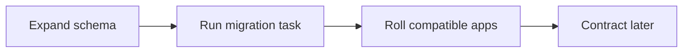
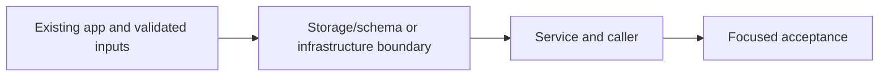
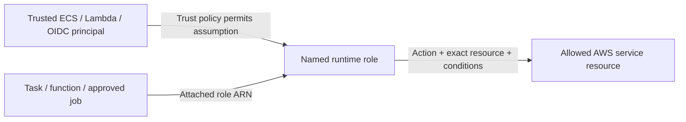

# 34. Approved delivery, migrations and stale-run safety

## 1. In one sentence

Rebuilding on deploy can ship bytes that were never reviewed or tested.

## 2. The big picture

## 3. Concepts and current behavior

Shape is committed Pulumi.dev.yaml; image tag and deployed infrastructure commit are SSM records. CD uses the newest guard and refuses superseded/ancestor infrastructure runs. App rollback uses current infrastructure and an older compatible image. Dedicated migration definition runs the new SHA before application rollout; no manual per-image config tags belong in committed YAML.

### How does build-once delivery and rollback work?

Publish API/web/worker images once with the git SHA after CI, then deploy that immutable release. The environment switches live in committed Pulumi YAML; deployed image tag lives in SSM and is written by CD. Migration runs before rollout. Roll back app images to a known tag while respecting current schema and current infrastructure.

The publish job in `.github/workflows/cd.yml` builds/pushes; its deploy job resolves release and runs two-phase deploy/migrate/smoke checks. `infra/src/image-tag.ts` reads the tag; `release.ts` tracks last deployed commit. See runbook §3.11–3.18. No publish, AWS write or live rollback was performed by this documentation work.

Why: Rebuilding on deploy can ship bytes that were never reviewed or tested.

Trade-offs: Rolling deployment overlaps versions. Blue/green gives a switchable target but costs overlap and still needs compatible migrations. Secrets/config are part of release compatibility.

### An old approved pipeline would delete new resources: how do you prevent it?

Approvals can outlive the commit they refer to. Record the deployed commit and refuse an older ancestor before applying infrastructure. Cancel/supersede waiting runs, but keep a server-side guard: concurrency alone may still leave an old pending run. Allow app rollback explicitly without applying an old infrastructure graph.

`scripts/deploy-guard.sh` compares ancestry; `infra/src/release.ts` defines the deployed-commit parameter; `.github/workflows/cd.yml` checks it before changes. Unit tests cover stale runs and rollback conditions. Run `pnpm test` and follow runbook bootstrap; current guard permissions still need AWS acceptance.

Why: A stale infrastructure program can interpret newer resources as removed.

Trade-offs: SSM records AWS release state without granting repo writes. Drift detection finds differences but does not itself prevent a destructive stale apply.

### How do migrations and rollback avoid downtime?

Run migrations once from the same published SHA before rolling tasks. Prefer expand/contract: add compatible schema, deploy readers/writers, backfill, then remove old columns in a later release. Application rollback must not assume a destructive migration can be undone. MiniTickets runs a dedicated migration task; full zero-downtime backfill orchestration is explain-only.

`infra/src/compute/migration-task.ts` defines the one-off task; `.github/workflows/cd.yml` invokes it before app rollout. `docs/20-deploy-day.md` explains tag rollback and migration limits. Proposed large backfills belong in explicit resumable scripts with bounded batches and progress, not API startup.

Why: Old and new tasks overlap during rolling deployment.

Trade-offs: CREATE INDEX CONCURRENTLY has transaction restrictions. Long locks can stall traffic. A forward fix may be safer than rolling back code after incompatible data changes.

## 4. Dependency order

The concrete prerequisites are the source files and current settings named above. Migrations precede the consuming image rollout; IAM permissions precede the job that uses them.

## 5. What breaks and how we notice

Should rollback run old Pulumi code? No; image rollback and infrastructure rollback are different risks. 10x: expired approvals and automated rollback criteria. 100x: canary analysis, immutable manifests and cross-service compatibility.

Why not just cancel pending runs? Human approval and queued concurrency can still select an obsolete run. 10x: approval expiry and environment rules. 100x: policy-as-code denying destructive stateful changes and separate deployment accounts.

Can rollback remove a column safely? Only if no running version uses it and recovery is planned. 10x: inspect lock duration on a copy. 100x: online index/backfill tooling, compatibility windows and rehearsed restore.

Current limits: Shape is committed Pulumi.dev.yaml; image tag and deployed infrastructure commit are SSM records. CD uses the newest guard and refuses superseded/ancestor infrastructure runs. App rollback uses current infrastructure and an older compatible image. Dedicated migration definition runs the new SHA before application rollout; no manual per-image config tags belong in committed YAML.

## 6. Interview questions with short answers

1. **How does build-once delivery and rollback work?** Publish API/web/worker images once with the git SHA after CI, then deploy that immutable release. The environment switches live in committed Pulumi YAML; deployed image tag lives in SSM and is written by CD. Migration runs before rollout. Roll back app images to a known tag while respecting current schema and current infrastructure.

2. **Where is the deployed image tag recorded?** SSM release parameter

3. **Why does this boundary exist?** Rebuilding on deploy can ship bytes that were never reviewed or tested.

4. **Which alternative would you compare?** Rolling deployment overlaps versions. Blue/green gives a switchable target but costs overlap and still needs compatible migrations. Secrets/config are part of release compatibility.

5. **What changes at 10x or 100x?** 10x: expired approvals and automated rollback criteria. 100x: canary analysis, immutable manifests and cross-service compatibility.

6. **What is the important counter-question?** Should rollback run old Pulumi code? No; image rollback and infrastructure rollback are different risks.

## 7. Check yourself

1. Trace the exact source path and identify the invariant it protects.
2. Where is the deployed image tag recorded?
3. Which failure requires live AWS acceptance rather than local evidence?

## How this connects

Uses the [architecture](00-architecture.md) and [previous step](33-alb-https.md). Continue with [next step](35-booking-transactions.md). Practice the [scenario](handbook/guides/interview-scenarios.md#delivery-rollback) and [explorer tour](handbook/guides/infra-explorer.html?tour=deploy).

## Historical evidence and open limits

The following is the implementation-time record, preserved from PENDING. Measurements describe that earlier local run, not a fresh benchmark. Later behavior is stated above; old “not built” statements may be superseded. Owner setup recipes are intentionally replaced by the current [deploy runbook](20-deploy-day.md). No old preview is a promise about today’s stack.

### Step 12b: CD part 2, deploy through GitHub Actions with approval (two-phase deploy, migrate-before-deploy, rollback by tag); would be `docs/34-*`.

- **Concepts:** provisioning (`pulumi up` makes the boxes) vs deploying (put a new app version in them); GitOps + single source of truth (shape = COMMITTED `Pulumi.dev.yaml`; running tag = SSM `/minitickets/dev/image-tag`, written only by CD; Pulumi creates the parameter once, `ignoreChanges: insecureValue`, reads it via `getParametersByPath` so a missing parameter is "empty", not an error; `unsecret` because the provider marks listed values secret); config drift (local `pulumi up` with uncommitted config is undone by the next CD run; `aws:profile` removed: it only exists on one laptop); two-phase deploy / migrate-before-deploy (A: migration task def → new image, services keep current tag, anything missing is created; migrate; B: SSM + `deployed-<sha>` ECR tag + `pulumi up` → roll); first deploy (SSM `none` → tag written before A); rollback by tag (`Run workflow` + `image_tag`: today's infra + config, older image) and why it needs backward-compatible migrations (expand/contract); approval gates (GitHub environment `dev` + OIDC `sub = …:environment:dev`: no approval = no credentials); deploy concurrency (one per env, never cancel: half a deploy is worse than a slow one; GitHub keeps one waiting run); stack locking (Pulumi Cloud lock makes a parallel `pulumi up` fail safely); "stable" ≠ "deployed" (circuit-breaker rollback is also stable → compare task def ARNs); build once / promote; installing third-party code BEFORE credentials exist in the job; script injection (`${{ }}` → env).
- **Key files:** `.github/workflows/cd.yml` (read first: flow at top; deploy job steps 19-40; publish gets `outputs.tag`, `image_tag == ''` gate, job-level concurrency); `infra/src/cicd.ts` steps 8-11 (deploy role, trust, policy 10a-10j with an honest "how broad" section); `infra/src/release.ts` (`createRelease`, `readDeployedImageTag`); `infra/src/image-tag.ts` `chooseImageTags` (+ `image-tag.test.ts`); `infra/src/compute/migration-task.ts`; `infra/src/registry.ts` (3 lifecycle rules + `deleteBeforeReplace`); `infra/index.ts` (header, 8a, 8b, 9b, 19b, 24, 27b-28 outputs `deployRoleArn`, `imageTagParameterName`, `migrationTaskDefinitionArn`, `imageTagsInUse`, `webTaskDefinitionArn`); `scripts/run-migrations.sh` (migration task def, stream `migrate/migrate/<id>`, no profile from config), `scripts/push-images.sh`; `infra/Pulumi.dev.yaml` (no `aws:profile`, no image tags); `CLAUDE.md` (source-of-truth rule, `export AWS_PROFILE=ticketlite`); `docs/16-infra-ecr.md` (one sentence).
- **Measured (2026-10-13):** typecheck, lint, docs:check OK; unit 159/159 (+5). actionlint 1.7.12 + shellcheck 0.11.0 (proven active on a bad sample): 0 errors on cd.yml + ci.yml; shellcheck clean on both scripts. `pulumi login` with `PULUMI_ACCESS_TOKEN` stores the token (checked with a temp `PULUMI_HOME`: `whoami` works without the env var). `pulumi preview`, all off: **+3 create (SSM parameter, deploy role, its policy), +-2 replace (lifecycle policies), 32 unchanged**; removing `aws:profile` shows NO diff (the provider does not diff credential settings). Without `deleteBeforeReplace` the replace was create-then-delete = the new policy would be deleted (same repo). All on, no tag anywhere: fails with "no image tag has been deployed yet …". All on + overrides 8510e1f + `migrationImageTag=dd95993`: 2 warnings, **+42 create**, `imageTagsInUse {api: 8510e1f, web: 8510e1f, migration: dd95993}`. Config file restored byte-identical after each `--config` preview.
- **Unsure / for the docs:** (1) Nothing ran on GitHub or AWS yet; the deploy policy was written from the resource list, not exercised: an AccessDenied in the first CD `pulumi up` means one missing action (add it to cicd.ts 10a-10i). (2) `!cancelled()` instead of the spec's `always()`: `always()` would deploy even after "Cancel workflow". (3) Phase B writes SSM BEFORE `pulumi up`: if that `pulumi up` fails, SSM names a version the services may not run yet (the next deploy's phase A then rolls them). (4) The `deny other regions` statement assumes global services sign for us-east-1 (true for IAM/CloudFront/Budgets). (5) ECR rule precedence ("matched by rule 1 → never expired by rule 2") is from AWS docs, not tested; "newest" = push date, so a rolled-back-to image does not become newer. (6) Smoke test in ALB-only mode uses `curl --connect-to <domain>:443:<alb>:443`, so it passes before DNS is updated; untested on a real ALB; fails if `allowedCidrs` excludes GitHub's runner. (7) Re-tag (`put-image` with the same manifest) is the AWS-documented way; the digest check guards it; untested against ECR. (8) Migration task reuses the api execution role (can read Redis + revalidate secrets too). (9) Outdated, for the catch-up: handbook `aws-foundations.md` (lines ~59, ~98: `aws:profile` in Pulumi.dev.yaml), `docs/20-deploy-day.md` 3.1/3.3/3.4/3.7 (manual tags, restart, migrate, off) → rewrite as "deploy day through CD"; `docs/17` (migration borrows the api task def).

### CD safety fix: the deploy guard (never apply old infrastructure code), before P2. Infra (1 SSM parameter, deploy policy) + CD + runbook (`docs/20-deploy-day.md` 3.11).

- **Incident (2026-10-15):** a CD deploy for `6ea9575` waited days for approval; approved after S1c, it checked out `6ea9575` and ran `pulumi up` with OLD infra code → Pulumi deleted 10 newer resources. Repaired with targeted local `pulumi up`s of the publish/deploy policies and the worker repo (runbook version in docs/20 3.11 also targets the repo's 2 policies, then lets CD rebuild the rest). Root cause: approval shows WHICH commit, nothing compares it with what is live; a waiting run never expires.
- **Concepts:** desired-state tools apply the WHOLE program (old code = delete newer resources); "deployed commit" record + ancestor check (`git merge-base --is-ancestor`); superseded runs; app rollback (image tag, newest infra) vs infra rollback (older code, explicit flag `allow_older_infra`); fail closed (unreadable SSM = refuse; only ParameterNotFound = "none"); record as soon as `pulumi up` STARTED (also on failure/cancel), since phase A may already have applied the new infra; guard script taken from main's newest commit (old commits carry an old guard or none); runs keep the workflow file from their start → reject runs waiting from before.
- **Infra (real names):** NEW SSM `/minitickets/dev/deployed-commit` (`minitickets-dev-deployed-commit`, String, Standard, "none", `ignoreChanges: insecureValue`); deploy policy Sid `OurImageTagParameter` → `OurReleaseParameters`, resources = both parameter ARNs (same actions). CD: input `allow_older_infra` (boolean), env `DEPLOYED_COMMIT_PARAMETER`, checkout `fetch-depth: 0`, step 28b guard (id `guard`), step 38b record (id `record_commit`, `always()` + phase A/apply-off outcome in success|failure|cancelled), summary lines.
- **Key files:** `scripts/deploy-guard.sh` (rules 1-2, steps 1-11), `scripts/deploy-guard.test.ts` (real script, throw-away git repo); `.github/workflows/cd.yml` 6b, 25, 28b, 38b, 40; `infra/src/release.ts` 1b, 2b; `infra/src/cicd.ts` 10i; `infra/index.ts` 8a/8b; `vitest.config.mts` (`scripts/*.test.ts`); `docs/20-deploy-day.md` 3.11 (bootstrap, refusals, recovery), section 5 row, question 11.
- **Measured (local, 2026-10-15):** guard tests 11/11; mutations: rule 2 refusal removed → the incident test fails; rule 1 skipped → 2 fail. actionlint 1.7.12 (+ shellcheck) clean on cd.yml/ci.yml; shellcheck clean on the script. `pulumi preview`: **+1 ~1** (parameter create, deploy policy update), 90 unchanged; targeted bootstrap preview: the same +1 ~1. SSM read-only: image-tag `95e4354`, deployed-commit `ParameterNotFound` (CLI error text contains it, which the guard matches).
- **Interview angles:** "An old pipeline run deleted prod resources: what went wrong and how do you prevent it?" (record deployed version, refuse ancestors, expire/supersede pending runs, separate app vs infra rollback, blast radius of a broad deploy role). "Why not just cancel pending runs?" (concurrency keeps ONE waiting run per group, which can still be old; humans approve the wrong one). Counter-questions: why SSM not a git tag (the deploy role has no repo write; AWS is the system of record for what is live); why not `pulumi refresh`/drift detection (detects, doesn't prevent); at 10x: deployment tickets with expiry, environment protection rules (wait timer, branch rules), Pulumi Deployments/Automation API, policy-as-code (CrossGuard) denying deletes of stateful resources, `protect: true` on data resources.
- **Unsure / for the docs:** (1) Not run on GitHub yet (needs the bootstrap, then a push). (2) A run approved while the record step of another run is still writing is serialized by the concurrency group, so no race expected. (3) `steps.<id>.outcome` for steps never reached assumed `skipped`/empty; the record condition lists the "ran" outcomes explicitly so either way it does not record. (4) A deliberate infra rollback past this commit removes the parameter and the permission (older code has neither); the next deploy then needs the bootstrap again.

## IAM: WHO / WHAT / ATTACHED

The phase's historical resource/permission record above lists exact actions and scopes. The [current IAM badge table](handbook/guides/infra-build-along.md#every-iam-badge-who--what--attached) separates API execution, API application, web execution, email, ticket, publish and deploy roles. Execution secret injection is not application authorization. Queue resource policy source-topic/account conditions are separate from the runtime role. Review the actual inline statements before granting an action; local emulator success does not validate IAM.
