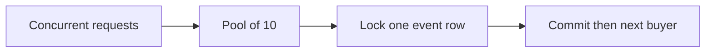
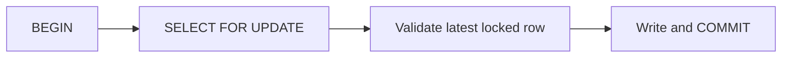
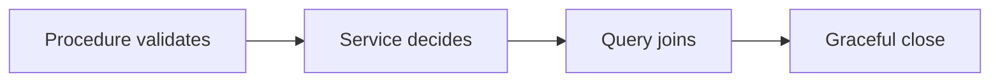
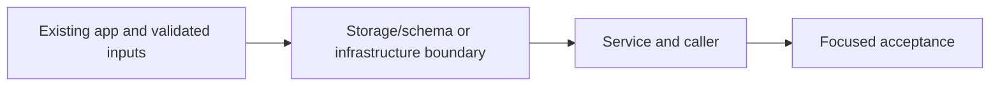

# 35. Booking transactions and My tickets

## 1. In one sentence

Read-then-write without locking loses updates.

## 2. The big picture

## 3. Concepts and current behavior

The locked query owns the three availability checks so they remain in the transaction. Relative seat decrement plus CHECK is the last defense. P3 adds outbox atomicity, P8 adds advisory admission and replay fast paths, P10 adds 2 s pool acquisition/5 s statement budgets. Plain row readers use MVCC; DDL locks can still block reads. My tickets remains an unbounded API aggregate despite paginated Dynamo reads.

### many requests at the same time: how does the DB handle it?

A connection pool limits concurrent database sessions. Postgres uses row versions for ordinary reads and locks for competing writes. Different event rows can progress together; buyers for one hot event wait on its row. A transaction makes seats, booking and outbox atomic. More connections cannot remove contention on one row.

`apps/api/src/db/client.ts` caps the pool at 10 with 2 s connection acquisition and 5 s statement timeouts. `apps/api/src/queries/bookings.ts` → `createBookingTx` takes FOR UPDATE. Run `pnpm demo:booking-race` to measure the invariant under concurrent buyers.

Why: Read-then-write without locking loses updates.

Trade-offs: MVCC keeps ordinary reads from waiting on row writers, but reads can still wait on schema locks. Serializable adds anomaly detection and transaction retries.

### no cache and many requests: how to lock and get the latest?

Begin a short transaction, select the event FOR UPDATE, wait for the previous writer, then validate the row returned and update it before commit. At READ COMMITTED the locking read returns the updated row after waiting. An ordinary SELECT snapshot is not a reservation. A conditional atomic UPDATE is another safe design.

`apps/api/src/queries/bookings.ts` → `createBookingTx` rechecks duplicate intent under the lock before availability checks; it decrements using SQL arithmetic and inserts booking/outbox in the same transaction. `pnpm demo:booking-race` verifies no negative inventory. Cache locks are never used as seat locks.

Why: The read and decision must remain protected until the write.

Trade-offs: Conditional UPDATE WHERE seats_left >= quantity RETURNING is shorter but needs separate error classification. Optimistic version columns retry conflicts and can starve under high contention.

### API design, N+1 and graceful shutdown

Keep input validation in procedures, business rules in services and storage in queries. Fetch related records in one intentional query rather than looping through requests. On shutdown stop accepting new work, finish bounded in-flight work, stop the relay and close clients. Health checks must distinguish liveness from dependency readiness.

`apps/api/src/queries/bookings.ts` → `listByUser` joins bookings/events once. `apps/api/src/trpc/init.ts` handles auth/error translation. `apps/api/src/server.ts` closes relay/Fastify/Redis/Postgres. Run `pnpm test` for API/service and relay lifecycle coverage; live ALB drain timing remains acceptance.

Why: Layer boundaries make code understandable; bounded work makes deployment safer.

Trade-offs: Joining everything can overfetch; pagination and projection still matter. GraphQL/tRPC do not automatically prevent N+1. Liveness that depends on every store can cause restart storms.

## 4. Dependency order

The concrete prerequisites are the source files and current settings named above. Migrations precede the consuming image rollout; IAM permissions precede the job that uses them.

## 5. What breaks and how we notice

Can two different events run together? Yes, unless another shared resource bottlenecks. 10x: observe pool wait and lock wait separately. 100x: partition inventory or queue admissions; do not just multiply pools.

Is Redis SET NX sufficient? No; lease expiry/restart can allow multiple holders. 10x: shorten transaction work. 100x: admission control and inventory partitioning; retain a database constraint.

Can the web import the API database module? No; only its router type crosses that boundary. 10x: paginate My tickets/bookings and inspect plans. 100x: per-dependency deadlines, connection budgets and task drain experiments.

Current limits: The locked query owns the three availability checks so they remain in the transaction. Relative seat decrement plus CHECK is the last defense. P3 adds outbox atomicity, P8 adds advisory admission and replay fast paths, P10 adds 2 s pool acquisition/5 s statement budgets. Plain row readers use MVCC; DDL locks can still block reads. My tickets remains an unbounded API aggregate despite paginated Dynamo reads.

## 6. Interview questions with short answers

1. **many requests at the same time: how does the DB handle it?** A connection pool limits concurrent database sessions. Postgres uses row versions for ordinary reads and locks for competing writes. Different event rows can progress together; buyers for one hot event wait on its row. A transaction makes seats, booking and outbox atomic. More connections cannot remove contention on one row.

2. **Does adding connections remove a hot-row queue?** No

3. **Why does this boundary exist?** Read-then-write without locking loses updates.

4. **Which alternative would you compare?** MVCC keeps ordinary reads from waiting on row writers, but reads can still wait on schema locks. Serializable adds anomaly detection and transaction retries.

5. **What changes at 10x or 100x?** 10x: observe pool wait and lock wait separately. 100x: partition inventory or queue admissions; do not just multiply pools.

6. **What is the important counter-question?** Can two different events run together? Yes, unless another shared resource bottlenecks.

## 7. Check yourself

1. Trace the exact source path and identify the invariant it protects.
2. Does adding connections remove a hot-row queue?
3. Which failure requires live AWS acceptance rather than local evidence?

## How this connects

Uses the [architecture](00-architecture.md) and [previous step](34-approved-delivery.md). Continue with [next step](36-booking-idempotency.md). Practice the [scenario](handbook/guides/interview-scenarios.md#database-concurrency) and [explorer tour](handbook/guides/infra-explorer.html?tour=sale-day).

## Historical evidence and open limits

The following is the implementation-time record, preserved from PENDING. Measurements describe that earlier local run, not a fresh benchmark. Later behavior is stated above; old “not built” statements may be superseded. Owner setup recipes are intentionally replaced by the current [deploy runbook](20-deploy-day.md). No old preview is a promise about today’s stack.

### Feature 2, Step F2a: book a ticket + "My tickets" (would be `docs/35-*`). Local only, no infra change. Prompt: [prompts/f2a.md](handbook/prompts/f2a.md). Also new rule: during the ticketing + serverless series, no handbook / guide / explorer edits (CLAUDE.md + AGENTS.md "Workflow"), prompts in `docs/handbook/prompts/`, ROADMAP "Next" replaced by the series.

- **Concepts:** transactions (all or nothing; Drizzle BEGIN/COMMIT, ROLLBACK + re-throw); row lock `SELECT … FOR UPDATE` (one row, held to COMMIT; same-event bookings queue and RE-READ the row after the wait, even in READ COMMITTED; plain reads never wait = MVCC; hot row cost; each waiter holds a pool connection); the lost-update race (read-then-write, absolute value written from the app); conditional `UPDATE … WHERE seats_left >= $n RETURNING` alternative (also safe via the UPDATE's own row lock + WHERE re-check; 1 statement, shorter lock; but 0 rows = no reason → 2nd query for 404/400/409); CHECK `seats_left >= 0` as last defense (works only with the RELATIVE `seats_left - n` form; 23514 → ConflictError); N+1 avoided with ONE join (`listByUser`); index `(user_id, created_at)` (equality first, then the sort column; FK columns are not auto-indexed); cache invalidation on writes (booking reuses `invalidateEventLists`: Redis gen bump, then web data cache) and its cost (every booking empties every list → under many bookings/s almost every `events.list` is a miss; options: don't invalidate on bookings and accept ~30 s old seat counts, or cache seat counts apart). Explain: the user comes from the session, never the input.
- **Key files:** read first `apps/api/src/queries/bookings.ts` `createBookingTx` (steps 1-5 + the alternative), `listByUser`; `db/schema/bookings.ts` + `drizzle/0004_bookings.sql` (hand-written header); `services/bookings.ts` `bookTicket`, `myTickets`; `services/events.ts` `invalidateEventLists` (extracted from `createEvent`), `getEvent`; `queries/events.ts` `findById`; `procedures/bookings.ts` (`create`, `mine`), `procedures/events.ts` `byId`; `errors.ts` `BadRequestError`; shared `schemas/bookings.ts` (`BookTicketInput`, `BookingSchema`, `MyTicketsOutput`, `MAX_TICKETS_PER_BOOKING`), `GetEventInput`; web `app/events/[id]/page.tsx`, `app/tickets/page.tsx`, `features/events/{hooks/use-event.ts,server/prefetch-event.ts (React cache(): metadata + page = 1 API call),components/event-details.tsx,components/event-card.tsx}`, `features/bookings/{hooks/use-book-ticket.ts,hooks/use-my-tickets.ts,components/book-ticket-form.tsx,components/my-tickets-list.tsx}`, `header-nav.tsx`, `proxy.ts` (/tickets), `next.config.ts` (/tickets private, no-store); `scripts/booking-race-demo.ts` (`pnpm demo:booking-race [--url] [--unsafe] [--keep]`; `pg` loaded from apps/api with `createRequire`); tests `services/bookings.test.ts`, `procedures/bookings.test.ts`, shared `bookings.test.ts`, `e2e/bookings.spec.ts`, `e2e/cache-headers.spec.ts` (+/tickets).
- **Measured (local, 2026-10-14, own API :4101 + prod web :3101, own DB `minitickets_f2a`, Redis db 1):** race demo SAFE 5/5 runs: **5 × 200, 15 × 409 "Not enough seats left", seats_left 0, 5 bookings**; all 20 answered in 16.6-30.0 ms (fastest 6.7-12.8 ms, slowest 16.0-29.3 ms). `--unsafe` 3/3 runs: **20 booked, 0 refused, seats_left 4, 20 bookings = 15 oversold** (19.6-38.0 ms, no artificial pause needed). Mutations through the API: (M1) no `FOR UPDATE`, relative UPDATE kept: still 5/15 in 3/3 runs, but of the 45 refusals **27 came from the CHECK net** (23514) and 18 from step 2; (M2) no lock + app-computed value: **20 × 200, seats_left 4 and 3, 20 bookings** (2/2); (M3) lock + app-computed value: 5/15 (3/3), all 45 from step 2, CHECK net 0. Unit **176/176** (+17); swapping invalidate before the transaction fails 3. e2e **29 passed, 4 skipped** (admin specs skip with `E2E_BASE_URL`) with `E2E_PRODUCTION_BUILD=1`. Headless UI: 409 race → "Not enough seats left", seats refetched to "No seats left", button disabled; past event → "This event has already started"; book 3 → 8 → 5 seats at once, `/events` server HTML says "5 of 30 seats left" right after (API log: gen bump + "web cache revalidated").
- **Unsure / for the docs:** (1) The 3 checks (404/400/409) live in the QUERY layer because they must run on the locked row inside the transaction; a service can't hold a transaction. Alternative: a callback/unit-of-work passed down (rejected: clever). (2) "Booked! You have N tickets" = this booking's quantity, not the user's total for the event. (3) The button is also disabled while `auth.me` loads (not only pending/sold out). (4) A session whose user was deleted → FK violation 23503 → 500 (not translated). (5) No `lock_timeout`/`statement_timeout`: a waiter waits as long as the holder (ms today). (6) "My tickets" has no limit/pagination; `bookings.event_id` has no index. (7) `events.byId` reads Postgres on every page view and refetch (no cache, no rate limit). (8) The demo inserts its event straight into Postgres (no invalidation) and deletes event, bookings and users at the end; a cached list may show the deleted event for ≤ one soft TTL (its page then 404s). (9) The 23514 → 409 translation is only exercised by mutant M1, not by a unit test. (10) CloudFront: `/events` behavior is an exact path, so `/events/<id>` uses the default behavior (no caching); not checked on AWS. (11) Cross-feature imports in web: the form uses events' `useEvent` + auth's `useMe`; My tickets uses events' `EventDate`. (12) e2e books 2 seats of seeded "Symphony Under the Stars" per run (640 left → ~320 runs). (13) The local `.next` is now a prod build pointing at API :4101. (14) The CHANGELOG rule still applies to ROADMAP/prompts edits during the series; this step adds an entry. Decide whether per-step ROADMAP status lines need one each.
