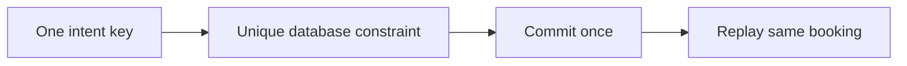
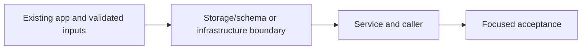

# 36. One booking per retryable intent

## 1. In one sentence

A network failure cannot tell a caller whether commit happened.

## 2. The big picture

## 3. Concepts and current behavior

One UUID identifies one user intent. Same event duplicates queue behind the row lock; cross-event duplicates resolve through the unique constraint and rollback. P8 can replay committed intents before entering the hot transaction. Keys are stored with successful bookings and do not expire. Signup still has no replay-response contract.

### idempotency

A retry repeats one intent rather than making another purchase. The browser creates one UUID per intent and keeps it for ambiguous retries. A unique user/key constraint stores identity with the booking transaction. Same input replays the booking; different input with the same key conflicts. Failed transactions store no success.

`apps/api/src/db/schema/bookings.ts` enforces unique user/idempotency key. `apps/api/src/services/bookings.ts` compares event and quantity on replay; `queries/bookings.ts` handles races across different event rows. `pnpm demo:idempotency` exercises lost responses and concurrent duplicates.

Why: A network failure cannot tell a caller whether commit happened.

Trade-offs: Redis TTL keys add a cross-store gap and can expire/evict. A generic response store can replay exact response bodies but adds retention rules. This app reconstructs successful responses and keeps keys with bookings.

### Should buying the last seat use optimistic UI?

Show pending feedback immediately, but only confirm a ticket after the authoritative transaction commits. An optimistic seat count may improve perceived speed but must roll back and reconcile. MiniTickets keeps the booking intent key through ambiguous retries and shows pending ticket issuance separately.

`apps/web/src/features/bookings/hooks/use-book-ticket.ts` owns mutation/retry state; `apps/web/src/features/bookings/components/my-tickets-list.tsx` distinguishes confirmed booking from pending QR issuance. Run `pnpm demo:idempotency`. Optimistic seat decrement is explain-only and would live in this hook with TanStack cache rollback.

Why: A false success on scarce inventory is worse than a short pending state.

Trade-offs: Optimistic likes are easy to undo; paid scarce inventory is different. Do not replace a lost-response retry with a new idempotency key.

## 4. Dependency order

The concrete prerequisites are the source files and current settings named above. Migrations precede the consuming image rollout; IAM permissions precede the job that uses them.

## 5. What breaks and how we notice

Why scope by user? Two users may coincidentally submit the same client key without sharing a booking. 10x: index/storage retention policy. 100x: explicit idempotency contract for payment providers and async intents.

Can pending QR trigger rebooking? No; poll ticket readiness for the existing booking. 10x: make pending states resilient to reload. 100x: async admission needs a durable intent/status resource.

Current limits: One UUID identifies one user intent. Same event duplicates queue behind the row lock; cross-event duplicates resolve through the unique constraint and rollback. P8 can replay committed intents before entering the hot transaction. Keys are stored with successful bookings and do not expire. Signup still has no replay-response contract.

## 6. Interview questions with short answers

1. **idempotency** A retry repeats one intent rather than making another purchase. The browser creates one UUID per intent and keeps it for ambiguous retries. A unique user/key constraint stores identity with the booking transaction. Same input replays the booking; different input with the same key conflicts. Failed transactions store no success.

2. **What should an ambiguous retry keep?** The same idempotency key

3. **Why does this boundary exist?** A network failure cannot tell a caller whether commit happened.

4. **Which alternative would you compare?** Redis TTL keys add a cross-store gap and can expire/evict. A generic response store can replay exact response bodies but adds retention rules. This app reconstructs successful responses and keeps keys with bookings.

5. **What changes at 10x or 100x?** 10x: index/storage retention policy. 100x: explicit idempotency contract for payment providers and async intents.

6. **What is the important counter-question?** Why scope by user? Two users may coincidentally submit the same client key without sharing a booking.

## 7. Check yourself

1. Trace the exact source path and identify the invariant it protects.
2. What should an ambiguous retry keep?
3. Which failure requires live AWS acceptance rather than local evidence?

## How this connects

Uses the [architecture](00-architecture.md) and [previous step](35-booking-transactions.md). Continue with [next step](37-background-jobs.md). Practice the [scenario](handbook/guides/interview-scenarios.md#idempotency) and [explorer tour](handbook/guides/infra-explorer.html?tour=booking).

## Historical evidence and open limits

The following is the implementation-time record, preserved from PENDING. Measurements describe that earlier local run, not a fresh benchmark. Later behavior is stated above; old “not built” statements may be superseded. Owner setup recipes are intentionally replaced by the current [deploy runbook](20-deploy-day.md). No old preview is a promise about today’s stack.

### Feature 2, Step F2b: idempotency key for booking (would be `docs/36-*`). Local only, no infra change. Prompt: [prompts/f2b.md](handbook/prompts/f2b.md). Also new rule: ROADMAP status lines and new prompt files need no CHANGELOG entry (CLAUDE.md + AGENTS.md); CHANGELOG's empty 2026-10-12 "Commit:" filled in (`97f9cab`, found by subject).

- **Concepts:** idempotency (twice = once); the lost-response problem (booked on the server, answer lost, retry = 2nd booking); idempotency keys (client-made UUID, sent with every retry); "one key per intent" (new key after success or when the quantity changes; same key for React Query retries AND for a click after an error; ref, not state); key unique PER USER (`UNIQUE (user_id, idempotency_key)`: no cross-user collisions, only your own bookings replay); concurrent duplicates: same event → the row lock queues them and the key lookup after the lock sees the committed booking; different events → no shared lock, the unique constraint makes the 2nd INSERT fail (23505), its whole transaction rolls back (seats too), then read the winner; replay = same answer (same id) vs different request = 409; why retries become safe (mutations otherwise `retry: 0`, booking retries ≤2 on network/5xx, never 4xx); compared, not built: keys in Redis + TTL (two systems, no shared transaction, eviction/TTL lose protection) and Stripe-style stored full responses (exact, generic, 24 h, "in progress" error; we replay only successes, rebuilt from the row).
- **Key files:** read first `apps/api/src/queries/bookings.ts` (problem comment at top, `createBookingTx` steps 1-7 + "WHY A DUPLICATE IS HARMLESS", `findByKey`, `isPgConstraintError`, `CreateBookingResult`, "OTHER WAYS TO STORE IDEMPOTENCY KEYS"); `services/bookings.ts` `bookTicket` step 2 (same vs different request), `toPublicBooking`; `db/schema/bookings.ts` (4, 7); `drizzle/0005_bookings_idempotency_key.sql` (hand-edited: temporary `DEFAULT gen_random_uuid()`, then `DROP DEFAULT`); shared `BookTicketInput.idempotencyKey`; web `features/bookings/lib/booking-retry.ts` `shouldRetryBooking`, `hooks/use-book-ticket.ts` (`retry`), `components/book-ticket-form.tsx` `keyFor` + `intent` ref, `providers/query-provider.tsx` (comment); `scripts/idempotency-demo.ts` (`pnpm demo:idempotency [--url] [--keep]`), `scripts/booking-race-demo.ts` (now sends keys; unsafe insert uses `gen_random_uuid()`); tests `services/bookings.test.ts`, `procedures/bookings.test.ts`, shared `bookings.test.ts`, web `booking-retry.test.ts` (real `MutationObserver`), `e2e/booking-idempotency.spec.ts` (`route.fetch()` then `route.abort()`).
- **Measured (local, 2026-10-14, own API :4101 + prod web :3101, own DB `minitickets_f2b` = copy of the owner's DB, Redis db 1):** migration on the copy: 3 existing bookings got 3 distinct keys, default gone, constraint present; `db:generate` afterwards = "No schema changes". Demo 3/3 runs: part 1 **10 × 200, 1 booking id, 1 row, seats 10 → 8** (all answered in 16.7-38.8 ms; API log: 9 "replayed" lines, 1 cache invalidation); part 2 **409 "This idempotency key was already used for a different booking"**, nothing changed; part 3 (same key, events A + B at once) **5/5 rounds 200 + 409, 1 row, 5 seats taken** (winner A or B varies); part 4 (repeat after taking the LAST 2 seats) **200 + 200, same id, seats 0**. Mutations: (M1) 23505 handler off → part 3 losers all **500** (5/5: every round really goes through the unique-violation path), seats still 5 (rollback); (M2) key lookup after the lock removed → parts 1-3 still pass, part 4 → **409 "Not enough seats left"**; (M3) API ignores the key → e2e fails (seats 594, must be 596); (M4) retry on 4xx → 5 unit tests fail. Race demo unchanged: SAFE 5/15, `--unsafe` 15 oversold. Unit **191/191** (+15). e2e **30 passed, 4 skipped** (admin specs skip with `E2E_BASE_URL`), `E2E_PRODUCTION_BUILD=1`. Headless check of the form: success → new key; network down → 3 tries, 1 key, "Something went wrong"; next click → same key, ok; quantity changed → new key.
- **Unsure / for the docs:** (1) Two deliberate deviations from the prompt: the key is looked up INSIDE the transaction right after the row lock, BEFORE the seat/date checks (else a retry of a last-seat booking says "Not enough seats left": M2), and the same-vs-different comparison lives in the service (layer rule: business logic; the query only reports "existing"). (2) A replay waits in the event's row-lock queue like any booking (hot row); a lookup before the lock would be a faster path, not built. (3) Keys never expire (16 bytes + index entry per booking). (4) A failed booking stores nothing, so the same key retried later is a fresh attempt (may succeed). (5) Edge: first booking saved, every answer lost, then seats shrink and the form lowers the quantity → new key → a second (smaller) booking is possible. (6) `crypto.randomUUID()` needs a secure context (HTTPS or localhost); plain HTTP on another host would throw. (7) No unit test runs `createBookingTx` itself (unit tests have no Postgres); its DB behaviour is proven by the demo, e2e and M1-M3. (8) Retry waits are React Query's defaults (1 s, 2 s): the error shows after ~3 s. (9) The local `.next` is a prod build pointing at API :4101 again. (10) No CHANGELOG entry for this step (new rule); the top entry's "Commit:" (F2a, `e7a3965`) stays a placeholder for the next handbook commit.
