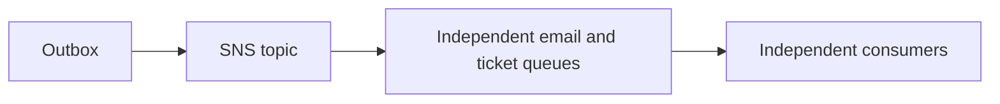
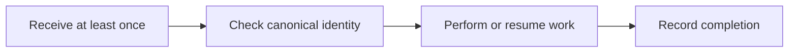
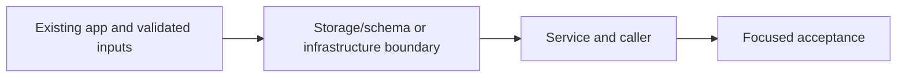

# 37. Background confirmation jobs

## 1. In one sentence

Two consumers must each receive the event; competing on one queue would divide work.

## 2. The big picture

## 3. Concepts and current behavior

The original direct-send gap is historical: P3 now writes an outbox; P4 relay publishes SNS and fan-outs to independent queues. Event-carried state keeps workers out of the VPC. Email dedup uses booking.confirmed:<bookingId>, not envelope messageId.

### Queue, topic, event bus or Kafka for booking events?

A topic fans one event out to multiple subscriptions. A queue buffers work for competing consumers. MiniTickets publishes to SNS, then separate email/ticket SQS queues; each can retry independently. EventBridge adds richer routing/integrations; Kafka adds retained partitioned replay. Choose those only when the product needs those semantics.

`infra/src/jobs/booking-events.ts` configures raw SNS deliveries and queue source restrictions. `apps/api/src/queues/jobs.ts` publishes one stable message. Run `pnpm demo:tickets` and `pnpm demo:outbox` separately; P4 local emulators exercise the same SDK boundaries. AWS fan-out acceptance is still manual.

Why: Two consumers must each receive the event; competing on one queue would divide work.

Trade-offs: SNS/SQS are operationally small but standard delivery is unordered/duplicated. A bus is routing, not a replacement for all consumer backpressure.

### Can an idempotent email consumer guarantee exactly one email?

It can skip known completed message ids, but a crash after SES accepts and before marking complete can still send twice on retry. Marking complete before sending risks loss. Ticket issuance converges more strongly using a canonical booking/seat id, a creating reservation, a deterministic S3 key and a final ready state.

`apps/worker/src/handlers/booking-confirmed.ts` and `processed-jobs.ts` mark successful mail after send. `handlers/tickets.ts` reserves a canonical ticket and resumes partial work; `tickets/store.ts` uses conditional writes. `pnpm demo:tickets` checks duplicates and crash-resume behavior.

Why: At-least-once queues force every side effect to define its duplicate behavior.

Trade-offs: No distributed transaction spans SES/S3/DynamoDB. TTL cleanup bounds dedup history; an expired old message may run again. External provider idempotency is valuable where supported.

## 4. Dependency order

The concrete prerequisites are the source files and current settings named above. Migrations precede the consuming image rollout; IAM permissions precede the job that uses them.

## 5. What breaks and how we notice

Why not two Lambdas on one SQS queue? They compete; each message is not promised to both. 10x: per-consumer backlog/concurrency. 100x: partition ordering domains and retention/replay requirements.

Why not use queue message id for tickets? Republishing the same booking can create a different queue id. 10x: bound dedup retention against redrive age. 100x: durable state machines and provider-specific idempotency contracts.

Current limits: The original direct-send gap is historical: P3 now writes an outbox; P4 relay publishes SNS and fan-outs to independent queues. Event-carried state keeps workers out of the VPC. Email dedup uses booking.confirmed:<bookingId>, not envelope messageId.

## 6. Interview questions with short answers

1. **Queue, topic, event bus or Kafka for booking events?** A topic fans one event out to multiple subscriptions. A queue buffers work for competing consumers. MiniTickets publishes to SNS, then separate email/ticket SQS queues; each can retry independently. EventBridge adds richer routing/integrations; Kafka adds retained partitioned replay. Choose those only when the product needs those semantics.

2. **What does a topic add?** Fan-out to separate consumers

3. **Why does this boundary exist?** Two consumers must each receive the event; competing on one queue would divide work.

4. **Which alternative would you compare?** SNS/SQS are operationally small but standard delivery is unordered/duplicated. A bus is routing, not a replacement for all consumer backpressure.

5. **What changes at 10x or 100x?** 10x: per-consumer backlog/concurrency. 100x: partition ordering domains and retention/replay requirements.

6. **What is the important counter-question?** Why not two Lambdas on one SQS queue? They compete; each message is not promised to both.

## 7. Check yourself

1. Trace the exact source path and identify the invariant it protects.
2. What does a topic add?
3. Which failure requires live AWS acceptance rather than local evidence?

## How this connects

Uses the [architecture](00-architecture.md) and [previous step](36-booking-idempotency.md). Continue with [next step](38-job-failures.md). Practice the [scenario](handbook/guides/interview-scenarios.md#fanout) and [explorer tour](handbook/guides/infra-explorer.html?tour=booking).

## Historical evidence and open limits

The following is the implementation-time record, preserved from PENDING. Measurements describe that earlier local run, not a fresh benchmark. Later behavior is stated above; old “not built” statements may be superseded. Owner setup recipes are intentionally replaced by the current [deploy runbook](20-deploy-day.md). No old preview is a promise about today’s stack.

### Serverless S1a: booking confirmation through a background queue (would be `docs/37-*`). Local only, no infra change. Prompt: [prompts/s1a.md](handbook/prompts/s1a.md).

- **Concepts:** sync vs async work (the user waits only for the booking, not the email); producer/consumer; queue as a buffer (worker off = messages wait); long polling (`WaitTimeSeconds 20`); delete-after-success + visibility timeout (30 s) = at-least-once delivery preview (a failed message comes back; duplicates are possible, so the consumer must cope: S1c); message versioning (`type` + `version`); event-carried state transfer (worker never reads the DB, so a Lambda can live outside the VPC); PII in messages/logs (email in the message; logs show ids, the recipient's domain only, wrong field NAMES only); same handler locally and on Lambda (`local.ts` builds the SQSEvent); SQS API via ElasticMQ (only the endpoint differs); the lost-message gap (publish fails or crash after commit) and the outbox pattern (added to ROADMAP); poison message loops forever until a DLQ exists (S1c). Optional env pair, off with a warning (like the revalidate hook).
- **Key files (read in this order):** `packages/shared/src/schemas/jobs.ts` (message + the 3 reasons); `apps/worker/src/handlers/booking-confirmed.ts` `handleBookingConfirmed`; `mailer.ts` `LogMailer`; `lambda.ts` `handler`; `local.ts` `poll`; then producer `apps/api/src/queues/jobs.ts` `publishBookingConfirmed`; `services/bookings.ts` `bookTicket` step 4 + `publishConfirmation` (the honest-gap comment); `queries/bookings.ts` `CreateBookingResult` ("created" now carries title/venue/startsAt, read under the lock already); `config/env.ts`; `server.ts` warning; `docker-compose.yml` `queue`; `docker/elasticmq.conf`; tests `apps/worker/src/handlers/booking-confirmed.test.ts`, `services/bookings.test.ts`. `Log` type gained `info`.
- **Measured (local, 2026-10-14, own API :4101, own DB `minitickets_s1a`, Redis db 1, ElasticMQ :9324):** book 2 tickets -> API info line `published booking.confirmed messageId=… bookingId=…` -> worker: received, `would send email to *@example.com: "Your booking is confirmed: Indie Rock Showcase"`, deleted, all within ~2 s. Worker stopped, 2 bookings -> queue depth 2 -> worker started -> both handled, depth 0. Replay with the same key -> same booking id, NO new message (3 `published` lines for 3 new bookings). Queue unreachable (2nd API :4102, closed port) -> booking HTTP 200 in 24 ms, one error log with `bookingId`, no address. Bad message (version 9) -> worker logs the wrong field names, message stays (comes back every 30 s). 205 unit tests, typecheck, lint pass. e2e on your servers: 26 passed, 6 skipped, 2 failed = the known `admin-events` revalidate-hook tests (your env lacks `WEB_INTERNAL_URL`/`REVALIDATE_SECRET`).
- **Unsure / for the docs:** (1) Your `apps/api/.env` has no `JOBS_QUEUE_URL`, so your API has publishing OFF (warning at startup) until you copy the new lines from `.env.example`. (2) `pnpm dev` starts the worker too (it has a `dev` script), but needs `apps/worker/.env` (copy `.env.example`; it is gitignored). (3) No healthcheck on the queue container (image has no shell tools). (4) The worker's `MessageId` in its log is SQS's, not our `messageId` (the handler does not log it). (5) Region default `us-east-1` is my choice, matching `infra/Pulumi.dev.yaml`. (6) The api Dockerfile and CD were NOT touched; the api image now carries `@aws-sdk/client-sqs`, not built/checked here. (7) After a commit the user lookup costs one extra PK query per new booking; it could ride in the session instead. (8) ZodError/JSON errors are not printed raw because they can quote the message body.
