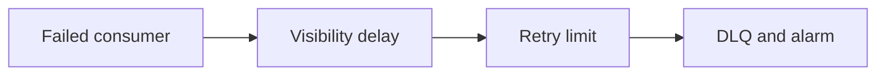
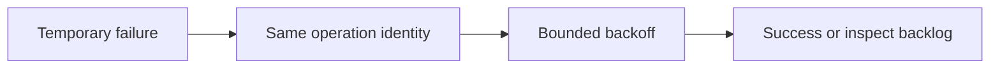
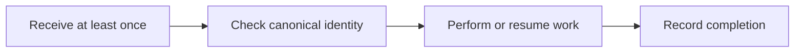
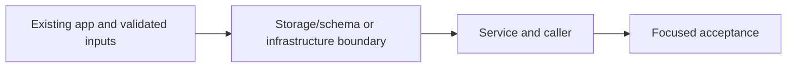

# 38. Job retries, idempotency and dead letters

## 1. In one sentence

Durable failure evidence is better than silently dropping work.

## 2. The big picture

## 3. Concepts and current behavior

AWS email queue visibility is 60 s; the older 30 s local-only phase is historical. Backoff is 10/40/120 s, no jitter. Email dedup is a conditional completed-job record after send with a 30-day TTL; two-workers/send-before-record windows remain. Partial-batch reporting must be enabled on the mapping.

### A customer has no confirmation: retry, DLQ or redrive?

Find the booking/correlation id, follow structured logs, inspect queue age and failed attempts, then DLQ and alarm. Fix the root cause before redrive. Visibility timeout hides an in-flight message; it is not deletion. Partial-batch reporting retries only failed records. A poison message should not block all useful work.

`apps/worker/src/batch.ts` returns batchItemFailures; `backoff.ts` sets delay; `infra/src/jobs/queue-trigger.ts` sets worker mapping. `pnpm jobs:dlq` lists local failures; redrive is an explicit owner operation after a fix. Runbook §3.12 has AWS diagnostics; no live alarm drill has been claimed.

Why: Durable failure evidence is better than silently dropping work.

Trade-offs: Too-short visibility can overlap work; too-large visibility delays recovery. Reserved Lambda concurrency and mapping maximumConcurrency must agree or throttling can consume receives.

### How do retries avoid amplifying an outage?

Retry only failures likely to be temporary, bound attempts/time and retain operation identity. Exponential backoff reduces pressure; jitter prevents synchronized clients. MiniTickets retries ambiguous booking network failures with the same key, caps worker retries into a DLQ and keeps outbox retries durable. Jitter is a proposed improvement, not a claim about current fixed schedules.

`apps/web/src/features/bookings/lib/booking-retry.ts`, `apps/worker/src/backoff.ts` and `apps/api/src/services/outbox.ts` implement separate policies. Run `pnpm demo:outbox`. Outbox retries cap at 60 s without a maximum attempt count; worker failures use 10/40/120 s and a DLQ after 3 receives.

Why: Immediate retries turn a partial failure into more load.

Trade-offs: Do not retry validation/authorization failures. Layered retries multiply attempts; choose one responsible layer. Proposed jitter belongs in retryInMs/backoff with bounded randomized tests.

### Can an idempotent email consumer guarantee exactly one email?

It can skip known completed message ids, but a crash after SES accepts and before marking complete can still send twice on retry. Marking complete before sending risks loss. Ticket issuance converges more strongly using a canonical booking/seat id, a creating reservation, a deterministic S3 key and a final ready state.

`apps/worker/src/handlers/booking-confirmed.ts` and `processed-jobs.ts` mark successful mail after send. `handlers/tickets.ts` reserves a canonical ticket and resumes partial work; `tickets/store.ts` uses conditional writes. `pnpm demo:tickets` checks duplicates and crash-resume behavior.

Why: At-least-once queues force every side effect to define its duplicate behavior.

Trade-offs: No distributed transaction spans SES/S3/DynamoDB. TTL cleanup bounds dedup history; an expired old message may run again. External provider idempotency is valuable where supported.

## 4. Dependency order

The concrete prerequisites are the source files and current settings named above. Migrations precede the consuming image rollout; IAM permissions precede the job that uses them.

## 5. What breaks and how we notice

Does an empty queue mean email was delivered? No; inspect completion/provider outcomes too. 10x: oldest-message age and redrive rate limits. 100x: separate poison-message classes, sampling and SLO-driven alarms.

What if the response is lost after send? A retry may duplicate delivery; the consumer must be idempotent. 10x: retry budgets and attempt metrics. 100x: per-destination admission and circuit breakers with durable backlog.

Why not use queue message id for tickets? Republishing the same booking can create a different queue id. 10x: bound dedup retention against redrive age. 100x: durable state machines and provider-specific idempotency contracts.

Current limits: AWS email queue visibility is 60 s; the older 30 s local-only phase is historical. Backoff is 10/40/120 s, no jitter. Email dedup is a conditional completed-job record after send with a 30-day TTL; two-workers/send-before-record windows remain. Partial-batch reporting must be enabled on the mapping.

## 6. Interview questions with short answers

1. **A customer has no confirmation: retry, DLQ or redrive?** Find the booking/correlation id, follow structured logs, inspect queue age and failed attempts, then DLQ and alarm. Fix the root cause before redrive. Visibility timeout hides an in-flight message; it is not deletion. Partial-batch reporting retries only failed records. A poison message should not block all useful work.

2. **What should happen before redrive?** Fix the failure cause

3. **Why does this boundary exist?** Durable failure evidence is better than silently dropping work.

4. **Which alternative would you compare?** Too-short visibility can overlap work; too-large visibility delays recovery. Reserved Lambda concurrency and mapping maximumConcurrency must agree or throttling can consume receives.

5. **What changes at 10x or 100x?** 10x: oldest-message age and redrive rate limits. 100x: separate poison-message classes, sampling and SLO-driven alarms.

6. **What is the important counter-question?** Does an empty queue mean email was delivered? No; inspect completion/provider outcomes too.

## 7. Check yourself

1. Trace the exact source path and identify the invariant it protects.
2. What should happen before redrive?
3. Which failure requires live AWS acceptance rather than local evidence?

## How this connects

Uses the [architecture](00-architecture.md) and [previous step](37-background-jobs.md). Continue with [next step](39-local-stack-health.md). Practice the [scenario](handbook/guides/interview-scenarios.md#dlq-failure) and [explorer tour](handbook/guides/infra-explorer.html?tour=failing-email).

## Historical evidence and open limits

The following is the implementation-time record, preserved from PENDING. Measurements describe that earlier local run, not a fresh benchmark. Later behavior is stated above; old “not built” statements may be superseded. Owner setup recipes are intentionally replaced by the current [deploy runbook](20-deploy-day.md). No old preview is a promise about today’s stack.

### Serverless S1b: failure handling for the background jobs (would be `docs/38-*`). Local only, no AWS resources. Prompt: [prompts/s1b.md](handbook/prompts/s1b.md). New local container: DynamoDB Local; new dependency `@aws-sdk/client-dynamodb` (worker only).

- **Concepts:** poison messages (fail on every try, e.g. version 9); dead-letter queue + redrive policy (`maxReceiveCount 3`: the 4th delivery moves it to `minitickets-jobs-dlq`; the receive count travels with it); visibility timeout (30 s; must be longer than the handler's max run time, AWS: ≥ 6 × the Lambda timeout; SDK timeouts keep the handler short); retry with exponential backoff via `ChangeMessageVisibility` (10 s, 40 s, 120 s cap; jitter explained, not built); at-least-once delivery; idempotent consumer keyed by the BUSINESS key `booking.confirmed:<bookingId>`, not the messageId (an outbox relay may republish with a new messageId); conditional write `attribute_not_exists(jobKey)`; `ConsistentRead`; TTL `expiresAt` 30 days (> SQS's 14-day max retention); send-then-record = "effectively once" (crash window and two-workers window both explained; a lease/in-progress status as the stronger option, not built); partial batch failures (`batchItemFailures`, ReportBatchItemFailures must be switched on in the event source mapping, S1c, or Lambda deletes failed ones too); invalid messages are failures → DLQ; fault injection (`MAILER_FAIL_MODE`, refused with `NODE_ENV=production`); redrive (send first, delete second; only after the fix; poison comes back).
- **Key files (read in this order):** `apps/worker/src/handlers/booking-confirmed.ts` `handleBookingConfirmed` (the honest "effectively once" block); `processed-jobs.ts` `ProcessedJobs`, `DynamoProcessedJobs` (`isDone`, `markDone`); `batch.ts` `handleBatch`, `describe`; `lambda.ts` (wiring: DynamoDB client with timeouts, mailer choice); `local.ts` `poll` (batch of 10, delete successes, backoff failures; `toRecord` passes `ApproximateReceiveCount`); `backoff.ts` `backoffSeconds`; `faulty-mailer.ts` `FaultyMailer`; `config.ts` (JOBS_QUEUE_URL now optional because Lambda doesn't need it; JOBS_DLQ_URL, DYNAMODB_ENDPOINT, PROCESSED_JOBS_TABLE, NODE_ENV, MAILER_FAIL_MODE + production refusal); scripts `src/scripts/{create-table,dlq-list,dlq-redrive,send-demo}.ts` = `pnpm jobs:table | jobs:dlq | jobs:redrive | jobs:send [--count n --bad n --twice]`; `docker/elasticmq.conf`; `docker-compose.yml` `dynamodb` (`amazon/dynamodb-local:3.3.1`, `-inMemory -sharedDb`, curl healthcheck); `.env.example`. Tests: `handlers/booking-confirmed.test.ts`, `batch.test.ts`, `processed-jobs.test.ts`, `backoff.test.ts`, `faulty-mailer.test.ts`.
- **Measured (local, 2026-10-14, own ElasticMQ :9325 with a copy of the new conf, own DynamoDB Local :8001, own workers):** poison v9 → tries at +0 s, +10 s, +50 s, then DLQ; `jobs:dlq` shows `type=booking.confirmed version=9 … receives=4` (3 tries + the listing's own receive; each listing adds 1). `first-n:2` → failed 17:50:58 and 17:51:08, sent 17:51:48 (try 3), **1 email**. Same message twice → `email sent`, then `skipped, already done`, both deleted, **1 email**. Batch of 5 with 1 bad → **one batch of 5: 4 sent + deleted, 1 kept** (10 s, 40 s, then DLQ). `always` → DLQ; healthy worker + `jobs:redrive` (4 moved) → the v1 message `email sent` on try 1; the poison ones failed again (as the comment says). Production refusal and an invalid mode both exit 1. Mutants caught: skip `isDone` (4 fail), key by messageId (4), record before send (3), throw instead of reporting (3). Unit **229/229** (+24); typecheck, lint pass.
- **Unsure / for the docs:** (1) Backoff is applied by the LOCAL runner, as the prompt asked. On Lambda nothing applies it: failed messages come back after the queue's visibility timeout, unless the handler calls `ChangeMessageVisibility` itself (decide in S1c). (2) Killing a worker in the middle of a long poll: ElasticMQ still gave the next message to the dead connection, so it stayed hidden 30 s and **lost one of its 3 tries** (seen twice). Real SQS likely does the same. (3) The DLQ listing receives messages to look at them, so it raises their receive count; harmless on a DLQ with no redrive policy. (4) DynamoDB Local is in-memory (the image has no data folder its user can write to; a named volume would be root-owned): run `pnpm jobs:table` after each `db:up` that creates or restarts it. Locally TTL is switched on, but whether DynamoDB Local ever deletes expired items was not checked. (5) An expired-but-not-yet-deleted record still counts as "done" (fine for a 30-day window). (6) The redriven message gets a new queue id, and `jobs:redrive` moves EVERYTHING (no filter). (7) The production refusal triggers only for a mode other than "off" (`MAILER_FAIL_MODE=off` in production is allowed). (8) Cost on AWS: one consistent read + one write per email; not measured. (9) S1c needs: a real DLQ with longer retention (in standard queues the message's age counts from the ORIGINAL send), an alarm on the DLQ depth, `FunctionResponseTypes`, the table + IAM `dynamodb:GetItem`/`PutItem` for the Lambda role.
