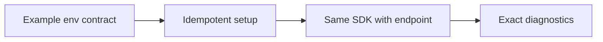
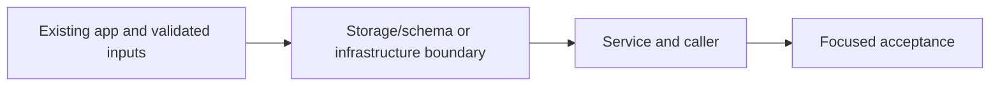

# 39. Repeatable local setup and diagnostics

## 1. In one sentence

Reproducible setup prevents environment guessing and accidental data loss.

## 2. The big picture

## 3. Concepts and current behavior

The supported command is pnpm stack:check, not pnpm doctor. pnpm dev runs idempotent setup before apps; reset is separate and local-only. Moto now supplies SNS/S3 and related queues while ElasticMQ remains for legacy exercises. No owner env or server changes are implied by these documents.

### How do you onboard a developer and keep local/cloud parity?

Use one idempotent setup command, env examples as the contract and a checker that prints exact fixes without secrets. Use the same AWS SDK operations locally against emulators, while naming their limits: no real IAM, SES delivery, AWS quotas or managed failover. Keep destructive reset separate and local-only.

`scripts/stack-up.ts` and `scripts/stack-check.ts` check containers, migrations, queues/table and ports. Run `pnpm stack:check`; owner starts with `pnpm dev`. Local apps use Postgres/Redis, ElasticMQ, DynamoDB Local and Moto for SNS/S3. Existing owner ports/processes are never restarted by agent checks.

Why: Reproducible setup prevents environment guessing and accidental data loss.

Trade-offs: Shared emulators are fast for humans; isolated tests avoid cross-test state. Testcontainers/devcontainers are possible later, not installed merely for documentation.

## 4. Dependency order

The concrete prerequisites are the source files and current settings named above. Migrations precede the consuming image rollout; IAM permissions precede the job that uses them.

## 5. What breaks and how we notice

Why not call the script doctor? pnpm has a built-in command with that name that shadowed it. 10x developers: consistent toolchain/devcontainer. 100x: image checks and documented emulator differences in CI.

Current limits: The supported command is pnpm stack:check, not pnpm doctor. pnpm dev runs idempotent setup before apps; reset is separate and local-only. Moto now supplies SNS/S3 and related queues while ElasticMQ remains for legacy exercises. No owner env or server changes are implied by these documents.

## 6. Interview questions with short answers

1. **How do you onboard a developer and keep local/cloud parity?** Use one idempotent setup command, env examples as the contract and a checker that prints exact fixes without secrets. Use the same AWS SDK operations locally against emulators, while naming their limits: no real IAM, SES delivery, AWS quotas or managed failover. Keep destructive reset separate and local-only.

2. **Which command diagnoses without resetting?** pnpm stack:check

3. **Why does this boundary exist?** Reproducible setup prevents environment guessing and accidental data loss.

4. **Which alternative would you compare?** Shared emulators are fast for humans; isolated tests avoid cross-test state. Testcontainers/devcontainers are possible later, not installed merely for documentation.

5. **What changes at 10x or 100x?** 10x developers: consistent toolchain/devcontainer. 100x: image checks and documented emulator differences in CI.

6. **What is the important counter-question?** Why not call the script doctor? pnpm has a built-in command with that name that shadowed it.

## 7. Check yourself

1. Trace the exact source path and identify the invariant it protects.
2. Which command diagnoses without resetting?
3. Which failure requires live AWS acceptance rather than local evidence?

## How this connects

Uses the [architecture](00-architecture.md) and [previous step](38-job-failures.md). Continue with [next step](40-aws-job-pipeline.md). Practice the [scenario](handbook/guides/interview-scenarios.md#dev-parity) and [explorer tour](handbook/guides/infra-explorer.html?tour=build-order).

## Historical evidence and open limits

The following is the implementation-time record, preserved from PENDING. Measurements describe that earlier local run, not a fresh benchmark. Later behavior is stated above; old “not built” statements may be superseded. Owner setup recipes are intentionally replaced by the current [deploy runbook](20-deploy-day.md). No old preview is a promise about today’s stack.

### Series 2, P0: local stack health (would be `docs/39-*`). Local only, no infra change. Prompt: [prompts/series-2.md](handbook/prompts/series-2.md) (P0). No new dependency.

- **Concepts:** a "doctor" command (check every dependency the app needs, print the exact fix; only looks); one-command dev start (`pnpm dev` = idempotent setup, then the apps) vs a destructive reset (`pnpm stack:reset`); the `.env.example` as the contract (every uncommented key must be in the real file); secrets compared, never printed; env precedence (`node --env-file` never overrides a variable already set in the shell → doctor warns); in-memory emulators (DynamoDB Local loses its table on every container start → `jobs:table` runs on every `pnpm dev`; ElasticMQ reads `elasticmq.conf` only at startup → a container older than the conf has no DLQ); readiness checks for a laptop (TCP open → login → schema → data); "fail = stop, warn = say"; dev/prod parity (same SDK code, local emulators).
- **Key files (read in this order):** `scripts/stack-check.ts` (was `scripts/doctor.ts`, renamed in P1); `scripts/stack/checks.ts` (`setupSections` / `stackSections`: the two halves); `stack/env-files.ts` (`readEnvFiles`, `exampleLines`, Node's `util.parseEnv`); `stack/env-checks.ts` (`checkEnvFile`, `checkRevalidateSecret`, `checkAgreement`, `checkShellOverrides`); `stack/tool-checks.ts` (`checkNode`, `checkPackages`: compares `node_modules/.pnpm/lock.yaml` with `pnpm-lock.yaml`, `checkDocker`, `checkContainers`); `stack/data-checks.ts` (`checkPostgres`, `pendingMigrations` = journal `when` vs `drizzle.__drizzle_migrations.created_at`, `checkRedis` via raw RESP in `stack/net.ts`); `stack/jobs-checks.ts` (`checkQueues`: RedrivePolicy + DLQ depth, `checkProcessedJobsTable`; local endpoints only, SDK via `createRequire` from apps/worker); `stack/port-checks.ts` (`portResult`: "running" vs "starting" mode); `scripts/stack-up.ts`, `scripts/stack-reset.ts`, `stack/run.ts`; api `db/seed-events.ts` (`SEED_EVENTS`, moved out of `seed.ts`), `db/seed.ts` `--reset` (one transaction: delete the seed events' bookings, upsert with `excluded.*`; refuses a non-local host); root `package.json` (`dev`, `dev:apps`, `stack:check`, `stack:up`, `stack:reset`); `scripts/tsconfig.json` (`allowImportingTsExtensions`, `stack/*.ts`); `vitest.config.mts`; tests `scripts/stack/env-checks.test.ts`, `checks.test.ts`. Anchors: `twelve-factor-config` (env-checks.ts), `health-checks` (data-checks.ts).
- **Measured (local, 2026-10-15, isolated copy of the repo in the scratchpad: own compose project `mtp0`, Postgres :15432, Redis :16379, queue :19324, DynamoDB :18000, api :4101, web :3101):** fresh clone, no env files → doctor: 8 problems with `cp` fixes; examples copied → only REVALIDATE_SECRET fails (placeholder); the printed openssl recipe applied verbatim → ok. `pnpm dev` from NOTHING (new volumes, empty DB): containers + 6 migrations + 12 seed events + table + checks in **9.9 s**, then api/web/worker up; warm `stack:up` **2.1-2.2 s**; doctor on the running stack **2.2 s**, all green. e2e on that stack: **28 passed, 6 skipped** (prod-only specs), including the 2 admin revalidate-hook tests. Parked 1 DLQ message → doctor warning with `jobs:dlq`/`jobs:redrive`. `stack:reset` with the servers running: **8.6 s**; seed bookings 2 → 0, Symphony 638 → 640, users 11 and events 14 kept, DLQ empty, table recreated; the running worker survived the queue restart (no error line) and the next booking was emailed (2 → 3). Second `stack:up` while servers run → 2 ✗ "already running", exit 1. DynamoDB restart → doctor ✗ "table does not exist" → `stack:up` recreates it. Mutations: (M1) `jobs:table` step removed → `pnpm dev` stops with the table ✗; (M2) secret values put in the mismatch title → the no-leak test fails; (M3) missing keys ignored → 1 test fails. Unit 21 new tests. Owner's machine (read only): doctor finds 5 problems (see below).
- **Interview angles:** "How do you onboard a new dev in 5 minutes?" (one command, idempotent setup, a doctor with exact fixes; the example file as the contract). "Dev/prod parity?" (same SDK calls, emulators; where they differ: ElasticMQ conf only at startup, DynamoDB Local in memory, no IAM locally). "Why is `pnpm dev` safe to run every time but reset is separate?" (idempotent adds vs destructive wipes; guard: reset refuses a non-local DB). "How do you check config without leaking secrets?" (compare, report which file/part differs). Counter-questions: why not Docker for the whole app (slower reloads; `pnpm app:up` exists for the prod-like path); why not Testcontainers (per-test isolation, slower; a shared dev stack is for humans); at 10x devs: a devcontainer / Nix and a `doctor` in CI on the image.
- **Unsure / for the docs:** (1) `pnpm doctor` (no "run") is pnpm's OWN built-in; a built-in wins over a script, and it prints nothing → looks like a pass. RENAMED in P1: the script is now `pnpm stack:check` (`scripts/stack-check.ts`), so it can't be shadowed; every mention updated (CLAUDE.md, AGENTS.md, series-2.md, ROADMAP, two cards, script comments). (2) `pnpm dev` now refuses to start the apps while any ✗ remains (incl. missing example keys); `pnpm dev:apps` is the old behaviour. (3) `stack:up` runs `docker compose up -d --wait`: like `db:up`, it RECREATES a container whose compose config changed (dry run on your machine: only `dynamodb` would be created, the 3 running ones untouched). (4) Doctor skips the queue/table checks when the endpoint is not local (never calls real AWS). (5) The doctor reads the env FILES; a shell export wins in the real apps (warned, not merged). (6) Web port = WEB_ORIGIN's port; `apps/web` dev script still hardcodes `--port 3000`. (7) `stack:reset` does not touch Redis: the events list cache may show old seats ≤ ~30 s (printed). (8) Fixed on the way: `prompts/series-2.md` had no history line, so `docs:check` failed on `main` since 98c1ed1.
