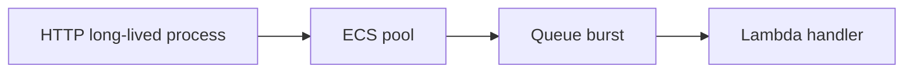
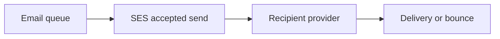
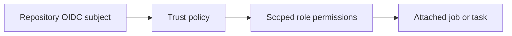
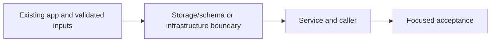
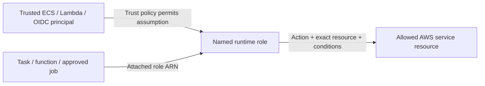

# 40. AWS email pipeline and publish-policy repair

## 1. In one sentence

Match runtime lifecycle and network needs to workload.

## 2. The big picture

## 3. Concepts and current behavior

P4 now routes API publishing through SNS, so historical API sqs:SendMessage permissions are superseded by sns:Publish. The single imageServices list feeds registry and publish permissions. Lambda/SES/IAM quotas and delivery require live acceptance; historical preview counts are not a current preview.

### ECS, Lambda or EKS? Cold starts, VPC and NAT?

ECS fits long-running API/web processes and predictable pools. Lambda fits bursty queue handlers with bounded work. EKS provides Kubernetes control at substantial operational cost. Our workers run outside the VPC because they only call managed public AWS APIs; putting a worker in a public subnet does not give it a public IP or automatic internet.

`infra/src/compute/service.ts` runs Fargate; `infra/src/jobs/worker-lambda.ts` has no vpcConfig and 10 s timeout; ticket Lambda has its own larger budget. Lambdas use container images already published by CI. `pnpm demo:tickets` validates handlers locally, not AWS cold starts. EKS/NAT gateways are not built.

Why: Match runtime lifecycle and network needs to workload.

Trade-offs: VPC Lambda for RDS requires routing/endpoints or NAT for outside services. NAT has fixed and data charges; endpoints also cost. Container image cold start differs from zip, so measure.

### SES deliverability, quotas and duplicate emails

A successful SendEmail means SES accepted the request, not that the recipient read it. Verify identity/DKIM, respect sandbox/production access and sending rate, then handle bounce/complaint outcomes. MiniTickets has a dedicated mail worker and scoped SES permission. Custom MAIL FROM/SPF/DMARC workflows and bounce processing are explain-only.

`infra/src/jobs/email.ts` configures the SES identity; `apps/worker/src/ses-mailer.ts` sends with a stable configured sender. `docs/20-deploy-day.md` §3.10 covers owner acceptance. Proposed feedback events would fan into a separate queue/service updating suppression preferences. No live inbox delivery claim.

Why: Offloading mail protects booking latency but delivery is still an external outcome.

Trade-offs: SES quotas can bottleneck a fast Lambda. Retrying permanent bad addresses wastes work. Mark-after-send leaves a duplicate window.

### IAM roles and OIDC: who can wear which badge?

A trust policy says who can assume a role; a permission policy says which actions/resources it can access; attachment says which runtime uses it. GitHub OIDC exchanges an approved repository/environment identity for short-lived AWS credentials. Task execution retrieves images/secrets; application roles authorize runtime AWS calls.

`infra/src/cicd.ts` restricts OIDC subjects and PassRole. `infra/src/publish-policy.ts` includes ECR read/write actions needed by publish; `compute/iam.ts` separates API execution/application roles. Read the D1 Every IAM badge tour and runbook §3.11. Live deploy acceptance remains owner work.

Why: A reachable AWS endpoint is not permission to invoke it.

Trade-offs: Resource wildcards needed for APIs without resource scoping require conditions where supported. Broad deploy capability is dangerous; do not let old infrastructure runs apply.

## 4. Dependency order

The concrete prerequisites are the source files and current settings named above. Migrations precede the consuming image rollout; IAM permissions precede the job that uses them.

## 5. What breaks and how we notice

Is a Lambda in a public subnet publicly addressed? No. 10x: concurrency/quota and SES limits. 100x: provisioned concurrency only for measured latency needs, reserved concurrency for protection.

Does more Lambda concurrency increase SES quota? No. 10x: production quota/rate and suppression. 100x: reputation monitoring, templates/localization and provider outcome ingestion.

Why did worker publish need BatchGetImage? Publishing tooling reads image manifests as well as uploading layers. 10x: environment protection/expiry and policy review. 100x: separate accounts, policy-as-code and change approvals tied to exact SHA.

Current limits: P4 now routes API publishing through SNS, so historical API sqs:SendMessage permissions are superseded by sns:Publish. The single imageServices list feeds registry and publish permissions. Lambda/SES/IAM quotas and delivery require live acceptance; historical preview counts are not a current preview.

## 6. Interview questions with short answers

1. **ECS, Lambda or EKS? Cold starts, VPC and NAT?** ECS fits long-running API/web processes and predictable pools. Lambda fits bursty queue handlers with bounded work. EKS provides Kubernetes control at substantial operational cost. Our workers run outside the VPC because they only call managed public AWS APIs; putting a worker in a public subnet does not give it a public IP or automatic internet.

2. **Which runtime currently owns the HTTP API?** ECS Fargate

3. **Why does this boundary exist?** Match runtime lifecycle and network needs to workload.

4. **Which alternative would you compare?** VPC Lambda for RDS requires routing/endpoints or NAT for outside services. NAT has fixed and data charges; endpoints also cost. Container image cold start differs from zip, so measure.

5. **What changes at 10x or 100x?** 10x: concurrency/quota and SES limits. 100x: provisioned concurrency only for measured latency needs, reserved concurrency for protection.

6. **What is the important counter-question?** Is a Lambda in a public subnet publicly addressed? No.

## 7. Check yourself

1. Trace the exact source path and identify the invariant it protects.
2. Which runtime currently owns the HTTP API?
3. Which failure requires live AWS acceptance rather than local evidence?

## How this connects

Uses the [architecture](00-architecture.md) and [previous step](39-local-stack-health.md). Continue with [next step](41-observability.md). Practice the [scenario](handbook/guides/interview-scenarios.md#compute-choices) and [explorer tour](handbook/guides/infra-explorer.html?tour=booking).

## Historical evidence and open limits

The following is the implementation-time record, preserved from PENDING. Measurements describe that earlier local run, not a fresh benchmark. Later behavior is stated above; old “not built” statements may be superseded. Owner setup recipes are intentionally replaced by the current [deploy runbook](20-deploy-day.md). No old preview is a promise about today’s stack.

### Series 2, P1 = S1c: the job pipeline on AWS (would be `docs/40-*`). Infra + CD + worker. Prompt: [prompts/series-2.md](handbook/prompts/series-2.md) (P1). New dependencies (worker only): `@aws-sdk/client-sesv2`, `esbuild` (dev, same version as the api's). Also: `pnpm run doctor` renamed to **`pnpm stack:check`** (`scripts/stack-check.ts`; pnpm's built-in `doctor` shadowed it); `eslint.config.mjs` ignores `**/dist/**`.

- **Concepts:** SQS standard queue (at-least-once, visibility timeout = 6 × Lambda timeout because Lambda may retry a throttled batch, long polling, SSE-SQS); DLQ + redrive policy (maxReceiveCount 3) + redrive-ALLOW policy (byQueue), DLQ retention 14 d > source 4 d (a message's age counts from its FIRST send); Lambda container image (AWS base image = runtime interface client + emulator; arm64; `provenance: false` because Lambda refuses image indexes; ECR repository policy for the `lambda.amazonaws.com` principal with `aws:SourceArn`); runtime choice nodejs24.x (= .nvmrc's major; image has Node 24.21.0, AWS patches minor/patch); Lambda OUTSIDE the VPC (talks only to public AWS APIs; in the VPC it would need a NAT gateway ~$33/mo or interface endpoints ~$7/mo/AZ each; DynamoDB's gateway endpoint is the free exception; event-carried state = no DB needed); event source mapping (batch 10, `ReportBatchItemFailures`, `maximumConcurrency` 5) vs reserved concurrency (throttled invokes return messages → receive count climbs → healthy messages can hit the DLQ); backoff on Lambda = the handler calls `ChangeMessageVisibility` before answering (Lambda has no backoff of its own); one role for a Lambda (no execution/task split); DynamoDB on demand + TTL; SES identities (domain via Easy DKIM 3 CNAMEs, address via link), the SANDBOX (only verified recipients, 200/24 h, 1/s), `ses:FromAddress` condition; build-once-promote for a third image; first-deploy tag rule (worker gets the new tag in phase A when the running tag has no worker image).
- **Infra (real names):** always on: ECR `minitickets-dev-worker` (IMMUTABLE, scanOnPush, same 3 lifecycle rules) + `RepositoryPolicy` `minitickets-dev-worker-lambda-pull` (lambda.amazonaws.com: `ecr:BatchGetImage`, `ecr:GetDownloadUrlForLayer`, `aws:SourceArn` like `arn:aws:lambda:us-east-1:<acct>:function:minitickets-dev-*`); SQS `minitickets-dev-jobs` (visibility 60, retention 4 d, wait 20, SSE-SQS, redrive → DLQ ×3) + `minitickets-dev-jobs-dlq` (14 d, SSE-SQS) + `RedriveAllowPolicy` (byQueue: only the jobs queue); DynamoDB `minitickets-dev-processed-jobs` (PAY_PER_REQUEST, hash `jobKey` S, TTL `expiresAt`, PITR off); SES `sesv2.EmailIdentity` `minitickets.theversehub.in` (Easy DKIM RSA_2048) + optional identity for config `sesTestRecipient` (SECRET). Compute switch: log group `/minitickets/dev/worker` (7 d); role `minitickets-dev-worker-role` (trust `lambda.amazonaws.com`, no condition) + inline `worker`: `sqs:ReceiveMessage/DeleteMessage/ChangeMessageVisibility/GetQueueAttributes` on the jobs queue, `dynamodb:GetItem/PutItem` on the table, `ses:SendEmail` on the identity ARN(s) with `ses:FromAddress = no-reply@minitickets.theversehub.in`, `logs:CreateLogStream/PutLogEvents` on the worker group; Lambda `minitickets-dev-worker` (Image, arm64, 256 MB, 10 s, no VPC, reserved concurrency only via config `workerReservedConcurrency`, env `NODE_ENV/JOBS_QUEUE_URL/PROCESSED_JOBS_TABLE/MAILER=ses/MAIL_FROM`, `loggingConfig.logGroup`); event source mapping `minitickets-dev-worker-trigger`. api: task role + inline `send-jobs` (`sqs:SendMessage` on the jobs queue only); task env `JOBS_QUEUE_URL`. CD roles: publish `push-images` + worker repo ARN; deploy `deploy`: 10f PassRole also to `lambda.amazonaws.com`, 10h + worker repo, NEW 10j `JobPipeline` (`sqs:*` `minitickets-dev-*`, `dynamodb:*` `table/minitickets-dev-*`, `lambda:*` `function:minitickets-dev-*` + `event-source-mapping:*`, `ses:*` `identity/*`), NEW 10k `CreateEventSourceMapping`/`ListEventSourceMappings` on `*`, deny renumbered 10l. No security group change (nothing connects TO the Lambda; it uses no VPC). Outputs: `workerRepoUrl`, `jobsQueueUrl`, `jobsDlqUrl`, `processedJobsTable`, `sesMailFrom`, `sesDkimRecords` (unsecret: the provider marks the whole DKIM block secret), `workerFunctionName`, `workerTriggerId`, `imageTagsInUse.worker`. CD: env `WORKER_REPO_NAME`, `WORKER_FUNCTION_NAME`; publish checks/builds/pushes worker (`scope=worker-arm64`), summary row; deploy checks the tag in 3 repos (a rollback to a pre-S1c tag now stops there), refuses committed `workerImageTag`, `worker_new_tag` → phase A `--config workerImageTag=<new>`, `deployed-<tag>` on 3 repos, wait step checks the Lambda's image tag / Active / Successful and the mapping Enabled. CI `docker` job builds the worker (x86). `scripts/push-images.sh` pushes the worker too.
- **Key files (read in this order):** `infra/src/jobs/queues.ts` `createJobQueues`; `processed-jobs-table.ts`; `email.ts` `createEmail` (sandbox explained at the top); `worker-iam.ts` `createWorkerRole` (WHO/WHAT/ATTACHED); `worker-lambda.ts` `createWorkerLambda` (2a-2g), `WORKER_TIMEOUT_SECONDS`; `queue-trigger.ts` `createQueueTrigger`; `infra/index.ts` 8c, 13, 19, 20b, 29b; `registry.ts` `allowLambdaPull`; `compute/iam.ts` 7b; `compute/task.ts`; `compute/logs.ts`; `cicd.ts` 6b, 10f, 10h, 10j, 10k; `image-tag.ts` 6b; `.github/workflows/cd.yml` 17b, 30, 31, 33, 35, 37d; worker `src/lambda.ts` `chooseMailer`, `handler`; `src/retry-later.ts` `delayFailedMessages`; `src/ses-mailer.ts` `SesMailer`; `src/config.ts` (MAILER, MAIL_FROM + refine); `src/local.ts` (backoff moved out); `apps/worker/build.mjs`, `apps/worker/Dockerfile`; `docs/20-deploy-day.md` 3.10 (runbook). Tests: `retry-later.test.ts`, `ses-mailer.test.ts`, `infra/src/image-tag.test.ts`. Anchors: new stub cards `sqs`, `dead-letter-queue`, `aws-lambda`, `dynamodb`, `ses-email` (📋, in concept-map); lines added to `arm64-graviton`, `cloudwatch-logs`, `docker-layer-caching`, `docker-multi-stage`, `idempotency`, `least-privilege`, `retry-policy`.
- **Measured (local, 2026-10-15):** read-only AWS: Lambda account quota **ConcurrentExecutions 10** (so reserved concurrency 5 is refused today → config switch, default none); SES **sandbox**, 200/24 h, 1/s; SSM tag `f947716`; no worker repo yet. Worker image (arm64): **631 MB** uncompressed = AWS base 629 MB + ~2 MB (one 1.9 MB bundle). Real image under the Lambda runtime emulator, against my own ElasticMQ + DynamoDB Local on a private network: **INIT 302 ms**, first batch of 3 (1 valid, 1 duplicate, 1 poison v9) **441 ms** → 1 email, 1 "skipped, already done", 1 failure; failed message invisible, back after **10.0 s** with receive count 2; second failure → next try 40 s (not back within 20 s); warm batch **23 ms**. x86 build (what CI does) OK. `pulumi preview`: **+14 ~5 +-1** (20 changes, 70 unchanged; api task definition replaced for `JOBS_QUEUE_URL` + new task role policy); targeted bootstrap preview **+3 ~3**. Unit **258/258** (+8). Mutations: (M1) backoff on every record → 1 test fails; (M2) SesMailer logs the full address → 1 fails; (M3) `workerImageTag` ignored → 2 fail. `MAILER=ses` without `MAIL_FROM` → exit 1 with the message. actionlint (with shellcheck) clean. Mermaid in docs/20: 11/11 render.
- **Interview angles:** "How do you send emails without slowing the request?" (queue + worker; the request only waits for SendMessage). "What if the worker fails?" (partial batch failures, backoff 10/40/120 s, DLQ after 3, redrive after the fix; idempotent consumer for duplicates). "Why is the visibility timeout 6× the Lambda timeout?" "Lambda in or out of the VPC?" (cost, NAT, endpoints, cold start; what needs the VPC: RDS). "Reserved concurrency vs maximumConcurrency for SQS?" (throttle → receive count → DLQ). "Container image vs zip?" (one pipeline, 10 GB limit, slightly slower cold start; zip ≤ 250 MB). "How do you get email delivered, not spammed?" (DKIM; SPF via custom MAIL FROM and DMARC: not built). Counter-questions: why SQS not SNS/EventBridge (one consumer, buffering, retries; SNS fan-out comes in P4); why DynamoDB not Postgres for processed jobs (no VPC, no connection pool for a bursty Lambda, conditional put, TTL). 10x/100x: SES production access + sending quota/rate (1/s today), maxConcurrency up with DynamoDB on demand, batch window, per-message parallelism inside a batch, FIFO only if ordering matters (lower throughput).
- **Unsure / for the docs:** (1) NOT deployed: no live check of anything on AWS (owner deploys via CD). (2) SES sandbox IAM: I believe SES checks `ses:SendEmail` on the RECIPIENT's identity too, so both ARNs are granted; not proven live. (3) The ECR repository policy with `aws:SourceArn`: documented for cross-account; if Lambda still tries to add its own policy on create, Pulumi will show drift on the next preview. (4) No `aws:SourceAccount` condition on the Lambda trust policy (AWS examples have none). (5) Deploy role 10j/10k: written from the IAM action reference, not from a CloudTrail run; a missing action would show as AccessDenied in the first CD run. (6) Idle cost of the trigger's polling (counts as SQS requests) not measured: watch `NumberOfEmptyReceives`. (7) A 10 s Lambda timeout with 10 messages × 3 s SDK timeouts could time out the whole batch (then retry after 60 s, no backoff). (8) SES 1 email/s in the sandbox: a burst of bookings may be throttled → retried with backoff (SDK retries first). (9) The SES test-recipient address sits as plain text in Pulumi's STATE (resource id), encrypted in the committed file. (10) Lambda base image tag `24` is not pinned by digest (patches flow in on each publish). (11) e2e NOT run: the owner's servers were not running on :3000/:4000 (P1 changes no api/web runtime code). (12) Test containers `p1w`, `p1q`, `p1d` + network `p1net` left running (`docker rm` is blocked for the agent): owner removes them.

### Series 2, P1 = S1c fix: CD publish "not authorized ... ecr:BatchGetImage on minitickets-dev-worker". Infra code only; no AWS change (preview identical before/after).

- **Root cause (measured):** CD run 38783979040 checked the worker tag at 18:16:00Z; the local `pulumi up` (stack v14) that added the worker ARN to the publish policy ran 18:17:39Z → the push raced ahead of the policy (docs/20 3.10: bootstrap BEFORE push). `pulumi preview --refresh` after: no drift, AWS policy already lists all 3 repos. v14 itself failed (Lambda wanted `worker:f947716`, a pre-S1c tag with no worker image).
- **Concepts:** one source of truth for a list that IAM depends on; a policy as a pure function so it can be unit-tested; ordering: a role's permissions must exist before the job that uses them; IAM "no identity-based policy allows" = missing Allow (not a Deny).
- **Key files:** `infra/src/image-repos.ts` `imageServices`, `repoName`; `publish-policy.ts` `publishPolicyDocument`, `ecrPushPullActions` (statements moved from cicd.ts 6a/6b); `registry.ts` step 4/5 (loop, `repoArns`); `cicd.ts` `CicdInputs.repoArns`, step 6, 10h; `index.ts` 8b; test `publish-policy.test.ts` (reads `*_REPO_NAME` from cd.yml).
- **Measured:** infra tests 19/19 (+5); mutations caught: policy on first 2 repos only → 1 fails; worker dropped from the list → 2 fail. `pulumi preview`: 3 changes / 88 unchanged both before and after (Lambda + trigger create, api service update = v14 leftovers); no IAM/ECR change.
- **Unsure / for the docs:** role description still says "the 3 minitickets ECR repos" (left alone: changing it would update the role). The test does not run Pulumi, so registry.ts → cicd.ts wiring is guaranteed by types, not by a test.

## IAM: WHO / WHAT / ATTACHED

The phase's historical resource/permission record above lists exact actions and scopes. The [current IAM badge table](handbook/guides/infra-build-along.md#every-iam-badge-who--what--attached) separates API execution, API application, web execution, email, ticket, publish and deploy roles. Execution secret injection is not application authorization. Queue resource policy source-topic/account conditions are separate from the runtime role. Review the actual inline statements before granting an action; local emulator success does not validate IAM.
