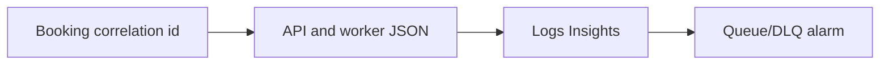
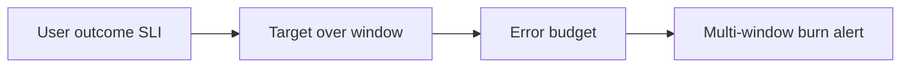
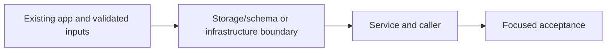

# 41. Follow one booking through logs and alarms

## 1. In one sentence

A user symptom spans asynchronous boundaries, not one process log.

## 2. The big picture

## 3. Concepts and current behavior

Four symptom alarms, SNS email and a dashboard are defined; subscription confirmation and live signal checks remain owner acceptance. P10 adds webVital logs. Correlation ids are validated UUIDs, not timed traces. Tracing/SLO resources remain explain-only.

### How do you debug one booking and avoid alert fatigue?

Use a validated correlation id across request, outbox and worker. Logs explain events, metrics show rates and traces time causal steps. Alarm on symptoms: API errors, old queue work, DLQ messages and worker failures. Missing data semantics matter; do not page on every idle CPU wobble.

`apps/api/src/http/correlation-id.ts`, worker correlation and JSON loggers preserve identity. `infra/src/observability` defines four alarms, dashboard and saved queries. P2 measured request-to-email 115 ms and retry recovery around 10 s locally. Runbook §3.12 supplies exact Logs Insights/console steps; SNS email confirmation/live alarms remain manual.

Why: A user symptom spans asynchronous boundaries, not one process log.

Trade-offs: Correlation is not a timed trace. Logging full messages leaks PII. Fixed thresholds are simple but need traffic-aware tuning and retention cost planning.

### Where would tracing, SLOs and error budgets fit?

Traces form a tree of timed spans linked by trace context. An SLI measures a user outcome; an SLO sets a target/window; an error budget is the permitted failure fraction. Alert on sustained fast budget burn, not a brief harmless blip. A dev app without real traffic cannot demonstrate a meaningful production SLO.

WHERE IN MINITICKETS: proposed apps/api/src/tracing.ts loaded before server modules, ADOT sidecar in API task, Lambda tracing config and narrowly scoped X-Ray write IAM. Propagate W3C traceparent through the message envelope. Proposed CloudWatch SLI for booking success/latency and email delay; logs remain current evidence. No OTel collector, tracing grants or SLO resource is built.

Existing integration point: `apps/api/src/http/correlation-id.ts`.

Why: Average latency and raw error counts can hide a failing user journey.

Trade-offs: Sampling loses individual traces; sidecars cost CPU/memory and collector operations. ALB errors alone do not fully describe business success. Use a business metric where needed.

## 4. Dependency order

The concrete prerequisites are the source files and current settings named above. Migrations precede the consuming image rollout; IAM permissions precede the job that uses them.

## 5. What breaks and how we notice

Why validate client correlation ids? Prevent log injection and unbounded junk while preserving useful propagation. 10x: error rates/p99 and sampling. 100x: SLO burn-rate alerting and trace sampling with explicit budgets.

Does 99.5% mean zero failures? No; it allows 0.5% of valid events to miss the objective. 10x: define denominator/exclusions and test alerts. 100x: sampled distributed spans, cost/PII limits and release policies tied to budget.

Current limits: Four symptom alarms, SNS email and a dashboard are defined; subscription confirmation and live signal checks remain owner acceptance. P10 adds webVital logs. Correlation ids are validated UUIDs, not timed traces. Tracing/SLO resources remain explain-only.

## 6. Interview questions with short answers

1. **How do you debug one booking and avoid alert fatigue?** Use a validated correlation id across request, outbox and worker. Logs explain events, metrics show rates and traces time causal steps. Alarm on symptoms: API errors, old queue work, DLQ messages and worker failures. Missing data semantics matter; do not page on every idle CPU wobble.

2. **Which signal explains a specific failed booking?** Correlated structured logs

3. **Why does this boundary exist?** A user symptom spans asynchronous boundaries, not one process log.

4. **Which alternative would you compare?** Correlation is not a timed trace. Logging full messages leaks PII. Fixed thresholds are simple but need traffic-aware tuning and retention cost planning.

5. **What changes at 10x or 100x?** 10x: error rates/p99 and sampling. 100x: SLO burn-rate alerting and trace sampling with explicit budgets.

6. **What is the important counter-question?** Why validate client correlation ids? Prevent log injection and unbounded junk while preserving useful propagation.

## 7. Check yourself

1. Trace the exact source path and identify the invariant it protects.
2. Which signal explains a specific failed booking?
3. Which failure requires live AWS acceptance rather than local evidence?

## How this connects

Uses the [architecture](00-architecture.md) and [previous step](40-aws-job-pipeline.md). Continue with [next step](42-transactional-outbox.md). Practice the [scenario](handbook/guides/interview-scenarios.md#observability) and [explorer tour](handbook/guides/infra-explorer.html?tour=failing-email).

## Historical evidence and open limits

The following is the implementation-time record, preserved from PENDING. Measurements describe that earlier local run, not a fresh benchmark. Later behavior is stated above; old “not built” statements may be superseded. Owner setup recipes are intentionally replaced by the current [deploy runbook](20-deploy-day.md). No old preview is a promise about today’s stack.

### Series 2, P2 = S1d: observability (would be `docs/41-*`). App code (api, worker, web server, shared) + infra (11 resources) + runbook (`docs/20-deploy-day.md` 3.12). Prompt: [prompts/series-2.md](handbook/prompts/series-2.md) (P2). No new dependency.

- **Concepts:** correlation id vs request id (one UUID per api request, unique across tasks, unlike Fastify's `req-1`); accepting a caller's id only if it is a UUID (log injection, fake lines); returning it in `x-correlation-id` (support can quote it); propagating it through a queue (an OPTIONAL message field = backward compatible, still version 1; z.object drops unknown keys for old workers); reading it before validation so invalid/DLQ messages keep it; structured JSON logs in ONE shape across services (pino's `level` 30/40/50, `time`, `msg`) so one Logs Insights query covers api + worker; why raw stdout on Lambda (console.* adds a text prefix in "Text" format); alarms on symptoms (DLQ depth, oldest message age, Lambda errors, ALB 5xx) vs causes; `treatMissingData` (ignore for the DLQ: SQS stops metrics on inactive queues, notBreaching for the rest); metric math (`FILL(target5xx,0)+FILL(alb5xx,0)`); handled failures (batchItemFailures) are NOT Lambda Errors; OK actions ("resolved" emails); SNS topic policy with `aws:SourceArn` + `aws:SourceAccount` (confused deputy), no SSE (AWS-managed key can't be used by CloudWatch); email subscription needs a human click; dashboards + saved Logs Insights queries as runbook shortcuts.
- **Infra (real names, all new):** SNS `minitickets-dev-alerts` (no SSE) + `TopicPolicy` `minitickets-dev-alerts-policy` (Allow `cloudwatch.amazonaws.com` `sns:Publish`, `aws:SourceArn` like `arn:aws:cloudwatch:us-east-1:<acct>:alarm:minitickets-dev-*`, `aws:SourceAccount`) + `TopicSubscription` `minitickets-dev-alerts-email` (email → config `alertEmail`, PendingConfirmation until clicked); MetricAlarms (alarm + OK actions → topic): `minitickets-dev-jobs-dlq-not-empty` (AWS/SQS ApproximateNumberOfMessagesVisible, dlq, Max, 60 s ×1, > 0, missing=ignore), `minitickets-dev-jobs-oldest-message-age` (ApproximateAgeOfOldestMessage, jobs, Max, 60 s ×1, >= 300, notBreaching), `minitickets-dev-worker-errors` (compute; AWS/Lambda Errors, Sum, 300 s, > 0), `minitickets-dev-alb-5xx` (entry; metric math Target_5XX + ELB_5XX, Sum, 300 s, >= 5); Dashboard `minitickets-dev`; QueryDefinitions `minitickets-dev/follow-one-request`, `/errors`, `/worker-durations` (compute). Deploy policy NEW 10m `Observability` (`sns:*` on `arn:aws:sns:…:minitickets-dev-*`, `cloudwatch:*` on `alarm:minitickets-dev-*` + `dashboard/minitickets-dev`) + 10m2 `ReadAlarms` (`cloudwatch:DescribeAlarms` on `*`). Outputs `alertTopicArn`, `dashboardName`. Code outputs: `jobs/queues.ts` `queueName`/`dlqName`, `entry/alb.ts` `albArnSuffix`. No IAM change for the api task or worker role. No security group change. Cost: $0.20/month always on (2 alarms), max $0.50 (+worker, +ALB math alarm = 2 metrics); dashboard free (3 free), SNS email free tier, Insights $0.005/GB scanned.
- **Key files (read in this order):** `packages/shared/src/schemas/jobs.ts` `CorrelationId`; `apps/api/src/http/correlation-id.ts` `correlationIdFor`, `addCorrelationIdHeader`; `app.ts` 1b2/1b3 (`genReqId`, `LogController({ requestIdLogLabel })`: the top-level option is deprecated in Fastify 5.12), `onError` uses `req.log`; `procedures/bookings.ts` 4; `services/bookings.ts` `bookTicket`/`publishConfirmation` (message `correlationId`); worker `src/log.ts` `createLog`, `src/correlation.ts` `correlationIdOf`, `batch.ts` 1b, `retry-later.ts` 2b, `lambda.ts` 5 (`awsRequestId`), `local.ts`, `mailer.ts`/`ses-mailer.ts`/`faulty-mailer.ts` (`send(email, log)`); web `src/lib/server-log.ts` + `features/events/server/{cached-events,prefetch-events}.ts`; infra `src/observability/alarm-specs.ts` (read first), `alert-topic.ts`, `alarms.ts`, `dashboard-body.ts`, `dashboard.ts`, `log-queries.ts`, `index.ts` 3/24b/29c, `cicd.ts` 10m, `jobs/worker-lambda.ts` 2g. Tests: `apps/api/src/http/correlation-id.test.ts`, `apps/worker/src/log.test.ts`, `batch.test.ts` (P2 block), `infra/src/observability/{alarm-specs,dashboard-body}.test.ts`.
- **Measured (local, 2026-10-15, own ElasticMQ :19325 + DynamoDB Local :18001, DB copy `minitickets_p2`, Redis db 1, own api :4101 + worker; then own web :3101):** one booking → **3 api lines + 3 worker lines** with the same `correlationId` (`incoming request`, `published booking.confirmed …`, `request completed` 200 in 39.9 ms; `would send email (LogMailer)`, `email sent`, `deleted`); request → `email sent` **115 ms**. Caller-supplied `x-correlation-id` kept end to end; bad header `"}{"level":60` → new UUID, no injected line. Failing booking (`MAILER_FAIL_MODE=first-n:1`): `message failed` (level 50, tries 1) → `stays in the queue … nextTryInSeconds 10` → **10.04 s** later `email sent` (tries 2), all with the caller's id. e2e run: 225 api lines, **0 non-JSON**, 0 request lines without `correlationId`; web `next data cache miss` lines are JSON. Unit **310/310** (+36 incl. 11 deploy-guard). Mutations: message without `correlationId` → 1 fails; worker child without it → 3 fail; any caller text accepted as id → 2 fail; text logs instead of JSON → 17 fail; DLQ alarm missing=notBreaching → 1 fails. e2e on own api :4101 + web :3101 (dev): **24 passed, 10 skipped** (prod-only + admin specs skip with `E2E_BASE_URL`). `pulumi preview`: **+12 ~1** (P2's 11 + the guard's parameter; ~ deploy policy), 90 unchanged.
- **Interview angles:** "A customer says they never got their confirmation email: how do you find out why?" (x-correlation-id / bookingId → Logs Insights across api + worker → DLQ → redrive after fix). "What do you alarm on?" (symptoms users feel: errors, stuck queues, DLQ; not CPU). "Logs vs metrics vs traces?" (events with context / cheap aggregates for alarms / causal timing across services). "How do you avoid alert fatigue?" (few symptom alarms, thresholds above normal noise, OK notifications, runbook link in every alarm). Counter-questions: why accept a client's correlation id at all (service-to-service propagation; validated); why not log the full message (PII); missing data semantics; at 10x/100x: rate-based alarms (5xx / requests), anomaly detection, p99 latency SLO alarms, log sampling + retention tiers, structured log costs (ingest $0.50/GB), PagerDuty/Opsgenie via SNS → HTTPS, per-tenant dashboards.
- **Explain-only: tracing (OpenTelemetry / X-Ray).** A TRACE = one request's tree of SPANS (timed steps: api handler → Postgres query → SQS send → Lambda → SES), linked by a trace id propagated in headers (W3C `traceparent`) and through SQS (`AWSTraceHeader` system attribute). The correlation id is "a trace id without timings". Where it would go: `apps/api/src/tracing.ts` loaded with `node --import` before `server.ts` (OTel SDK, auto-instrumentation for Fastify, pg, ioredis, aws-sdk); an ADOT collector sidecar in the api task definition exporting to X-Ray (task role `xray:PutTraceSegments`, `PutTelemetryRecords`); worker Lambda `tracingConfig: { mode: "Active" }` + the same IAM. Trade-offs: sidecar CPU/memory per task, X-Ray $5 per million traces recorded (sample, e.g. 5%), vendor-neutral OTel vs X-Ray SDK lock-in. Not built: logs + correlation id answer "follow one booking" at our scale.
- **Explain-only: SLOs and error budgets.** SLI = good events / valid events (e.g. `bookings.create` answered without 5xx in < 500 ms; confirmation email sent < 5 min after booking). SLO = target over a window (99.5% / 28 days). Error budget = the 0.5% you may fail (1 in 200 bookings; ~3.4 h of total outage) → spend it on releases, freeze features when it is gone. Alert on BURN RATE (e.g. 14.4× budget burn over 1 h AND 5 min) instead of fixed thresholds: pages only when the budget is really at risk. Where it would go: CloudWatch metric math SLI from ALB `RequestCount` − 5xx, or CloudWatch Application Signals SLOs; the email SLI from the queue's oldest-message age. Not built: dev has no real traffic, so an SLO would measure nothing.
- **Unsure / for the docs:** (1) NOT deployed: no alarm, email or dashboard checked live. (2) SQS metrics on an inactive queue: I believe SQS stops publishing after ~6 h without activity (hence `ignore` on the DLQ alarm); not verified. (3) `cloudwatch:DescribeAlarms` on `*` is a guess at what Pulumi needs; a missing CloudWatch/SNS action would show as AccessDenied in the first CD run. (4) Lambda's handling of raw `process.stdout.write` lines under "Text" format (pure JSON, no prefix) is from AWS docs/experience, not seen on AWS for this function yet. (5) The DLQ alarm stays INSUFFICIENT_DATA until the DLQ has activity (no email for that state, on purpose). (6) The web server's SSR calls do not send a correlation id to the api (Next's data cache is shared across requests, so a per-request id would mislead); the api gives those calls their own. (7) ALB access logs (with `X-Amzn-Trace-Id`) are not enabled. (8) Left behind (agent cannot stop containers): container `p2q` (ElasticMQ :19325), DB `minitickets_p2`, Redis db 1 keys, a throwaway user `p2-trace-…@example.com` in that DB copy.
