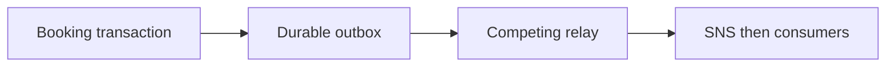
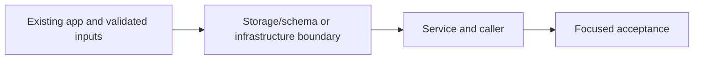

# 42. Durable confirmation outbox

## 1. In one sentence

Commit-then-send has a gap; send-then-commit can announce a rolled-back purchase.

## 2. The big picture

## 3. Concepts and current behavior

The queue adapter now publishes SNS rather than the P3 SQS target. The outbox invariant and at-least-once duplicate window remain. Batches are 10, idle polling 1 s, retry delay capped at 60 s without maximum attempts. No historical-booking backfill or sent-row retention job exists.

### What if booking commits but publishing fails?

Store the booking, seat decrement and confirmation payload in one Postgres transaction. A relay publishes committed outbox rows and marks them sent. A crash after publish but before marking sent produces a duplicate, so consumers stay idempotent. This closes message loss, not exactly-once delivery.

`apps/api/src/queries/bookings.ts` inserts the outbox row. `queries/outbox.ts` uses FOR UPDATE SKIP LOCKED batches of 10; `services/outbox.ts` retries persisted rows. `pnpm demo:outbox` measured 24/24 recovered after queue restoration and atomic rollback on injected outbox failure.

Why: Commit-then-send has a gap; send-then-commit can announce a rolled-back purchase.

Trade-offs: Holding row locks while sending is simple but occupies a pool connection. Leases/CDC decouple IO at greater complexity. Sent rows need retention planning.

## 4. Dependency order

The concrete prerequisites are the source files and current settings named above. Migrations precede the consuming image rollout; IAM permissions precede the job that uses them.

## 5. What breaks and how we notice

What if SNS accepted before relay crash? Publish again with stable message identity; consumers deduplicate. 10x: batch sends/backlog age. 100x: separate relay or CDC, retention and publish throughput budgets.

Current limits: The queue adapter now publishes SNS rather than the P3 SQS target. The outbox invariant and at-least-once duplicate window remain. Batches are 10, idle polling 1 s, retry delay capped at 60 s without maximum attempts. No historical-booking backfill or sent-row retention job exists.

## 6. Interview questions with short answers

1. **What if booking commits but publishing fails?** Store the booking, seat decrement and confirmation payload in one Postgres transaction. A relay publishes committed outbox rows and marks them sent. A crash after publish but before marking sent produces a duplicate, so consumers stay idempotent. This closes message loss, not exactly-once delivery.

2. **Does an outbox guarantee exactly-once delivery?** No; at-least-once with idempotent consumers

3. **Why does this boundary exist?** Commit-then-send has a gap; send-then-commit can announce a rolled-back purchase.

4. **Which alternative would you compare?** Holding row locks while sending is simple but occupies a pool connection. Leases/CDC decouple IO at greater complexity. Sent rows need retention planning.

5. **What changes at 10x or 100x?** 10x: batch sends/backlog age. 100x: separate relay or CDC, retention and publish throughput budgets.

6. **What is the important counter-question?** What if SNS accepted before relay crash? Publish again with stable message identity; consumers deduplicate.

## 7. Check yourself

1. Trace the exact source path and identify the invariant it protects.
2. Does an outbox guarantee exactly-once delivery?
3. Which failure requires live AWS acceptance rather than local evidence?

## How this connects

Uses the [architecture](00-architecture.md) and [previous step](41-observability.md). Continue with [next step](43-signed-qr-tickets.md). Practice the [scenario](handbook/guides/interview-scenarios.md#outbox) and [explorer tour](handbook/guides/infra-explorer.html?tour=booking).

## Historical evidence and open limits

The following is the implementation-time record, preserved from PENDING. Measurements describe that earlier local run, not a fresh benchmark. Later behavior is stated above; old “not built” statements may be superseded. Owner setup recipes are intentionally replaced by the current [deploy runbook](20-deploy-day.md). No old preview is a promise about today’s stack.

### Series 2, P3: transactional outbox for booking confirmations.

- **Concepts:** atomic booking + seats + message; persisted payload/id/correlation; competing relays with `FOR UPDATE SKIP LOCKED`; partial due-row index; at-least-once publishing; exponential backoff; graceful relay shutdown.
- **Key files / reading order:** `apps/api/src/db/schema/outbox.ts` `outbox`; `queries/bookings.ts` `createBookingTx` (message mapping inside transaction); `queries/outbox.ts` `deliverBatch` (SQL/locks, service supplies delivery callback); `services/outbox.ts` `relayOnce`/`retryInMs`/`startOutboxRelay`; `server.ts` startup/shutdown; `services/bookings.ts` `bookTicket` removes direct publish; `drizzle/0006_outbox.sql` + metadata; `src/scripts/outbox-demo.ts`; root/API `demo:outbox` scripts. Existing booking service/procedure tests updated; `services/outbox.test.ts` covers retry/validation/lifecycle.
- **Limits:** batches 10, idle poll 1 s, retry 1/2/4/8/16/32/60 s capped with no limit (DB errors back off too); queue calls use 1 s connect / 2 s hard request timeouts (`throwOnRequestTimeout: true`; the installed SDK otherwise only warns). Missing queue config pauses delivery but still records messages. Pending rows survive restarts; sent rows retained; booking deletion cascades for existing demo/reset cleanup.
- **Infra / CD / cost:** no resources, IAM/SG/secret/env changes. Existing API `sqs:SendMessage` on `minitickets-dev-jobs`; existing CD migration task applies 0006 from the published SHA before API rollout. No new fixed AWS charge; existing RDS storage/IO + API polling. `docs/20-deploy-day.md` 3.13 covers migration, verification, backlog SQL, rollback. Minimal outbox anchor stub + concept-map row only; full guide/story deferred.
- **Measured (local):** disposable DB + ElasticMQ queue/proxy; own APIs :4101/:4102, web :3101, Redis db 15. Queue down: booking/replay 200, 1 pending row, 0 accepted; injected outbox insert rejection: 500, 0 extra bookings/seats. Silent first queue call timed out and recovered. Queue restored after API restart: 24/24 sent + received, 24 unique ids, 0 duplicates, API sends 10 + 14. Related Playwright specs 6/6; unit tests 318/318; one mutation (publish not awaited) made the send-ordering test fail, then was restored; typecheck/lint/docs:check passed (124 cards, 122 slugs, 291 places).
- **Interview angles:** why commit then publish loses messages; why an outbox fixes loss but cannot guarantee exactly-once SQS delivery; why SKIP LOCKED vs one global lock; lock duration/pool pressure vs leases; why preserve messageId/correlationId. Counter-question: what if SQS accepts then the relay crashes? At 10x/100x: batch sends, tune polling/pool, backlog metrics, sent-row retention, separate relay/CDC; explain only.
- **Unsure / manual / not verified:** AWS rollout, SES delivery and abrupt death after publish were not tested; no historical booking backfill. SQS alarms do not see a Postgres backlog. Local base DB still needs migration 0006; owner servers were offline. Demo resources/processes/session cleaned up; Redis db 15 cache keys expire. Pre-existing missing local env settings/DynamoDB reported by stack:check were left alone. Full e2e, actionlint and Pulumi preview skipped (no workflow/infra changes).
