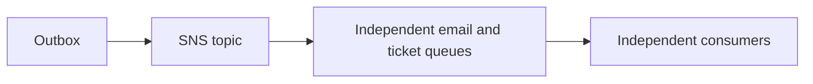
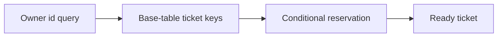
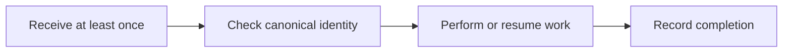
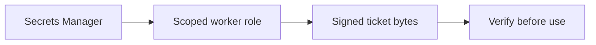
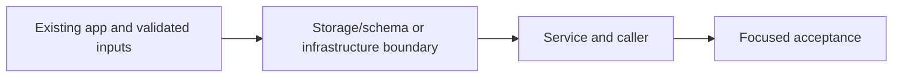
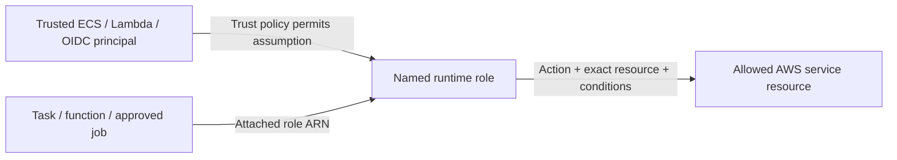

# 43. SNS fan-out and recoverable signed tickets

## 1. In one sentence

Two consumers must each receive the event; competing on one queue would divide work.

## 2. The big picture

## 3. Concepts and current behavior

Ticket id is bookingId:seat; storage uses owner keys and a date GSI. A creating record reserves canonical token/object identity, deterministic PNG writes resume, ready skips repeated work. HMAC proves issuance, not confidentiality or one-time admission. Automated key rotation/check-in are explain-only.

### Queue, topic, event bus or Kafka for booking events?

A topic fans one event out to multiple subscriptions. A queue buffers work for competing consumers. MiniTickets publishes to SNS, then separate email/ticket SQS queues; each can retry independently. EventBridge adds richer routing/integrations; Kafka adds retained partitioned replay. Choose those only when the product needs those semantics.

`infra/src/jobs/booking-events.ts` configures raw SNS deliveries and queue source restrictions. `apps/api/src/queues/jobs.ts` publishes one stable message. Run `pnpm demo:tickets` and `pnpm demo:outbox` separately; P4 local emulators exercise the same SDK boundaries. AWS fan-out acceptance is still manual.

Why: Two consumers must each receive the event; competing on one queue would divide work.

Trade-offs: SNS/SQS are operationally small but standard delivery is unordered/duplicated. A bus is routing, not a replacement for all consumer backpressure.

### How do access patterns choose DynamoDB keys?

Design from queries: an owner lists their tickets and the worker conditionally reserves a canonical ticket. Base keys userId/ticketId support owner-scoped reads; a date index supports event-date access. Conditional writes prevent duplicate reservations. A GSI is eventually consistent and a popular date can become hot.

`infra/src/tickets/storage.ts` defines the ticket table/index; `apps/worker/src/tickets/store.ts` reserves/marks ready; `apps/api/src/queries/tickets.ts` only reads the authenticated owner. `pnpm demo:tickets` tests duplicate/resume behavior. The API role is not granted arbitrary Scan.

Why: A table key should serve actual reads rather than mimic a relational schema blindly.

Trade-offs: A GSI adds write/storage cost and lag. TTL deletion is asynchronous; never use it as exact authorization expiry. On-demand billing still has hot-partition limits.

### Can an idempotent email consumer guarantee exactly one email?

It can skip known completed message ids, but a crash after SES accepts and before marking complete can still send twice on retry. Marking complete before sending risks loss. Ticket issuance converges more strongly using a canonical booking/seat id, a creating reservation, a deterministic S3 key and a final ready state.

`apps/worker/src/handlers/booking-confirmed.ts` and `processed-jobs.ts` mark successful mail after send. `handlers/tickets.ts` reserves a canonical ticket and resumes partial work; `tickets/store.ts` uses conditional writes. `pnpm demo:tickets` checks duplicates and crash-resume behavior.

Why: At-least-once queues force every side effect to define its duplicate behavior.

Trade-offs: No distributed transaction spans SES/S3/DynamoDB. TTL cleanup bounds dedup history; an expired old message may run again. External provider idempotency is valuable where supported.

### Secrets, ticket forgery, rotation and OWASP checks

Store signing/database credentials in Secrets Manager, expose them only to the runtime that needs them and never log them. HMAC authenticates the original ticket bytes and constant-time comparison rejects tampering; it does not encrypt the payload or prevent reuse. Authorization still checks owner/role and uploads remain untrusted.

`apps/worker/src/tickets/token.ts` signs/verifies bounded strict claims; `infra/src/tickets/iam.ts` grants only ticket worker secret access; `services/tickets.ts` owner-scopes reads. Run `pnpm demo:tickets` and `pnpm demo:p4-assets` separately. Proposed rotation adds key id plus verification key ring, staged rollout and old-key retirement; this key-ring is not built.

Why: A client must never receive the signing secret or invent a valid ticket.

Trade-offs: Rotating a single key immediately invalidates old QR tokens unless a key ring is supported. OWASP review also needs abuse, dependency, authorization, logging and incident practices beyond code checks.

## 4. Dependency order

The concrete prerequisites are the source files and current settings named above. Migrations precede the consuming image rollout; IAM permissions precede the job that uses them.

## 5. What breaks and how we notice

Why not two Lambdas on one SQS queue? They compete; each message is not promised to both. 10x: per-consumer backlog/concurrency. 100x: partition ordering domains and retention/replay requirements.

Can a caller choose another ownerId? No; take it from the verified session. 10x: paginate owner queries. 100x: shard hot date indexes/bounded time windows and model reconciliation reads.

Why not use queue message id for tickets? Republishing the same booking can create a different queue id. 10x: bound dedup retention against redrive age. 100x: durable state machines and provider-specific idempotency contracts.

Are signed QR claims private? No; base64url is readable. 10x: expiry/rotation drills and audit access. 100x: per-environment/key versioning, compromise playbooks and threat modeling.

Current limits: Ticket id is bookingId:seat; storage uses owner keys and a date GSI. A creating record reserves canonical token/object identity, deterministic PNG writes resume, ready skips repeated work. HMAC proves issuance, not confidentiality or one-time admission. Automated key rotation/check-in are explain-only.

## 6. Interview questions with short answers

1. **Queue, topic, event bus or Kafka for booking events?** A topic fans one event out to multiple subscriptions. A queue buffers work for competing consumers. MiniTickets publishes to SNS, then separate email/ticket SQS queues; each can retry independently. EventBridge adds richer routing/integrations; Kafka adds retained partitioned replay. Choose those only when the product needs those semantics.

2. **What does a topic add?** Fan-out to separate consumers

3. **Why does this boundary exist?** Two consumers must each receive the event; competing on one queue would divide work.

4. **Which alternative would you compare?** SNS/SQS are operationally small but standard delivery is unordered/duplicated. A bus is routing, not a replacement for all consumer backpressure.

5. **What changes at 10x or 100x?** 10x: per-consumer backlog/concurrency. 100x: partition ordering domains and retention/replay requirements.

6. **What is the important counter-question?** Why not two Lambdas on one SQS queue? They compete; each message is not promised to both.

## 7. Check yourself

1. Trace the exact source path and identify the invariant it protects.
2. What does a topic add?
3. Which failure requires live AWS acceptance rather than local evidence?

## How this connects

Uses the [architecture](00-architecture.md) and [previous step](42-transactional-outbox.md). Continue with [next step](44-ticket-assets.md). Practice the [scenario](handbook/guides/interview-scenarios.md#fanout) and [explorer tour](handbook/guides/infra-explorer.html?tour=booking).

## Historical evidence and open limits

The following is the implementation-time record, preserved from PENDING. Measurements describe that earlier local run, not a fresh benchmark. Later behavior is stated above; old “not built” statements may be superseded. Owner setup recipes are intentionally replaced by the current [deploy runbook](20-deploy-day.md). No old preview is a promise about today’s stack.

### Series 2 — P4 Part A: SNS fan-out and signed QR ticket issuance

- **Built / concepts:** relay → SNS → independent email/ticket SQS consumers; raw JSON, one HMAC-SHA256 QR per booking seat, recoverable creating→ready state, private encrypted PNGs, ownership key + UTC event-date GSI. Part B (tickets.mine/presigned URLs, QR UI, posters) remains.
- **App files:** `packages/shared/src/schemas/{jobs,tickets}.ts` (compatible optional ids / strict ticket schemas); API `queries/bookings.ts:createBookingTx` snapshots ids, `queues/jobs.ts:publishBookingConfirmed` publishes SNS; worker `handlers/tickets.ts:handleTickets`, `tickets/{token,store,assets,batch}.ts`, `ticket-lambda.ts:handler`, `local.ts:poll` issue/recover tickets without SQL.
- **Infra resources:** prefix `minitickets-dev-`: `booking-events` topic + email/tickets raw subscriptions + queue policies; existing `jobs`/`jobs-dlq` retained; `tickets`/`tickets-dlq` + redrive allow (3 tries, 180 s visibility, 4/14-day retention, SSE-SQS); `tickets` DynamoDB (userId/ticketId, `by-event-date`: eventDate/eventDateKey, PAY_PER_REQUEST/SSE, no TTL); `ticket-assets-258237553751` S3 + owner/public-block/AES256/TLS/lifecycle policies (abort incomplete uploads after 1 day; issued assets retained); `ticket-signing-key` RandomBytes + `minitickets/dev/ticket-signing` secret/version (32 bytes, encrypted state, 7-day recovery, no rotation).
- **Compute / IAM:** `infra/src/tickets/{storage,iam,lambda}.ts` + `jobs/booking-events.ts`, `jobs/queues.ts`, `infra/index.ts`; compute-on adds `minitickets-dev-tickets` Lambda (shared worker image, ticket-lambda.handler, arm64, 512 MB, 30 s, no VPC), `tickets-trigger` (batch 1, partial failures, max concurrency 2), `/minitickets/dev/tickets` logs (7 days), `tickets-role`/inline policy: SQS Receive/Delete/GetQueueAttributes only its queue; Dynamo Get/Put/Update only its table; S3 PutObject only tickets/*; GetSecretValue only signing secret; logs CreateLogStream/PutLogEvents only its group. API task switches SendMessage to sns:Publish only topic; queue policy trusts SNS with topic/account conditions. No SG/network changes. Standing secret cost ~$0.40/month + calls; other resources usage/storage billed.
- **CD / operations:** `cicd.ts` grants gh-deploy s3:* only the named bucket/objects (existing SNS/Secrets/job rights suffice); existing worker ECR pull covers both functions. Worker build/Dockerfile package both handlers once per SHA; `cd.yml` early-promotes worker only for pre-P4 current images, refuses pre-P4 rollback targets, checks both image/state/trigger + ticket command. Owner bootstraps deploy policy once, then normal CD; runbook `docs/20-deploy-day.md` §3.14 gives cutover/acceptance/retention details. First rollout pauses bookings: old pending messages without ids still email but ticket-DLQ; no backfill.
- **Local files:** `docker-compose.yml` adds `motoserver/moto:5.2.2` on loopback :5001 (SNS/SQS fan-out must share a backend; S3/Secrets too), keeps DynamoDB Local :8000 and legacy ElasticMQ :9324. `tickets/local-stack.ts:setupLocalTickets`, setup/check/demo scripts, .env examples and stack scripts add repeatable setup, checks and owner-run reset; local mutation tools reject remote endpoints and use dummy credentials. Owner .env files left unchanged.
- **Measured:** local SDK + shipped Lambda bundle demo: 1 publish → 2 queues; injected S3 outage → 1 failed item; concurrent delivery + replay → exactly 4 ready records/4 PNGs, 4 verified HMACs, 4 date-GSI results, 0 extra tickets; isolated resources cleaned. 345/345 unit tests; typecheck/lint/docs:check (124 cards/122 slugs/291 anchors), dual-handler build, actionlint pass. One security mutation skipping HMAC comparison failed 2 forgery tests, restored 8/8 green. Final Pulumi preview: +23 / ~4 / +-1 (API task definition), 98 unchanged, no deletions beyond replaced revision.
- **Interview angles / decision:** SNS copies a simple booking event to two consumers; SQS buffers/retries independently (SNS alone has no consumer backlog); EventBridge adds routing/integration/schema features we do not need; Kafka adds retained replay/ordered partitions but more operational cost. Counter-question: crash between S3 and DynamoDB? Canonical reservation + deterministic object key converges; HMAC authenticates but does not prevent reuse. At 10x/100x: hot date partitions, sharded GSI/bounded query windows, throughput/concurrency/quota tuning, backlog alarms, key-ring rotation and retention; explain only.
- **Not verified / manual:** live CD/IAM/SNS/S3 denial/SES acceptance; no browser/UI change or e2e run (owner :3000/:4000 offline); updated P3 demo/reset not run. stack:check: 4 failures/3 warnings from missing local env/setup and offline servers; new Moto/Dynamo containers healthy, original containers untouched. Ticket alarms, historical backfill, automated key rotation/asset expiry and all Part B remain deferred. Owner acceptance: SNS raw subscriptions; separate SQS redrive policies; ticket Lambda image/trigger; Dynamo seat counts/GSI; S3 private/SSE/TLS/lifecycle; secret metadata only.

## IAM: WHO / WHAT / ATTACHED

The phase's historical resource/permission record above lists exact actions and scopes. The [current IAM badge table](handbook/guides/infra-build-along.md#every-iam-badge-who--what--attached) separates API execution, API application, web execution, email, ticket, publish and deploy roles. Execution secret injection is not application authorization. Queue resource policy source-topic/account conditions are separate from the runtime role. Review the actual inline statements before granting an action; local emulator success does not validate IAM.
