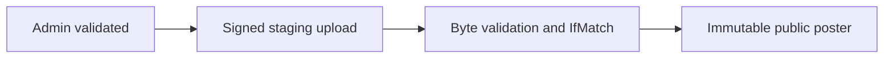
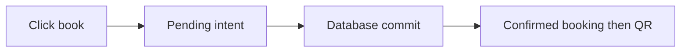
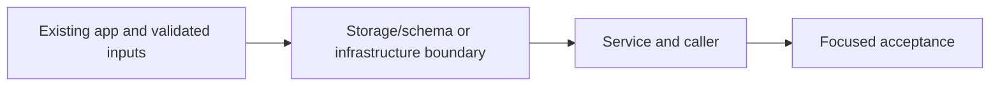
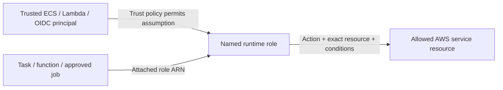

# 44. Private downloads and constrained poster publication

## 1. In one sentence

Direct uploads avoid buffering large files through the API while retaining controlled publication.

## 2. The big picture

## 3. Concepts and current behavior

Owner-scoped API verifies every ticket record against booking identity before issuing 120 s signed GETs. Admin poster PUT signs exact declared headers; bounded byte/header checks and ETag-pinned copy publish an immutable key. This is not malware scanning/full decoding. Dynamo pages are paginated internally; the final owner response is not bounded yet.

### Presigned URLs, CORS and untrusted uploads

A presigned URL is a short-lived bearer capability with exactly the signer’s allowed action. CORS controls browser cross-origin use, not authorization. Validate the owner/admin before signing, constrain type/size, inspect actual image bytes and publish to an immutable key with conditional version identity. Never treat a declared Content-Type as malware scanning.

`apps/api/src/services/posters.ts` validates admin workflow; `queries/posters.ts` signs staging/publish operations; `services/poster-image.ts` checks bounded bytes; `queries/assets.ts` signs private reads for 120 s. `pnpm demo:p4-assets` tests owner isolation and constrained upload/publication. No antivirus/re-encoding pipeline is built.

Why: Direct uploads avoid buffering large files through the API while retaining controlled publication.

Trade-offs: A leaked URL works until expiry. Exact PUT length differs from POST length ranges. Proposed scanning worker belongs before publication and must quarantine failures.

### Should buying the last seat use optimistic UI?

Show pending feedback immediately, but only confirm a ticket after the authoritative transaction commits. An optimistic seat count may improve perceived speed but must roll back and reconcile. MiniTickets keeps the booking intent key through ambiguous retries and shows pending ticket issuance separately.

`apps/web/src/features/bookings/hooks/use-book-ticket.ts` owns mutation/retry state; `apps/web/src/features/bookings/components/my-tickets-list.tsx` distinguishes confirmed booking from pending QR issuance. Run `pnpm demo:idempotency`. Optimistic seat decrement is explain-only and would live in this hook with TanStack cache rollback.

Why: A false success on scarce inventory is worse than a short pending state.

Trade-offs: Optimistic likes are easy to undo; paid scarce inventory is different. Do not replace a lost-response retry with a new idempotency key.

## 4. Dependency order

The concrete prerequisites are the source files and current settings named above. Migrations precede the consuming image rollout; IAM permissions precede the job that uses them.

## 5. What breaks and how we notice

Can another origin with curl use a leaked URL? Yes; CORS does not constrain non-browser callers. 10x: upload quotas and cleanup. 100x: scan/re-encode queues, retention and abuse response.

Can pending QR trigger rebooking? No; poll ticket readiness for the existing booking. 10x: make pending states resilient to reload. 100x: async admission needs a durable intent/status resource.

Current limits: Owner-scoped API verifies every ticket record against booking identity before issuing 120 s signed GETs. Admin poster PUT signs exact declared headers; bounded byte/header checks and ETag-pinned copy publish an immutable key. This is not malware scanning/full decoding. Dynamo pages are paginated internally; the final owner response is not bounded yet.

## 6. Interview questions with short answers

1. **Presigned URLs, CORS and untrusted uploads** A presigned URL is a short-lived bearer capability with exactly the signer’s allowed action. CORS controls browser cross-origin use, not authorization. Validate the owner/admin before signing, constrain type/size, inspect actual image bytes and publish to an immutable key with conditional version identity. Never treat a declared Content-Type as malware scanning.

2. **What is a presigned URL?** Bearer capability

3. **Why does this boundary exist?** Direct uploads avoid buffering large files through the API while retaining controlled publication.

4. **Which alternative would you compare?** A leaked URL works until expiry. Exact PUT length differs from POST length ranges. Proposed scanning worker belongs before publication and must quarantine failures.

5. **What changes at 10x or 100x?** 10x: upload quotas and cleanup. 100x: scan/re-encode queues, retention and abuse response.

6. **What is the important counter-question?** Can another origin with curl use a leaked URL? Yes; CORS does not constrain non-browser callers.

## 7. Check yourself

1. Trace the exact source path and identify the invariant it protects.
2. What is a presigned URL?
3. Which failure requires live AWS acceptance rather than local evidence?

## How this connects

Uses the [architecture](00-architecture.md) and [previous step](43-signed-qr-tickets.md). Continue with [next step](45-search-big-lists.md). Practice the [scenario](handbook/guides/interview-scenarios.md#presigned-uploads) and [explorer tour](handbook/guides/infra-explorer.html?tour=booking).

## Historical evidence and open limits

The following is the implementation-time record, preserved from PENDING. Measurements describe that earlier local run, not a fresh benchmark. Later behavior is stated above; old “not built” statements may be superseded. Owner setup recipes are intentionally replaced by the current [deploy runbook](20-deploy-day.md). No old preview is a promise about today’s stack.

### Series 2 — P4 Part B: private ticket downloads and constrained poster uploads

- **Built / concepts:** session-owned `tickets.mine`, strongly consistent paginated DynamoDB Query, Postgres booking truth + pending/partial/ready UI, 120-second inline/download GET capabilities, 2-second pending polling / 60-second renewal + focus/manual refresh; no raw QR token, owner id or object key in ticket output. Old pre-P4 bookings are not backfilled.
- **API / shared:** `schemas/{tickets,posters,events}.ts` define outputs and PNG/JPEG ≤2 MiB declarations; `procedures/{tickets,posters}.ts` validate + check session/admin; `services/tickets.ts:mine` checks owner/booking/event/seat/key before signing; `queries/{tickets,assets,posters}.ts` own SDK Query/presign/Head/Get/Copy; `services/{posters,poster-image}.ts` validate stored bytes, type, size, ≤4096-pixel sides / ≤16 MP. `services/events.ts:getEvent` signs only that event's published poster prefix, never tickets/staging.
- **Upload security / SQL:** admin/event/server-UUID `poster-uploads/` key; PUT signs exact Content-Length, Content-Type and AES256 (SDK optional empty-body checksum disabled). Completion reconstructs the caller's key, bounds actual S3 metadata/body and pins Get/Copy to ETag; immutable `posters/<event>/<uuid>.png|jpg` copy precedes DB attachment, so PUT reuse cannot change a published poster. `db/schema/events.ts` + `drizzle/0007_event_poster.sql`/snapshot/journal add nullable `poster_key`; existing CD migration job runs it before the API rolls. Header checks are NOT malware scanning/full decoding; production isolation + scan/re-encode explained in runbook §3.15.
- **Web:** `features/bookings/{hooks/use-my-tickets,hooks/use-book-ticket,components/my-tickets-list,components/ticket-qr}` show ready seats/downloads while polling for missing ones; raw private image URLs bypass Next's shared optimizer. `features/events/{hooks/use-upload-poster,components/poster-upload,components/event-details}` handle direct browser PUT, verification/publication, admin controls and poster display. Browser code calls tRPC only from hooks; S3 fetch sends no cookies.
- **Infra / IAM:** new `minitickets-dev-api-task-assets` inline policy `ticket-reads-and-posters` on API task role (ECS trust unchanged): dynamodb:Query only `minitickets-dev-tickets`; s3:GetObject only `minitickets-dev-ticket-assets-258237553751/{tickets,posters,poster-uploads}/*`; s3:PutObject only poster prefixes with AES256 condition; no ticket writes/Scan/ListBucket/secret access. API task gets TICKETS_TABLE/TICKETS_BUCKET. New `minitickets-dev-ticket-assets-cors` allows GET/PUT from appUrl (ALB-only: https://minitickets.theversehub.in), content-type/content-length/SSE headers; `expire-staged-posters` lifecycle rule expires staging after 1 day. No network/SG/secret/repo/workflow changes or new idle fee; request/storage costs only.
- **Local / operations:** approved API DynamoDB/S3/presigner dependencies; examples + `scripts/stack/env-checks.ts` compare API/worker table, bucket, endpoints and web origin. Worker `tickets/local-stack.ts` adds matching CORS/staging lifecycle + local-only demo cleanup; `scripts/check-tickets.ts` checks them read-only. `demo:p4-assets` (`apps/api/src/scripts/p4-assets-demo.ts`) creates its own database/topic/queues/tables/bucket/key and API :4101 / web :3101 / worker; `docs/20-deploy-day.md` §3.15 records deployment, signed-header enforcement, scanning limits and console/CLI acceptance. No handbook/guide/explorer catch-up or new anchors.
- **Measured:** 382/382 unit tests (49 files); 14/14 related headless Playwright tests in 11.1 s (bookings/idempotency/admin + ticket-assets), no screenshots: pending→2 real QR PNGs + attachment download; session/owner/no-store checks; real browser S3 PUT/CORS; poster survives staging URL replay; non-admin 403 and SVG/oversize 400. One security mutation removing signed MIME failed 1 test, restored 5/5 signing tests green. Typecheck/lint/docs:check (124 cards, 122 slugs, 291 places)/API build pass. Pulumi preview +25 / ~4 / +-1 (API task definition), 98 unchanged, includes undeployed Part A (+2 creates for Part B: CORS + API inline policy).
- **Interview angles:** why signed URLs are bearer capabilities, why CORS is not authorization, why signer needs IAM rights, exact PUT length vs POST length-range, why trusted metadata/header signatures are still not malware scanning, why immutable publication + IfMatch prevents reuse/TOCTOU, why pending UI must not rebook. At 10x/100x: bound/paginate ticket API, shard hot date queries, reduce polling, scan/re-encode queue, upload quotas, retention cleanup; explain only.
- **Manual / not verified:** owner stack:check has 5 failures/3 warnings (missing env/setup, pending 0007, owner servers offline); owner env files/servers untouched. Disposable resources/processes cleaned; Redis db 15 sessions/cache expire by TTL. Live AWS IAM, expired GET and tampered PUT MIME/length enforcement still need §3.15 acceptance (Moto is not proof); no deploy, full e2e, screenshots, full-app Docker profile or malware scanner. Existing Part A bootstrap required if not already applied; no new bootstrap/CD permission beyond it.

## IAM: WHO / WHAT / ATTACHED

The phase's historical resource/permission record above lists exact actions and scopes. The [current IAM badge table](handbook/guides/infra-build-along.md#every-iam-badge-who--what--attached) separates API execution, API application, web execution, email, ticket, publish and deploy roles. Execution secret injection is not application authorization. Queue resource policy source-topic/account conditions are separate from the runtime role. Review the actual inline statements before granting an action; local emulator success does not validate IAM.
