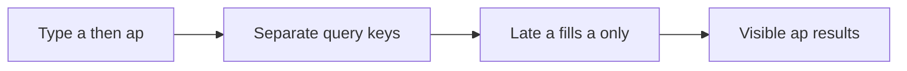
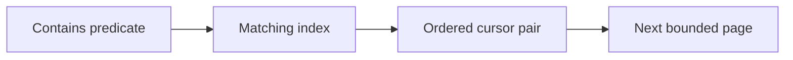
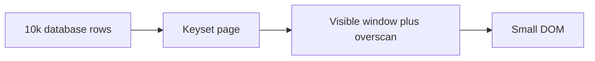
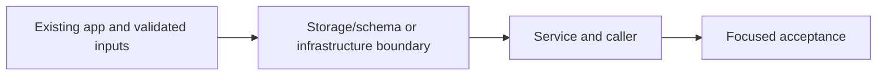

# 45. Indexed search and bounded event rendering

## 1. In one sentence

A shared results variable with no request identity allows stale completion to win.

## 2. The big picture

## 3. Concepts and current behavior

Search uses events.search with literal escaped title/venue terms, pg_trgm GIN and (starts_at,id) keyset traversal. The cursor preserves microsecond ordering and a stable upcoming cutoff, not a DB snapshot. SSR and browser use the same infinite-query key. Fixed-height virtualization bounds DOM, not retained page memory.

### typing "a" then "ap" in search: can the old response override the new one?

An old request may finish last. Give each search input its own query key so it can only fill its own cache entry. Cancellation saves work, but identity provides correctness even when a server ignores cancellation. Keep previous results visibly marked while the next input is loading.

`apps/web/src/features/events/hooks/use-event-search.ts` → `useEventSearch` debounces 250 ms, uses tRPC infinite-query options keyed by all input, consumes cancellation and keeps previous data. The component labels typing/loading. Run `pnpm demo:search`; the related browser spec deliberately delays an older response.

Why: A shared results variable with no request identity allows stale completion to win.

Trade-offs: A monotonically increasing request id also works for manual fetch. Abort alone does not prove the server stopped; debounce does not order responses.

### GIN, B-tree, EXPLAIN and keyset versus OFFSET

Choose an index for the predicate and order. Trigram GIN helps contains search; B-tree on starts_at/id supports stable traversal. Keyset asks for rows after the last pair, avoiding a growing OFFSET scan. A stable cutoff prevents time drift but is not a database snapshot: inserts and edits can still change later pages.

`apps/api/src/queries/event-search.ts` escapes LIKE metacharacters and uses composite cursor boundaries. Migration `apps/api/drizzle/0008_lethal_amazoness.sql` adds search indexes. `pnpm demo:search` measures 10k rows, index plans and page boundaries including timestamp ties.

Why: Deep OFFSET discards earlier rows repeatedly.

Trade-offs: GIN adds write/storage cost and short/unselective terms can favor a scan. Keyset cannot jump to arbitrary page 200; snapshot semantics need more design.

### rendering 10k events

Pagination bounds transfer and database work; virtualization bounds mounted DOM nodes. They solve different problems. Keep stable event ids, a fixed-height window and overscan. Fetch the next keyset page before the user reaches the end. The full dataset should never become 10,000 React rows.

`apps/web/src/features/events/components/virtual-event-list.tsx` renders a bounded window. Search returns pages of 50. `pnpm demo:search` seeds an isolated 10k dataset, checks ordering/plans and runs related headless assertions. The virtual-list browser check bounds rendered rows.

Why: Large DOM trees hurt layout, paint, memory and interaction.

Trade-offs: Fixed heights are simple but constrain content. Variable-height libraries add measurement. Virtual lists need accessible list position and keyboard testing; pagination is a valid alternative.

## 4. Dependency order

The concrete prerequisites are the source files and current settings named above. Migrations precede the consuming image rollout; IAM permissions precede the job that uses them.

## 5. What breaks and how we notice

Could filters race too? Yes: venue/date/cursor must be in the input key. Should previous rows be bookable? Recheck authoritative availability on booking. 10x: measure input-to-result latency and cap retained pages. 100x: add relevance/search infrastructure only after query plans and traffic justify it.

Why carry id with time? It breaks ties so rows sharing a timestamp are not skipped. 10x: inspect real selectivity and buffers. 100x: retention/partitioning or full-text relevance when product needs it.

Does virtualization reduce SQL rows scanned? No; indexes and pagination do that. 10x: bound retained pages as well as DOM. 100x: server-side ranking, narrower payloads and a search engine may matter more than another UI optimization.

Current limits: Search uses events.search with literal escaped title/venue terms, pg_trgm GIN and (starts_at,id) keyset traversal. The cursor preserves microsecond ordering and a stable upcoming cutoff, not a DB snapshot. SSR and browser use the same infinite-query key. Fixed-height virtualization bounds DOM, not retained page memory.

## 6. Interview questions with short answers

1. **typing "a" then "ap" in search: can the old response override the new one?** An old request may finish last. Give each search input its own query key so it can only fill its own cache entry. Cancellation saves work, but identity provides correctness even when a server ignores cancellation. Keep previous results visibly marked while the next input is loading.

2. **What prevents a late a response from overwriting ap?** Separate query keys

3. **Why does this boundary exist?** A shared results variable with no request identity allows stale completion to win.

4. **Which alternative would you compare?** A monotonically increasing request id also works for manual fetch. Abort alone does not prove the server stopped; debounce does not order responses.

5. **What changes at 10x or 100x?** 10x: measure input-to-result latency and cap retained pages. 100x: add relevance/search infrastructure only after query plans and traffic justify it.

6. **What is the important counter-question?** Could filters race too? Yes: venue/date/cursor must be in the input key. Should previous rows be bookable? Recheck authoritative availability on booking.

## 7. Check yourself

1. Trace the exact source path and identify the invariant it protects.
2. What prevents a late a response from overwriting ap?
3. Which failure requires live AWS acceptance rather than local evidence?

## How this connects

Uses the [architecture](00-architecture.md) and [previous step](44-ticket-assets.md). Continue with [next step](46-sale-day.md). Practice the [scenario](handbook/guides/interview-scenarios.md#search-races) and [explorer tour](handbook/guides/infra-explorer.html?tour=search).

## Historical evidence and open limits

The following is the implementation-time record, preserved from PENDING. Measurements describe that earlier local run, not a fresh benchmark. Later behavior is stated above; old “not built” statements may be superseded. Owner setup recipes are intentionally replaced by the current [deploy runbook](20-deploy-day.md). No old preview is a promise about today’s stack.

### Series 2 — P7: indexed search and big lists

- **Built / concepts:** literal title/venue substring search, pg_trgm GIN + `(starts_at,id)` B-tree, bounded `events.search` keyset pages, precision-preserving tuple cursor + stable upcoming cutoff; 250 ms debounce, stale cancellation/key isolation, previous results, SSR infinite-query hydration, fixed-height virtualization + automatic next page / accessible load-more fallback. Legacy `events.list` remains compatible; search bypasses list caches to avoid text/cursor key explosion.
- **Reading order / files:** shared `schemas/event-search.ts` contract → API `queries/event-search.ts:search` SQL → `services/event-search.ts:searchEvents` lookahead/cursor → `procedures/events.ts:search` boundary → web `hooks/use-event-search.ts:useEventSearch` → `components/{event-list,virtual-event-list,event-card}.tsx`; `server/prefetch-events.ts:prefetchEvents` hydrates matching infinite key. Tests: shared/service/query/procedure + `e2e/{event-search,events}.spec.ts`; `src/scripts/search-demo.ts` bulk-seeds an isolated local DB and cleans recorded PIDs.
- **Deploy / cost:** migration `0008_lethal_amazoness.sql` + snapshot/journal install trusted pg_trgm and both indexes before API rollout; existing CD migration path, no AWS resources/IAM/SG/secrets/env changes or new libraries. Index build takes write locks; quiet deploy window, operator-managed concurrent build at larger scale; runbook `docs/20-deploy-day.md` §3.16. GIN costs storage/write work, no new idle service fee; short/common terms may scan. Bulk demo VACUUM ANALYZE flushes GIN pending entries before plan measurement.
- **Measured:** final isolated run: 10,000 unique events / 100 pages / 0 duplicates in 265 ms; bulk seed + maintenance 140 ms; related Playwright 7/7 in 19.2 s (abort + ignored-abort races, SSR/hydration/filtering, all 200 UI pages). At 10k loaded: 6 mounted cards; cloned-card DOM insertion/layout 9 rows/72 descendants/1.2 ms vs 10k rows/80k descendants/169.8 ms (browser layout benchmark, not React render timing); selective EXPLAIN ANALYZE uses events_search_trgm_idx. Unit tests 387/387, typecheck/lint/docs:check (124 cards, 122 slugs, 291 anchors) and API build pass.
- **API design:** OFFSET/page-number pagination allows random jumps/total counts but scans a growing prefix and shifts under inserts; keyset makes sequential deep pages efficient without COUNT, with no random page jump. `(time,UUID)` resolves ties, SQL six-digit timestamps avoid millisecond truncation. Not a snapshot: moved events can repeat/skip; inserts before cursor require refresh; deleting a boundary row is safe. Cursor belongs to one filter/sort traversal; changing filters starts over.
- **Errors / evolution:** existing tRPC `{error:{message,code,data:{code,httpStatus,path,…}}}` format, boundary Zod BAD_REQUEST, unknown failures sanitized by existing formatter; UI generic error/retry. Additive search procedure leaves old list consumers intact; breaking changes need a parallel contract/version + client migration window. tRPC fits this shared-TypeScript app; REST suits external clients/HTTP tooling and explicit versioned DTOs; GraphQL offers client-selected related fields at schema/resolver/auth/query-cost complexity. None automatically versions a breaking change.
- **Interview angles:** why GIN for contains vs B-tree for ordered traversal; why abort alone is insufficient; cache key per query input prevents late-response overwrite; why pagination alone cannot bound DOM; fixed row heights/overscan vs dynamic measurement. At 10x/100x: tune selectivity/query plans, GIN maintenance/write amplification, cap retained browser pages, consider ranking/full-text search and snapshot semantics only when needed. Counter-question: random page navigation, index freshness, mutable event times or accessibility requirements?
- **Not verified / manual:** live AWS/CD/RDS extension permissions and production browser timing; first browser run reached 10k but its stale load-button loop timed out; corrected explicit per-page waits pass. No full e2e, screenshots, deliberate mutations, infra changes or Pulumi preview. Owner env/servers untouched; demo uses its own :3101/:4101 and DB. See §3.16 for migration/index and ALB search acceptance.
