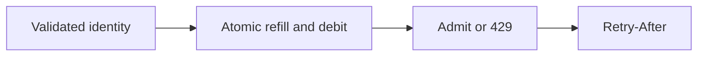
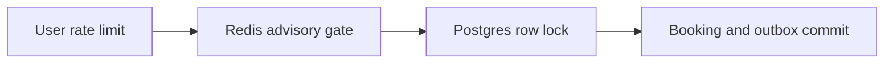
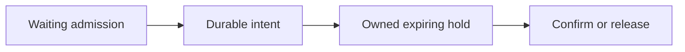
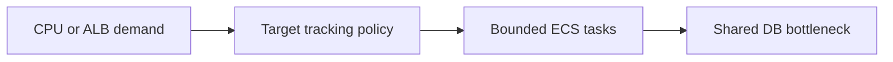
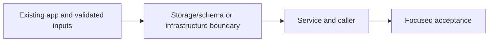

# 46. Rate limits and advisory inventory

## 1. In one sentence

One instance’s memory cannot enforce a shared quota.

## 2. The big picture

## 3. Concepts and current behavior

Redis is advisory admission; every confirmed booking still commits in Postgres. Idempotent retries at zero stock replay correctly. Settlement can be ambiguous after network/commit failures; versioned reconciliation avoids overwriting in-flight debits. Waiting rooms, queued booking, customer timed holds and autoscaling are not built.

### Why token buckets, and which identity do you limit?

Token buckets permit a burst then refill at a steady rate. Login limits a trustworthy client IP; booking limits an authenticated user. Redis Lua makes refill and debit atomic across instances. Return 429 and Retry-After. A spoofable forwarded header must not choose someone else’s bucket.

`apps/api/src/queries/rate-limits.ts` stores buckets; `services/rate-limits.ts` chooses policy. `config/trust-proxy.ts` only trusts configured hops/CIDRs. `pnpm demo:sale` verifies shared quotas, spoof resistance and the inventory gate. Redis failure is an explicit failure policy, not a durable quota guarantee.

Why: One instance’s memory cannot enforce a shared quota.

Trade-offs: Fixed windows permit boundary bursts; sliding windows cost more state. IP limits affect NAT users. Redis allkeys-lru can evict quotas; strict financial quotas need durable accounting.

### sale day with row locks.

One event row serializes buyers even with many API tasks. Rate limits bound callers; an advisory Redis inventory gate rejects obvious sold-out work before the database. All admitted buyers still run the same Postgres transaction. Redis failure, expiry or wrong counts must never create a confirmed seat by itself.

`apps/api/src/services/booking-inventory.ts` debits an intent-owned reservation and falls back to Postgres on Redis failure. `services/inventory-reconciliation.ts` compares versions before correction so it does not overwrite in-flight work. `pnpm demo:sale` compares gated/ungated short loads and verifies replay at zero stock.

Why: Fewer doomed buyers enter the hot-row queue.

Trade-offs: Unknown DB commit/refund and worker crashes can skew the hint; reconciliation repairs admission, not correctness. This is not a customer-visible timed seat hold.

### Where would a waiting room, booking queue and expiring seat holds go?

A waiting room controls admission before the hot API. A durable booking queue changes the contract to accepted intent plus later status. A customer seat hold needs an owner, expiry and atomic transition to booking; it is not the Redis inventory hint. State the fairness and abandonment policy before choosing technology.

WHERE IN MINITICKETS: proposed admission middleware before bookings procedure, durable booking_intents/seat_holds queries in Postgres and a service/worker processing one event shard. Browser hook polls its intent; an expiry job releases only still-held rows by conditional transition. No waiting-room token issuer, booking queue or timed customer hold exists.

Existing integration point: `apps/api/src/procedures/bookings.ts`.

Why: An unbounded request queue consumes connections and gives poor user feedback.

Trade-offs: FIFO fairness, bots, token replay and expiry races need explicit rules. An async response cannot claim success until final booking commits.

### P8: how would ECS autoscaling help, and what would it cost?

Target tracking can add tasks on CPU or ALB requests per target, with min/max bounds and scale-in/out cooldowns. It helps independent request work; it cannot parallelize a single locked event row. More API tasks also create more database pools. Pick bounds from latency, DB connection budget and cost.

WHERE IN MINITICKETS: proposed Pulumi module infra/src/compute/autoscaling.ts after ECS service creation, using Application Auto Scaling target/policy for desiredCount. Start with explicit min 1/max 3 for a controlled exercise, account for API and web separately and set cooldowns/alarms. No scaling resource/IAM policy is built. Inspect existing service desiredCount; load test only under an owner budget.

Existing integration point: `infra/src/compute/service.ts`.

Why: Elastic compute reduces overprovisioning for variable independent load.

Trade-offs: Scale-out is delayed by metrics, image start and health checks. Min tasks cost while idle; max tasks bound but do not fully cap AWS spend. Never blindly scale past RDS pool capacity.

## 4. Dependency order

The concrete prerequisites are the source files and current settings named above. Migrations precede the consuming image rollout; IAM permissions precede the job that uses them.

## 5. What breaks and how we notice

Should auth failures all share one user key? No; unauthenticated identity needs a trusted edge/IP policy. 10x: key cardinality/TTL and fairness. 100x: gateway protections, per-tenant budgets and hot-key partitioning.

Can reconciliation blindly SET database stock? No; compare-and-set against an observed version to avoid clobbering in-flight debits. 10x: compare p95/p99 and lock waits. 100x: durable queue admission or partitioned seat rows, keeping DB constraints.

What if expiry races payment? One conditional state transition wins; reconcile external payment/refund. 10x: bounded queue depth and abandonment metrics. 100x: sharded processors, capacity tokens and abuse protection.

Why not just set max 100? Cost, DB connection limits and downstream saturation. 10x: load-test cooldowns and connection totals. 100x: scheduled on-sale capacity plus downstream quotas and event sharding.

Current limits: Redis is advisory admission; every confirmed booking still commits in Postgres. Idempotent retries at zero stock replay correctly. Settlement can be ambiguous after network/commit failures; versioned reconciliation avoids overwriting in-flight debits. Waiting rooms, queued booking, customer timed holds and autoscaling are not built.

## 6. Interview questions with short answers

1. **Why token buckets, and which identity do you limit?** Token buckets permit a burst then refill at a steady rate. Login limits a trustworthy client IP; booking limits an authenticated user. Redis Lua makes refill and debit atomic across instances. Return 429 and Retry-After. A spoofable forwarded header must not choose someone else’s bucket.

2. **What makes a bucket update atomic across API tasks?** Redis Lua operation

3. **Why does this boundary exist?** One instance’s memory cannot enforce a shared quota.

4. **Which alternative would you compare?** Fixed windows permit boundary bursts; sliding windows cost more state. IP limits affect NAT users. Redis allkeys-lru can evict quotas; strict financial quotas need durable accounting.

5. **What changes at 10x or 100x?** 10x: key cardinality/TTL and fairness. 100x: gateway protections, per-tenant budgets and hot-key partitioning.

6. **What is the important counter-question?** Should auth failures all share one user key? No; unauthenticated identity needs a trusted edge/IP policy.

## 7. Check yourself

1. Trace the exact source path and identify the invariant it protects.
2. What makes a bucket update atomic across API tasks?
3. Which failure requires live AWS acceptance rather than local evidence?

## How this connects

Uses the [architecture](00-architecture.md) and [previous step](45-search-big-lists.md). Continue with [next step](47-security-vitals-accessibility.md). Practice the [scenario](handbook/guides/interview-scenarios.md#rate-limits) and [explorer tour](handbook/guides/infra-explorer.html?tour=sale-day).

## Historical evidence and open limits

The following is the implementation-time record, preserved from PENDING. Measurements describe that earlier local run, not a fresh benchmark. Later behavior is stated above; old “not built” statements may be superseded. Owner setup recipes are intentionally replaced by the current [deploy runbook](20-deploy-day.md). No old preview is a promise about today’s stack.

### Series 2 — P8: sale-day limits and advisory inventory

- **Built / concepts:** atomic Redis TIME/Lua token buckets: login IP burst 20 / refill 1 per 3 s; authenticated booking user burst 10 / refill 1 per s; 429 + integer Retry-After + structured retryAfterSeconds, longest wait on mixed tRPC batches (207 possible), no-store/CORS exposure, login/booking wait messages and no automatic 429 retries. Validation/auth precede the limiter; limiter errors fail closed with 503; shared NATs share login budget; idle bucket TTL = full refill period and eviction resets a burst.
- **Gate / correctness:** lazily gate all booking events, atomic HINCRBY -quantity (hash DECRBY equivalent), stable intent hash + unique attempt owner, pending-duplicate bypass, sold-out indexed replay/event reads preserving idempotency/400/404; Postgres locked transaction + unique key/CHECK + outbox remain authoritative. Refund rollback/DB replay at most once; commit consumes; unknown/late outcomes are advisory drift, never permission to skip DB checks. Redis gate command failures fall back to DB, but total Redis outage also breaks sessions/rate enforcement, so this does not promise outage availability.
- **Reconciliation / lifecycle:** per-API 5 s incremental SCAN job, max 50 events/batch, no local overlap, per-event failure isolation and graceful stop; snapshot Redis before SQL, generation/revision CAS rejects concurrent changes, subtract live debits conservatively (temporary undercount), clean up ≤100 expired 30 s leases/event/pass; idle keys 1 h, partial lease-index eviction invalidates state for SQL-backed rebuild, old attempt refunds cannot inflate new state. 5 s is a scheduling interval, not repair SLA; large scan backlog/contention extends recovery. Redis commands have 200 ms application deadline; timed-out writes may execute later.
- **Reading order / files:** `services/rate-limits.ts:enforceRateLimit` → `queries/rate-limits.ts:takeToken` → `services/booking-inventory.ts:createGatedBooking` → `queries/inventory-scripts.ts` / `inventory.ts` → `services/inventory-reconciliation.ts:reconcileEvent/startInventoryReconciliation`; procedures auth/bookings and trpc/init map enforcement/errors/headers; services/bookings uses gate; queries/bookings:findByIdempotencyKey; server starts/stops job; web auth/bookings forms show wait. Tests: rate/gate/reconciliation services, trpc/init, existing booking tests/retry matrix + e2e/sale-day; `scripts/sale-demo.ts` / `pnpm demo:sale` reproduces local acceptance.
- **Infra / deploy / cost:** no AWS resources, IAM/SG/CD changes, secrets, migrations, new libraries or Docker services. Existing Valkey/DB/ALB paths used; default `SALE_REDIS_NAMESPACE=minitickets`, `INVENTORY_GATE_ENABLED=true` (env.ts/.env.example); all API tasks must share namespace. Existing entry mode already chooses trusted proxy hops 1 for ALB-only / 2 with CDN. Runbook `docs/20-deploy-day.md` §3.17 covers deploy/rollback/failure limits/acceptance; no new idle service fee, extra Redis memory/commands and bounded SQL reconciliation reads.
- **Measured local:** 128 requests / 32 users / concurrency 16 / 16 seats: gate off 784 req/s, p50/p95/p99 14/51/63 ms, 128 booking transactions; on 1107 req/s, 6/72/108 ms, 16 transactions (87.5% fewer); both 16 booked + 112 rejected, 0 oversold. Tail latency worsened in this short sample; not a capacity claim. Lua 10/100 admitted; owner/duplicate/refund/CAS/expiry/partial-eviction assertions pass; token burst 2/20 then refill at 1100 ms; two API tasks share 10/15 booking budget (5 × 429); concurrent last-seat + sold-out retry return one booking id; forced outbox rollback refunds; wrong-type gate still books 1/8 with 0 oversold via DB.
- **Checks / limits:** 401/401 unit tests (55 files), 9/9 related headless e2e (7.7 s), typecheck/lint/docs:check (124 cards, 122 slugs, 291 anchors)/API build pass. One intentional concurrency mutation changed debit to increment: gate assertion caught 100/100 instead of 10/100, original restored. Browser 429 server enforcement is real; UI assertions replay the captured real error to avoid a refill/navigation timing race. First browser run exposed missing 429 presentation/Next alert selector collision, corrected. Own DB, sale namespace, recorded PIDs/load sessions cleaned; browser sessions expire by TTL; owner env/data/servers untouched.
- **Interview angles / deferred / manual:** token bucket vs fixed/sliding windows, IP vs user identity/NAT, trusted proxy spoofing, Redis eviction vs durable quota, advisory admission vs DB correctness, idempotency at zero stock, crash/unknown commit refunds, CAS reconciliation vs clobbered in-flight work, tail latency vs throughput/lock pressure. At 10x/100x: shared quotas/cardinality, Valkey script cost/SCAN backlog, event sharding and metrics; waiting room, queue-based booking, expiring customer seat holds and ECS autoscaling stay explain-only in D2 with where they would go. AWS/CD/Valkey and controlled ALB live acceptance still manual (§3.17); no full e2e, screenshots, Pulumi preview or deploy. Next P10 only.
