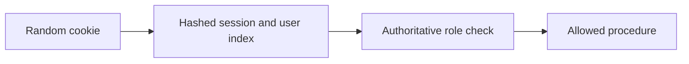
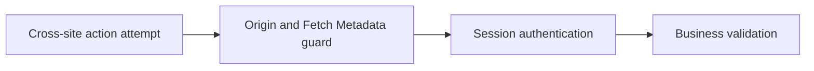
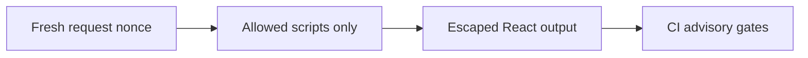
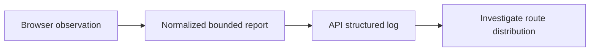
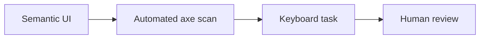
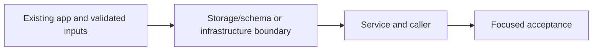

# 47. Security hardening, vitals and accessibility

## 1. In one sentence

A role embedded forever in a session becomes stale after a privilege change.

## 2. The big picture

## 3. Concepts and current behavior

P10 is locally production-tested: exact mutation Origin/metadata, fresh nonce CSP/no-store HTML, bounded indexed sessions and revocation, database deadlines, anonymous vitals and axe. CI gates critical dependency/image findings. Audit has 0 critical, high braces and moderate esbuild remain. Trivy execution/AWS headers, logs and live deployment remain acceptance.

### Sessions versus JWTs, rotation, revocation and roles

Opaque session cookies keep revocation server-side; JWTs reduce lookup dependence but revocation/role changes need expiry or another authoritative version. MiniTickets hashes random tokens in Redis, rotates login sessions, indexes at most 20 devices and checks membership on every read. Admin authorization reads Postgres; role changes revoke sessions before and after the update.

`apps/api/src/queries/sessions.ts` implements indexed creation/read/revokeAll; `services/users.ts` revokes around makeAdmin. `pnpm demo:security` checks old-cookie, all-device and role revocation. Cookies are HttpOnly/SameSite with Secure in production. An in-flight authorized request cannot be recalled; two-store role/revocation is not a global transaction.

Why: A role embedded forever in a session becomes stale after a privilege change.

Trade-offs: Redis/index eviction fails closed and forces login. The 20-device bound makes revoke work bounded. Session-versioning/transactional role changes are proposed improvements for larger deployments.

### CSRF, CORS, SameSite and trusted headers

CSRF tricks a browser into sending an authenticated action from another site. CORS controls whether browser code can read cross-origin responses; it is not a mutation authorization check. SameSite helps but is not the entire policy. MiniTickets requires the exact trusted Origin on mutations and rejects cross-site Sec-Fetch-Site.

`apps/api/src/http/security.ts` → `mutationAllowed` guards all non-safe methods, including missing-Origin refusal. CLI callers explicitly send Origin. `pnpm demo:security` exercises same/cross/missing metadata and cookie isolation; one isolated inverted-origin mutation made both relevant tests fail.

Why: A request can cause side effects even if its response is unreadable.

Trade-offs: Non-browser clients must follow the explicit Origin contract; XSS on the trusted origin bypasses CSRF defenses, so output safety/CSP still matter. Proxy headers need their own trust policy.

### Nonce CSP, XSS and supply-chain gates

XSS executes unwanted code in a trusted page. Validate input, render escaped text and use a per-request nonce CSP to limit script execution. Production does not allow unsafe-eval. CI dependency and image scanners catch known advisories, not every vulnerability or malicious business rule. Gates need a clear severity policy and honest residual findings.

`apps/web/src/proxy.ts` generates/overwrites nonce headers; `lib/security-policy.ts` defines script policy; `lib/trpc/client.ts` disables Zod JIT to avoid eval probes. CI audits critical dependencies and scans three images with Trivy CRITICAL. `pnpm demo:security` asserts no CSP violations. Audit: 0 critical, one high braces and one moderate esbuild remain; image scan execution is unverified locally.

Why: Defense in depth reduces damage from accidental injection and known dependency flaws.

Trade-offs: Nonce pages require dynamic/no-store HTML. Style attributes remain allowed for current UI. Scanners cannot prove safety and unfixed findings need tracked decisions.

### how to check LCP and other vitals

LCP measures the main content appearing, INP interaction responsiveness and CLS unexpected layout shifts. Use field measurements grouped by route/device and percentile, then reproduce slow cases in lab tools. A single fast laptop run is not a user population. Good Core Web Vitals target the 75th percentile: LCP ≤2.5 s, INP ≤200 ms and CLS ≤0.1.

`apps/web/src/features/telemetry/hooks/use-web-vitals.ts` reports bounded values and normalized routes to telemetry.report; `apps/api/src/services/telemetry.ts` logs webVital without query strings or user ids. Run `pnpm demo:security`; the browser test interacts to produce INP and checks request validation. No reporting dashboard or sampling service is built.

Why: Field data catches slow devices, real network conditions and long interactions.

Trade-offs: Logs are simple but not a percentile analytics product. Client reports are untrusted. Lighthouse is repeatable lab evidence, not field truth.

### What do axe checks prove, and what do they miss?

Automated checks catch many structural accessibility errors such as missing names and invalid contrast relationships. They cannot prove the whole experience works with a keyboard, screen reader or cognitive needs. Keep semantic controls and visible focus; test loading/error states and long lists manually too.

`apps/web/e2e/security.spec.ts` runs axe WCAG 2A/AA/2.1AA on events, login and signup. `pnpm demo:security` passed these three scans. The offline learning pages also use native buttons, labels and keyboard navigation. Comprehensive assistive-technology review remains manual.

Why: An accessible control must convey name, role and state, and remain usable under change.

Trade-offs: Automated gates are fast but incomplete. Virtualized lists need careful position/context; infinite scroll can make navigation harder.

## 4. Dependency order

The concrete prerequisites are the source files and current settings named above. Migrations precede the consuming image rollout; IAM permissions precede the job that uses them.

## 5. What breaks and how we notice

Is the presence cookie authorization? No; it only avoids a predictable redirect flash; API verifies the real session. 10x: monitor auth-store failures and session churn. 100x: coordinated auth versioning, device management and key/credential rotation.

Is Origin cryptographic API authentication? No; non-browser clients can set it. Sessions still authorize actions. 10x: centralize trusted origin/environment validation. 100x: service-to-service auth and tenant origin rules with tests.

Why not enable unsafe-eval to silence Zod? Disable the optional JIT/probe instead, preserving production policy. 10x: report CSP violations with bounded sampling. 100x: dependency provenance, policies and attack-surface reviews.

Why no INP on a page never touched? It needs qualifying interactions. 10x: sample ingestion and group by device/network. 100x: dedicated metrics pipeline, retention and privacy budgets.

Does zero axe violations certify accessibility? No. 10x: component-level semantic conventions. 100x: representative assistive-technology testing across critical journeys.

Current limits: P10 is locally production-tested: exact mutation Origin/metadata, fresh nonce CSP/no-store HTML, bounded indexed sessions and revocation, database deadlines, anonymous vitals and axe. CI gates critical dependency/image findings. Audit has 0 critical, high braces and moderate esbuild remain. Trivy execution/AWS headers, logs and live deployment remain acceptance.

## 6. Interview questions with short answers

1. **Sessions versus JWTs, rotation, revocation and roles** Opaque session cookies keep revocation server-side; JWTs reduce lookup dependence but revocation/role changes need expiry or another authoritative version. MiniTickets hashes random tokens in Redis, rotates login sessions, indexes at most 20 devices and checks membership on every read. Admin authorization reads Postgres; role changes revoke sessions before and after the update.

2. **What happens if session membership is missing?** Authentication fails closed

3. **Why does this boundary exist?** A role embedded forever in a session becomes stale after a privilege change.

4. **Which alternative would you compare?** Redis/index eviction fails closed and forces login. The 20-device bound makes revoke work bounded. Session-versioning/transactional role changes are proposed improvements for larger deployments.

5. **What changes at 10x or 100x?** 10x: monitor auth-store failures and session churn. 100x: coordinated auth versioning, device management and key/credential rotation.

6. **What is the important counter-question?** Is the presence cookie authorization? No; it only avoids a predictable redirect flash; API verifies the real session.

## 7. Check yourself

1. Trace the exact source path and identify the invariant it protects.
2. What happens if session membership is missing?
3. Which failure requires live AWS acceptance rather than local evidence?

## How this connects

Uses the [architecture](00-architecture.md) and [previous step](46-sale-day.md). Continue with [Start here](handbook/guides/index.html). Practice the [scenario](handbook/guides/interview-scenarios.md#sessions-roles) and [explorer tour](handbook/guides/infra-explorer.html?tour=security-layers).

## Historical evidence and open limits

The following is the implementation-time record, preserved from PENDING. Measurements describe that earlier local run, not a fresh benchmark. Later behavior is stated above; old “not built” statements may be superseded. Owner setup recipes are intentionally replaced by the current [deploy runbook](20-deploy-day.md). No old preview is a promise about today’s stack.

### Series 2 — P10: security hardening, vitals and accessibility

- **Built:** exact Origin + Sec-Fetch-Site mutation guard including missing-origin refusal, API/web security headers, per-request Next Proxy CSP nonce and dynamic root layout, all HTML/RSC private,no-store (static assets retain caching); production script unsafe-eval remains blocked and web Zod JIT/probe disabled after a real CSP violation exposed it. Style attributes remain allowed for React layouts, S3 regional sources allowed; dev-only HMR/eval/local-emulator sources.
- **Sessions / DB:** login atomically replaces prior cookie record; bounded 20-device Redis sorted-set membership required on every read (legacy records re-login; index eviction fails closed); logoutEverywhere revokes all devices; role CLI revokes before/after update, requires Redis, closes it. Existing DB admin-role lookup remains authoritative; in-flight requests cannot be recalled. Pool connect/acquisition 2 s, statement_timeout 5 s, including lock waits.
- **Files / reading order:** http/security.ts:addSecurity/mutationAllowed → web proxy.ts + lib/security-policy.ts → queries/sessions.ts:create/get/revokeAll → services/auth/users + auth procedure + logout hook/header → db/client.ts; shared schemas/web-vitals.ts → telemetry procedure/service + web telemetry hook/component; CI workflow loads/scans all 3 images and audits dependencies; demos/e2e callers now supply Origin and sale demo includes session membership.
- **Vitals / axe:** bounded public telemetry.report logs LCP/INP/CLS/TTFB/FCP as webVital JSON on existing CloudWatch stream, normalized routes, no URL queries/cookies/user ids, untrusted client values; real INP requires interaction. Approved @axe-core/playwright dev dependency; WCAG 2A/AA/2.1AA checks on events/login/signup; no new AWS metric/resource/IAM/secret/migration/CD permission. CSP nonce rendering trades HTML CDN caching for security; existing CloudFront min/default TTL 0 honors no-store.
- **Measured:** 404 unit tests; 24/24 related production-build headless e2e in 8.4 s (CSRF, nonce/no CSP violations, old-cookie/role/all-device revocation, vitals, three axe pages, cache/login/logout/booking/retry); production build, typecheck/lint/docs:check/API build and actionlint v1.7.12 pass. One security mutation in isolated copies inverted origin equality: both origin/HTTP tests failed, production source unchanged. Auto-review rejected removing a broad no-store rule; retained explicit HTML no-store excluding only static/image assets, then acceptance passed.
- **Audit / limitations:** pnpm audit --audit-level=critical passes with 0 critical, but reports high braces (unfixed; eslint-config-next→fast-glob→micromatch) and moderate esbuild ≤0.24.2 (drizzle-kit→deprecated loader); not a clean audit. Trivy v0.36.0 CRITICAL image gates configured (including unfixed), GitHub execution/local image vulnerability scan not verified; runbook §3.18 lists owner acceptance. No push/deploy/Pulumi change; owner env/servers untouched. Browser sessions from disposable DB expire normally.
- **Interview angles:** CSRF vs CORS/SameSite, trusted request metadata, nonce vs hash/static CSP, eval probes, private HTML vs data/static cache, session rotation/revocation/eviction/races, role changes across two stores, pool vs statement timeouts, supply-chain gates vs accepted advisories, field vs lab metrics, axe limits. At 10x/100x: bound telemetry ingestion/retention, sample metrics, session limits, auth-store availability and coordinated role-change/session versioning; explain only. D0-D3 must incorporate this and all earlier PENDING details, distinguish built/local-tested from AWS-accepted.
