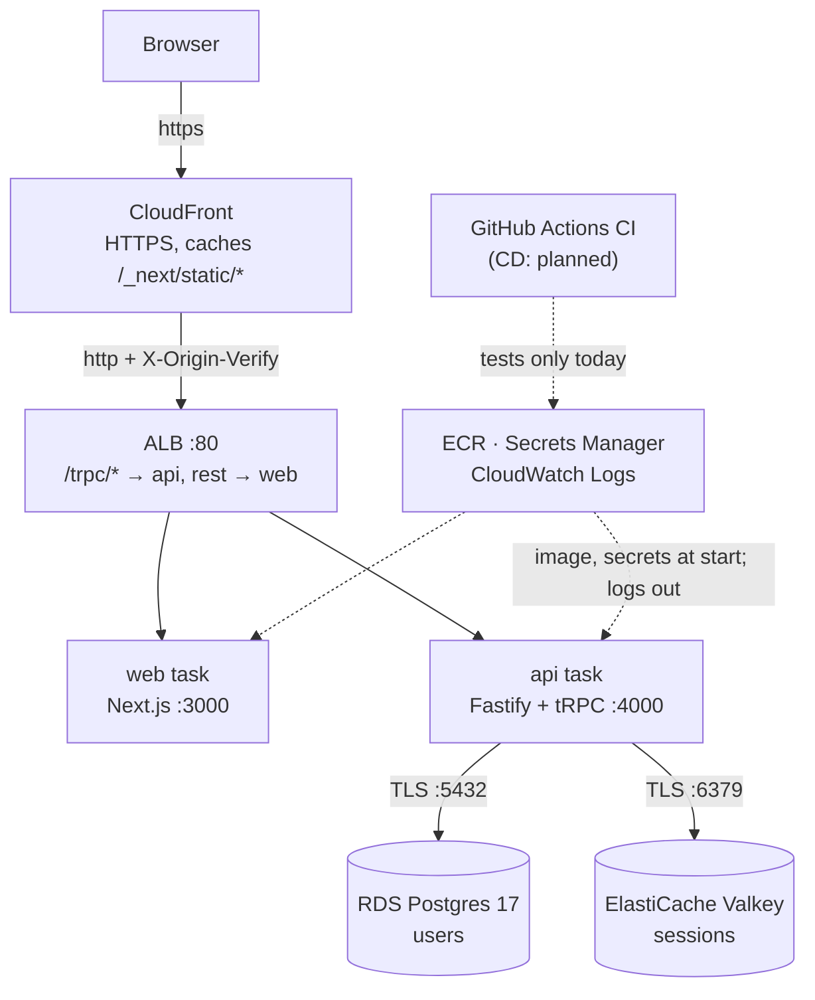
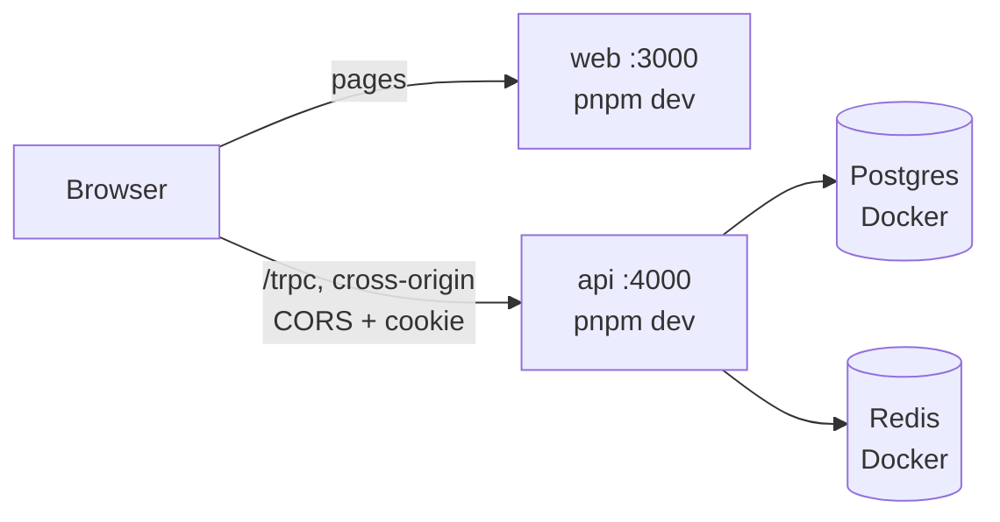
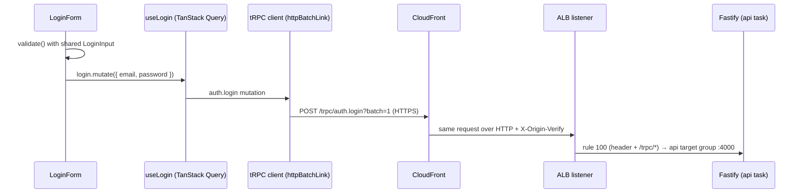
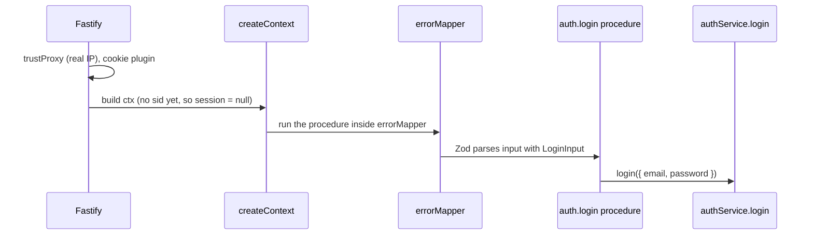
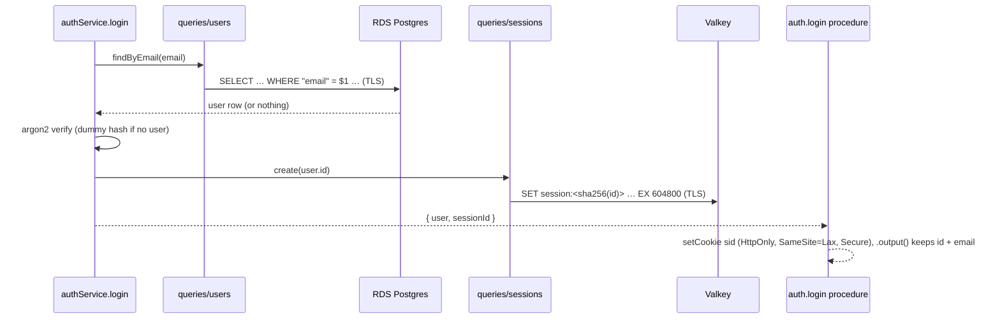

# The big picture

History: see [CHANGELOG.md](CHANGELOG.md) or run `pnpm docs:history`

**In one line:** MiniTickets is a Next.js web app and a Fastify + tRPC API that share types,
store users in Postgres and sessions in Redis, and run on AWS behind CloudFront and a load balancer.

Today it can sign up, log in, show a private dashboard and log out. Tickets themselves are not
built yet. This page shows the whole system once, then follows one request and one login through it.
Every name below is a real name from the code.

## 1. The whole system today

How to read it:

- **Solid arrows** are requests while the app runs. **Dotted arrows** happen around it: ECS pulls
  the image from ECR and reads secrets from Secrets Manager when a task starts, and every log line
  goes to CloudWatch Logs.
- **Planned:** continuous deployment. Today CI only checks the code and builds the images
  ([docs/10](../10-ci.md)); images are pushed from a laptop with `pnpm images:push`
  ([docs/16](../16-infra-ecr.md)) and deployed with `pulumi up` by the owner.
- **Switchable:** RDS, Valkey, the tasks, the ALB and CloudFront exist only while their Pulumi
  switches are on (`dataEnabled`, `computeEnabled`, `entryEnabled` in `infra/index.ts`), because
  they cost money every hour. The network, security groups, budget and ECR are always on.
  See [docs/00-architecture](../00-architecture.md) for the detailed AWS diagram.

The same app also runs on a laptop. There, nothing sits in front of the two servers:

| | Laptop (`pnpm dev`) | AWS |
| --- | --- | --- |
| Where the browser sends `/trpc` | `http://localhost:4000/trpc` (another origin, so CORS applies) | `/trpc` on the same origin; the ALB routes it |
| Session store | Redis 7.4 in Docker | Valkey 8.2 on ElastiCache (Redis-compatible) |
| Database settings | `DATABASE_URL`, no TLS | `DB_HOST` … `DB_PASSWORD`, TLS with a verified certificate |
| Cookie `Secure` flag | off (`NODE_ENV` is not `production`) | on (HTTPS through CloudFront) |
| Proxies trusted by the api | 0 | 2 (CloudFront, then the ALB) |

## 2. The life of one request

A logged-in user opens `https://<id>.cloudfront.net/dashboard` on AWS:

1. The browser opens HTTPS to the nearest CloudFront edge. TLS ends there.
2. CloudFront's default behavior does not cache pages. It forwards the request, cookie included,
   over plain HTTP to the ALB and adds the secret `X-Origin-Verify` header.
3. The ALB's security group lets it in (it comes from CloudFront's IP ranges). Listener rule 200
   sees the secret header and forwards to the web target group.
4. Next.js runs `proxy` in `apps/web/src/proxy.ts`: a `sid` cookie exists, so the page renders.
   `DashboardPage` is HTML from the server; `ProfileCard` is a client component.
5. The browser loads the JavaScript from `/_next/static/*`. CloudFront serves it from its cache when
   it can.
6. `ProfileCard` calls `useProfile`, which asks TanStack Query, which asks the tRPC client for
   `account.profile`. The header's `useMe` asks for `auth.me` at the same moment, and
   `httpBatchLink` can send both in one `GET /trpc/…?batch=1`.
7. CloudFront's `/trpc/*` behavior never caches. ALB rule 100 (secret header + `/trpc/*`) forwards
   to the api target group on port 4000.
8. Fastify reads the real visitor IP (`trustProxy`) and the cookie. `createContext` hashes the
   `sid` and looks up `session:<sha256>` in Valkey.
9. `protectedProcedure` lets the call through, `getProfile` in `services/account.ts` calls
   `findById` in `queries/users.ts`, and Drizzle asks Postgres over TLS.
10. `.output(ProfileSchema)` keeps only `id`, `email`, `createdAt`. The JSON goes back through the
    ALB and CloudFront. TanStack Query caches it and `ProfileCard` shows the email.

## 3. The life of a login request

Three small sequence diagrams instead of one huge one. Together they name every component.

### 3a. From the form to the api's front door

- `LoginForm` (`apps/web/src/features/auth/components/login-form.tsx`) runs the same Zod schema
  the server will run, only to give fast feedback.
- Login is a **mutation**, so tRPC sends a `POST`. CloudFront's `/trpc/*` behavior allows `POST`;
  the default (pages) behavior allows only `GET` and `HEAD`.
- Locally there is no CloudFront or ALB: the browser calls `http://localhost:4000` directly, and
  because that is another origin, CORS rules apply (`app.register(cors, …)` in `apps/api/src/app.ts`).

### 3b. Inside the api: from Fastify to the service

- `createContext` (`apps/api/src/trpc/context.ts`) runs for every tRPC request. With no `sid`
  cookie it does not touch Valkey.
- `errorMapper` (`apps/api/src/trpc/init.ts`) wraps every procedure. If the input is invalid, tRPC
  answers 400 and `errorFormatter` adds per-field messages.

### 3c. The service, the stores and the way back

- **Equal timing:** `login` in `apps/api/src/services/auth.ts` always runs one argon2 verify, against
  `DUMMY_HASH` when the email is unknown, and answers "Invalid email or password" for both failures.
- **The session:** 32 random bytes become the cookie value. Valkey stores only its SHA-256 hash,
  for 7 days (`SESSION_TTL_SECONDS` = 604800). The cookie's `maxAge` is the same.
- **Back in the browser:** the response carries `Set-Cookie` back through the ALB and CloudFront.
  `useLogin`'s `onSuccess` invalidates the cached `auth.me`, so the header asks again and shows
  "Signed in as …". Then `LoginForm` sends the user to `getSafeNext(next)`, which allows only paths
  on our own site.
- **Wrong password:** the service throws `UnauthorizedError`, `errorMapper` turns it into tRPC
  `UNAUTHORIZED`, the browser gets HTTP 401, and the form shows the message under the button.

## How this connects

- **Uses:** the step docs, especially [07 login](../07-login-session.md),
  [18 ALB](../18-infra-alb-web.md) and [19 CloudFront](../19-infra-cloudfront.md).
- **Gives:** the frame for everything else. [aws-foundations.md](aws-foundations.md) explains the
  AWS rules these arrows obey. The [infra story](infra-story.md) and the [app story](app-story.md) walk the same
  path chapter by chapter. The [concept map](concept-map.md) lists every concept named here.
