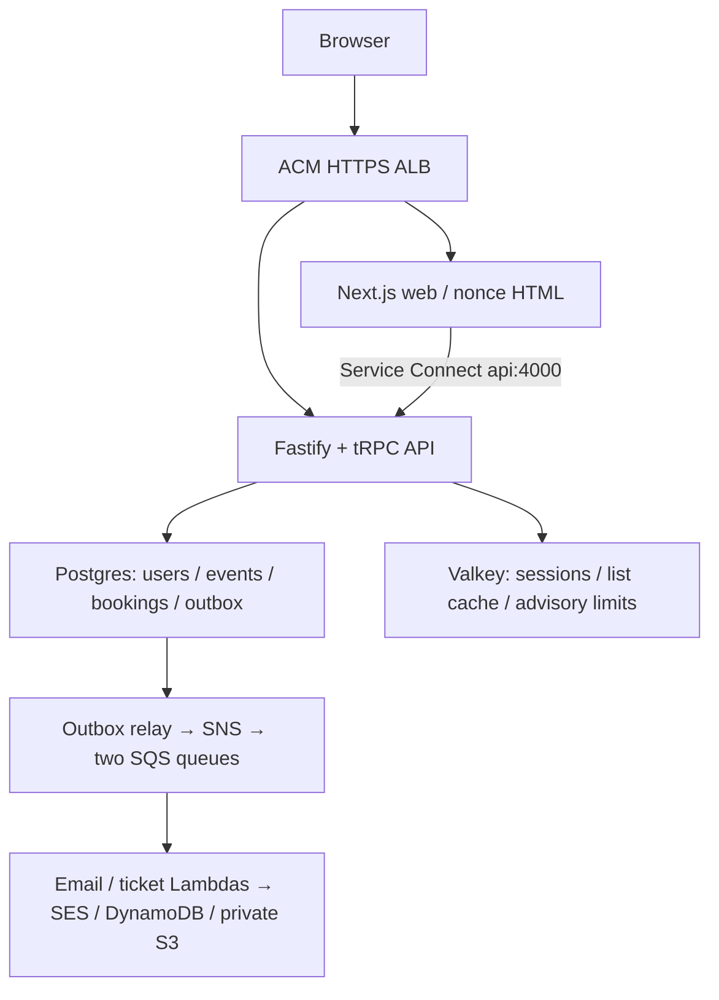
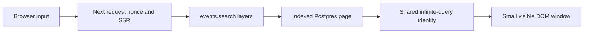
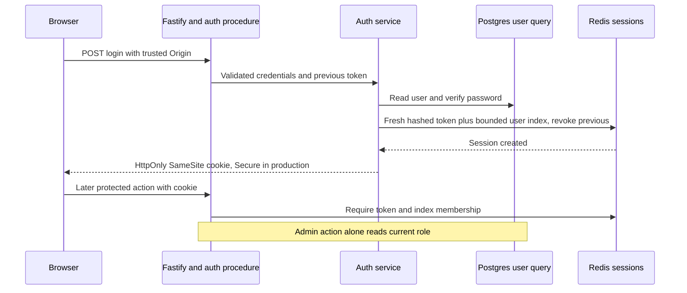

# The big picture

History: see [CHANGELOG.md](CHANGELOG.md) or run `pnpm docs:history`

MiniTickets is a layered web/API app with searchable events, atomic retryable bookings and asynchronous email/QR issuance. The code is built and locally tested. Live AWS acceptance remains an explicit owner task. Begin with [Start here](guides/index.html) for the ordered path.

## 1. The whole system today

The committed dev shape enables data/compute/entry with `cdnEnabled=false` and domain `minitickets.theversehub.in`. HTTPS terminates at the ALB. CloudFront is implemented but inactive while account verification is pending. Same-origin `/trpc/*` routes to API; other paths route to web. The browser never resolves Service Connect names.

Local owner ports are web :3000/API :4000. Tests use separate ports and isolated data. Docker provides Postgres, Redis, ElasticMQ, DynamoDB Local and Moto; AWS SDK boundaries stay the same but local success does not prove IAM, SES delivery or managed-service behavior.

The [architecture](../00-architecture.md) separates the search, transaction, queue and delivery paths. The [city explorer](guides/infra-explorer.html) shows 25 chapters and 36 tours; optional CloudFront and proposed services stay labelled.

Related concepts: [server-to-server-calls](concepts/server-to-server-calls.md), [service-connect](concepts/service-connect.md).

## 2. The life of one request

1. Browser opens `/events` over HTTPS to the current ALB.
2. ALB sends the page to Next; Proxy replaces nonce/CSP headers and sends no-store HTML.
3. A Server Component prefetches `events.search` over private Service Connect.
4. Fastify validates request metadata/context; public search does not need a role lookup.
5. Procedure validates Zod input; service fixes the upcoming cutoff; query executes indexed SQL.
6. Next streams/dehydrates the same infinite-query key the browser will observe.
7. The browser hydrates without repeating the first successful query.
8. Typing waits 250 ms, then uses a separate input key; old completions cannot replace new results.
9. Keyset pages bound transfer and virtualization bounds DOM nodes.
10. Availability shown here is a hint; buying seats enters the locked Postgres transaction.

Legacy events.list separately uses bounded Redis SWR and generation invalidation. The current search SSR bypasses that list cache and the old Next list-data helper. All HTML/RSC is private,no-store; public data/static caching is a distinct decision.

Related concepts: [cache-aside](concepts/cache-aside.md), [graceful-degradation](concepts/graceful-degradation.md).

## 3. The life of a login request

Membership expiry/eviction fails closed. LogoutEverywhere revokes indexed sessions; the role CLI revokes before/after its DB update. In-flight authorized work cannot be recalled and the two stores do not commit as one transaction. These are explicit limits, not a claim of perfect revocation across all races.

## 4. Components

✅ means built in the repository. Check deployment state separately in the [owner runbook](../20-deploy-day.md). Current shape has data/compute/entry enabled and CDN disabled; secrets and account state are never inferred from a local emulator.

| Component | Area | What it does for us | Card |
| --- | --- | --- | --- |
| CloudFront distribution | AWS Network | Optional/inactive CDN; ALB is the current HTTPS front door | [`cloudfront`](concepts/cloudfront.md) |
| ALB, listener and rules | AWS Network | Routes `/trpc/*` to api, the rest to web | [`alb`](concepts/alb.md) |
| Target groups | AWS Network | The lists of healthy task IPs per service | [`target-groups`](concepts/target-groups.md) |
| VPC | AWS Network | The private network everything lives in | [`vpc`](concepts/vpc.md) |
| Subnets (public and private) | AWS Network | The floors of the VPC | [`subnets`](concepts/subnets.md) |
| Route tables and internet gateway | AWS Network | Where each subnet's traffic goes | [`route-tables`](concepts/route-tables.md) |
| Security groups | AWS Network | Stateful firewalls between the pieces | [`security-groups`](concepts/security-groups.md) |
| Regions and availability zones | AWS Network | Where the resources physically run | [`regions-and-azs`](concepts/regions-and-azs.md) |
| Origin protection (prefix list + secret header) | AWS Network | CloudFront-mode restriction; current ALB-only uses allowedCidrs | [`origin-protection`](concepts/origin-protection.md) |
| Same-origin path routing | AWS Network | One public host for pages and `/trpc` | [`same-origin-routing`](concepts/same-origin-routing.md) |
| TLS termination | AWS Network | Current ACM-backed ALB HTTPS; optional edge mode is separate | [`tls-termination`](concepts/tls-termination.md) |
| ECS cluster and capacity providers | AWS Compute | The group that tasks run in | [`ecs-cluster`](concepts/ecs-cluster.md) |
| ECS service | AWS Compute | Keeps the desired number of tasks running | [`ecs-service`](concepts/ecs-service.md) |
| Task definition | AWS Compute | The recipe for a task | [`task-definition`](concepts/task-definition.md) |
| Fargate | AWS Compute | Runs containers with no servers to manage | [`fargate`](concepts/fargate.md) |
| Fargate Spot | AWS Compute | Cheap spare capacity that AWS can take back | [`fargate-spot`](concepts/fargate-spot.md) |
| ARM64 (Graviton) tasks | AWS Compute | The CPU type of the images and tasks | [`arm64-graviton`](concepts/arm64-graviton.md) |
| Execution role and task role | AWS Compute | IAM roles for ECS and for our code | [`execution-vs-task-role`](concepts/execution-vs-task-role.md) |
| ECS Exec | AWS Compute | A shell inside a running task | [`ecs-exec`](concepts/ecs-exec.md) |
| ECR repositories | AWS Compute | Where the Docker images are stored | [`ecr`](concepts/ecr.md) |
| RDS Postgres instance | AWS Data | Users, events, bookings and outbox | [`rds-postgres`](concepts/rds-postgres.md) |
| RDS-managed master password | AWS Data | The database password kept in Secrets Manager | [`rds-managed-password`](concepts/rds-managed-password.md) |
| Secrets Manager secrets | AWS Data | Passwords and tokens injected at task start | [`secrets-manager`](concepts/secrets-manager.md) |
| ElastiCache Valkey | AWS Data | Sessions, bounded public list cache and advisory admission | [`elasticache-valkey`](concepts/elasticache-valkey.md) |
| aws-lambda | AWS Compute | Implemented boundary; see card and live acceptance | [aws-lambda](concepts/aws-lambda.md) |
| dynamodb | AWS Data | Implemented boundary; see card and live acceptance | [dynamodb](concepts/dynamodb.md) |
| service-connect | AWS Compute | Implemented boundary; see card and live acceptance | [service-connect](concepts/service-connect.md) |
| ses-email | AWS Compute | Implemented boundary; see card and live acceptance | [ses-email](concepts/ses-email.md) |
| sns | AWS Events | Implemented boundary; see card and live acceptance | [sns](concepts/sns.md) |
| sqs | AWS Compute | Implemented boundary; see card and live acceptance | [sqs](concepts/sqs.md) |

## How this connects

[App story](app-story.md) follows code boundaries; [infra story](infra-story.md) follows infrastructure; [scenarios](guides/scenarios.html) practice decisions. [Concept map](concept-map.md) links every card.
