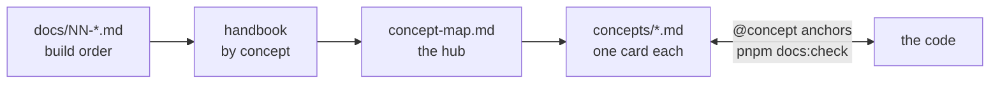

# The MiniTickets handbook

**In one line:** a living handbook that explains every concept in MiniTickets (app + AWS), tied to
the exact code that implements it, so interview answers come from things we built.

The step docs (`docs/01` … `docs/20`) tell the story **in the order we built it**. This handbook
tells it **by concept**: what it is, where it lives in the code, how to show it working, its
trade-offs, and how to explain it at three levels (simple, senior, lead).



## The files

| File | What it holds | Status |
| ---- | ------------- | ------ |
| [README.md](README.md) | This page: how to use the handbook | written |
| [concept-map.md](concept-map.md) | Every concept, grouped by area, with status and code location | written |
| [00-big-picture.md](00-big-picture.md) | The whole system, the life of one request, the life of a login | written |
| [aws-foundations.md](aws-foundations.md) | Regions, ARNs, Reach / Allowed / Password, IAM, roles, debugging | written |
| [glossary.md](glossary.md) | Every technical word used in the handbook | written, grows with every phase |
| [reference-topics.md](reference-topics.md) | The owner's checklist of interview topics | the owner's notes |
| [HANDBOOK_SPEC.md](HANDBOOK_SPEC.md) | The spec this handbook is built from | fixed |
| [infra-story.md](infra-story.md) | The AWS resources, in the order a request meets them; deploy, security and cost stories | written |
| `app-story.md` | Our code, in the order a request travels through it | Phase 3 |
| `concepts/<slug>.md` | One card per concept | AWS / infra cards written (Phase 2); app cards Phase 3; planned and explain-only Phase 5 |
| `decisions/NNNN-<title>.md` | Architecture Decision Records (why we chose X over Y) | Phase 4 |
| `system-design.md` | Classic system design questions, answered from our app | Phase 4 |
| `interview-drills.md` | Question bank by interview round | Phase 5 |

## How to use it

1. Start at the [concept map](concept-map.md). Find the concept, check its status.
2. Open its card (once written). Read "In one line", "Picture it" and "Where in our code".
3. Open the code at the anchor (search for `@concept: <slug>`). Read the step-wise comments there.
4. Do "See it yourself": run the command or test, then break it on purpose.
5. Say the three interview answers out loud. Then the 30-second version.

## Reading paths

Files that are not written yet are shown without a link and with their phase.

**First full read (a few evenings)**

1. [00-big-picture.md](00-big-picture.md)
2. [aws-foundations.md](aws-foundations.md)
3. [infra-story.md](infra-story.md), then `app-story.md` (Phase 3)
4. `decisions/` (Phase 4)
5. `system-design.md` (Phase 4)
6. Skim the [concept map](concept-map.md) for anything you skipped.

**1 hour before an interview**

1. 10 min: [00-big-picture.md](00-big-picture.md), sections 2 and 3 (one request, one login).
2. 15 min: [aws-foundations.md](aws-foundations.md), chapter 3 (Reach / Allowed / Password) and
   chapter 8 (the debugging table).
3. 25 min: "Say it in 30 seconds" of every ✅ card in the areas the role cares about.
4. 10 min: `interview-drills.md` (Phase 5) for that round.

**System design round**

[00-big-picture.md](00-big-picture.md) → `system-design.md` (Phase 4) → `decisions/` (Phase 4) →
cards from the concept map's Reliability, Performance & Caching, Data and Async & Events areas.
Know which parts are ✅ and which are 📖: say "here is what we built, here is what I'd add".

**Security round**

[aws-foundations.md](aws-foundations.md) chapters 3 to 5 → the "security story" in
[infra-story.md](infra-story.md#the-security-story) → the Auth & Security cards: `password-hashing`, `sessions-vs-jwt`,
`session-cookie`, `user-enumeration`, `csrf`, `xss`, `open-redirect`, [`origin-protection`](concepts/origin-protection.md),
[`least-privilege`](concepts/least-privilege.md), [`secrets-management`](concepts/secrets-management.md).

**AWS round**

[aws-foundations.md](aws-foundations.md) (all of it) → [infra-story.md](infra-story.md) → the AWS
Network, AWS Compute and AWS Data cards → the [cost story](infra-story.md#the-cost-story).

**Frontend round**

The first chapters of `app-story.md` (Phase 3) → the Frontend cards: `server-client-components`,
`route-guard-proxy`, `tanstack-query`, `query-invalidation`, `trpc-client`, `accessible-forms`,
`ui-error-handling` → `end-to-end-types` and `retry-policy`.

## Conventions

**Status marks** (used everywhere):

| Mark | Meaning |
| ---- | ------- |
| ✅ built | In our code. |
| 🟡 partial | Partly in our code. The card says what production would add. |
| 📋 planned | Not in our app yet (planned). A step doc says we will build it. |
| 📖 explain-only | Not in our app and not planned. We explain it and say where it would go. |

**Code references** are a file path plus a symbol (function, variable or setting name), never a
line number.

**Code anchors** are comments at the exact place a concept lives. They only add comments; they
never change behaviour.

```ts
// @concept: graceful-shutdown        (TypeScript / JavaScript)
```

```dockerfile
# @concept: graceful-shutdown         (Dockerfile, YAML, shell)
```

One concept can have anchors in several files.

**Card format.** Every card (`concepts/<slug>.md`) and every story chapter uses these 16 headings,
in this order. A heading is left out only when it truly does not apply.

1. In one line
2. Real-life comparison
3. Picture it (diagram)
4. Where in our code
5. See it yourself
6. How it connects
7. Our settings and WHY
8. Trade-offs
9. Alternatives and when to choose them
10. What breaks, and how we'd notice
11. Reach / Allowed / Password (AWS resources only)
12. Cost (AWS resources only)
13. Interview answers at 3 levels
14. Follow-up questions interviewers ask
15. Say it in 30 seconds
16. Status (+ "to make it production-grade" if partial)

In a card, heading 4 is written exactly `## 4. Where in our code`, and each anchor is listed on its
own line in this form, which the check script reads:

```markdown
- Anchor: `apps/api/src/server.ts` · `shutdown`: stops accepting requests, then closes the pools.
```

Planned and explain-only cards write "Not in our app yet" under headings 4 and 5, plus what we would
build and where.

## Keeping it true: `pnpm docs:check`

`scripts/check-concepts.ts` runs in CI (the `quality` job) and locally with `pnpm docs:check`. It fails
with a clear message when:

1. a `@concept: <slug>` anchor in the code has no card `concepts/<slug>.md`;
2. a card's `- Anchor:` line names a file that does not exist or has no anchor for that card;
3. a file holds an anchor that its card does not list;
4. `concept-map.md` does not link to a card;
5. any handbook file links to a card that does not exist.

Mermaid diagrams are checked separately with mermaid-cli (it is not a project dependency):

```bash
npx -y @mermaid-js/mermaid-cli -i docs/handbook/<file>.md -o /tmp/out.md
```

## The living handbook rule

For every future feature or infra step, in the **same commit**: add `@concept` anchors to the new
code, add or update the cards (status 📋 → 🟡 → ✅), update the concept map, the story chapter
and [00-big-picture.md](00-big-picture.md), add an ADR if a design decision was made, add new
words to the [glossary](glossary.md), and make sure `pnpm docs:check` passes. The same rule is in
the repo's `CLAUDE.md`.

## How this connects

- **Uses:** the step docs in [docs/](..) and the code.
- **Gives:** the entry point for every reader of the handbook.
