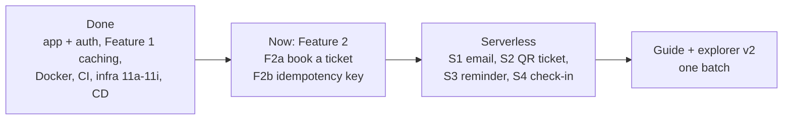

# Roadmap

History: see [CHANGELOG.md](CHANGELOG.md) or run `pnpm docs:history`

**In one line:** the whole plan for MiniTickets: what is built, where things stand today, and what
comes next, in order.

This page is updated in each handbook catch-up step, whenever the owner changes the plan, and
(during the ticketing + serverless series) in every step: its status, in one or two lines.
Details of finished-but-not-yet-documented steps live in [PENDING.md](PENDING.md).

## Done

| Area | Steps | Where it is explained |
| ---- | ----- | --------------------- |
| App basics + auth | Steps 01-09: setup, error handling, landing page, signup form, database, signup API, login with a server-side session, logout, private dashboard | [docs/01](../01-setup.md) … [docs/09](../09-dashboard.md) |
| CI | Step 10: lint, unit tests, e2e tests on GitHub Actions | [docs/10](../10-ci.md) |
| Docker | Step 11: Dockerfiles for the api and the web app | [docs/11](../11-docker.md) |
| Infra 11a-11g | 11a network (VPC, subnets, routes), 11b security groups + budget alert, 11c data (RDS, Valkey, secrets) + explicit layer dependencies, 11d ECR, 11e ECS cluster + api service, 11f ALB + web service + path routing, 11g CloudFront + HTTPS + origin protection; deploy day | [docs/12](../12-infra-network.md) … [docs/20](../20-deploy-day.md) |
| Infra 11h | ECS Service Connect: web and api call each other inside AWS (`API_INTERNAL_URL`, `WEB_INTERNAL_URL`) | [32 private calls](../32-service-connect.md) |
| Infra 11i | HTTPS on the ALB with our own domain (ACM, DNS validation) + the `cdnEnabled` switch | [33 ALB HTTPS](../33-alb-https.md) |
| Feature 1 caching, steps 1-4 | Events list baseline, server rendering with streaming, index on `events.starts_at`, Redis cache-aside | [docs/21](../21-events-list.md) … [docs/24](../24-events-cache.md) |
| Feature 1 caching, steps 5-9b | 5 stampede protection, 6 invalidation + admin role, 7 stale-while-revalidate + stale-if-error, 8 filters + filter-aware keys, 9a Next.js data cache + on-demand revalidation, 9b HTTP cache headers + CloudFront page caching | [25–30 cache evolution](../25-cache-stampede.md) |
| CD 12a | Publish arm64 images to ECR from GitHub Actions through OIDC | [31 OIDC publish](../31-oidc-publish.md) |
| CD 12b | Deploy through GitHub Actions with approval: two-phase deploy, migrate before deploy, rollback by tag | [34 approved delivery](../34-approved-delivery.md) |
| Handbook phases 1-3 | Spec, skeleton, concept map, AWS foundations; infra story + AWS cards; app story + app cards | [README.md](README.md), [HANDBOOK_SPEC.md](HANDBOOK_SPEC.md) |
| Guides | The CI/CD story; the infra build-along, chapters 0-2 (laptop, AWS basics, the VPC network), and its interactive explorer | [guides/cicd-story.md](guides/cicd-story.md), [guides/infra-build-along.md](guides/infra-build-along.md), [guides/infra-explorer.html](guides/infra-explorer.html) |

## Where things stand now

The reduced [Series 2 plan](prompts/series-2.md) is complete in the repository and documentation. Built does not imply deployed or live AWS-accepted.

| Phase | Status and evidence | Read |
| --- | --- | --- |
| F2a/F2b | Atomic booking, row locks and durable per-user intent identity | [35 transactions](../35-booking-transactions.md), [36 idempotency](../36-booking-idempotency.md) |
| S1a/S1b/P0 | Queue handlers, retries/DLQ/dedup and repeatable local setup | [37 jobs](../37-background-jobs.md), [38 failures](../38-job-failures.md), [39 local stack](../39-local-stack-health.md) |
| P1/P2 | AWS worker pipeline, publish-policy repair, deploy guard, correlated logs and four symptom alarms | [40 AWS jobs](../40-aws-job-pipeline.md), [41 observation](../41-observability.md), [34 delivery](../34-approved-delivery.md) |
| P3 | Atomic booking/seats/outbox and competing at-least-once relay | [42 outbox](../42-transactional-outbox.md) |
| P4 A/B | SNS fan-out, recoverable signed QR tickets, owner URLs and constrained poster publication | [43 ticket issuance](../43-signed-qr-tickets.md), [44 assets](../44-ticket-assets.md) |
| P7 | Indexed literal search, precision-safe keyset pages, debounced input identity and virtualized lists | [45 search](../45-search-big-lists.md); 10k rows, 100 API pages, 0 duplicates, 7 related e2e |
| P8 | Shared token buckets, advisory Redis inventory and versioned reconciliation; short load comparison | [46 sale day](../46-sale-day.md); Postgres remains final seat authority |
| P10 | Origin/metadata, nonce CSP/no-store HTML, rotation/revocation, DB deadlines, CI gates, vitals and axe | [47 security](../47-security-vitals-accessibility.md); 404 unit tests and 24 related production e2e |
| D0 | Deterministic source generator and stale-data gate | [Code tours](guides/code-tours.html); 332 snippets from 152 anchored files |
| D1 | 25 infra chapters and 36 map/code tours with connection ledger and saved checks | [City explorer](guides/infra-explorer.html); four width/theme combinations, 144 tour checks |
| D2 | 55 scenarios with full proposed locations for explain-only features, flashcards and quizzes | [Practice](guides/scenarios.html); 220 scenario visits in four combinations |
| D3 | Start-here path, 25 pending entries covered by 23 step docs, cards/stories/ADRs/glossary and corrected deployment guidance | [Start here](guides/index.html), [coverage](generated/catchup-coverage.json) |

## Explain-only scope

P5 reminders, P6 door check-in, P9 live seats, P8 autoscaling and P11 Lighthouse CI are not built. They have full D2 scenarios including proposed MiniTickets files/layers, diagrams, trade-offs and 10x/100x changes. P10 web-vital reporting and axe are built. Waiting room, queued booking and customer timed holds remain designs too. Do not schedule them as unfinished builds for this series.

## Current environment and remaining acceptance

- Committed shape: data/compute/entry enabled, cdnEnabled=false, minitickets.theversehub.in. CloudFront awaits account verification; HTTPS ends at ACM-backed ALB. Cloudflare CNAME is an owner operation after ALB recreation.
- Shape comes from committed Pulumi YAML; deployed image/deployed-commit records live in SSM. No laptop profile or per-image emergency tag is committed. Local read-only preview uses AWS_PROFILE=ticketlite; CD assumes scoped OIDC roles.
- Owner live acceptance remains in [runbook 3.10–3.18](../20-deploy-day.md#310-the-job-pipeline-booking-emails-s1c): newest approved CD, IAM/SNS/SQS/Lambda/Dynamo/S3/SES, alarm subscription/delivery, controlled ALB rate limits, CSP/session behavior and vital logs.
- Critical dependency gate is locally green, but high braces and moderate esbuild advisories remain. CI Trivy image gates are configured; their GitHub execution/live image findings were not verified locally.
- PENDING is cleared because its documentation is covered, not because the above operational checks are complete. No push/deploy was part of this local series work.

## Next

Work through [Start here](guides/index.html), then perform the owner acceptance checklist before claiming the deployed system verified. No further build phase is authorized by this reduced series. Future product extensions require a new scoped step.

## How this connects

[Architecture](../00-architecture.md) describes current behavior. [Concept map](concept-map.md) and [ADRs](decisions/0003-cache-coordination.md) explain mechanisms and decisions. [CHANGELOG](CHANGELOG.md) records documentation history; [coverage](generated/catchup-coverage.json) locates the cleared historical evidence.
