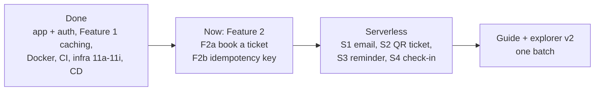

# Roadmap

History: see [CHANGELOG.md](CHANGELOG.md) or run `pnpm docs:history`

**In one line:** the whole plan for MiniTickets: what is built, where things stand today, and what
comes next, in order.

This page is updated in each handbook catch-up step, whenever the owner changes the plan, and
(during the ticketing + serverless series) in every step: its status, in one or two lines.
Details of finished-but-not-yet-documented steps live in [PENDING.md](PENDING.md).

## Done

| Area | Steps | Where it is explained |
| ---- | ----- | --------------------- |
| App basics + auth | Steps 01-09: setup, error handling, landing page, signup form, database, signup API, login with a server-side session, logout, private dashboard | [docs/01](../01-setup.md) … [docs/09](../09-dashboard.md) |
| CI | Step 10: lint, unit tests, e2e tests on GitHub Actions | [docs/10](../10-ci.md) |
| Docker | Step 11: Dockerfiles for the api and the web app | [docs/11](../11-docker.md) |
| Infra 11a-11g | 11a network (VPC, subnets, routes), 11b security groups + budget alert, 11c data (RDS, Valkey, secrets) + explicit layer dependencies, 11d ECR, 11e ECS cluster + api service, 11f ALB + web service + path routing, 11g CloudFront + HTTPS + origin protection; deploy day | [docs/12](../12-infra-network.md) … [docs/20](../20-deploy-day.md) |
| Infra 11h | ECS Service Connect: web and api call each other inside AWS (`API_INTERNAL_URL`, `WEB_INTERNAL_URL`) | [PENDING.md](PENDING.md) |
| Infra 11i | HTTPS on the ALB with our own domain (ACM, DNS validation) + the `cdnEnabled` switch | [PENDING.md](PENDING.md) |
| Feature 1 caching, steps 1-4 | Events list baseline, server rendering with streaming, index on `events.starts_at`, Redis cache-aside | [docs/21](../21-events-list.md) … [docs/24](../24-events-cache.md) |
| Feature 1 caching, steps 5-9b | 5 stampede protection, 6 invalidation + admin role, 7 stale-while-revalidate + stale-if-error, 8 filters + filter-aware keys, 9a Next.js data cache + on-demand revalidation, 9b HTTP cache headers + CloudFront page caching | [PENDING.md](PENDING.md) |
| CD 12a | Publish arm64 images to ECR from GitHub Actions through OIDC | [PENDING.md](PENDING.md) |
| CD 12b | Deploy through GitHub Actions with approval: two-phase deploy, migrate before deploy, rollback by tag | [PENDING.md](PENDING.md) |
| Handbook phases 1-3 | Spec, skeleton, concept map, AWS foundations; infra story + AWS cards; app story + app cards | [README.md](README.md), [HANDBOOK_SPEC.md](HANDBOOK_SPEC.md) |
| Guides | The CI/CD story; the infra build-along, chapters 0-2 (laptop, AWS basics, the VPC network), and its interactive explorer | [guides/cicd-story.md](guides/cicd-story.md), [guides/infra-build-along.md](guides/infra-build-along.md), [guides/infra-explorer.html](guides/infra-explorer.html) |

## Where things stand now

- **F2a, F2b, S1a and S1b are done** (committed).
- **Series 2 ([prompts/series-2.md](prompts/series-2.md)) now sets the order (remaining builds P7 -> P8 -> P10, then D0-D3).
  P0 (local stack health) is done:** `pnpm stack:check` (was `pnpm run doctor`), `pnpm dev` =
  `stack:up` + the apps, `pnpm stack:reset`. **P1 = S1c (the job pipeline on AWS) is built** and
  waits for its first CD deploy (manual steps in [PENDING.md](PENDING.md), P1). **CD deploy guard**
  (after an old approved run deleted newer resources): CD refuses infra code older than the deployed
  commit (SSM) and superseded runs; one-time bootstrap in `docs/20-deploy-day.md` 3.11.
  **P2 = S1d (observability) is built:** correlation id from api request to worker, JSON logs in all
  three apps, 4 CloudWatch alarms emailing through SNS, a dashboard, saved Logs Insights queries;
  waits for its first CD deploy (bootstrap + email confirmation in `docs/20-deploy-day.md` 3.12).
  **P3 (outbox) is built:** atomic booking + confirmation, API relay with locked batches and retries.
  **P4 Part A is built:** SNS fan-out + idempotent HMAC QR ticket Lambda, private S3/DynamoDB, local emulators and CD; AWS acceptance pending.
  **P4 Part B is built:** owner-scoped tickets.mine, short-lived QR/download URLs and pending UI; admin-only constrained poster uploads. AWS acceptance pending.
  P5 reminders, P6 check-in, P9 live seats and P11 Lighthouse CI are **EXPLAIN-ONLY**, fully covered in D2 with "where it would go in MiniTickets".
  P8 builds rate limiting + Redis inventory gate + short load test; autoscaling is explain-only in D2. P10 includes web-vitals reporting + axe.
  **P7 is built:** indexed title/venue search, stable keyset pages, debounced stale-safe UI and virtualized 10k lists; 387 unit / 7 related e2e tests pass.
  **P8 is built:** Redis token buckets with 429/Retry-After; advisory inventory debits/refunds, safe reconciliation and bounded load comparison. AWS acceptance pending.
  **P10 is built:** origin/metadata CSRF checks, nonce CSP/private HTML, session rotation/revocation, DB deadlines, CI scanners, anonymous vitals and axe. Local production acceptance passed; live AWS/CI image scans pending.
  **D0 is built:** generated offline code tours; docs:check rejects stale snippets.
  **Next: D1 -> D2 -> D3**, following [the series prompt](prompts/series-2.md).
- **Ticketing + serverless series rule:** until the series is done, steps do not update the
  handbook, the infra guide or the explorer; everything goes into [PENDING.md](PENDING.md), and
  each step's prompt is saved in [prompts/](prompts/f2a.md) (see `CLAUDE.md`, "Workflow").
- **CloudFront is waiting for AWS account verification.** Until AWS verifies the account,
  `cdnEnabled` is `false` in `infra/Pulumi.dev.yaml`: visitors reach the ALB directly, without
  CloudFront in front. Switch `cdnEnabled` only while `entryEnabled` is off (with the entry on, the
  switch fails: two port-80 listeners).
- **HTTPS ends at the ALB**, on our own domain `minitickets.theversehub.in`, with an ACM certificate
  proven through a DNS record (`infra/src/certificate.ts`). The certificate stays on even when the
  rest of the environment is off, so it is ready on deploy day.
- **DNS is at Cloudflare, not Route 53, and the CNAME is set by hand.** Each deploy that creates a
  new ALB gives it a new name, so after it the owner points the `minitickets` CNAME at the new ALB
  (DNS only, not proxied). The name is in the CD summary and in `pulumi stack output appDnsRecord`.
- **The environment is turned on and off by committing the switches.** Change `dataEnabled`,
  `computeEnabled`, `entryEnabled` in `infra/Pulumi.dev.yaml`, commit, push, approve the CD deploy
  job. Never `pulumi up` locally with uncommitted config: the next CD run would undo it. The
  deployed image tag lives in SSM `/minitickets/dev/image-tag`, written only by CD.
- **OIDC uses GitHub's immutable subjects.** The roles trust
  `repo:maheshnd@63289193/minitickets@1412723955:…` (owner and repo name plus their IDs; config
  `githubSubjectPrefix`, used in `infra/src/cicd.ts`). A new repo with the same name gets new IDs,
  so it can't use our roles.
- **Docs debt:** [PENDING.md](PENDING.md) holds the steps whose docs are not written yet (Feature 1
  steps 5-9b, infra 11h and 11i, CD 12a and 12b, and each step of the series as it is done).

## Next, in order

The ticketing + serverless series. Each item links to its prompt once there is one.

1. **F2a: book a ticket + "My tickets"** (done, [prompt](prompts/f2a.md)). A database
   transaction with a row lock (`SELECT … FOR UPDATE`), so two people can't buy the same last seat.
2. **F2b: idempotency key for booking** (done, [prompt](prompts/f2b.md)).
   A retried "Book ticket" request doesn't book twice.
3. **S1: booking confirmation email.** In parts. **S1a** (done, [prompt](prompts/s1a.md)): the API
   puts a message on a local queue (ElasticMQ), a worker reads it and logs the email. **S1b** (done,
   [prompt](prompts/s1b.md)): a dead-letter queue (DLQ: where messages go
   after too many failures), retries with backoff, and idempotency in DynamoDB Local (handling the
   same message twice does no harm). **S1c** follows: the same on AWS (SQS, Lambda, SES, DynamoDB).
4. **S2: a ticket with a QR code**, through SNS fan-out (one message, several subscribers): a
   Lambda draws the ticket, stores it in S3, and the user downloads it through a presigned URL.
5. **S3: a reminder email the day before**, with EventBridge Scheduler.
6. **S4: door check-in.** API Gateway + Lambda + a DynamoDB conditional write (a ticket can be
   checked in only once).
7. **Detailed infra guide + explorer v2, in one batch:** every concept, file and infra change the
   series recorded in [PENDING.md](PENDING.md), plus the older chapters listed under "Coming next"
   in [the guide](guides/infra-build-along.md#coming-next).

**P3 outbox pattern is built:** confirmations commit with bookings and API relays publish them
with `FOR UPDATE SKIP LOCKED`; queue failures retry from Postgres (details in [PENDING.md](PENDING.md)).

**Optional, later:** a waitlist, cancelling a booking, uploading an event poster, a payment saga
with Step Functions.

**Later, not scheduled yet:** the handbook catch-up (turn every PENDING.md entry into step docs,
cards, story chapters, ADRs, glossary words and a CHANGELOG entry; fix the small things below;
clear PENDING.md; the owner decides when); handbook phase 4 (`system-design.md`; two ADRs exist already) and
phase 5 (cards for planned and explain-only topics, `interview-drills.md`), see
[HANDBOOK_SPEC.md](HANDBOOK_SPEC.md); HTTPS between CloudFront and the ALB once CloudFront is back
(the plan is in the 11i entry of [PENDING.md](PENDING.md)).

## Known small fixes

For the next handbook catch-up. Each line was checked against the code.

- [aws-foundations.md](aws-foundations.md), chapter 1, "4. Where in our code": says
  `infra/Pulumi.dev.yaml` holds `aws:profile: ticketlite`. Removed in CD 12b; the profile now comes
  from `AWS_PROFILE` in the terminal. The `--profile ticketlite` CLI examples are still fine.
- [concepts/infrastructure-as-code.md](concepts/infrastructure-as-code.md): the same `aws:profile`
  mention, in "4. Where in our code" and "11. Reach / Allowed / Password".
- [glossary.md](glossary.md): **ACM** says "Not used by us yet" (used since 11i,
  `infra/src/certificate.ts`); **API_INTERNAL_URL** says "not set on AWS yet" (set since 11h,
  `infra/src/compute/web-task.ts`).
- [README.md](README.md), "The living handbook rule": says docs are written in the same commit as
  each step. Since then `CLAUDE.md` batches them: feature steps append to PENDING.md, a catch-up
  step writes the docs.
- `docs/20-deploy-day.md` sections 3.1, 3.3, 3.4, 3.7 (manual image tags, restart, migrate, turning
  off) and `docs/17-infra-ecs-api.md` (the migration task now has its own task definition):
  outdated since CD 12b; rewrite deploy day as "deploy through CD".

## How this connects

- **Uses:** [PENDING.md](PENDING.md) for the details of each finished step, the step docs in
  [docs/](..), and the rules in the repo's `CLAUDE.md` and `AGENTS.md`.
- **Gives:** one place for the owner, Claude and other coding agents to see what to build next.
