# The app story

History: see [CHANGELOG.md](CHANGELOG.md) or run `pnpm docs:history`

**In one line:** our own code, in the order a request travels through it, from the browser to
Postgres and Redis and back (including the error path), then the things around it: the monorepo,
validation, tests, Docker and CI, and the app's security story.

Each chapter is a guided tour: short answers under the usual headings, with links to the concept
cards for depth. Headings 11 (Reach / Allowed / Password) and 12 (Cost) are for AWS resources, so
they are left out here; the [infra story](infra-story.md) covers them. Code paths are short:
`api/` = `apps/api/src/`, `web/` = `apps/web/src/`.

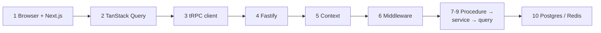

Chapter 10b is a second example request, reading the public events list. Chapter 11 follows an error back to the UI. Chapters 12-16 are the ground under it:
[monorepo](#12-monorepo-and-shared-types), [validation](#13-validation-at-boundaries),
[tests](#14-the-testing-pyramid), [Docker](#15-docker), [CI](#16-ci). Then the
[app security story](#the-app-security-story) and [what we'd change for production](#what-wed-change-for-production).

The example request throughout: a logged-in user opens `/dashboard`, which shows their profile.

---

## 1. Browser → Next.js: layout, server vs client components, proxy guard

### 1. In one line

Next.js decides whether you may see `/dashboard` at all (the proxy), renders the page frame on the
server, and sends the interactive parts as JavaScript.

### 2. Real-life comparison

A theatre: the usher checks you have a ticket stub (proxy), the stage set is built before you
arrive (Server Components), the actors move once the play starts (Client Components).

### 3. Picture it

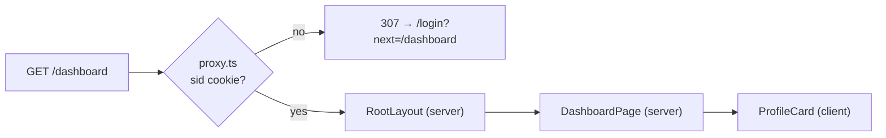

### 4. Where in our code

`web/proxy.ts` → `proxy` (matcher `/dashboard/:path*`); `web/app/layout.tsx` → `RootLayout`
(header, footer, `QueryProvider`); `web/app/dashboard/page.tsx` → `DashboardPage`;
`web/features/account/components/profile-card.tsx` → `ProfileCard`. Cards:
[app-router](concepts/app-router.md), [server-client-components](concepts/server-client-components.md),
[route-guard-proxy](concepts/route-guard-proxy.md), [feature-folders](concepts/feature-folders.md),
[tailwind](concepts/tailwind.md).

### 5. See it yourself

`curl -s -o /dev/null -w '%{http_code} %{redirect_url}\n' localhost:3000/dashboard` →
`307 http://localhost:3000/login?next=%2Fdashboard` (recorded with `pnpm dev`).

### 6. How it connects

Gets the cookie set by login (chapter 7); hands over to TanStack Query inside `ProfileCard`
(chapter 2). On AWS the request reached Next.js through CloudFront and the ALB's default rule
([infra story](infra-story.md#1-cloudfront)).

### 7. Our settings and WHY

The proxy only checks that the cookie **exists** (no Redis call per page): UX, not security. Pages
are Server Components; only six components are `"use client"`.

### 8. Trade-offs

Fast redirect and little JavaScript, but a fake cookie passes the proxy (the api catches it), and the
profile loads only after hydration.

### 9. Alternatives and when to choose them

Validate the session in the proxy, or fetch data in Server Components, when first paint matters more
than simplicity.

### 10. What breaks, and how we'd notice

Cookie renamed in one place only: everyone bounces to login (e2e `dashboard.spec.ts` fails).

### 13. Interview answers at 3 levels

Simple: Next.js shows the page and sends you to login if you have no cookie. Senior: the proxy is a
cookie-exists check; layout and pages are Server Components; interactive leaves are Client
Components wrapped by a client `QueryProvider`. Lead: keep the client boundary low and treat
frontend guards as UX only.

### 14. Follow-up questions interviewers ask

*Is the proxy security?* No; `protectedProcedure` is (chapter 6).

### 15. Say it in 30 seconds

"Next.js runs a proxy that redirects to login when there's no session cookie, renders the layout and
page on the server, and ships only the interactive components, like the profile card, as client
JavaScript."

### 16. Status

✅ built.

---

## 2. TanStack Query: cache, retries, invalidation

### 1. In one line

`ProfileCard` asks `useProfile`, which asks TanStack Query: a browser cache of api answers with
retry and refresh rules.

### 2. Real-life comparison

A notice board in a shared office: one person phones head office, pins the answer, everyone reads
the board.

### 3. Picture it

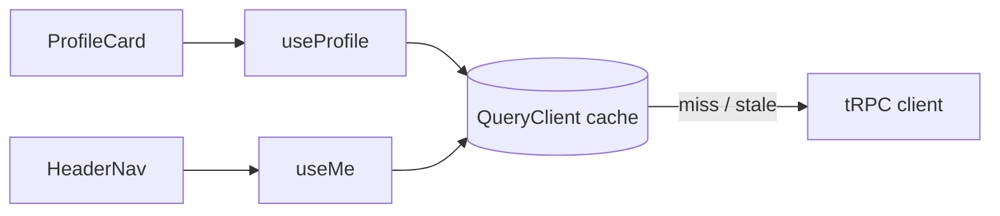

### 4. Where in our code

`web/providers/query-provider.tsx` → `QueryProvider`, `shouldRetry`, `mutations: { retry: 0 }`;
`web/features/account/hooks/use-profile.ts` → `useProfile` (401 → redirect);
`web/features/auth/hooks/use-login.ts` / `use-logout.ts` (invalidate / clear). Cards:
[tanstack-query](concepts/tanstack-query.md), [retry-policy](concepts/retry-policy.md),
[query-invalidation](concepts/query-invalidation.md), [state-management](concepts/state-management.md).

### 5. See it yourself

Network tab on `/`: one `auth.me` request although `HeaderNav` and `Hero` both use it.

### 6. How it connects

Uses the tRPC client (chapter 3) to fetch; gives cached data to components; reacts to the error
shape from chapter 11.

### 7. Our settings and WHY

Queries retry twice (1 s, 2 s) but never on 4xx; mutations never retry; login invalidates
`auth.me`; logout clears the whole cache.

### 8. Trade-offs

No hand-written loading or retry code; one more concept (stale vs fresh, keys) to learn.

### 9. Alternatives and when to choose them

SWR, RTK Query, or Server Components fetching data.

### 10. What breaks, and how we'd notice

Forgetting to clear on logout would show the last user's data; we clear, and e2e logout checks the
header.

### 13. Interview answers at 3 levels

Simple: it remembers server answers. Senior: one `QueryClient` per tab; status-aware retries;
mutations never retried; invalidate on login, clear on logout. Lead: server state is a cache with
rules per data type, not global app state.

### 14. Follow-up questions interviewers ask

*Why no mutation retries?* A retried successful signup would return 409.

### 15. Say it in 30 seconds

"TanStack Query caches api answers per procedure: one request for many components, smart retries
for reads only, and explicit invalidation after login and logout."

### 16. Status

✅ built.

---

## 3. The tRPC client

### 1. In one line

The typed client turns `account.profile` into `GET /trpc/account.profile`, batching calls made at the
same moment and sending cookies along.

### 2. Real-life comparison

A postal clerk who puts all letters handed over in the same minute into one envelope.

### 3. Picture it

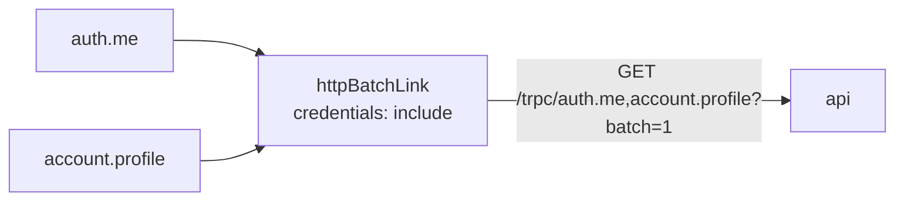

### 4. Where in our code

`web/lib/trpc/client.ts` → `makeTrpcClient`, `API_URL`, `createTRPCContext<AppRouter>`. Cards:
[trpc-client](concepts/trpc-client.md), [end-to-end-types](concepts/end-to-end-types.md),
[same-origin-routing](concepts/same-origin-routing.md), [rpc-vs-rest](concepts/rpc-vs-rest.md).

### 5. See it yourself

Batched answer recorded against a local api: `[{"result":{"data":{…}}},{"result":{"data":{…,"createdAt":…}}}]`.

### 6. How it connects

Typed by the api's `AppRouter` (chapter 12); talks to Fastify (chapter 4). On AWS `API_URL` is empty,
so it calls `/trpc` on the same origin and the ALB routes it.

### 7. Our settings and WHY

`httpBatchLink`; `credentials: "include"` (needed locally, where :3000 → :4000 is cross-origin);
empty URL on AWS so one web image works everywhere.

### 8. Trade-offs

Fewer round-trips; the slowest call in a batch delays the others.

### 9. Alternatives and when to choose them

`httpLink` (no batching), `httpBatchStreamLink` (stream each result).

### 10. What breaks, and how we'd notice

A malformed `NEXT_PUBLIC_API_URL` throws at startup (by design).

### 13. Interview answers at 3 levels

Simple: how the web calls the api. Senior: typed from `AppRouter`, queries GET and mutations POST,
batched, cookies included. Lead: batching vs latency of the slowest call; streaming when procedures
get slow.

### 14. Follow-up questions interviewers ask

*Does the browser bundle contain api code?* No, only `import type`.

### 15. Say it in 30 seconds

"A tRPC client typed from the api's router, with a batch link that sends calls made together as one
request and includes the session cookie."

### 16. Status

✅ built.

---

## 4. Fastify: CORS, trustProxy, cookie

### 1. In one line

The request reaches the api's Fastify server, which knows the real visitor IP, applies CORS, parses
cookies and hands `/trpc/*` to tRPC.

### 2. Real-life comparison

A building's front desk: notes who really came in (not just the courier), checks the guest list,
reads the visitor's badge, and sends them to the right floor.

### 3. Picture it

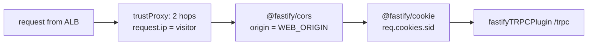

### 4. Where in our code

`api/app.ts` → `buildApp` (logger with redaction, `trustProxy`, `cors`, `cookie`, error handler,
`/health`, `/ready`, tRPC plugin); `api/server.ts` → `listen`, `shutdown`. Cards:
[fastify-app](concepts/fastify-app.md), [trust-proxy](concepts/trust-proxy.md),
[cors](concepts/cors.md), [structured-logging](concepts/structured-logging.md),
[log-redaction](concepts/log-redaction.md), [correlation-ids](concepts/correlation-ids.md) (the per-request `reqId`), [health-checks](concepts/health-checks.md),
[graceful-shutdown](concepts/graceful-shutdown.md).

### 5. See it yourself

A CORS preflight recorded locally answers `access-control-allow-origin: http://localhost:3000` and
`access-control-allow-credentials: true`.

### 6. How it connects

Validated config from `api/config/env.ts`; builds the context next (chapter 5).

### 7. Our settings and WHY

`TRUST_PROXY_HOPS` 2 on AWS, 0 elsewhere; one exact CORS origin with credentials; JSON logs with
passwords redacted.

### 8. Trade-offs

Correct IPs and safe defaults; the hop count must match the real path.

### 9. Alternatives and when to choose them

Trust CloudFront's IP ranges instead of a hop count; same-origin locally to avoid CORS.

### 10. What breaks, and how we'd notice

Wrong `WEB_ORIGIN`: browser CORS errors while curl still works.

### 13. Interview answers at 3 levels

Simple: the server's front door. Senior: `buildApp` composes logger, `trustProxy`, CORS, cookies and
tRPC; `server.ts` only listens and shuts down. Lead: proxy trust and CORS are security settings tied
to network topology.

### 14. Follow-up questions interviewers ask

*Why build apart from listen?* Testable without a port (`inject`).

### 15. Say it in 30 seconds

"Fastify reads the real IP through two trusted proxy hops, allows CORS only from our web origin with
credentials, parses the session cookie, and mounts tRPC at /trpc."

### 16. Status

✅ built.

---

## 5. The tRPC context

### 1. In one line

Once per request, `createContext` turns the `sid` cookie into `{ userId }` (or `null`) by looking up
its hash in Redis.

### 2. Real-life comparison

The hotel desk writes your room number on a wristband once; every service reads the wristband.

### 3. Picture it

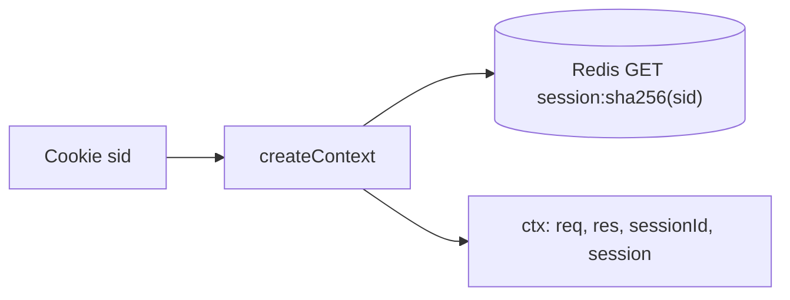

### 4. Where in our code

`api/trpc/context.ts` → `createContext`, `SESSION_COOKIE`, `Context`;
`api/queries/sessions.ts` → `get`. Cards: [trpc-context](concepts/trpc-context.md),
[sessions-vs-jwt](concepts/sessions-vs-jwt.md).

### 5. See it yourself

`curl -s -b 'sid=fake' localhost:4000/trpc/auth.me` → `{"result":{"data":null}}`.

### 6. How it connects

Feeds `ctx.session` to the middleware (chapter 6) and `ctx.res` to procedures that set cookies
(chapter 7).

### 7. Our settings and WHY

Lookup once per request, so no procedure can forget it, and a batch pays it once.

### 8. Trade-offs

One Redis round-trip per request with a cookie, even for public procedures.

### 9. Alternatives and when to choose them

Lazy lookup; stateless tokens.

### 10. What breaks, and how we'd notice

Redis down → 500s fast and `/ready` 503 ([fail-fast](concepts/fail-fast.md)).

### 13. Interview answers at 3 levels

Simple: works out who you are once. Senior: cookie → SHA-256 → Redis → `{ userId }` on `ctx`.
Lead: the context is the identity boundary; keep it cheap.

### 14. Follow-up questions interviewers ask

*Per call or per batch?* Per HTTP request.

### 15. Say it in 30 seconds

"createContext reads the sid cookie, looks up its hash in Redis once, and gives every procedure
ctx.session."

### 16. Status

✅ built.

---

## 6. Middleware: errorMapper and protectedProcedure

### 1. In one line

Every procedure runs inside `errorMapper`; private ones also inside `isAuthed`, which returns 401
without a session.

### 2. Real-life comparison

Every traveller passes the baggage desk; international ones also the passport check.

### 3. Picture it

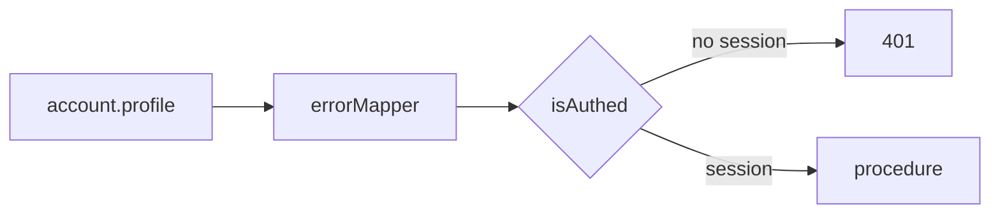

### 4. Where in our code

`api/trpc/init.ts` → `errorMapper`, `isAuthed`, `publicProcedure`, `protectedProcedure`,
`errorFormatter`. Cards: [trpc-middleware](concepts/trpc-middleware.md),
[protected-procedure](concepts/protected-procedure.md), [authn-vs-authz](concepts/authn-vs-authz.md),
[error-handling](concepts/error-handling.md).

### 5. See it yourself

`curl -s localhost:4000/trpc/account.profile` → 401 "You must be logged in"; `pnpm test init.test`.

### 6. How it connects

Uses `ctx.session` (chapter 5); maps service errors (chapters 8, 11).

### 7. Our settings and WHY

Two small middlewares; `errorMapper` outermost so it sees every error.

### 8. Trade-offs

Policy in one place; order matters.

### 9. Alternatives and when to choose them

Protected-by-default exports; per-procedure rate limit or role middlewares later.

### 10. What breaks, and how we'd notice

A private procedure on `publicProcedure` would leak; TypeScript complains because `ctx.session`
could be null.

### 13. Interview answers at 3 levels

Simple: shared checks around every api function. Senior: `errorMapper` maps `AppError`s;
`isAuthed` throws 401 and narrows the type. Lead: middleware is where policy lives.

### 14. Follow-up questions interviewers ask

*Is the Next.js proxy enough?* No, this is the real check.

### 15. Say it in 30 seconds

"errorMapper wraps every procedure; protectedProcedure adds isAuthed, the real login check, which
throws 401 and narrows ctx.session."

### 16. Status

✅ built.

---

## 7. The procedure

### 1. In one line

The procedure validates input, calls one service, does HTTP-only jobs (cookies) and filters the
output.

### 2. Real-life comparison

A waiter: checks the order, passes it to the kitchen, brings back only what's on the plate.

### 3. Picture it

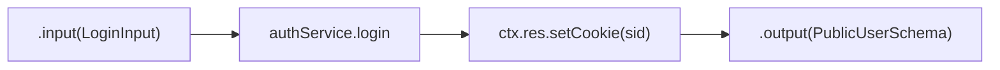

### 4. Where in our code

`api/procedures/auth.ts` → `signup`, `login`, `logout`, `me`, `cookieOptions`;
`api/procedures/account.ts` → `profile`. Cards: [layered-api](concepts/layered-api.md),
[validation-at-boundaries](concepts/validation-at-boundaries.md),
[session-cookie](concepts/session-cookie.md), [idempotency](concepts/idempotency.md).

### 5. See it yourself

The login `Set-Cookie` recorded locally: `sid=…; Max-Age=604800; Path=/; HttpOnly; SameSite=Lax`.

### 6. How it connects

Called after middleware (chapter 6); calls services (chapter 8).

### 7. Our settings and WHY

No logic in procedures; cookies here because they are HTTP; `.output()` on every procedure.

### 8. Trade-offs

Thin and readable; three files per feature.

### 9. Alternatives and when to choose them

Feature-sliced files; fat procedures only in prototypes.

### 10. What breaks, and how we'd notice

A missing `.output()` could leak a field; the services also pick fields by hand.

### 13. Interview answers at 3 levels

Simple: checks and forwards. Senior: Zod in, service call, cookie, Zod out. Lead: keep transport
concerns at the edge so services stay reusable.

### 14. Follow-up questions interviewers ask

*Why is the cookie set here?* It's an HTTP concern.

### 15. Say it in 30 seconds

"Procedures parse input with shared Zod schemas, call one service, set cookies, and filter the
output, so nothing extra ever leaves."

### 16. Status

✅ built.

---

## 8. The service

### 1. In one line

Services hold the business rules: hash and verify passwords, prevent user enumeration, create and
delete sessions, and throw business errors; no HTTP, no SQL.

### 2. Real-life comparison

The chef: decides how the dish is made; never takes orders and never goes into the storeroom.

### 3. Picture it

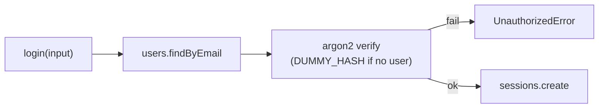

### 4. Where in our code

`api/services/auth.ts` → `signup`, `login`, `getCurrentUser`, `logout`, `DUMMY_HASH`;
`api/services/account.ts` → `getProfile`; `api/errors.ts`. Cards:
[password-hashing](concepts/password-hashing.md), [user-enumeration](concepts/user-enumeration.md),
[unique-constraint-race](concepts/unique-constraint-race.md), [sessions-vs-jwt](concepts/sessions-vs-jwt.md),
[ttl](concepts/ttl.md).

### 5. See it yourself

Wrong password vs unknown email, 20 logins each on the owner's laptop: 0.0099 s vs 0.0090 s average,
both 401.

### 6. How it connects

Called by procedures (chapter 7); calls queries (chapter 9); its errors become HTTP codes
(chapter 11).

### 7. Our settings and WHY

argon2id with OWASP-minimum defaults; insert-then-catch for unique emails; one login error message.

### 8. Trade-offs

Testable plain functions; signup still reveals taken emails (409).

### 9. Alternatives and when to choose them

Hexagonal ports if stores get swapped; email-verified signup to close enumeration.

### 10. What breaks, and how we'd notice

Skipping the dummy verify would leak timing; review and the code comment guard it.

### 13. Interview answers at 3 levels

Simple: where the rules live. Senior: argon2id, equal-timing login, unique-constraint signup,
sessions in Redis, `AppError`s. Lead: business rules free of transport and storage.

### 14. Follow-up questions interviewers ask

*How do services report errors?* Throw `AppError` subclasses.

### 15. Say it in 30 seconds

"Services hold the rules, like argon2id hashing, equal-timing login and session creation, and throw
small business errors. They never see HTTP or SQL."

### 16. Status

✅ built.

---

## 9. The query

### 1. In one line

Queries are the only code that touches Postgres or Redis: parameterised SQL through Drizzle, Redis
commands with TTLs, and translation of driver errors.

### 2. Real-life comparison

The storeroom keeper, the only person with the key.

### 3. Picture it

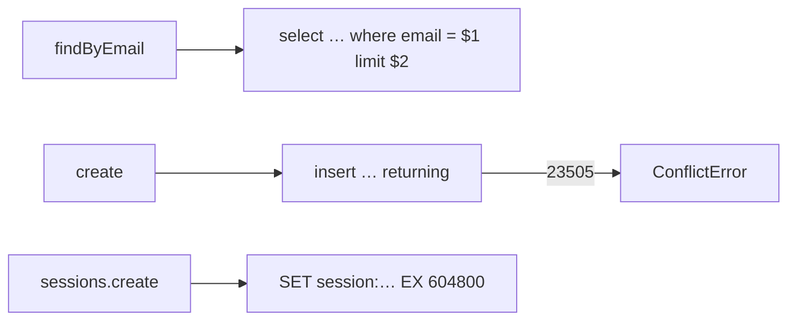

### 4. Where in our code

`api/queries/users.ts` → `findByEmail`, `findById`, `create`, `isUniqueViolation`;
`api/queries/sessions.ts` → `keyFor`, `create`, `get`, `remove`; `api/queries/health.ts`. Cards:
[sql-injection](concepts/sql-injection.md), [drizzle-schema](concepts/drizzle-schema.md),
[sql-vs-nosql](concepts/sql-vs-nosql.md), [stateless-servers](concepts/stateless-servers.md).

### 5. See it yourself

Drizzle's SQL for a hostile email, printed on the owner's laptop:
`where "users"."email" = $1` with the string in `params`.

### 6. How it connects

Called by services (chapter 8); uses the pool and Redis client (chapter 10).

### 7. Our settings and WHY

One layer per data store; driver codes never leave it.

### 8. Trade-offs

Swappable stores, injection-proof; only e2e tests cover these today.

### 9. Alternatives and when to choose them

Repository interfaces; raw `pg` with `$1` parameters.

### 10. What breaks, and how we'd notice

A `sql.raw` with user input; review.

### 13. Interview answers at 3 levels

Simple: the only code allowed in the database. Senior: parameterised Drizzle queries, hashed Redis
keys with TTL, unique violation → `ConflictError`. Lead: one data-access layer makes safety
structural.

### 14. Follow-up questions interviewers ask

*Why translate errors here?* So services don't depend on Postgres codes.

### 15. Say it in 30 seconds

"Queries are the only code that talks to Postgres or Redis: parameterised SQL, hashed session keys
with a TTL, and driver errors turned into our own errors."

### 16. Status

✅ built.

---

## 10. Postgres and Redis

### 1. In one line

Postgres stores users (durable, unique email); Redis stores sessions (fast, 7-day TTL); the api
reaches both through long-lived clients that fail fast and close cleanly.

### 2. Real-life comparison

A filing cabinet for records and a cloakroom for tickets.

### 3. Picture it

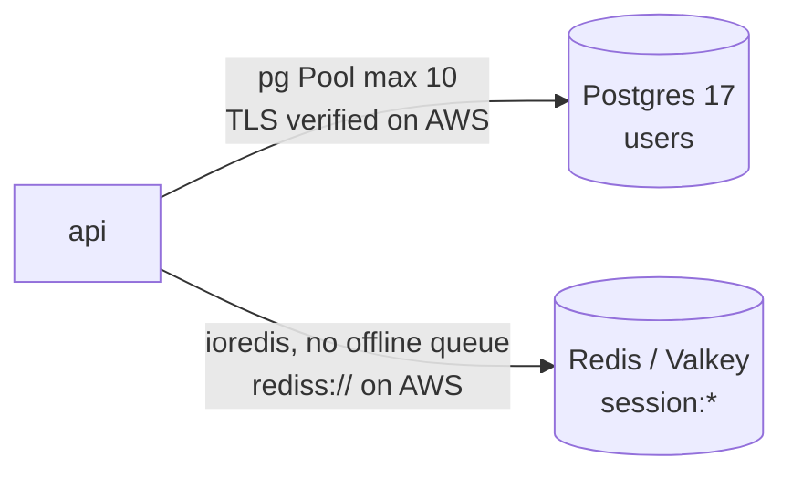

### 4. Where in our code

`api/db/client.ts` → `pool`, `db`; `api/db/schema/users.ts` → `users`; `api/redis/client.ts` →
`redis`; `api/db/migrate.ts`. Cards: [connection-pooling](concepts/connection-pooling.md),
[fail-fast](concepts/fail-fast.md), [migrations](concepts/migrations.md),
[indexing](concepts/indexing.md), [tls-in-transit](concepts/tls-in-transit.md).

### 5. See it yourself

`docker exec minitickets-postgres-1 psql -U minitickets -d minitickets -c '\di'` →
`users_email_unique`, `users_pkey`. With Redis unreachable (local test instance), login → 500 in
0.019 s and `/ready` → 503.

### 6. How it connects

Locally Docker Compose; on AWS RDS and ElastiCache Valkey ([infra story](infra-story.md#7-rds-postgres)).

### 7. Our settings and WHY

Pool of 10; Redis `maxRetriesPerRequest: 1` and no offline queue; `"error"` listeners so a broken
connection never crashes the process.

### 8. Trade-offs

Fast, honest failures for Redis; Postgres still has no connection or statement timeout.

### 9. Alternatives and when to choose them

RDS Proxy with many tasks; timeouts everywhere.

### 10. What breaks, and how we'd notice

Pool exhaustion or a silent network partition to Postgres: slow requests; no alarms yet.

### 13. Interview answers at 3 levels

Simple: one database for users, one fast store for logins. Senior: pooled pg with verified TLS on
AWS, ioredis set to fail fast. Lead: every network call needs a deadline; add pg timeouts and RDS
Proxy as tasks grow.

### 14. Follow-up questions interviewers ask

*Why two stores?* Different durability and access patterns.

### 15. Say it in 30 seconds

"Users in Postgres through a pool of ten connections, sessions in Redis with a seven-day TTL; Redis
fails fast, both clients survive connection errors, and Postgres timeouts are the known gap."

### 16. Status

✅ built (fail-fast for Postgres is 🟡).

---

## 10b. Reading events

A second example request, this one public and with no login: a visitor opens `/events`.

### 1. In one line

The browser asks for the page frame, then a hook calls `events.list`, which goes procedure →
service → query → Postgres and comes back as JSON the cards are drawn from. No caching yet: this is
the baseline.

### 2. Real-life comparison

Asking the ticket office what is on. You walk in (page), the clerk at the desk (procedure) checks you
asked a proper question, a manager (service) decides "upcoming means starting after now", and the
archivist (query) pulls the folders from the cabinet (Postgres).

### 3. Picture it

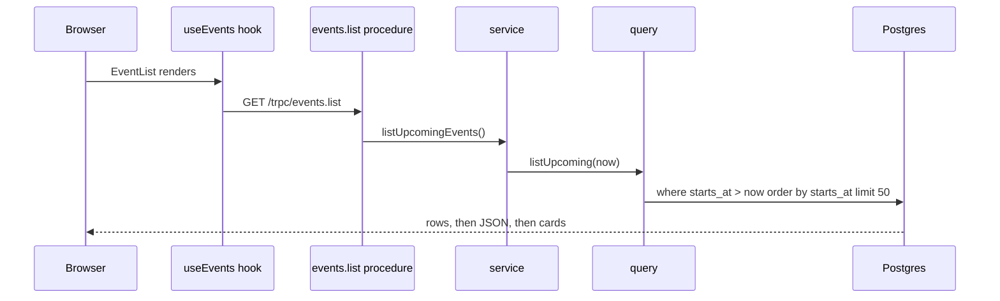

### 4. Where in our code

`web/app/events/page.tsx` → `EventsPage`; `web/features/events/components/event-list.tsx` →
`EventList` (loading, error + Retry, empty); `event-card.tsx` → `EventCard` (date format, sold out
badge); `hooks/use-events.ts` → `useEvents`; `api/procedures/events.ts` → `eventsRouter.list`
(`.output(ListEventsOutput)`); `api/services/events.ts` → `listUpcomingEvents`; `api/queries/events.ts`
→ `listUpcoming`; `api/db/schema/events.ts` → `events`; `api/db/seed.ts`; `packages/shared/src/schemas/events.ts`.
Cards: [csr-vs-ssr](concepts/csr-vs-ssr.md), [db-check-constraints](concepts/db-check-constraints.md),
[seed-data](concepts/seed-data.md), [tanstack-query](concepts/tanstack-query.md) (second example),
[layered-api](concepts/layered-api.md), [feature-folders](concepts/feature-folders.md),
[drizzle-schema](concepts/drizzle-schema.md), [indexing](concepts/indexing.md),
[validation-at-boundaries](concepts/validation-at-boundaries.md),
[ui-error-handling](concepts/ui-error-handling.md).

### 5. See it yourself

`pnpm --filter @minitickets/api db:seed`, then open `/events`. `curl localhost:4000/trpc/events.list`
returns the JSON. In psql, inserting an event with `seats_left` bigger than `total_seats` fails with
`events_seats_left_within_total`. **Break it on purpose:** stop the api and reload: after two quiet
retries the page shows "Something went wrong" and a Retry button.

### 6. How it connects

Same layers as chapters 7-9 and the same query cache as chapter 2. Unlike `account.profile` it is a
`publicProcedure`, so there is no session check. Chapter 11 covers what happens when it fails.

### 7. Our settings and WHY

`limit 50` so one request cannot return an unbounded list; `now` passed into the query so the service
owns the meaning of "upcoming"; no index on `starts_at` yet, because the next step measures first.

### 8. Trade-offs

Simple and always fresh, but every visitor causes a database read, and the HTML has no events in it
(client-side rendering).

### 9. Alternatives and when to choose them

Server rendering for faster first content and SEO; a cache in front of the query for hot, rarely
changing lists. Both are planned as later steps, with this chapter as the "before" picture.

### 10. What breaks, and how we'd notice

The table is empty (seed not run): "No upcoming events". The api is down: the error state and Retry
button. The query gets slow as the table grows: nothing alerts us yet.

### 13. Interview answers at 3 levels

Simple: the events page asks the api for the list and draws it. Senior: a client component's hook
calls a public tRPC procedure; layers keep HTTP, rules and SQL apart; Postgres CHECK constraints stop
bad seat counts; output is validated with a shared Zod schema. Lead: this is the uncached baseline
(on this laptop, with 12 rows: first call 23.8 ms, then 1.3-3.3 ms, median about 1.8 ms), so later changes
(index, cache, SSR) can be judged against numbers, not feelings.

### 14. Follow-up questions interviewers ask

*Why is `now` a parameter?* The caller decides the clock, so tests can fix it. *Why `limit 50` without
pagination?* It is a safety cap; real pagination comes when the list grows.

### 15. Say it in 30 seconds

"Visiting /events renders a frame, then a TanStack Query hook calls a public tRPC procedure. The
service asks one query for events starting after now, soonest first, max 50. It's client-rendered and
uncached on purpose, so we have a baseline to measure indexes, caching and SSR against."

### 16. Status

✅ built (the baseline). Rendering on the server and caching are planned.

---

## 11. The error path back to the UI

### 1. In one line

A failure anywhere becomes a business error or a crash, is mapped to a status code with a safe
message and field errors, is logged on the server, and lands in the right place on screen.

### 2. Real-life comparison

A specialist's internal note, translated by the front desk into a short standard answer, while the
full details go into the incident log.

### 3. Picture it

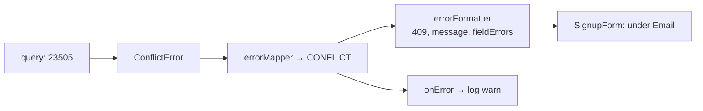

### 4. Where in our code

`api/queries/users.ts` → `create`; `api/errors.ts`; `api/trpc/init.ts` → `errorMapper`,
`errorFormatter`; `api/app.ts` → `onError`; `web/features/auth/components/signup-form.tsx` and
`login-form.tsx` → `onError`; `web/features/account/hooks/use-profile.ts` (401 redirect). Cards:
[error-handling](concepts/error-handling.md), [http-status-codes](concepts/http-status-codes.md),
[ui-error-handling](concepts/ui-error-handling.md), [retry-policy](concepts/retry-policy.md).

### 5. See it yourself

Recorded locally: duplicate signup →
`{"error":{"message":"Email already registered",…,"data":{"code":"CONFLICT","httpStatus":409,…}}}`;
Redis down → `"message":"Something went wrong"` while the log has `"procedure crashed"` with the
cause.

### 6. How it connects

Spans chapters 2 to 9 in reverse.

### 7. Our settings and WHY

Map by status, never by message; 500 always generic; 4xx logged at `warn`, 500 at `error`.

### 8. Trade-offs

Safe and consistent; each form repeats its small mapping.

### 9. Alternatives and when to choose them

A shared `mapApiError` helper; error boundaries; Problem Details for REST.

### 10. What breaks, and how we'd notice

A status change breaks where a message lands; e2e tests check `#email-error` and the login alert.

### 13. Interview answers at 3 levels

Simple: errors show up where you can fix them. Senior: `AppError` → `errorMapper` → formatter with
`httpStatus` and `fieldErrors` → forms map by status. Lead: the error shape is part of the API
contract.

### 14. Follow-up questions interviewers ask

*Do 4xx errors retry?* No (chapter 2).

### 15. Say it in 30 seconds

"Errors travel back as one shape: status, safe message and field errors. Forms put them under fields
or the form, a 401 on the profile redirects to login, and crashes say only 'Something went wrong'
while the full error is logged."

### 16. Status

✅ built.

---

## 12. Monorepo and shared types

### 1. In one line

One pnpm workspace holds web, api, shared schemas and infra; the web imports only the api's router
**type**.

### 2. Real-life comparison

One building, several companies, a shared mail room.

### 3. Picture it

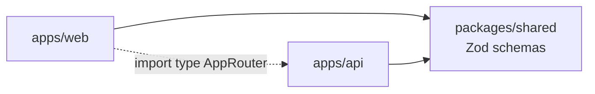

### 4. Where in our code

`pnpm-workspace.yaml`; `packages/shared/src/index.ts`; `api/trpc/router.ts` → `AppRouter`;
`apps/web/next.config.ts` → `transpilePackages`. Cards: [monorepo](concepts/monorepo.md),
[end-to-end-types](concepts/end-to-end-types.md), [rpc-vs-rest](concepts/rpc-vs-rest.md),
[monolith-vs-microservices](concepts/monolith-vs-microservices.md).

### 5. See it yourself

Rename `createdAt` in `ProfileSchema`: `pnpm typecheck` fails in the web.

### 6. How it connects

Types for chapters 2, 3, 7; one CI for all (chapter 16).

### 7. Our settings and WHY

Shared = schemas only, raw TypeScript; web depends on the api only as a devDependency, for types.

### 8. Trade-offs

Atomic, type-checked changes; CI checks everything on every push.

### 9. Alternatives and when to choose them

Turborepo/Nx caching; polyrepo with OpenAPI clients.

### 10. What breaks, and how we'd notice

A runtime import of api code in the web: server code in the bundle; review and `CLAUDE.md` rule.

### 13. Interview answers at 3 levels

Simple: one repo, shared pieces. Senior: pnpm workspaces, raw-TS shared schemas compiled by each
consumer, type-only router import. Lead: compile-time contracts don't cover deploy-time skew.

### 14. Follow-up questions interviewers ask

*How does the api bundle the shared package?* esbuild compiles it in (it's not `external`).

### 15. Say it in 30 seconds

"pnpm workspaces with a shared package of Zod schemas; the web imports only the api's router type,
so a breaking change fails CI before it ships."

### 16. Status

✅ built.

---

## 13. Validation at boundaries

### 1. In one line

Everything entering the system is parsed: request inputs, env vars, URL parameters; everything
leaving the api is filtered.

### 2. Real-life comparison

Customs at both ends of the border.

### 3. Picture it

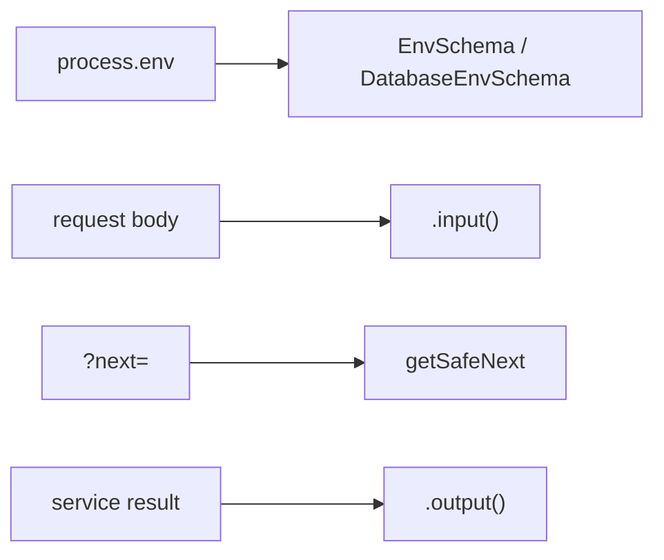

### 4. Where in our code

`api/config/env.ts`, `api/config/database.ts`; `packages/shared/src/schemas/*.ts`;
`api/procedures/*.ts`; `web/features/auth/lib/safe-next.ts`. Cards:
[validation-at-boundaries](concepts/validation-at-boundaries.md),
[config-validation](concepts/config-validation.md), [accessible-forms](concepts/accessible-forms.md),
[open-redirect](concepts/open-redirect.md).

### 5. See it yourself

`WEB_ORIGIN=not-a-url` → "Invalid environment variables: { WEB_ORIGIN: [ 'Invalid URL' ] }", exit 1
(recorded).

### 6. How it connects

Protects chapters 4-9; feeds field errors to chapter 11.

### 7. Our settings and WHY

Parse, don't just check: normalised emails, coerced ports, verified TLS settings.

### 8. Trade-offs

A parse per request and response; strong guarantees.

### 9. Alternatives and when to choose them

JSON Schema in Fastify for plain routes; Valibot/ArkType.

### 10. What breaks, and how we'd notice

Bad config fails the deploy (exit 1); bad input is 400 with field errors.

### 13. Interview answers at 3 levels

Simple: check everything coming in and going out. Senior: shared Zod schemas, `.input`/`.output`,
env validated at start, URL params allow-listed. Lead: every trust boundary gets a parser.

### 14. Follow-up questions interviewers ask

*Client-side validation enough?* Never; it's UX only.

### 15. Say it in 30 seconds

"Inputs, env vars and URL params are parsed with Zod or allow-lists; outputs are filtered with
schemas, so a hash can't leak."

### 16. Status

✅ built.

---

## 14. The testing pyramid

### 1. In one line

Static checks and unit tests at the bottom, two in-process api tests, four Playwright journeys at the
top; no real-database integration tests yet.

### 2. Real-life comparison

Test the bricks, then the walls, then walk through the house; we skipped most of the walls.

### 3. Picture it

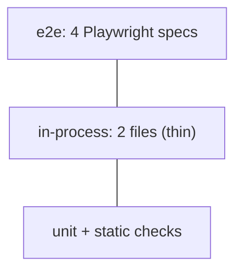

### 4. Where in our code

`vitest.config.mts`; `*.test.ts` files; `apps/web/playwright.config.ts`; `apps/web/e2e/*.spec.ts`.
Cards: [testing-pyramid](concepts/testing-pyramid.md), [unit-tests](concepts/unit-tests.md),
[in-process-api-tests](concepts/in-process-api-tests.md), [e2e-tests](concepts/e2e-tests.md),
[static-checks](concepts/static-checks.md).

### 5. See it yourself

`pnpm test` (5 files, 19 tests when run for this handbook) and `pnpm test:e2e` with `pnpm dev`
running.

### 6. How it connects

Runs in CI (chapter 16); checks chapters 1-13.

### 7. Our settings and WHY

Units for risky logic, e2e for journeys, unique data per e2e run.

### 8. Trade-offs

Quick feedback plus full-stack confidence; data-layer bugs are found late.

### 9. Alternatives and when to choose them

Integration tests with real Postgres/Redis (the CI services already exist).

### 10. What breaks, and how we'd notice

A query bug appears only as an e2e failure.

### 13. Interview answers at 3 levels

Simple: many small tests, few big ones. Senior: Vitest units and in-process tests, Playwright with
real stores. Lead: next investment is integration tests for queries and services.

### 14. Follow-up questions interviewers ask

*What would you add first?* Tests for `queries/users.ts` and `queries/sessions.ts` against real stores.

### 15. Say it in 30 seconds

"Static checks, Vitest units, two in-process api tests and four Playwright journeys; the missing
middle is integration tests against real Postgres and Redis."

### 16. Status

🟡 partial.

---

## 15. Docker

### 1. In one line

Multi-stage Dockerfiles build small, non-root images with production dependencies only, and
exec-form `CMD` so shutdown signals reach node.

### 2. Real-life comparison

Cook in a full kitchen, ship only the lunch box.

### 3. Picture it

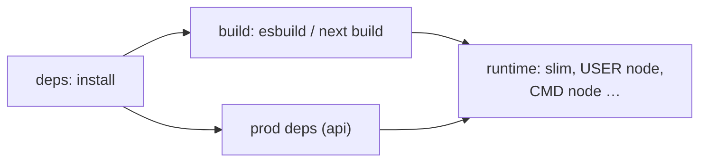

### 4. Where in our code

`apps/api/Dockerfile`, `apps/web/Dockerfile`, `.dockerignore`, `docker-compose.yml`. Cards:
[docker-multi-stage](concepts/docker-multi-stage.md),
[docker-layer-caching](concepts/docker-layer-caching.md),
[container-hardening](concepts/container-hardening.md),
[twelve-factor-config](concepts/twelve-factor-config.md), [graceful-shutdown](concepts/graceful-shutdown.md).

### 5. See it yourself

Recorded with the local image: `id` → `uid=1000(node)`; `touch dist/x` → Permission denied;
`node_modules` has only production packages.

### 6. How it connects

Images are pushed to ECR and run on Fargate ([infra story](infra-story.md#12-ecr)); compose runs the
same images locally with a one-off `migrate` service.

### 7. Our settings and WHY

`node:24.13.0-slim` (glibc for argon2), package files before source, cache mounts, empty
`NEXT_PUBLIC_API_URL` for one web image everywhere.

### 8. Trade-offs

Small and reproducible; longer Dockerfiles.

### 9. Alternatives and when to choose them

Distroless; digest-pinned bases; read-only root filesystem.

### 10. What breaks, and how we'd notice

Shell-form `CMD`: SIGTERM never reaches node; slow, unclean stops.

### 13. Interview answers at 3 levels

Simple: we package the app in small, locked-down containers. Senior: multi-stage builds, prod-only
deps, non-root, exec-form CMD, layer caching. Lead: pin by digest, scan in CI, read-only rootfs.

### 14. Follow-up questions interviewers ask

*Why slim, not Alpine?* The argon2 binary needs glibc.

### 15. Say it in 30 seconds

"Multi-stage images on slim Debian with production dependencies only, running as the node user with
exec-form CMD, cached so code changes don't reinstall dependencies."

### 16. Status

✅ built.

---

## 16. CI

### 1. In one line

GitHub Actions runs quality (types, lint, unit tests, docs:check), then e2e with real stores and
Docker builds, on every push; deployment is still manual.

### 2. Real-life comparison

An inspection line; the delivery truck (CD) isn't bought yet.

### 3. Picture it

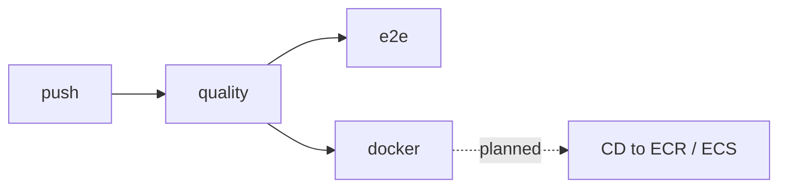

### 4. Where in our code

`.github/workflows/ci.yml`. Cards: [ci-pipeline](concepts/ci-pipeline.md),
[static-checks](concepts/static-checks.md), [e2e-tests](concepts/e2e-tests.md).

### 5. See it yourself

GitHub → Actions; locally `pnpm typecheck && pnpm lint && pnpm test && pnpm docs:check`.

### 6. How it connects

Runs chapter 14's tests and chapter 15's builds; the [deploy story](infra-story.md#the-deploy-story)
picks up from there by hand.

### 7. Our settings and WHY

Read-only token, cancel superseded runs, pinned service images, GHA layer cache.

### 8. Trade-offs

Strong gate; the tested image isn't the deployed image yet.

### 9. Alternatives and when to choose them

CD with OIDC, image digests, gated migrations.

### 10. What breaks, and how we'd notice

A red quality job stops everything after it.

### 13. Interview answers at 3 levels

Simple: every push is checked automatically. Senior: three jobs with service containers and layer
caching. Lead: build once, deploy the same digest, migrations as a gated step.

### 14. Follow-up questions interviewers ask

*Why not deploy from CI yet?* A learning step; the owner deploys with `pulumi up`.

### 15. Say it in 30 seconds

"CI runs typecheck, lint, unit tests and the handbook check first, then e2e with real Postgres and
Redis and both Docker builds. CD is the next step."

### 16. Status

✅ built for CI; CD 📋 planned.

---

## The app security story

Every app-level defence, outside in, and the attack it stops. (The AWS layers are in the
[infra story's security story](infra-story.md#the-security-story).)

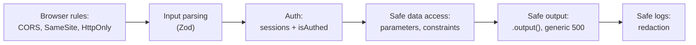

| Defence | Where | Attack or mistake it stops |
| ------- | ----- | -------------------------- |
| CORS with one exact origin + credentials | `api/app.ts` | Other sites reading our api with the user's cookie |
| `SameSite=Lax` + JSON-only mutations (415 otherwise) | `api/procedures/auth.ts`; tRPC/Fastify | CSRF from forms on other sites ([csrf](concepts/csrf.md)) |
| `HttpOnly` session cookie | `api/procedures/auth.ts` | Session theft through XSS |
| `Secure` cookie in production | `api/procedures/auth.ts` | Cookie sent over plain HTTP |
| React escaping, no `dangerouslySetInnerHTML` | `web/` | Stored or reflected XSS ([xss](concepts/xss.md)) |
| `getSafeNext` | `web/features/auth/lib/safe-next.ts` | Open redirect to a phishing site |
| Zod on every input, length caps | `packages/shared`, procedures | Malformed input, huge passwords slowing argon2 |
| argon2id (OWASP minimum) | `api/services/auth.ts` | Cheap cracking of a leaked database |
| Dummy verify + one login message | `api/services/auth.ts` | Finding which emails have accounts (login) |
| Random 256-bit session id, stored as SHA-256 | `api/queries/sessions.ts` | Guessing sessions; using a Redis leak to log in |
| Server-side logout | `api/services/auth.ts` | A stolen cookie working after logout |
| `protectedProcedure` | `api/trpc/init.ts` | Calling private procedures without a session (curl, fake cookies) |
| Ids from the session, never from input | `api/procedures/account.ts` | Reading someone else's profile (IDOR) |
| Parameterised queries | `api/queries/users.ts` | SQL injection |
| Unique constraint | `api/db/schema/users.ts` | Duplicate accounts through a race |
| `.output()` + generic 500 + no stack | procedures, `api/trpc/init.ts` | Leaking hashes, SQL, paths or secrets in responses |
| Log redaction | `api/app.ts` | Passwords in CloudWatch Logs |
| `trustProxy` by hop count | `api/config/trust-proxy.ts` | Spoofed IPs (for logs and future rate limits) |
| Non-root, read-only app files, no secrets in images | Dockerfiles, `.dockerignore` | A compromised process changing the system or its code |

**Gaps we know about:** signup reveals taken emails (409); no rate limiting on login or signup; no
Origin check on mutations (planned); no Content-Security-Policy; no roles or ownership model; no
MFA; Postgres without timeouts; no wait-after-SIGTERM (planned).

## What we'd change for production

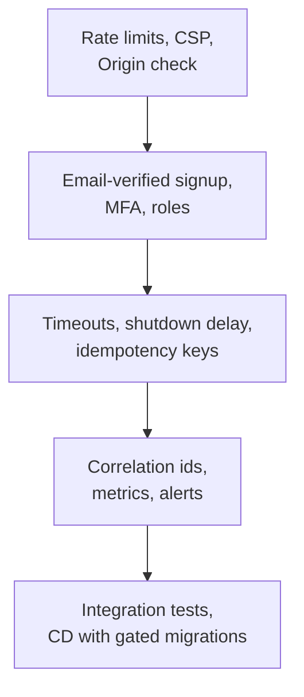

| Area | Today | Production |
| ---- | ----- | ---------- |
| Abuse | none | Rate limiting per IP and per account (Redis), keyed on the `trustProxy` IP |
| Browser security | SameSite, HttpOnly, CORS | + Origin check on mutations, strict CSP, `__Host-` cookie |
| Accounts | 409 on taken email; no MFA | Email-verified signup and reset, MFA or passkeys, roles/ownership |
| Reliability | Redis fails fast; immediate `app.close()` | pg `connectionTimeoutMillis` + `statement_timeout`; wait after SIGTERM; idempotency keys for creates |
| Sessions | fixed 7 days | Sliding renewal + idle timeout; "log out everywhere" |
| Observability | JSON logs, per-process `reqId` | Correlation ids from the ALB trace header, metrics, alerts on 5xx and latency |
| Tests | units, in-process, e2e | + integration tests for queries and services against real stores |
| Delivery | manual push and `pulumi up` | CD: build once, deploy by digest, migrations as a gated step |

## How this connects

- **Uses:** [00-big-picture.md](00-big-picture.md) (the same request at a glance), the step docs
  [01](../01-setup.md) to [11](../11-docker.md) and [19](../19-infra-cloudfront.md), and the code in
  `apps/` and `packages/`.
- **Gives:** the frontend, backend and security rounds in the [README](README.md) reading paths;
  context for the app [concept cards](concept-map.md); the base for Phase 4's ADRs and
  `system-design.md`.
