# The app story

History: see [CHANGELOG.md](CHANGELOG.md) or run `pnpm docs:history`

**In one line:** our own code, in the order a request travels through it, from the browser to
Postgres and Redis and back (including the error path), then the things around it: the monorepo,
validation, tests, Docker and CI, and the app's security story.

Each chapter is a guided tour: short answers under the usual headings, with links to the concept
cards for depth. Headings 11 (Reach / Allowed / Password) and 12 (Cost) are for AWS resources, so
they are left out here; the [infra story](infra-story.md) covers them. Code paths are short:
`api/` = `apps/api/src/`, `web/` = `apps/web/src/`.

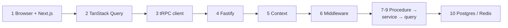

Chapter 10b is a second example request, reading the public events list; there the *web server* makes the api call and streams the HTML (server-side rendering), next to the browser-only baseline. Chapter 11 follows an error back to the UI. Chapters 12-16 are the ground under it:
[monorepo](#12-monorepo-and-shared-types), [validation](#13-validation-at-boundaries),
[tests](#14-the-testing-pyramid), [Docker](#15-docker), [CI](#16-ci). Then the
[app security story](#the-app-security-story) and [what we'd change for production](#what-wed-change-for-production).

The example request throughout: a logged-in user opens `/dashboard`, which shows their profile.

---

## 1. Browser → Next.js: layout, server vs client components, proxy guard

### 1. In one line

Next.js decides whether you may see `/dashboard` at all (the proxy), renders the page frame on the
server, and sends the interactive parts as JavaScript.

### 2. Real-life comparison

A theatre: the usher checks you have a ticket stub (proxy), the stage set is built before you
arrive (Server Components), the actors move once the play starts (Client Components).

### 3. Picture it

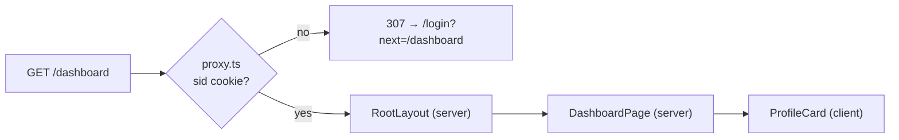

### 4. Where in our code

`web/proxy.ts` → `proxy` (HTML/RSC matcher plus private-page presence guards); `web/app/layout.tsx` → `RootLayout`
(header, footer, `QueryProvider`); `web/app/dashboard/page.tsx` → `DashboardPage`;
`web/features/account/components/profile-card.tsx` → `ProfileCard`. Cards:
[app-router](concepts/app-router.md), [server-client-components](concepts/server-client-components.md),
[route-guard-proxy](concepts/route-guard-proxy.md), [feature-folders](concepts/feature-folders.md),
[tailwind](concepts/tailwind.md).

### 5. See it yourself

`curl -s -o /dev/null -w '%{http_code} %{redirect_url}\n' localhost:3000/dashboard` →
`307 http://localhost:3000/login?next=%2Fdashboard` (recorded with `pnpm dev`).

### 6. How it connects

Gets the cookie set by login (chapter 7); hands over to TanStack Query inside `ProfileCard`
(chapter 2). On AWS the request reached Next.js through CloudFront and the ALB's default rule
([infra story](infra-story.md#1-cloudfront)).

### 7. Our settings and WHY

The proxy only checks that the cookie **exists** (no Redis call per page): UX, not security. Pages
are Server Components; client boundaries stay in interactive feature components.

### 8. Trade-offs

Fast redirect and little JavaScript, but a fake cookie passes the proxy (the api catches it), and the
profile loads only after hydration.

### 9. Alternatives and when to choose them

Validate the session in the proxy, or fetch data in Server Components, when first paint matters more
than simplicity.

### 10. What breaks, and how we'd notice

Cookie renamed in one place only: everyone bounces to login (e2e `dashboard.spec.ts` fails).

### 13. Interview answers at 3 levels

Simple: Next.js shows the page and sends you to login if you have no cookie. Senior: the proxy is a
cookie-exists check; layout and pages are Server Components; interactive leaves are Client
Components wrapped by a client `QueryProvider`. Lead: keep the client boundary low and treat
frontend guards as UX only.

### 14. Follow-up questions interviewers ask

*Is the proxy security?* No; `protectedProcedure` is (chapter 6).

### 15. Say it in 30 seconds

"Next.js runs a proxy that redirects to login when there's no session cookie, renders the layout and
page on the server, and ships only the interactive components, like the profile card, as client
JavaScript."

### 16. Status

✅ built.

---

## 1b. Search input, hydration and bounded rows

### 1. In one line

SSR sends useful initial HTML, CSR handles interactive changes and static output suits public content that tolerates rebuilds. MiniTickets combines server-prefetched catalogue data with client queries. P10 nonce security makes HTML dynamic and no-store; explicit public data caching remains a separate choice.

### 2. Real-life comparison

Follow one receipt from the visitor through the desk responsible for this decision; each desk has one clear job.

### 3. Picture it

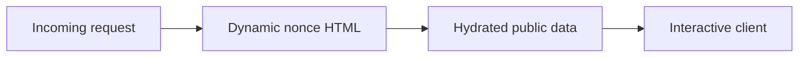

### 4. Where in our code

The Next data cache stores an explicit public result independently of HTML. unstable_cache and a fixed events tag remain; P7 search SSR bypasses this helper and P10 HTML is private,no-store. See [next-data-cache](concepts/next-data-cache.md).

A response race happens when old work finishes after new work. Each canonical input gets its own infinite-query key; debounce is 250 ms, and abort is an optimization rather than the correctness guarantee. See [search-races](concepts/search-races.md).

A keyset cursor identifies the last ordered row. Ours carries microsecond startsAt, id and a stable upcoming cutoff; limit is bounded and one extra row detects the next page. It is not a database snapshot. See [keyset-pagination](concepts/keyset-pagination.md).

Virtualization mounts only the visible fixed-height rows plus overscan. It bounds DOM work while keyset pages bound transfer; retained page memory is a separate limit and load-more remains accessible. See [virtualization](concepts/virtualization.md).

Current indexes include starts_at/id traversal, trigram GIN contains search, booking user/created order, user/idempotency uniqueness and an outbox due-row partial index. Indexes accelerate a matching predicate but cost writes/storage. See [indexing](concepts/indexing.md).

The catalogue SSR prefetches events.search into a per-request QueryClient and the browser hydrates the same infinite key. HTML is now dynamically nonced/no-store; client search remains interactive and data caches are separate. See [csr-vs-ssr](concepts/csr-vs-ssr.md).

### 5. See it yourself

`apps/web/src/app/layout.tsx` waits for a request; `apps/web/src/features/events/server/prefetch-events.ts` hydrates public data. `apps/web/src/features/events/server/cached-events.ts` provides an explicit public-data cache; the current search-prefetch path bypasses that helper to avoid unbounded cursor/text keys. Run `pnpm demo:security` for production HTML/cache acceptance; there is no static-site export.

`apps/web/src/features/events/hooks/use-event-search.ts` → `useEventSearch` debounces 250 ms, uses tRPC infinite-query options keyed by all input, consumes cancellation and keeps previous data. The component labels typing/loading. Run `pnpm demo:search`; the related browser spec deliberately delays an older response.

`apps/api/src/queries/event-search.ts` escapes LIKE metacharacters and uses composite cursor boundaries. Migration `apps/api/drizzle/0008_lethal_amazoness.sql` adds search indexes. `pnpm demo:search` measures 10k rows, index plans and page boundaries including timestamp ties.

`apps/web/src/features/events/components/virtual-event-list.tsx` renders a bounded window. Search returns pages of 50. `pnpm demo:search` seeds an isolated 10k dataset, checks ordering/plans and runs related headless assertions. The virtual-list browser check bounds rendered rows.

### 6. How it connects

Initial content and interactivity have different latency and security constraints.

A shared results variable with no request identity allows stale completion to win.

Deep OFFSET discards earlier rows repeatedly.

Large DOM trees hurt layout, paint, memory and interaction.

### 7. Our settings and WHY

SSR sends useful initial HTML, CSR handles interactive changes and static output suits public content that tolerates rebuilds. MiniTickets combines server-prefetched catalogue data with client queries. P10 nonce security makes HTML dynamic and no-store; explicit public data caching remains a separate choice.

An old request may finish last. Give each search input its own query key so it can only fill its own cache entry. Cancellation saves work, but identity provides correctness even when a server ignores cancellation. Keep previous results visibly marked while the next input is loading.

Choose an index for the predicate and order. Trigram GIN helps contains search; B-tree on starts_at/id supports stable traversal. Keyset asks for rows after the last pair, avoiding a growing OFFSET scan. A stable cutoff prevents time drift but is not a database snapshot: inserts and edits can still change later pages.

Pagination bounds transfer and database work; virtualization bounds mounted DOM nodes. They solve different problems. Keep stable event ids, a fixed-height window and overscan. Fetch the next keyset page before the user reaches the end. The full dataset should never become 10,000 React rows.

### 8. Trade-offs

Static HTML has cheap delivery but cannot reuse a fresh per-request nonce. CSR adds client work. Dynamic HTML costs server work even when data is cached.

A monotonically increasing request id also works for manual fetch. Abort alone does not prove the server stopped; debounce does not order responses.

GIN adds write/storage cost and short/unselective terms can favor a scan. Keyset cannot jump to arbitrary page 200; snapshot semantics need more design.

Fixed heights are simple but constrain content. Variable-height libraries add measurement. Virtual lists need accessible list position and keyboard testing; pagination is a valid alternative.

### 9. Alternatives

10x: measure TTFB/cache hit rate. 100x: evaluate hash-based static CSP or separating public/static routes as a deliberate redesign.

10x: measure input-to-result latency and cap retained pages. 100x: add relevance/search infrastructure only after query plans and traffic justify it.

10x: inspect real selectivity and buffers. 100x: retention/partitioning or full-text relevance when product needs it.

10x: bound retained pages as well as DOM. 100x: server-side ranking, narrower payloads and a search engine may matter more than another UI optimization.

### 10. Failure modes

Does dynamic HTML forbid cached data? No. Cache only public results with complete keys.

Could filters race too? Yes: venue/date/cursor must be in the input key. Should previous rows be bookable? Recheck authoritative availability on booking.

Why carry id with time? It breaks ties so rows sharing a timestamp are not skipped.

Does virtualization reduce SQL rows scanned? No; indexes and pagination do that.

### 13. Interview answers

Simple: Initial content and interactivity have different latency and security constraints. Senior: SSR sends useful initial HTML, CSR handles interactive changes and static output suits public content that tolerates rebuilds. MiniTickets combines server-prefetched catalogue data with client queries. P10 nonce security makes HTML dynamic and no-store; explicit public data caching remains a separate choice. Lead: 10x: measure TTFB/cache hit rate. 100x: evaluate hash-based static CSP or separating public/static routes as a deliberate redesign.

### 14. Follow-up

Does dynamic HTML forbid cached data? No. Cache only public results with complete keys.

### 15. Say it in 30 seconds

SSR sends useful initial HTML, CSR handles interactive changes and static output suits public content that tolerates rebuilds. MiniTickets combines server-prefetched catalogue data with client queries. P10 nonce security makes HTML dynamic and no-store; explicit public data caching remains a separate choice.

### 16. Status

Built and explain-only pieces are labelled in the linked cards. Local evidence does not replace AWS acceptance.

## 1c. Side path: browser vitals and accessibility

### 1. In one line

LCP measures the main content appearing, INP interaction responsiveness and CLS unexpected layout shifts. Use field measurements grouped by route/device and percentile, then reproduce slow cases in lab tools. A single fast laptop run is not a user population. Good Core Web Vitals target the 75th percentile: LCP ≤2.5 s, INP ≤200 ms and CLS ≤0.1.

### 2. Real-life comparison

Follow one receipt from the visitor through the desk responsible for this decision; each desk has one clear job.

### 3. Picture it

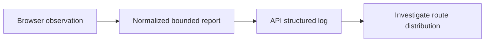

### 4. Where in our code

Web Vitals measure field experience. LCP/INP/CLS plus TTFB/FCP are logged through a bounded normalized-route endpoint; no analytics dashboard, sampling pipeline or Lighthouse CI is built. See [web-vitals](concepts/web-vitals.md).

Native labels, semantic controls and visible focus support forms. P10 axe scans cover events/login/signup; keyboard and assistive-technology review are still needed, including pending/errors and virtualized lists. See [accessible-forms](concepts/accessible-forms.md).

### 5. See it yourself

`apps/web/src/features/telemetry/hooks/use-web-vitals.ts` reports bounded values and normalized routes to telemetry.report; `apps/api/src/services/telemetry.ts` logs webVital without query strings or user ids. Run `pnpm demo:security`; the browser test interacts to produce INP and checks request validation. No reporting dashboard or sampling service is built.

`apps/web/e2e/security.spec.ts` runs axe WCAG 2A/AA/2.1AA on events, login and signup. `pnpm demo:security` passed these three scans. The offline learning pages also use native buttons, labels and keyboard navigation. Comprehensive assistive-technology review remains manual.

### 6. How it connects

Field data catches slow devices, real network conditions and long interactions.

An accessible control must convey name, role and state, and remain usable under change.

### 7. Our settings and WHY

LCP measures the main content appearing, INP interaction responsiveness and CLS unexpected layout shifts. Use field measurements grouped by route/device and percentile, then reproduce slow cases in lab tools. A single fast laptop run is not a user population. Good Core Web Vitals target the 75th percentile: LCP ≤2.5 s, INP ≤200 ms and CLS ≤0.1.

Automated checks catch many structural accessibility errors such as missing names and invalid contrast relationships. They cannot prove the whole experience works with a keyboard, screen reader or cognitive needs. Keep semantic controls and visible focus; test loading/error states and long lists manually too.

### 8. Trade-offs

Logs are simple but not a percentile analytics product. Client reports are untrusted. Lighthouse is repeatable lab evidence, not field truth.

Automated gates are fast but incomplete. Virtualized lists need careful position/context; infinite scroll can make navigation harder.

### 9. Alternatives

10x: sample ingestion and group by device/network. 100x: dedicated metrics pipeline, retention and privacy budgets.

10x: component-level semantic conventions. 100x: representative assistive-technology testing across critical journeys.

### 10. Failure modes

Why no INP on a page never touched? It needs qualifying interactions.

Does zero axe violations certify accessibility? No.

### 13. Interview answers

Simple: Field data catches slow devices, real network conditions and long interactions. Senior: LCP measures the main content appearing, INP interaction responsiveness and CLS unexpected layout shifts. Use field measurements grouped by route/device and percentile, then reproduce slow cases in lab tools. A single fast laptop run is not a user population. Good Core Web Vitals target the 75th percentile: LCP ≤2.5 s, INP ≤200 ms and CLS ≤0.1. Lead: 10x: sample ingestion and group by device/network. 100x: dedicated metrics pipeline, retention and privacy budgets.

### 14. Follow-up

Why no INP on a page never touched? It needs qualifying interactions.

### 15. Say it in 30 seconds

LCP measures the main content appearing, INP interaction responsiveness and CLS unexpected layout shifts. Use field measurements grouped by route/device and percentile, then reproduce slow cases in lab tools. A single fast laptop run is not a user population. Good Core Web Vitals target the 75th percentile: LCP ≤2.5 s, INP ≤200 ms and CLS ≤0.1.

### 16. Status

Built and explain-only pieces are labelled in the linked cards. Local evidence does not replace AWS acceptance.

## 2. TanStack Query: cache, retries, invalidation

### 1. In one line

`ProfileCard` asks `useProfile`, which asks TanStack Query: a browser cache of api answers with
retry and refresh rules.

### 2. Real-life comparison

A notice board in a shared office: one person phones head office, pins the answer, everyone reads
the board.

### 3. Picture it

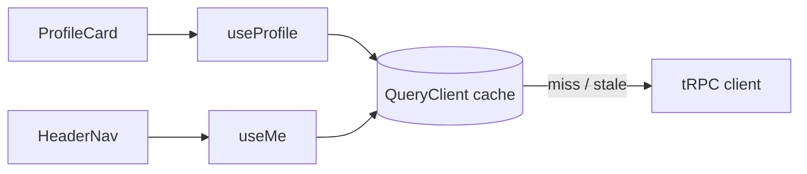

### 4. Where in our code

`web/providers/query-provider.tsx` → `QueryProvider`, `shouldRetry`, `mutations: { retry: 0 }`;
`web/features/account/hooks/use-profile.ts` → `useProfile` (401 → redirect);
`web/features/auth/hooks/use-login.ts` / `use-logout.ts` (invalidate / clear). Cards:
[tanstack-query](concepts/tanstack-query.md), [retry-policy](concepts/retry-policy.md),
[query-invalidation](concepts/query-invalidation.md), [state-management](concepts/state-management.md).

### 5. See it yourself

Network tab on `/`: one `auth.me` request although `HeaderNav` and `Hero` both use it.

### 6. How it connects

Uses the tRPC client (chapter 3) to fetch; gives cached data to components; reacts to the error
shape from chapter 11.

### 7. Our settings and WHY

Queries retry twice (1 s, 2 s) but never on 4xx; mutations never retry; login invalidates
`auth.me`; logout clears the whole cache.

### 8. Trade-offs

No hand-written loading or retry code; one more concept (stale vs fresh, keys) to learn.

### 9. Alternatives and when to choose them

SWR, RTK Query, or Server Components fetching data.

### 10. What breaks, and how we'd notice

Forgetting to clear on logout would show the last user's data; we clear, and e2e logout checks the
header.

### 13. Interview answers at 3 levels

Simple: it remembers server answers. Senior: one `QueryClient` per tab; status-aware retries;
mutations never retried; invalidate on login, clear on logout. Lead: server state is a cache with
rules per data type, not global app state.

### 14. Follow-up questions interviewers ask

*Why no mutation retries?* A retried successful signup would return 409.

### 15. Say it in 30 seconds

"TanStack Query caches api answers per procedure: one request for many components, smart retries
for reads only, and explicit invalidation after login and logout."

### 16. Status

✅ built.

---

## 3. The tRPC client

### 1. In one line

The typed client turns `account.profile` into `GET /trpc/account.profile`, batching calls made at the
same moment and sending cookies along.

### 2. Real-life comparison

A postal clerk who puts all letters handed over in the same minute into one envelope.

### 3. Picture it

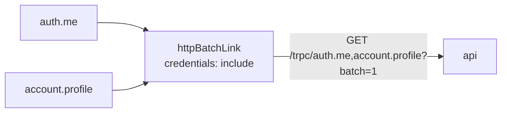

### 4. Where in our code

`web/lib/trpc/client.ts` → `makeTrpcClient`, `API_URL`, `createTRPCContext<AppRouter>`. Cards:
[trpc-client](concepts/trpc-client.md), [end-to-end-types](concepts/end-to-end-types.md),
[same-origin-routing](concepts/same-origin-routing.md), [rpc-vs-rest](concepts/rpc-vs-rest.md).

### 5. See it yourself

Batched answer recorded against a local api: `[{"result":{"data":{…}}},{"result":{"data":{…,"createdAt":…}}}]`.

### 6. How it connects

Typed by the api's `AppRouter` (chapter 12); talks to Fastify (chapter 4). On AWS `API_URL` is empty,
so it calls `/trpc` on the same origin and the ALB routes it.

### 7. Our settings and WHY

`httpBatchLink`; `credentials: "include"` (needed locally, where :3000 → :4000 is cross-origin);
empty URL on AWS so one web image works everywhere.

### 8. Trade-offs

Fewer round-trips; the slowest call in a batch delays the others.

### 9. Alternatives and when to choose them

`httpLink` (no batching), `httpBatchStreamLink` (stream each result).

### 10. What breaks, and how we'd notice

A malformed `NEXT_PUBLIC_API_URL` throws at startup (by design).

### 13. Interview answers at 3 levels

Simple: how the web calls the api. Senior: typed from `AppRouter`, queries GET and mutations POST,
batched, cookies included. Lead: batching vs latency of the slowest call; streaming when procedures
get slow.

### 14. Follow-up questions interviewers ask

*Does the browser bundle contain api code?* No, only `import type`.

### 15. Say it in 30 seconds

"A tRPC client typed from the api's router, with a batch link that sends calls made together as one
request and includes the session cookie."

### 16. Status

✅ built.

---

## 4. Fastify: CORS, trustProxy, cookie

### 1. In one line

The request reaches the api's Fastify server, which knows the real visitor IP, applies CORS, parses
cookies and hands `/trpc/*` to tRPC.

### 2. Real-life comparison

A building's front desk: notes who really came in (not just the courier), checks the guest list,
reads the visitor's badge, and sends them to the right floor.

### 3. Picture it

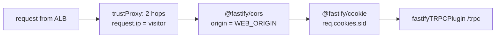

### 4. Where in our code

`api/app.ts` → `buildApp` (logger with redaction, `trustProxy`, `cors`, `cookie`, error handler,
`/health`, `/ready`, tRPC plugin); `api/server.ts` → `listen`, `shutdown`. Cards:
[fastify-app](concepts/fastify-app.md), [trust-proxy](concepts/trust-proxy.md),
[cors](concepts/cors.md), [structured-logging](concepts/structured-logging.md),
[log-redaction](concepts/log-redaction.md), [correlation-ids](concepts/correlation-ids.md) (the per-request `reqId`), [health-checks](concepts/health-checks.md),
[graceful-shutdown](concepts/graceful-shutdown.md).

### 5. See it yourself

A CORS preflight recorded locally answers `access-control-allow-origin: http://localhost:3000` and
`access-control-allow-credentials: true`.

### 6. How it connects

Validated config from `api/config/env.ts`; builds the context next (chapter 5).

### 7. Our settings and WHY

`TRUST_PROXY_HOPS` 2 on AWS, 0 elsewhere; one exact CORS origin with credentials; JSON logs with
passwords redacted.

### 8. Trade-offs

Correct IPs and safe defaults; the hop count must match the real path.

### 9. Alternatives and when to choose them

Trust CloudFront's IP ranges instead of a hop count; same-origin locally to avoid CORS.

### 10. What breaks, and how we'd notice

Wrong `WEB_ORIGIN`: browser CORS errors while curl still works.

### 13. Interview answers at 3 levels

Simple: the server's front door. Senior: `buildApp` composes logger, `trustProxy`, CORS, cookies and
tRPC; `server.ts` only listens and shuts down. Lead: proxy trust and CORS are security settings tied
to network topology.

### 14. Follow-up questions interviewers ask

*Why build apart from listen?* Testable without a port (`inject`).

### 15. Say it in 30 seconds

"Fastify reads the real IP through two trusted proxy hops, allows CORS only from our web origin with
credentials, parses the session cookie, and mounts tRPC at /trpc."

### 16. Status

✅ built.

---

## 4b. Mutation admission and browser security

### 1. In one line

XSS executes unwanted code in a trusted page. Validate input, render escaped text and use a per-request nonce CSP to limit script execution. Production does not allow unsafe-eval. CI dependency and image scanners catch known advisories, not every vulnerability or malicious business rule. Gates need a clear severity policy and honest residual findings.

### 2. Real-life comparison

Follow one receipt from the visitor through the desk responsible for this decision; each desk has one clear job.

### 3. Picture it

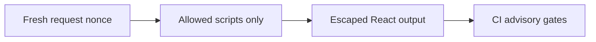

### 4. Where in our code

Content Security Policy restricts what a page may execute. A fresh request nonce authorizes Next scripts; production has no unsafe-eval, while style attributes remain allowed for current React layouts. See [csp](concepts/csp.md).

A presigned URL is a bearer capability, not public bucket access. Owner-checked ticket GETs expire in 120 s; staged poster PUTs sign exact length/type/AES256, then verified ETag-pinned copy publishes immutable content. See [presigned-urls](concepts/presigned-urls.md).

Explain-only: an authenticated scanner would verify the QR and conditionally transition unused to used. API Gateway REST usage-plan keys meter devices but do not authenticate staff; no scanner/gateway exists. See [door-checkin](concepts/door-checkin.md).

CSRF is an authenticated action induced by a foreign site. Exact trusted Origin plus Sec-Fetch-Site checks protect mutations, including rejecting missing Origin; CORS and SameSite are additional independent controls. See [csrf](concepts/csrf.md).

XSS runs attacker code in a trusted page. React escaping, HttpOnly cookies and nonce CSP reduce exposure; CSP is not a sanitizer and a trusted-origin injection could still bypass CSRF metadata. See [xss](concepts/xss.md).

ECR scanOnPush remains, and CI now runs Trivy CRITICAL gates for API/web/worker plus critical dependency audit. Local audit has no critical but high braces/moderate esbuild remain; local image scan/GitHub execution is not claimed. See [image-scanning](concepts/image-scanning.md).

### 5. See it yourself

`apps/web/src/proxy.ts` generates/overwrites nonce headers; `lib/security-policy.ts` defines script policy; `lib/trpc/client.ts` disables Zod JIT to avoid eval probes. CI audits critical dependencies and scans three images with Trivy CRITICAL. `pnpm demo:security` asserts no CSP violations. Audit: 0 critical, one high braces and one moderate esbuild remain; image scan execution is unverified locally.

`apps/api/src/services/posters.ts` validates admin workflow; `queries/posters.ts` signs staging/publish operations; `services/poster-image.ts` checks bounded bytes; `queries/assets.ts` signs private reads for 120 s. `pnpm demo:p4-assets` tests owner isolation and constrained upload/publication. No antivirus/re-encoding pipeline is built.

WHERE IN MINITICKETS: proposed check-in procedure/service/queries under apps/api/src, an API Gateway REST route plus authenticated staff authorizer in infra, and a scanner UI feature. Reuse worker token verification as a deliberate shared server-only module, never browser signing. DynamoDB update condition checks unused state/event; audit actor/time and return already-used explicitly. No gateway, usage plan/key, scanner or used-state transition is built.


Existing integration point: `apps/worker/src/tickets/token.ts`.

`apps/api/src/http/security.ts` → `mutationAllowed` guards all non-safe methods, including missing-Origin refusal. CLI callers explicitly send Origin. `pnpm demo:security` exercises same/cross/missing metadata and cookie isolation; one isolated inverted-origin mutation made both relevant tests fail.

### 6. How it connects

Defense in depth reduces damage from accidental injection and known dependency flaws.

Direct uploads avoid buffering large files through the API while retaining controlled publication.

HMAC proves issuance; it cannot stop the same valid QR being shown twice.

A request can cause side effects even if its response is unreadable.

### 7. Our settings and WHY

XSS executes unwanted code in a trusted page. Validate input, render escaped text and use a per-request nonce CSP to limit script execution. Production does not allow unsafe-eval. CI dependency and image scanners catch known advisories, not every vulnerability or malicious business rule. Gates need a clear severity policy and honest residual findings.

A presigned URL is a short-lived bearer capability with exactly the signer’s allowed action. CORS controls browser cross-origin use, not authorization. Validate the owner/admin before signing, constrain type/size, inspect actual image bytes and publish to an immutable key with conditional version identity. Never treat a declared Content-Type as malware scanning.

Authenticate the staff/device, verify the signed QR claims and conditionally transition a canonical ticket from unused to used. Two scanners race: exactly one conditional update wins. API Gateway REST usage plans/API keys can meter devices, but keys are not user authentication and quotas are best-effort. Reject replay, wrong event and invalid signatures.

CSRF tricks a browser into sending an authenticated action from another site. CORS controls whether browser code can read cross-origin responses; it is not a mutation authorization check. SameSite helps but is not the entire policy. MiniTickets requires the exact trusted Origin on mutations and rejects cross-site Sec-Fetch-Site.

### 8. Trade-offs

Nonce pages require dynamic/no-store HTML. Style attributes remain allowed for current UI. Scanners cannot prove safety and unfixed findings need tracked decisions.

A leaked URL works until expiry. Exact PUT length differs from POST length ranges. Proposed scanning worker belongs before publication and must quarantine failures.

Offline scanners need a reconciliation/conflict policy and cannot promise global one-time use. API keys leak and are not authorization. Rate limits supplement device/staff identity.

Non-browser clients must follow the explicit Origin contract; XSS on the trusted origin bypasses CSRF defenses, so output safety/CSP still matter. Proxy headers need their own trust policy.

### 9. Alternatives

10x: report CSP violations with bounded sampling. 100x: dependency provenance, policies and attack-surface reviews.

10x: upload quotas and cleanup. 100x: scan/re-encode queues, retention and abuse response.

10x: per-gate quotas and burst tests. 100x: regional ownership, key revocation and offline conflict procedure.

10x: centralize trusted origin/environment validation. 100x: service-to-service auth and tenant origin rules with tests.

### 10. Failure modes

Why not enable unsafe-eval to silence Zod? Disable the optional JIT/probe instead, preserving production policy.

Can another origin with curl use a leaked URL? Yes; CORS does not constrain non-browser callers.

Can two valid scans both succeed? Only if the storage transition is not conditional or checks different identities.

Is Origin cryptographic API authentication? No; non-browser clients can set it. Sessions still authorize actions.

### 13. Interview answers

Simple: Defense in depth reduces damage from accidental injection and known dependency flaws. Senior: XSS executes unwanted code in a trusted page. Validate input, render escaped text and use a per-request nonce CSP to limit script execution. Production does not allow unsafe-eval. CI dependency and image scanners catch known advisories, not every vulnerability or malicious business rule. Gates need a clear severity policy and honest residual findings. Lead: 10x: report CSP violations with bounded sampling. 100x: dependency provenance, policies and attack-surface reviews.

### 14. Follow-up

Why not enable unsafe-eval to silence Zod? Disable the optional JIT/probe instead, preserving production policy.

### 15. Say it in 30 seconds

XSS executes unwanted code in a trusted page. Validate input, render escaped text and use a per-request nonce CSP to limit script execution. Production does not allow unsafe-eval. CI dependency and image scanners catch known advisories, not every vulnerability or malicious business rule. Gates need a clear severity policy and honest residual findings.

### 16. Status

Built and explain-only pieces are labelled in the linked cards. Local evidence does not replace AWS acceptance.

## 5. The tRPC context

### 1. In one line

Once per request, `createContext` turns the `sid` cookie into `{ userId }` (or `null`) by looking up
its hash in Redis.

### 2. Real-life comparison

The hotel desk writes your room number on a wristband once; every service reads the wristband.

### 3. Picture it

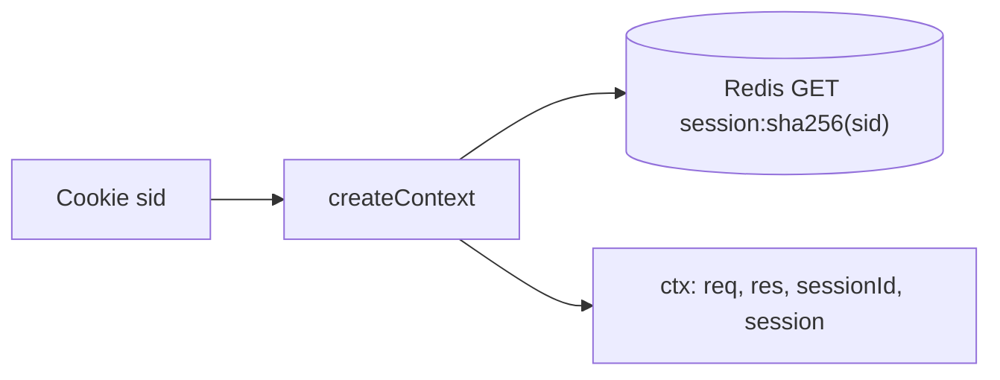

### 4. Where in our code

`api/trpc/context.ts` → `createContext`, `SESSION_COOKIE`, `Context`;
`api/queries/sessions.ts` → `get`. Cards: [trpc-context](concepts/trpc-context.md),
[sessions-vs-jwt](concepts/sessions-vs-jwt.md).

### 5. See it yourself

`curl -s -b 'sid=fake' localhost:4000/trpc/auth.me` → `{"result":{"data":null}}`.

### 6. How it connects

Feeds `ctx.session` to the middleware (chapter 6) and `ctx.res` to procedures that set cookies
(chapter 7).

### 7. Our settings and WHY

Lookup once per request, so no procedure can forget it, and a batch pays it once.

### 8. Trade-offs

One Redis round-trip per request with a cookie, even for public procedures.

### 9. Alternatives and when to choose them

Lazy lookup; stateless tokens.

### 10. What breaks, and how we'd notice

Redis down → 500s fast and `/ready` 503 ([fail-fast](concepts/fail-fast.md)).

### 13. Interview answers at 3 levels

Simple: works out who you are once. Senior: cookie → SHA-256 → Redis → `{ userId }` on `ctx`.
Lead: the context is the identity boundary; keep it cheap.

### 14. Follow-up questions interviewers ask

*Per call or per batch?* Per HTTP request.

### 15. Say it in 30 seconds

"createContext reads the sid cookie, looks up its hash in Redis once, and gives every procedure
ctx.session."

### 16. Status

✅ built.

---

## 5b. Session identity, roles and revocation

### 1. In one line

Opaque session cookies keep revocation server-side; JWTs reduce lookup dependence but revocation/role changes need expiry or another authoritative version. MiniTickets hashes random tokens in Redis, rotates login sessions, indexes at most 20 devices and checks membership on every read. Admin authorization reads Postgres; role changes revoke sessions before and after the update.

### 2. Real-life comparison

Follow one receipt from the visitor through the desk responsible for this decision; each desk has one clear job.

### 3. Picture it

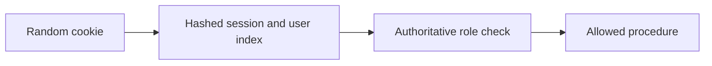

### 4. Where in our code

Role-based access control checks whether an authenticated user is allowed an action. adminProcedure reads Postgres lazily per admin request; changing a role revokes indexed sessions before and after the update. See [rbac](concepts/rbac.md).

Revocation removes an existing login's authority. Every read requires the hashed token and user-index membership; the sorted-set index caps devices at 20, login rotates and logoutEverywhere deletes all indexed sessions. See [session-revocation](concepts/session-revocation.md).

Authentication verifies the session; authorization checks owner or current admin role. Protected context does not require an unrelated role read; admin middleware does. A valid login alone does not authorize another owner's assets. See [authn-vs-authz](concepts/authn-vs-authz.md).

Opaque Redis sessions trade an auth-store lookup for immediate indexed revocation. Current roles come from Postgres only where needed; JWT claims would need expiry/version checks for equivalent role revocation. See [sessions-vs-jwt](concepts/sessions-vs-jwt.md).

The sid cookie carries only an opaque random token. HttpOnly/SameSite apply, Secure is production-only, max age is seven days, and server-side token/index membership is authoritative; page cookie presence is UX only. See [session-cookie](concepts/session-cookie.md).

### 5. See it yourself

`apps/api/src/queries/sessions.ts` implements indexed creation/read/revokeAll; `services/users.ts` revokes around makeAdmin. `pnpm demo:security` checks old-cookie, all-device and role revocation. Cookies are HttpOnly/SameSite with Secure in production. An in-flight authorized request cannot be recalled; two-store role/revocation is not a global transaction.

### 6. How it connects

A role embedded forever in a session becomes stale after a privilege change.

### 7. Our settings and WHY

Opaque session cookies keep revocation server-side; JWTs reduce lookup dependence but revocation/role changes need expiry or another authoritative version. MiniTickets hashes random tokens in Redis, rotates login sessions, indexes at most 20 devices and checks membership on every read. Admin authorization reads Postgres; role changes revoke sessions before and after the update.

### 8. Trade-offs

Redis/index eviction fails closed and forces login. The 20-device bound makes revoke work bounded. Session-versioning/transactional role changes are proposed improvements for larger deployments.

### 9. Alternatives

10x: monitor auth-store failures and session churn. 100x: coordinated auth versioning, device management and key/credential rotation.

### 10. Failure modes

Is the presence cookie authorization? No; it only avoids a predictable redirect flash; API verifies the real session.

### 13. Interview answers

Simple: A role embedded forever in a session becomes stale after a privilege change. Senior: Opaque session cookies keep revocation server-side; JWTs reduce lookup dependence but revocation/role changes need expiry or another authoritative version. MiniTickets hashes random tokens in Redis, rotates login sessions, indexes at most 20 devices and checks membership on every read. Admin authorization reads Postgres; role changes revoke sessions before and after the update. Lead: 10x: monitor auth-store failures and session churn. 100x: coordinated auth versioning, device management and key/credential rotation.

### 14. Follow-up

Is the presence cookie authorization? No; it only avoids a predictable redirect flash; API verifies the real session.

### 15. Say it in 30 seconds

Opaque session cookies keep revocation server-side; JWTs reduce lookup dependence but revocation/role changes need expiry or another authoritative version. MiniTickets hashes random tokens in Redis, rotates login sessions, indexes at most 20 devices and checks membership on every read. Admin authorization reads Postgres; role changes revoke sessions before and after the update.

### 16. Status

Built and explain-only pieces are labelled in the linked cards. Local evidence does not replace AWS acceptance.

## 6. Middleware: errorMapper and protectedProcedure

### 1. In one line

Every procedure runs inside `errorMapper`; private ones also inside `isAuthed`, which returns 401
without a session.

### 2. Real-life comparison

Every traveller passes the baggage desk; international ones also the passport check.

### 3. Picture it

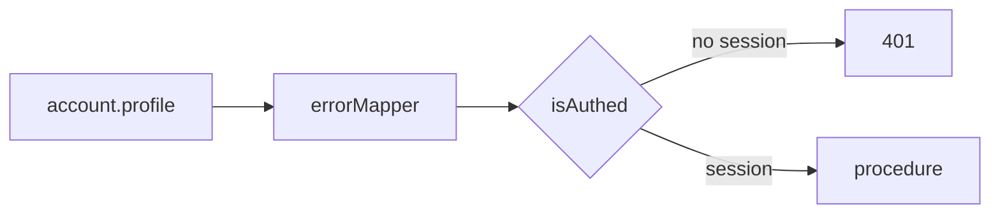

### 4. Where in our code

`api/trpc/init.ts` → `errorMapper`, `isAuthed`, `publicProcedure`, `protectedProcedure`,
`errorFormatter`. Cards: [trpc-middleware](concepts/trpc-middleware.md),
[protected-procedure](concepts/protected-procedure.md), [authn-vs-authz](concepts/authn-vs-authz.md),
[error-handling](concepts/error-handling.md).

### 5. See it yourself

`curl -s localhost:4000/trpc/account.profile` → 401 "You must be logged in"; `pnpm test init.test`.

### 6. How it connects

Uses `ctx.session` (chapter 5); maps service errors (chapters 8, 11).

### 7. Our settings and WHY

Two small middlewares; `errorMapper` outermost so it sees every error.

### 8. Trade-offs

Policy in one place; order matters.

### 9. Alternatives and when to choose them

Protected-by-default exports; per-procedure rate limit or role middlewares later.

### 10. What breaks, and how we'd notice

A private procedure on `publicProcedure` would leak; TypeScript complains because `ctx.session`
could be null.

### 13. Interview answers at 3 levels

Simple: shared checks around every api function. Senior: `errorMapper` maps `AppError`s;
`isAuthed` throws 401 and narrows the type. Lead: middleware is where policy lives.

### 14. Follow-up questions interviewers ask

*Is the Next.js proxy enough?* No, this is the real check.

### 15. Say it in 30 seconds

"errorMapper wraps every procedure; protectedProcedure adds isAuthed, the real login check, which
throws 401 and narrows ctx.session."

### 16. Status

✅ built.

---

## 7. The procedure

### 1. In one line

The procedure validates input, calls one service, does HTTP-only jobs (cookies) and filters the
output.

### 2. Real-life comparison

A waiter: checks the order, passes it to the kitchen, brings back only what's on the plate.

### 3. Picture it

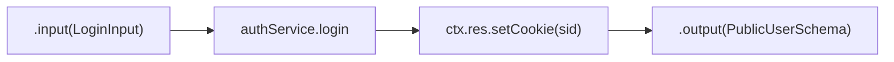

### 4. Where in our code

`api/procedures/auth.ts` → `signup`, `login`, `logout`, `me`, `cookieOptions`;
`api/procedures/account.ts` → `profile`. Cards: [layered-api](concepts/layered-api.md),
[validation-at-boundaries](concepts/validation-at-boundaries.md),
[session-cookie](concepts/session-cookie.md), [idempotency](concepts/idempotency.md).

### 5. See it yourself

The login `Set-Cookie` recorded locally: `sid=…; Max-Age=604800; Path=/; HttpOnly; SameSite=Lax`.

### 6. How it connects

Called after middleware (chapter 6); calls services (chapter 8).

### 7. Our settings and WHY

No logic in procedures; cookies here because they are HTTP; `.output()` on every procedure.

### 8. Trade-offs

Thin and readable; three files per feature.

### 9. Alternatives and when to choose them

Feature-sliced files; fat procedures only in prototypes.

### 10. What breaks, and how we'd notice

A missing `.output()` could leak a field; the services also pick fields by hand.

### 13. Interview answers at 3 levels

Simple: checks and forwards. Senior: Zod in, service call, cookie, Zod out. Lead: keep transport
concerns at the edge so services stay reusable.

### 14. Follow-up questions interviewers ask

*Why is the cookie set here?* It's an HTTP concern.

### 15. Say it in 30 seconds

"Procedures parse input with shared Zod schemas, call one service, set cookies, and filter the
output, so nothing extra ever leaves."

### 16. Status

✅ built.

---

## 8. The service

### 1. In one line

Services hold the business rules: hash and verify passwords, prevent user enumeration, create and
delete sessions, and throw business errors; no HTTP, no SQL.

### 2. Real-life comparison

The chef: decides how the dish is made; never takes orders and never goes into the storeroom.

### 3. Picture it

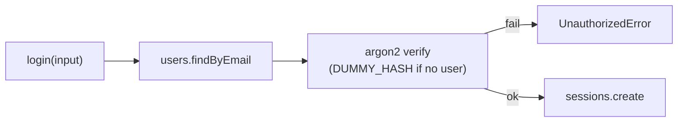

### 4. Where in our code

`api/services/auth.ts` → `signup`, `login`, `getCurrentUser`, `logout`, `DUMMY_HASH`;
`api/services/account.ts` → `getProfile`; `api/errors.ts`. Cards:
[password-hashing](concepts/password-hashing.md), [user-enumeration](concepts/user-enumeration.md),
[unique-constraint-race](concepts/unique-constraint-race.md), [sessions-vs-jwt](concepts/sessions-vs-jwt.md),
[ttl](concepts/ttl.md).

### 5. See it yourself

Wrong password vs unknown email, 20 logins each on the owner's laptop: 0.0099 s vs 0.0090 s average,
both 401.

### 6. How it connects

Called by procedures (chapter 7); calls queries (chapter 9); its errors become HTTP codes
(chapter 11).

### 7. Our settings and WHY

argon2id with OWASP-minimum defaults; insert-then-catch for unique emails; one login error message.

### 8. Trade-offs

Testable plain functions; signup still reveals taken emails (409).

### 9. Alternatives and when to choose them

Hexagonal ports if stores get swapped; email-verified signup to close enumeration.

### 10. What breaks, and how we'd notice

Skipping the dummy verify would leak timing; review and the code comment guard it.

### 13. Interview answers at 3 levels

Simple: where the rules live. Senior: argon2id, equal-timing login, unique-constraint signup,
sessions in Redis, `AppError`s. Lead: business rules free of transport and storage.

### 14. Follow-up questions interviewers ask

*How do services report errors?* Throw `AppError` subclasses.

### 15. Say it in 30 seconds

"Services hold the rules, like argon2id hashing, equal-timing login and session creation, and throw
small business errors. They never see HTTP or SQL."

### 16. Status

✅ built.

---

## 9. The query

### 1. In one line

Queries are the only code that touches Postgres or Redis: parameterised SQL through Drizzle, Redis
commands with TTLs, and translation of driver errors.

### 2. Real-life comparison

The storeroom keeper, the only person with the key.

### 3. Picture it

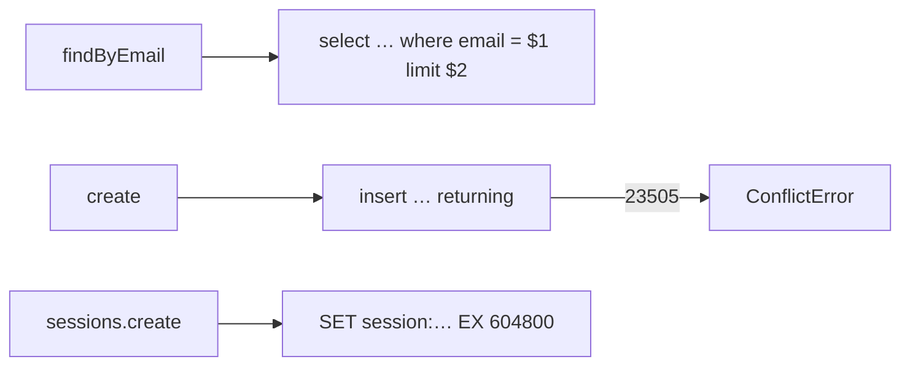

### 4. Where in our code

`api/queries/users.ts` → `findByEmail`, `findById`, `create`, `isUniqueViolation`;
`api/queries/sessions.ts` → `keyFor`, `create`, `get`, `remove`; `api/queries/health.ts`. Cards:
[sql-injection](concepts/sql-injection.md), [drizzle-schema](concepts/drizzle-schema.md),
[sql-vs-nosql](concepts/sql-vs-nosql.md), [stateless-servers](concepts/stateless-servers.md).

### 5. See it yourself

Drizzle's SQL for a hostile email, printed on the owner's laptop:
`where "users"."email" = $1` with the string in `params`.

### 6. How it connects

Called by services (chapter 8); uses the pool and Redis client (chapter 10).

### 7. Our settings and WHY

One layer per data store; driver codes never leave it.

### 8. Trade-offs

Swappable stores, injection-proof; only e2e tests cover these today.

### 9. Alternatives and when to choose them

Repository interfaces; raw `pg` with `$1` parameters.

### 10. What breaks, and how we'd notice

A `sql.raw` with user input; review.

### 13. Interview answers at 3 levels

Simple: the only code allowed in the database. Senior: parameterised Drizzle queries, hashed Redis
keys with TTL, unique violation → `ConflictError`. Lead: one data-access layer makes safety
structural.

### 14. Follow-up questions interviewers ask

*Why translate errors here?* So services don't depend on Postgres codes.

### 15. Say it in 30 seconds

"Queries are the only code that talks to Postgres or Redis: parameterised SQL, hashed session keys
with a TTL, and driver errors turned into our own errors."

### 16. Status

✅ built.

---

## 9b. A booking reaches its transaction

### 1. In one line

Token buckets permit a burst then refill at a steady rate. Login limits a trustworthy client IP; booking limits an authenticated user. Redis Lua makes refill and debit atomic across instances. Return 429 and Retry-After. A spoofable forwarded header must not choose someone else’s bucket.

### 2. Real-life comparison

Follow one receipt from the visitor through the desk responsible for this decision; each desk has one clear job.

### 3. Picture it

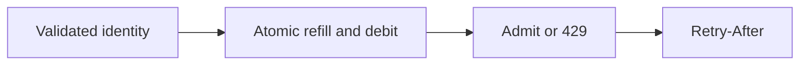

### 4. Where in our code

A token bucket admits a bounded burst and refills over time. Atomic Redis Lua shares policy across API instances; trusted client IP limits login and authenticated user identity limits booking; rejection is 429 with Retry-After. See [rate-limiting](concepts/rate-limiting.md).

An advisory inventory gate rejects doomed traffic before row locks. Intent-owned debits settle/refund around Postgres and versioned reconciliation avoids overwriting concurrent work; Redis never confirms a booking. See [inventory-gate](concepts/inventory-gate.md).

Explain-only: SSE with reconnect snapshots and versioned Redis fan-out would refresh hints across API tasks; no stream endpoint/pub-sub channel is implemented. See [live-seats](concepts/live-seats.md).

Explain-only: bounded Application Auto Scaling targets would adjust ECS desiredCount on CPU or ALB demand; current services have no autoscaling policy and a hot row still serializes buyers. See [autoscaling](concepts/autoscaling.md).

Explain-only: CI could audit a seeded production build with calibrated metric/asset budgets. P10 field-vital logs and axe checks are built, but no Lighthouse package/job is installed. See [lighthouse-ci](concepts/lighthouse-ci.md).

Booking idempotency stores one successful user/UUID intent in the same transaction as seats and outbox. Same payload replays; changed payload conflicts. Signup has no stored-response contract; worker dedup uses business booking identity. See [idempotency](concepts/idempotency.md).

The pg pool caps simultaneous sessions at 10 per API instance, acquisition/connect at 2 s and statements at 5 s. Each row-lock waiter holds a connection; scaling tasks multiplies pools. See [connection-pooling](concepts/connection-pooling.md).

Fail-fast bounds resource wait rather than hanging. Postgres now has explicit pool/statement deadlines, Redis operations are bounded, and queue SDK requests enforce connect/hard timeouts; commit outcomes can still be ambiguous. See [fail-fast](concepts/fail-fast.md).

Shutdown closes Fastify and background relay, waits for bounded in-flight work and closes Redis/Postgres. A stuck downstream is bounded by its timeout; real ALB drain timing still needs deployment acceptance. See [graceful-shutdown](concepts/graceful-shutdown.md).

Current HTML/RSC is private,no-store, including public catalogue HTML because it has fresh nonces. Optional CloudFront events minimum/default TTL is zero; static hashed assets retain caching. CDN is inactive in committed dev shape. See [cdn-caching](concepts/cdn-caching.md).

CloudFront is implemented but inactive (cdnEnabled=false); browser traffic currently reaches HTTPS ALB. Optional mode has prefix-list/header origin protection and zero minimum/default HTML TTL; never assume it is deployed. See [cloudfront](concepts/cloudfront.md).

Fastify trusts only the configured proxy boundary: 0 direct, 1 ALB-only, 2 CDN+ALB, with loopback peers never trusted. Wrong hops let clients forge IP/protocol, corrupting rate limits and security assumptions. See [trust-proxy](concepts/trust-proxy.md).

### 5. See it yourself

`apps/api/src/queries/rate-limits.ts` stores buckets; `services/rate-limits.ts` chooses policy. `config/trust-proxy.ts` only trusts configured hops/CIDRs. `pnpm demo:sale` verifies shared quotas, spoof resistance and the inventory gate. Redis failure is an explicit failure policy, not a durable quota guarantee.

`apps/api/src/services/booking-inventory.ts` debits an intent-owned reservation and falls back to Postgres on Redis failure. `services/inventory-reconciliation.ts` compares versions before correction so it does not overwrite in-flight work. `pnpm demo:sale` compares gated/ungated short loads and verifies replay at zero stock.

WHERE IN MINITICKETS: proposed API procedure/service stream in apps/api/src/services/live-seats.ts, Redis adapter in queries/live-seats.ts and browser hook features/events/hooks/use-live-seats.ts. Publish only after commit, include event id and version, snapshot on connect/reconnect, heartbeats and bounded buffers. Backoff with jitter; close idle slow clients. No SSE/WebSocket endpoint or pub/sub deployment exists. Walk the Live seats explain-only explorer tour.


Existing integration point: `apps/api/src/services/bookings.ts`.

WHERE IN MINITICKETS: proposed Pulumi module infra/src/compute/autoscaling.ts after ECS service creation, using Application Auto Scaling target/policy for desiredCount. Start with explicit min 1/max 3 for a controlled exercise, account for API and web separately and set cooldowns/alarms. No scaling resource/IAM policy is built. Inspect existing service desiredCount; load test only under an owner budget.


Existing integration point: `infra/src/compute/service.ts`.

WHERE IN MINITICKETS: proposed Lighthouse CI config at repo root and a job after web build in .github/workflows/ci.yml, serving isolated API/web ports with seeded public events. Set budgets for LCP/CLS, JS bytes and accessibility; collect several runs and retain reports. No Lighthouse dependency, config or CI job is installed. P10 field telemetry is built separately.


Existing integration point: `.github/workflows/ci.yml`.

`apps/api/src/db/schema/bookings.ts` enforces unique user/idempotency key. `apps/api/src/services/bookings.ts` compares event and quantity on replay; `queries/bookings.ts` handles races across different event rows. `pnpm demo:idempotency` exercises lost responses and concurrent duplicates.

`apps/api/src/db/client.ts` sets 2 s connect/acquisition and 5 s statements. `apps/api/src/queues/jobs.ts` bounds SDK connection/request time; Redis adapters bound operations. Run `pnpm demo:outbox` for a silent queue timeout. A breaker is explain-only: proposed state in services/outbox.ts around delivery, with half-open probes and durable rows left pending.

`apps/api/src/queries/bookings.ts` → `listByUser` joins bookings/events once. `apps/api/src/trpc/init.ts` handles auth/error translation. `apps/api/src/server.ts` closes relay/Fastify/Redis/Postgres. Run `pnpm test` for API/service and relay lifecycle coverage; live ALB drain timing remains acceptance.

`apps/web/src/proxy.ts` and `apps/web/next.config.ts` guard HTML caching. `apps/web/src/features/events/server/cached-events.ts` only stores public catalogue data. `infra/src/entry/cdn.ts` has zero minimum/default TTL on the events policy. CloudFront is inactive: `cdnEnabled=false`. Run `pnpm demo:security`.

### 6. How it connects

One instance’s memory cannot enforce a shared quota.

Fewer doomed buyers enter the hot-row queue.

A catalogue benefits from fresher hints without weakening booking correctness.

Elastic compute reduces overprovisioning for variable independent load.

A lab gate catches a large regression before release.

A network failure cannot tell a caller whether commit happened.

Unbounded waits keep scarce connections and shutdowns occupied.

Layer boundaries make code understandable; bounded work makes deployment safer.

A cross-user cache leak exposes private data, and cached nonce HTML breaks CSP assumptions.

### 7. Our settings and WHY

Token buckets permit a burst then refill at a steady rate. Login limits a trustworthy client IP; booking limits an authenticated user. Redis Lua makes refill and debit atomic across instances. Return 429 and Retry-After. A spoofable forwarded header must not choose someone else’s bucket.

One event row serializes buyers even with many API tasks. Rate limits bound callers; an advisory Redis inventory gate rejects obvious sold-out work before the database. All admitted buyers still run the same Postgres transaction. Redis failure, expiry or wrong counts must never create a confirmed seat by itself.

Use polling for simplicity, SSE for one-way seat notifications and WebSockets for bidirectional interaction. Seat messages are hints, not a purchase guarantee. Every booking still reaches Postgres. Across API instances, publish committed changes through Redis pub/sub or an outbox-driven channel; Redis pub/sub loses messages while a subscriber is disconnected.

Target tracking can add tasks on CPU or ALB requests per target, with min/max bounds and scale-in/out cooldowns. It helps independent request work; it cannot parallelize a single locked event row. More API tasks also create more database pools. Pick bounds from latency, DB connection budget and cost.

Run repeatable audits against a production build with fixed data and explicit budgets. Track trends and regressions, not a perfect score. Lab metrics help diagnose reproducible work; field vitals reveal real user distributions. Axe remains a separate P10 gate already built.

A retry repeats one intent rather than making another purchase. The browser creates one UUID per intent and keeps it for ambiguous retries. A unique user/key constraint stores identity with the booking transaction. Same input replays the booking; different input with the same key conflicts. Failed transactions store no success.

An acquisition timeout bounds waiting for a connection; a statement timeout bounds SQL execution including lock wait. Network timeouts bound downstream calls. None proves an operation did not commit. A circuit breaker can stop repeated calls to an unhealthy dependency, but critical durable work still needs an eventual retry path.

Keep input validation in procedures, business rules in services and storage in queries. Fetch related records in one intentional query rather than looping through requests. On shutdown stop accepting new work, finish bounded in-flight work, stop the relay and close clients. Health checks must distinguish liveness from dependency readiness.

Cache public data, never a shared personalized page. P10 generates a nonce for every HTML/RSC request and explicitly sends private,no-store for those responses. Keep user-bound queries out of shared server caches. A CDN must honor no-store; a positive CloudFront minimum TTL can override origin privacy directives.

### 8. Trade-offs

Fixed windows permit boundary bursts; sliding windows cost more state. IP limits affect NAT users. Redis allkeys-lru can evict quotas; strict financial quotas need durable accounting.

Unknown DB commit/refund and worker crashes can skew the hint; reconciliation repairs admission, not correctness. This is not a customer-visible timed seat hold.

SSE supports one-way HTTP streaming; proxy buffering/timeouts need checks. WebSockets add connection protocol/state. Polling costs repeated reads but survives missed notifications.

Scale-out is delayed by metrics, image start and health checks. Min tasks cost while idle; max tasks bound but do not fully cap AWS spend. Never blindly scale past RDS pool capacity.

Shared CI runners are noisy; hard score thresholds can be flaky. Use calibrated metric/asset budgets and compare medians with a baseline.

Redis TTL keys add a cross-store gap and can expire/evict. A generic response store can replay exact response bodies but adds retention rules. This app reconstructs successful responses and keeps keys with bookings.

Timeouts need an overall deadline, not independent budgets longer than the request. Circuit breakers can reject useful probes or hide recovery if poorly tuned.

Joining everything can overfetch; pagination and projection still matter. GraphQL/tRPC do not automatically prevent N+1. Liveness that depends on every store can cause restart storms.

Per-user edge keys are difficult to audit and multiply cache entries. No-store simplifies privacy at server cost. Static JS/images can still be cached.

### 9. Alternatives

10x: key cardinality/TTL and fairness. 100x: gateway protections, per-tenant budgets and hot-key partitioning.

10x: compare p95/p99 and lock waits. 100x: durable queue admission or partitioned seat rows, keeping DB constraints.

10x: cap connections and reconnect storms. 100x: partition events, fan-out gateways, snapshot/version catch-up and regional ownership.

10x: load-test cooldowns and connection totals. 100x: scheduled on-sale capacity plus downstream quotas and event sharding.

10x: representative routes/devices. 100x: controlled runners, trend storage and field/lab correlation.

10x: index/storage retention policy. 100x: explicit idempotency contract for payment providers and async intents.

10x: pool occupancy/queue metrics. 100x: per-dependency bulkheads, adaptive limits and end-to-end deadlines.

10x: paginate My tickets/bookings and inspect plans. 100x: per-dependency deadlines, connection budgets and task drain experiments.

10x: inspect headers on HTML and RSC. 100x: centralize cache policy tests and keep any public HTML strategy separate.

### 10. Failure modes

Should auth failures all share one user key? No; unauthenticated identity needs a trusted edge/IP policy.

Can reconciliation blindly SET database stock? No; compare-and-set against an observed version to avoid clobbering in-flight debits.

How recover a missed pub/sub message? Reload an authoritative snapshot; do not infer availability from a gap.

Why not just set max 100? Cost, DB connection limits and downstream saturation.

Can a good lab score prove p75 field INP? No; real interactions and device populations differ.

Why scope by user? Two users may coincidentally submit the same client key without sharing a booking.

Does a timeout prove rollback? No; retry with idempotency and reconcile ambiguous results.

Can the web import the API database module? No; only its router type crosses that boundary.

Does Vary: Cookie make every policy safe? No; the CDN cache key and minimum TTL must also agree.

### 13. Interview answers

Simple: One instance’s memory cannot enforce a shared quota. Senior: Token buckets permit a burst then refill at a steady rate. Login limits a trustworthy client IP; booking limits an authenticated user. Redis Lua makes refill and debit atomic across instances. Return 429 and Retry-After. A spoofable forwarded header must not choose someone else’s bucket. Lead: 10x: key cardinality/TTL and fairness. 100x: gateway protections, per-tenant budgets and hot-key partitioning.

### 14. Follow-up

Should auth failures all share one user key? No; unauthenticated identity needs a trusted edge/IP policy.

### 15. Say it in 30 seconds

Token buckets permit a burst then refill at a steady rate. Login limits a trustworthy client IP; booking limits an authenticated user. Redis Lua makes refill and debit atomic across instances. Return 429 and Retry-After. A spoofable forwarded header must not choose someone else’s bucket.

### 16. Status

Built and explain-only pieces are labelled in the linked cards. Local evidence does not replace AWS acceptance.

## 9c. Side path: outbox, fan-out and recoverable work

### 1. In one line

A topic fans one event out to multiple subscriptions. A queue buffers work for competing consumers. MiniTickets publishes to SNS, then separate email/ticket SQS queues; each can retry independently. EventBridge adds richer routing/integrations; Kafka adds retained partitioned replay. Choose those only when the product needs those semantics.

### 2. Real-life comparison

Follow one receipt from the visitor through the desk responsible for this decision; each desk has one clear job.

### 3. Picture it

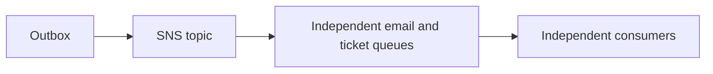

### 4. Where in our code

SNS fans a booking event into independent email and ticket queues. Raw delivery keeps one versioned payload, and queue policies constrain the topic and account; duplicates and reordering remain possible. See [sns](concepts/sns.md).

HMAC-SHA256 authenticates QR bytes using a 32-byte secret. Strict bounds/encoding and constant-time comparison reject forgery. Claims are readable; one-time door admission and key-ring rotation remain explain-only. See [ticket-signing](concepts/ticket-signing.md).

Explain-only: a daily Scheduler would invoke a paginated date-index worker and enqueue stable reminder identities; there is no schedule, Lambda or reminder IAM grant. See [reminders](concepts/reminders.md).

General mutations do not auto-retry. Booking explicitly retries network/5xx at most twice with the same intent; worker and outbox policies differ, and jitter remains explain-only. See [retry-policy](concepts/retry-policy.md).

The transactional outbox saves seats, booking and confirmation atomically. Competing locked batches publish SNS at least once; a crash before marking sent can duplicate delivery. Stable business identities make consumers safe. See [outbox](concepts/outbox.md).

SQS buffers independently retryable work. Email and tickets have separate standard queues/DLQs, SSE-SQS and partial-batch mappings. Email visibility is 60 s, tickets 180 s; both redrive after 3 receives. See [sqs](concepts/sqs.md).

A DLQ retains failed work for diagnosis, not automatic success. Source retention is 4 days and DLQ 14 days; only the named source may redrive to it. Fix the cause before owner-controlled redrive. See [dead-letter-queue](concepts/dead-letter-queue.md).

Lambda processes bounded queue batches from one arm64 worker image. Email is 256 MB/10 s, tickets 512 MB/30 s, outside the VPC; image cold starts and AWS quotas remain live acceptance. See [aws-lambda](concepts/aws-lambda.md).

DynamoDB holds processed-job dedup and canonical owner tickets. Jobs use jobKey with 30-day TTL; tickets use userId/ticketId and by-event-date GSI with no TTL. Conditional reservation and ready transitions converge after retries. See [dynamodb](concepts/dynamodb.md).

SES sends confirmation mail using a verified identity and FromAddress IAM constraint. Acceptance is not inbox delivery; sandbox/quotas are account state to recheck. DKIM is defined, feedback processing/custom MAIL FROM/DMARC are not built. See [ses-email](concepts/ses-email.md).

### 5. See it yourself

`infra/src/jobs/booking-events.ts` configures raw SNS deliveries and queue source restrictions. `apps/api/src/queues/jobs.ts` publishes one stable message. Run `pnpm demo:tickets` and `pnpm demo:outbox` separately; P4 local emulators exercise the same SDK boundaries. AWS fan-out acceptance is still manual.

`apps/worker/src/tickets/token.ts` signs/verifies bounded strict claims; `infra/src/tickets/iam.ts` grants only ticket worker secret access; `services/tickets.ts` owner-scopes reads. Run `pnpm demo:tickets` and `pnpm demo:p4-assets` separately. Proposed rotation adds key id plus verification key ring, staged rollout and old-key retirement; this key-ring is not built.

WHERE IN MINITICKETS: proposed infra/src/jobs/reminders.ts after ticket table, proposed worker reminder handler with paginated date-index queries, and existing SNS/SQS mail boundary extended with a versioned reminder schema. Trust scheduler.amazonaws.com for invoke-only execution role; Lambda role queries only the date index and publishes only the mail destination. No Scheduler, reminder Lambda, IAM grants or reminder UI is built. Do not run a nonexistent demo.


Existing integration point: `infra/src/tickets/storage.ts`.

`apps/web/src/features/bookings/lib/booking-retry.ts`, `apps/worker/src/backoff.ts` and `apps/api/src/services/outbox.ts` implement separate policies. Run `pnpm demo:outbox`. Outbox retries cap at 60 s without a maximum attempt count; worker failures use 10/40/120 s and a DLQ after 3 receives.

`apps/api/src/queries/bookings.ts` inserts the outbox row. `queries/outbox.ts` uses FOR UPDATE SKIP LOCKED batches of 10; `services/outbox.ts` retries persisted rows. `pnpm demo:outbox` measured 24/24 recovered after queue restoration and atomic rollback on injected outbox failure.

`apps/worker/src/batch.ts` returns batchItemFailures; `backoff.ts` sets delay; `infra/src/jobs/queue-trigger.ts` sets worker mapping. `pnpm jobs:dlq` lists local failures; redrive is an explicit owner operation after a fix. Runbook §3.12 has AWS diagnostics; no live alarm drill has been claimed.

`infra/src/compute/service.ts` runs Fargate; `infra/src/jobs/worker-lambda.ts` has no vpcConfig and 10 s timeout; ticket Lambda has its own larger budget. Lambdas use container images already published by CI. `pnpm demo:tickets` validates handlers locally, not AWS cold starts. EKS/NAT gateways are not built.

`infra/src/tickets/storage.ts` defines the ticket table/index; `apps/worker/src/tickets/store.ts` reserves/marks ready; `apps/api/src/queries/tickets.ts` only reads the authenticated owner. `pnpm demo:tickets` tests duplicate/resume behavior. The API role is not granted arbitrary Scan.

`infra/src/jobs/email.ts` configures the SES identity; `apps/worker/src/ses-mailer.ts` sends with a stable configured sender. `docs/20-deploy-day.md` §3.10 covers owner acceptance. Proposed feedback events would fan into a separate queue/service updating suppression preferences. No live inbox delivery claim.

### 6. How it connects

Two consumers must each receive the event; competing on one queue would divide work.

A client must never receive the signing secret or invent a valid ticket.

Scheduled work belongs outside user requests and must survive retries.

Immediate retries turn a partial failure into more load.

Commit-then-send has a gap; send-then-commit can announce a rolled-back purchase.

Durable failure evidence is better than silently dropping work.

Match runtime lifecycle and network needs to workload.

A table key should serve actual reads rather than mimic a relational schema blindly.

Offloading mail protects booking latency but delivery is still an external outcome.

### 7. Our settings and WHY

A topic fans one event out to multiple subscriptions. A queue buffers work for competing consumers. MiniTickets publishes to SNS, then separate email/ticket SQS queues; each can retry independently. EventBridge adds richer routing/integrations; Kafka adds retained partitioned replay. Choose those only when the product needs those semantics.

Store signing/database credentials in Secrets Manager, expose them only to the runtime that needs them and never log them. HMAC authenticates the original ticket bytes and constant-time comparison rejects tampering; it does not encrypt the payload or prevent reuse. Authorization still checks owner/role and uploads remain untrusted.

Use one daily EventBridge schedule to invoke a reminder Lambda, query a bounded date range and enqueue reminder messages. Use explicit reminder identity such as ticketId plus reminder date/type to prevent duplicate sends. Time zone and missed-run semantics are product decisions. A daily schedule does not guarantee exactly one invocation.

Retry only failures likely to be temporary, bound attempts/time and retain operation identity. Exponential backoff reduces pressure; jitter prevents synchronized clients. MiniTickets retries ambiguous booking network failures with the same key, caps worker retries into a DLQ and keeps outbox retries durable. Jitter is a proposed improvement, not a claim about current fixed schedules.

Store the booking, seat decrement and confirmation payload in one Postgres transaction. A relay publishes committed outbox rows and marks them sent. A crash after publish but before marking sent produces a duplicate, so consumers stay idempotent. This closes message loss, not exactly-once delivery.

Find the booking/correlation id, follow structured logs, inspect queue age and failed attempts, then DLQ and alarm. Fix the root cause before redrive. Visibility timeout hides an in-flight message; it is not deletion. Partial-batch reporting retries only failed records. A poison message should not block all useful work.

ECS fits long-running API/web processes and predictable pools. Lambda fits bursty queue handlers with bounded work. EKS provides Kubernetes control at substantial operational cost. Our workers run outside the VPC because they only call managed public AWS APIs; putting a worker in a public subnet does not give it a public IP or automatic internet.

Design from queries: an owner lists their tickets and the worker conditionally reserves a canonical ticket. Base keys userId/ticketId support owner-scoped reads; a date index supports event-date access. Conditional writes prevent duplicate reservations. A GSI is eventually consistent and a popular date can become hot.

A successful SendEmail means SES accepted the request, not that the recipient read it. Verify identity/DKIM, respect sandbox/production access and sending rate, then handle bounce/complaint outcomes. MiniTickets has a dedicated mail worker and scoped SES permission. Custom MAIL FROM/SPF/DMARC workflows and bounce processing are explain-only.

### 8. Trade-offs

SNS/SQS are operationally small but standard delivery is unordered/duplicated. A bus is routing, not a replacement for all consumer backpressure.

Rotating a single key immediately invalidates old QR tokens unless a key ring is supported. OWASP review also needs abuse, dependency, authorization, logging and incident practices beyond code checks.

GSI lag means use overlapping windows plus dedup; TTL is not an exact scheduler. Flexible windows spread load but affect delivery timing. Missed schedules need bounded catch-up and DLQ alarms.

Do not retry validation/authorization failures. Layered retries multiply attempts; choose one responsible layer. Proposed jitter belongs in retryInMs/backoff with bounded randomized tests.

Holding row locks while sending is simple but occupies a pool connection. Leases/CDC decouple IO at greater complexity. Sent rows need retention planning.

Too-short visibility can overlap work; too-large visibility delays recovery. Reserved Lambda concurrency and mapping maximumConcurrency must agree or throttling can consume receives.

VPC Lambda for RDS requires routing/endpoints or NAT for outside services. NAT has fixed and data charges; endpoints also cost. Container image cold start differs from zip, so measure.

A GSI adds write/storage cost and lag. TTL deletion is asynchronous; never use it as exact authorization expiry. On-demand billing still has hot-partition limits.

SES quotas can bottleneck a fast Lambda. Retrying permanent bad addresses wastes work. Mark-after-send leaves a duplicate window.

### 9. Alternatives

10x: per-consumer backlog/concurrency. 100x: partition ordering domains and retention/replay requirements.

10x: expiry/rotation drills and audit access. 100x: per-environment/key versioning, compromise playbooks and threat modeling.

10x: page sizes and sending rate. 100x: shard date partitions, incremental checkpoints and user-local time-zone batches.

10x: retry budgets and attempt metrics. 100x: per-destination admission and circuit breakers with durable backlog.

10x: batch sends/backlog age. 100x: separate relay or CDC, retention and publish throughput budgets.

10x: oldest-message age and redrive rate limits. 100x: separate poison-message classes, sampling and SLO-driven alarms.

10x: concurrency/quota and SES limits. 100x: provisioned concurrency only for measured latency needs, reserved concurrency for protection.

10x: paginate owner queries. 100x: shard hot date indexes/bounded time windows and model reconciliation reads.

10x: production quota/rate and suppression. 100x: reputation monitoring, templates/localization and provider outcome ingestion.

### 10. Failure modes

Why not two Lambdas on one SQS queue? They compete; each message is not promised to both.

Are signed QR claims private? No; base64url is readable.

What if the schedule runs twice? Dedup by stable reminder identity, not invocation id.

What if the response is lost after send? A retry may duplicate delivery; the consumer must be idempotent.

What if SNS accepted before relay crash? Publish again with stable message identity; consumers deduplicate.

Does an empty queue mean email was delivered? No; inspect completion/provider outcomes too.

Is a Lambda in a public subnet publicly addressed? No.

Can a caller choose another ownerId? No; take it from the verified session.

Does more Lambda concurrency increase SES quota? No.

### 13. Interview answers

Simple: Two consumers must each receive the event; competing on one queue would divide work. Senior: A topic fans one event out to multiple subscriptions. A queue buffers work for competing consumers. MiniTickets publishes to SNS, then separate email/ticket SQS queues; each can retry independently. EventBridge adds richer routing/integrations; Kafka adds retained partitioned replay. Choose those only when the product needs those semantics. Lead: 10x: per-consumer backlog/concurrency. 100x: partition ordering domains and retention/replay requirements.

### 14. Follow-up

Why not two Lambdas on one SQS queue? They compete; each message is not promised to both.

### 15. Say it in 30 seconds

A topic fans one event out to multiple subscriptions. A queue buffers work for competing consumers. MiniTickets publishes to SNS, then separate email/ticket SQS queues; each can retry independently. EventBridge adds richer routing/integrations; Kafka adds retained partitioned replay. Choose those only when the product needs those semantics.

### 16. Status

Built and explain-only pieces are labelled in the linked cards. Local evidence does not replace AWS acceptance.

## 10. Postgres and Redis

### 1. In one line

Postgres stores users (durable, unique email); Redis stores sessions (fast, 7-day TTL); the api
reaches both through long-lived clients that fail fast and close cleanly.

### 2. Real-life comparison

A filing cabinet for records and a cloakroom for tickets.

### 3. Picture it

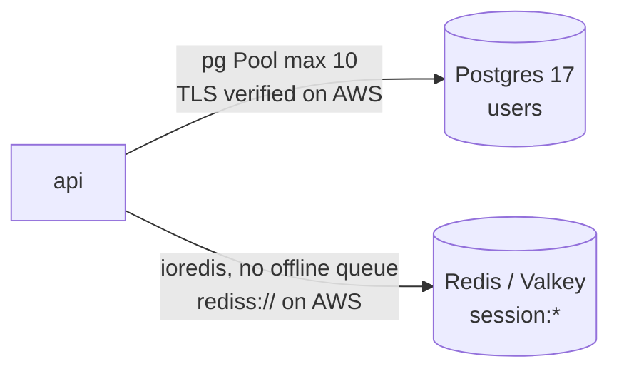

### 4. Where in our code

`api/db/client.ts` → `pool`, `db`; `api/db/schema/users.ts` → `users`; `api/redis/client.ts` →
`redis`; `api/db/migrate.ts`. Cards: [connection-pooling](concepts/connection-pooling.md),
[fail-fast](concepts/fail-fast.md), [migrations](concepts/migrations.md),
[indexing](concepts/indexing.md), [tls-in-transit](concepts/tls-in-transit.md).

### 5. See it yourself

`docker exec minitickets-postgres-1 psql -U minitickets -d minitickets -c '\di'` →
`users_email_unique`, `users_pkey`. With Redis unreachable (local test instance), login → 500 in
0.019 s and `/ready` → 503.

### 6. How it connects

Locally Docker Compose; on AWS RDS and ElastiCache Valkey ([infra story](infra-story.md#7-rds-postgres)).

### 7. Our settings and WHY

Pool of 10; Redis `maxRetriesPerRequest: 1` and no offline queue; `"error"` listeners so a broken
connection never crashes the process.

### 8. Trade-offs

Fast, honest failures for Redis; Postgres now bounds acquisition/connect at 2 s and statements at 5 s.

### 9. Alternatives and when to choose them

RDS Proxy with many tasks; timeouts everywhere.

### 10. What breaks, and how we'd notice

Pool/statement timeouts now bound waits (2 s/5 s), and P2 defines symptom alarms; inspect actual live alarm state before claiming acceptance.

### 13. Interview answers at 3 levels

Simple: one database for users, one fast store for logins. Senior: pooled pg with verified TLS on
AWS, ioredis set to fail fast. Lead: every network call needs a deadline; add pg timeouts and RDS
Proxy as tasks grow.

### 14. Follow-up questions interviewers ask

*Why two stores?* Different durability and access patterns.

### 15. Say it in 30 seconds

"Users in Postgres through a pool of ten connections, sessions in Redis with a seven-day TTL; Redis
fails fast, both clients survive connection errors, and Postgres timeouts are the known gap."

### 16. Status

✅ built (fail-fast for Postgres is 🟡).

---

## 10b. Reading events

Current catalogue SSR uses events.search and hydrates an infinite-query key. The legacy cached events.list path remains an intentional comparison, not the current search path.

### 1. In one line

An old request may finish last. Give each search input its own query key so it can only fill its own cache entry. Cancellation saves work, but identity provides correctness even when a server ignores cancellation. Keep previous results visibly marked while the next input is loading.

### 2. Real-life comparison

Follow one receipt through the desks responsible for the request; each boundary checks only its own responsibility.

### 3. Picture it

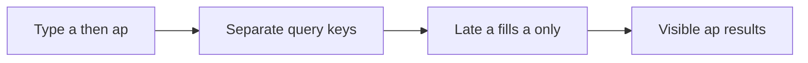

### 4. Where in our code

`apps/web/src/features/events/hooks/use-event-search.ts` → `useEventSearch` debounces 250 ms, uses tRPC infinite-query options keyed by all input, consumes cancellation and keeps previous data. The component labels typing/loading. Run `pnpm demo:search`; the related browser spec deliberately delays an older response.

`apps/api/src/queries/event-search.ts` escapes LIKE metacharacters and uses composite cursor boundaries. Migration `apps/api/drizzle/0008_lethal_amazoness.sql` adds search indexes. `pnpm demo:search` measures 10k rows, index plans and page boundaries including timestamp ties.

`apps/web/src/features/events/components/virtual-event-list.tsx` renders a bounded window. Search returns pages of 50. `pnpm demo:search` seeds an isolated 10k dataset, checks ordering/plans and runs related headless assertions. The virtual-list browser check bounds rendered rows.

`apps/api/src/services/events.ts` applies fresh/stale/error windows and tracks in-flight refreshes. `apps/web/src/features/events/server/cached-events.ts` and `hooks/use-events.ts` add separate caches. Run `pnpm test` for fake-clock SWR/error cases. P10 disables shared HTML caching while retaining explicit public data caching.

Cards: [cache-aside](concepts/cache-aside.md), [cache-key-versioning](concepts/cache-key-versioning.md), [config-validation](concepts/config-validation.md), [csr-vs-ssr](concepts/csr-vs-ssr.md), [db-check-constraints](concepts/db-check-constraints.md), [drizzle-schema](concepts/drizzle-schema.md), [explain-analyze](concepts/explain-analyze.md), [fail-fast](concepts/fail-fast.md), [feature-folders](concepts/feature-folders.md), [graceful-degradation](concepts/graceful-degradation.md), [hydration](concepts/hydration.md), [indexing](concepts/indexing.md), [layered-api](concepts/layered-api.md), [seed-data](concepts/seed-data.md), [server-client-components](concepts/server-client-components.md), [server-to-server-calls](concepts/server-to-server-calls.md), [streaming-suspense](concepts/streaming-suspense.md), [tanstack-query](concepts/tanstack-query.md), [ttl](concepts/ttl.md), [ui-error-handling](concepts/ui-error-handling.md), [validation-at-boundaries](concepts/validation-at-boundaries.md).

### 5. See it yourself

`apps/web/src/features/events/hooks/use-event-search.ts` → `useEventSearch` debounces 250 ms, uses tRPC infinite-query options keyed by all input, consumes cancellation and keeps previous data. The component labels typing/loading. Run `pnpm demo:search`; the related browser spec deliberately delays an older response.

`apps/api/src/queries/event-search.ts` escapes LIKE metacharacters and uses composite cursor boundaries. Migration `apps/api/drizzle/0008_lethal_amazoness.sql` adds search indexes. `pnpm demo:search` measures 10k rows, index plans and page boundaries including timestamp ties.

`apps/web/src/features/events/components/virtual-event-list.tsx` renders a bounded window. Search returns pages of 50. `pnpm demo:search` seeds an isolated 10k dataset, checks ordering/plans and runs related headless assertions. The virtual-list browser check bounds rendered rows.

`apps/api/src/services/events.ts` applies fresh/stale/error windows and tracks in-flight refreshes. `apps/web/src/features/events/server/cached-events.ts` and `hooks/use-events.ts` add separate caches. Run `pnpm test` for fake-clock SWR/error cases. P10 disables shared HTML caching while retaining explicit public data caching.

### 6. How it connects

A shared results variable with no request identity allows stale completion to win.

Deep OFFSET discards earlier rows repeatedly.

Large DOM trees hurt layout, paint, memory and interaction.

Bounded stale public listings trade freshness for latency/availability.

### 7. Our settings and WHY

An old request may finish last. Give each search input its own query key so it can only fill its own cache entry. Cancellation saves work, but identity provides correctness even when a server ignores cancellation. Keep previous results visibly marked while the next input is loading.

Choose an index for the predicate and order. Trigram GIN helps contains search; B-tree on starts_at/id supports stable traversal. Keyset asks for rows after the last pair, avoiding a growing OFFSET scan. A stable cutoff prevents time drift but is not a database snapshot: inserts and edits can still change later pages.

Pagination bounds transfer and database work; virtualization bounds mounted DOM nodes. They solve different problems. Keep stable event ids, a fixed-height window and overscan. Fetch the next keyset page before the user reaches the end. The full dataset should never become 10,000 React rows.

SWR serves a bounded stale value while one background refresh runs; stale-if-error serves a previous good value during a bounded outage. Each cache layer has its own clock: Redis, Next public data and browser queries. Fresh at one layer does not force another layer to refetch. Seat purchase always checks the writer.

### 8. Trade-offs

A monotonically increasing request id also works for manual fetch. Abort alone does not prove the server stopped; debounce does not order responses.

GIN adds write/storage cost and short/unselective terms can favor a scan. Keyset cannot jump to arbitrary page 200; snapshot semantics need more design.

Fixed heights are simple but constrain content. Variable-height libraries add measurement. Virtual lists need accessible list position and keyboard testing; pagination is a valid alternative.

Never use stale data for authorization or seats. Long independent TTLs can compound staleness. A failing refresh must not reset old data to fresh.

### 9. Alternatives and scale

10x: measure input-to-result latency and cap retained pages. 100x: add relevance/search infrastructure only after query plans and traffic justify it.

10x: inspect real selectivity and buffers. 100x: retention/partitioning or full-text relevance when product needs it.

10x: bound retained pages as well as DOM. 100x: server-side ranking, narrower payloads and a search engine may matter more than another UI optimization.

10x: expose age/hit telemetry. 100x: consolidate overlapping caches and define end-to-end freshness budgets.

### 10. Failure modes

Could filters race too? Yes: venue/date/cursor must be in the input key. Should previous rows be bookable? Recheck authoritative availability on booking.

Why carry id with time? It breaks ties so rows sharing a timestamp are not skipped.

Does virtualization reduce SQL rows scanned? No; indexes and pagination do that.

Does a successful admin write refresh all open tabs? No; they refetch on their own query policy.

### 13. Interview answers at 3 levels

- Simple: A shared results variable with no request identity allows stale completion to win.
- Senior: An old request may finish last. Give each search input its own query key so it can only fill its own cache entry. Cancellation saves work, but identity provides correctness even when a server ignores cancellation. Keep previous results visibly marked while the next input is loading.
- Lead: 10x: measure input-to-result latency and cap retained pages. 100x: add relevance/search infrastructure only after query plans and traffic justify it.

### 14. Follow-up questions

Could filters race too? Yes: venue/date/cursor must be in the input key. Should previous rows be bookable? Recheck authoritative availability on booking.

### 15. Say it in 30 seconds

An old request may finish last. Give each search input its own query key so it can only fill its own cache entry. Cancellation saves work, but identity provides correctness even when a server ignores cancellation. Keep previous results visibly marked while the next input is loading.

### 16. Status

Implemented portions and proposed extensions are distinguished above. Local evidence does not imply AWS acceptance.

## 10c. Public list caches and freshness

### 1. In one line

Use single-flight inside one process and a short distributed rebuild lock across processes. Recheck the cache after taking the lock: another holder may have filled it while this request waited. Release only with the owner token. Bound waiting and fall back to Postgres so a broken cache does not hang the request.

### 2. Real-life comparison

Follow one receipt from the visitor through the desk responsible for this decision; each desk has one clear job.

### 3. Picture it

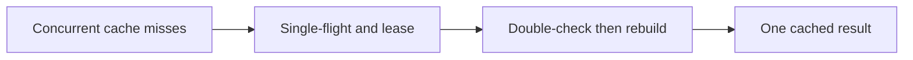

### 4. Where in our code

A stampede is many callers rebuilding the same missing result. One promise per process plus a Redis owner-token lease and double-check coalesce work; bounded wait can still fall back. See [cache-stampede](concepts/cache-stampede.md).

Invalidation makes old cached results unreachable after a write. Read the generation before SQL, commit before INCR, then notify the web cache; a slow refill remains in its old generation. See [cache-invalidation](concepts/cache-invalidation.md).

SWR serves a bounded old result while refreshing. Our list soft age is 30–33 s, hard age 300 s, and failed refreshes never renew old data; search bypasses this list cache. See [stale-while-revalidate](concepts/stale-while-revalidate.md).

Canonical keys give equivalent filter inputs one identity. Venue is exact case-insensitive after trim; dates are UTC days; v3 keys include generation plus a 16-hex SHA-256 input hash. See [cache-filter-keys](concepts/cache-filter-keys.md).

Postgres caches database pages in shared buffers and can benefit from OS page cache. SQL still executes on a hit; Redis result caching and browser caching are different layers. See [postgres-page-cache](concepts/postgres-page-cache.md).

Cache-aside checks Redis before Postgres for legacy events.list. It now has generation/filter keys, SWR, bounded stale-if-error and stampede protection. Current events.search intentionally bypasses it. See [cache-aside](concepts/cache-aside.md).

A version separates incompatible cached shapes. Current list keys are events:upcoming:v3:g<generation>:<hash>; generation handles writes, version handles schema, and canonical input handles filters. See [cache-key-versioning](concepts/cache-key-versioning.md).

TTL is an expiry boundary. Sessions/cookie use fixed 604800 s; list soft freshness is 30–33 s while Redis PX hard expiry is 300000 ms. Soft jitter does not extend the hard age cap; Dynamo dedup TTL is asynchronous cleanup after 30 days. See [ttl](concepts/ttl.md).

### 5. See it yourself

`apps/api/src/services/single-flight.ts` shares a promise with cleanup on both success/error. `queries/events-cache.ts` uses SET NX PX and Lua compare/delete. `pnpm demo:stampede` previously measured 100 concurrent requests as 1 DB query, including two instances after the double-check fix.

`apps/api/src/services/events.ts` → `invalidateUpcomingList` runs after event creation. `queries/events-cache.ts` builds generation/filter keys. `queries/web-cache.ts` calls signed Next revalidation. Run `pnpm demo:stampede`; inspect cache invalidation unit tests for late refill and failure.

`apps/api/src/services/events.ts` applies fresh/stale/error windows and tracks in-flight refreshes. `apps/web/src/features/events/server/cached-events.ts` and `hooks/use-events.ts` add separate caches. Run `pnpm test` for fake-clock SWR/error cases. P10 disables shared HTML caching while retaining explicit public data caching.

`apps/api/src/services/event-filters.ts` normalizes filters; `queries/events-cache.ts` hashes complete inputs. `queries/sessions.ts` requires session-index membership and never caches private pages. Run `pnpm test` for canonical filter/key and session eviction cases. Dedicated Redis isolation is explain-only.

`apps/api/src/queries/events.ts` still executes SQL on a Redis miss. `pnpm demo:search` reports EXPLAIN plans on its isolated data. Inspect EXPLAIN (ANALYZE, BUFFERS) in a controlled read-only session; warm and cold runs answer different questions. Production cache sizing has not been benchmarked.

### 6. How it connects

A fast cache can amplify database load when many entries expire together.

DEL alone allows an in-flight old reader to repopulate the same key.

Bounded stale public listings trade freshness for latency/availability.

Missing a venue/date/user dimension can return wrong or private data.

A warm database can be fast without a separate application cache.

### 7. Our settings and WHY

Use single-flight inside one process and a short distributed rebuild lock across processes. Recheck the cache after taking the lock: another holder may have filled it while this request waited. Release only with the owner token. Bound waiting and fall back to Postgres so a broken cache does not hang the request.

Commit the write, then increment a cache generation. A reader captures the generation before its database read and stores only under that generation. A slow pre-write reader can fill its old key, but new readers use the new generation. TTL bounds stale data if invalidation fails; errors are logged instead of undoing a committed event.

SWR serves a bounded stale value while one background refresh runs; stale-if-error serves a previous good value during a bounded outage. Each cache layer has its own clock: Redis, Next public data and browser queries. Fresh at one layer does not force another layer to refetch. Seat purchase always checks the writer.

A cache key must include every input that changes the result. Canonicalize dates/venue so equivalent filters share a key; keep authenticated data out of public keys. A very hot event or generation key still concentrates load. Redis eviction is acceptable for reconstructible public data, but sessions should fail closed and quotas are only advisory under eviction.

Postgres keeps table/index pages in shared buffers, and the operating system can cache file pages too. A cache hit avoids a storage read, but the query still executes: visibility checks, joins, filtering and sorting cost CPU. This is different from Redis storing the finished public events result. There is no general automatic result cache for arbitrary SELECTs.

### 8. Trade-offs

The 5 s lease and bounded wait permit duplicate rebuilds if slow or evicted. That is acceptable for public reads, never scarce-seat correctness.

Generation keys increase transient cardinality. Redis and Next/browser caches have separate stale windows; one invalidation does not instantly refresh every tab.

Never use stale data for authorization or seats. Long independent TTLs can compound staleness. A failing refresh must not reset old data to fresh.

Hashing bounds key size but does not fix omitted input. One cache used for sessions/results/quotas shares failure and eviction behavior.

Larger shared buffers are not unlimited free memory; sorts/work_mem multiply with operations and sessions. Evicting caches just to benchmark can disrupt other workloads.

### 9. Alternatives

10x: TTL jitter and refresh metrics. 100x: hot-key partitioning, stale serving and bounded rebuild queues.

10x: watch invalidation failures/key churn. 100x: outbox-driven invalidation and explicit freshness SLOs.

10x: expose age/hit telemetry. 100x: consolidate overlapping caches and define end-to-end freshness budgets.

10x: hot-key and eviction metrics. 100x: separate security-critical stores/policies and shard only measured bottlenecks.

10x: inspect hit/read counts and CPU. 100x: tune working set, queries and IO before assuming Redis solves all load.

### 10. Failure modes

Why random owner token? A late old holder must not delete a newer lease.

Why read generation before SQL? Reading after SQL could place old rows in the new generation.

Does a successful admin write refresh all open tabs? No; they refetch on their own query policy.

Is hashing a key encryption? No; do not put secrets into it assuming privacy.

Does a shared-buffer hit skip SQL execution? No.

### 13. Interview answers

Simple: A fast cache can amplify database load when many entries expire together. Senior: Use single-flight inside one process and a short distributed rebuild lock across processes. Recheck the cache after taking the lock: another holder may have filled it while this request waited. Release only with the owner token. Bound waiting and fall back to Postgres so a broken cache does not hang the request. Lead: 10x: TTL jitter and refresh metrics. 100x: hot-key partitioning, stale serving and bounded rebuild queues.

### 14. Follow-up

Why random owner token? A late old holder must not delete a newer lease.

### 15. Say it in 30 seconds

Use single-flight inside one process and a short distributed rebuild lock across processes. Recheck the cache after taking the lock: another holder may have filled it while this request waited. Release only with the owner token. Bound waiting and fall back to Postgres so a broken cache does not hang the request.

### 16. Status

Built and explain-only pieces are labelled in the linked cards. Local evidence does not replace AWS acceptance.

## 11. The error path back to the UI

### 1. In one line

A failure anywhere becomes a business error or a crash, is mapped to a status code with a safe
message and field errors, is logged on the server, and lands in the right place on screen.

### 2. Real-life comparison

A specialist's internal note, translated by the front desk into a short standard answer, while the
full details go into the incident log.

### 3. Picture it

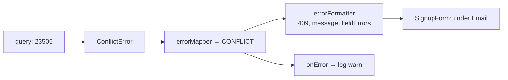

### 4. Where in our code

`api/queries/users.ts` → `create`; `api/errors.ts`; `api/trpc/init.ts` → `errorMapper`,
`errorFormatter`; `api/app.ts` → `onError`; `web/features/auth/components/signup-form.tsx` and
`login-form.tsx` → `onError`; `web/features/account/hooks/use-profile.ts` (401 redirect). Cards:
[error-handling](concepts/error-handling.md), [http-status-codes](concepts/http-status-codes.md),
[ui-error-handling](concepts/ui-error-handling.md), [retry-policy](concepts/retry-policy.md).

### 5. See it yourself

Recorded locally: duplicate signup →
`{"error":{"message":"Email already registered",…,"data":{"code":"CONFLICT","httpStatus":409,…}}}`;
Redis down → `"message":"Something went wrong"` while the log has `"procedure crashed"` with the
cause.

### 6. How it connects

Spans chapters 2 to 9 in reverse.

### 7. Our settings and WHY

Map by status, never by message; 500 always generic; 4xx logged at `warn`, 500 at `error`.

### 8. Trade-offs

Safe and consistent; each form repeats its small mapping.

### 9. Alternatives and when to choose them

A shared `mapApiError` helper; error boundaries; Problem Details for REST.

### 10. What breaks, and how we'd notice

A status change breaks where a message lands; e2e tests check `#email-error` and the login alert.

### 13. Interview answers at 3 levels

Simple: errors show up where you can fix them. Senior: `AppError` → `errorMapper` → formatter with
`httpStatus` and `fieldErrors` → forms map by status. Lead: the error shape is part of the API
contract.

### 14. Follow-up questions interviewers ask

*Do 4xx errors retry?* No (chapter 2).

### 15. Say it in 30 seconds

"Errors travel back as one shape: status, safe message and field errors. Forms put them under fields
or the form, a 401 on the profile redirects to login, and crashes say only 'Something went wrong'
while the full error is logged."

### 16. Status

✅ built.

---

## 12. Monorepo and shared types

### 1. In one line

One pnpm workspace holds web, api, shared schemas and infra; the web imports only the api's router
**type**.

### 2. Real-life comparison

One building, several companies, a shared mail room.

### 3. Picture it

```mermaid
flowchart LR
    web["apps/web"] --> shared["packages/shared<br/>Zod schemas"]
    api["apps/api"] --> shared
    web -.->|"import type AppRouter"| api
```

### 4. Where in our code

`pnpm-workspace.yaml`; `packages/shared/src/index.ts`; `api/trpc/router.ts` → `AppRouter`;
`apps/web/next.config.ts` → `transpilePackages`. Cards: [monorepo](concepts/monorepo.md),
[end-to-end-types](concepts/end-to-end-types.md), [rpc-vs-rest](concepts/rpc-vs-rest.md),
[monolith-vs-microservices](concepts/monolith-vs-microservices.md).

### 5. See it yourself

Rename `createdAt` in `ProfileSchema`: `pnpm typecheck` fails in the web.

### 6. How it connects

Types for chapters 2, 3, 7; one CI for all (chapter 16).

### 7. Our settings and WHY

Shared = schemas only, raw TypeScript; web depends on the api only as a devDependency, for types.

### 8. Trade-offs

Atomic, type-checked changes; CI checks everything on every push.

### 9. Alternatives and when to choose them

Turborepo/Nx caching; polyrepo with OpenAPI clients.

### 10. What breaks, and how we'd notice

A runtime import of api code in the web: server code in the bundle; review and `CLAUDE.md` rule.

### 13. Interview answers at 3 levels

Simple: one repo, shared pieces. Senior: pnpm workspaces, raw-TS shared schemas compiled by each
consumer, type-only router import. Lead: compile-time contracts don't cover deploy-time skew.

### 14. Follow-up questions interviewers ask

*How does the api bundle the shared package?* esbuild compiles it in (it's not `external`).

### 15. Say it in 30 seconds

"pnpm workspaces with a shared package of Zod schemas; the web imports only the api's router type,
so a breaking change fails CI before it ships."

### 16. Status

✅ built.

---

## 13. Validation at boundaries

### 1. In one line

Everything entering the system is parsed: request inputs, env vars, URL parameters; everything
leaving the api is filtered.

### 2. Real-life comparison

Customs at both ends of the border.

### 3. Picture it

```mermaid
flowchart LR
    env["process.env"] --> e["EnvSchema / DatabaseEnvSchema"]
    req["request body"] --> i[".input()"]
    url["?next="] --> n["getSafeNext"]
    res["service result"] --> o[".output()"]
```

### 4. Where in our code

`api/config/env.ts`, `api/config/database.ts`; `packages/shared/src/schemas/*.ts`;
`api/procedures/*.ts`; `web/features/auth/lib/safe-next.ts`. Cards:
[validation-at-boundaries](concepts/validation-at-boundaries.md),
[config-validation](concepts/config-validation.md), [accessible-forms](concepts/accessible-forms.md),
[open-redirect](concepts/open-redirect.md).

### 5. See it yourself

`WEB_ORIGIN=not-a-url` → "Invalid environment variables: { WEB_ORIGIN: [ 'Invalid URL' ] }", exit 1
(recorded).

### 6. How it connects

Protects chapters 4-9; feeds field errors to chapter 11.

### 7. Our settings and WHY

Parse, don't just check: normalised emails, coerced ports, verified TLS settings.

### 8. Trade-offs

A parse per request and response; strong guarantees.

### 9. Alternatives and when to choose them

JSON Schema in Fastify for plain routes; Valibot/ArkType.

### 10. What breaks, and how we'd notice

Bad config fails the deploy (exit 1); bad input is 400 with field errors.

### 13. Interview answers at 3 levels

Simple: check everything coming in and going out. Senior: shared Zod schemas, `.input`/`.output`,
env validated at start, URL params allow-listed. Lead: every trust boundary gets a parser.

### 14. Follow-up questions interviewers ask

*Client-side validation enough?* Never; it's UX only.

### 15. Say it in 30 seconds

"Inputs, env vars and URL params are parsed with Zod or allow-lists; outputs are filtered with
schemas, so a hash can't leak."

### 16. Status

✅ built.

---

## 14. The testing pyramid

### 1. In one line

Static checks and unit tests at the bottom, two in-process api tests, four Playwright journeys at the
top; real Postgres concurrency is exercised by isolated demos, alongside unit and browser tests.

### 2. Real-life comparison

Test the bricks, then the walls, then walk through the house; we skipped most of the walls.

### 3. Picture it

```mermaid
flowchart TB
    e2e["e2e: 4 Playwright specs"]
    mid["in-process: 2 files (thin)"]
    unit["unit + static checks"]
    e2e --- mid --- unit
```

### 4. Where in our code

`vitest.config.mts`; `*.test.ts` files; `apps/web/playwright.config.ts`; `apps/web/e2e/*.spec.ts`.
Cards: [testing-pyramid](concepts/testing-pyramid.md), [unit-tests](concepts/unit-tests.md),
[in-process-api-tests](concepts/in-process-api-tests.md), [e2e-tests](concepts/e2e-tests.md),
[static-checks](concepts/static-checks.md).

### 5. See it yourself

`pnpm test` (5 files, 19 tests when run for this handbook) and `pnpm test:e2e` with `pnpm dev`
running.

### 6. How it connects

Runs in CI (chapter 16); checks chapters 1-13.

### 7. Our settings and WHY

Units for risky logic, e2e for journeys, unique data per e2e run.

### 8. Trade-offs

Quick feedback plus full-stack confidence; data-layer bugs are found late.

### 9. Alternatives and when to choose them

Integration tests with real Postgres/Redis (the CI services already exist).

### 10. What breaks, and how we'd notice

A query bug appears only as an e2e failure.

### 13. Interview answers at 3 levels

Simple: many small tests, few big ones. Senior: Vitest units and in-process tests, Playwright with
real stores. Lead: next investment is integration tests for queries and services.

### 14. Follow-up questions interviewers ask

*What would you add first?* Tests for `queries/users.ts` and `queries/sessions.ts` against real stores.

### 15. Say it in 30 seconds

"Static checks, Vitest units, two in-process api tests and four Playwright journeys; the missing
middle is integration tests against real Postgres and Redis."

### 16. Status

🟡 partial.

---

## 15. Docker

### 1. In one line

Multi-stage Dockerfiles build small, non-root images with production dependencies only, and
exec-form `CMD` so shutdown signals reach node.

### 2. Real-life comparison

Cook in a full kitchen, ship only the lunch box.

### 3. Picture it

```mermaid
flowchart LR
    deps["deps: install"] --> build["build: esbuild / next build"]
    deps --> prod["prod deps (api)"]
    build --> rt["runtime: slim, USER node,<br/>CMD node …"]
    prod --> rt
```

### 4. Where in our code

`apps/api/Dockerfile`, `apps/web/Dockerfile`, `.dockerignore`, `docker-compose.yml`. Cards:
[docker-multi-stage](concepts/docker-multi-stage.md),
[docker-layer-caching](concepts/docker-layer-caching.md),
[container-hardening](concepts/container-hardening.md),
[twelve-factor-config](concepts/twelve-factor-config.md), [graceful-shutdown](concepts/graceful-shutdown.md).

### 5. See it yourself

Recorded with the local image: `id` → `uid=1000(node)`; `touch dist/x` → Permission denied;
`node_modules` has only production packages.

### 6. How it connects

Images are pushed to ECR and run on Fargate ([infra story](infra-story.md#12-ecr)); compose runs the
same images locally with a one-off `migrate` service.

### 7. Our settings and WHY

`node:24.13.0-slim` (glibc for argon2), package files before source, cache mounts, empty
`NEXT_PUBLIC_API_URL` for one web image everywhere.

### 8. Trade-offs

Small and reproducible; longer Dockerfiles.

### 9. Alternatives and when to choose them

Distroless; digest-pinned bases; read-only root filesystem.

### 10. What breaks, and how we'd notice

Shell-form `CMD`: SIGTERM never reaches node; slow, unclean stops.

### 13. Interview answers at 3 levels

Simple: we package the app in small, locked-down containers. Senior: multi-stage builds, prod-only
deps, non-root, exec-form CMD, layer caching. Lead: pin by digest, scan in CI, read-only rootfs.

### 14. Follow-up questions interviewers ask

*Why slim, not Alpine?* The argon2 binary needs glibc.

### 15. Say it in 30 seconds

"Multi-stage images on slim Debian with production dependencies only, running as the node user with
exec-form CMD, cached so code changes don't reinstall dependencies."

### 16. Status

✅ built.

---

## 16. CI

CI quality/e2e/image jobs gate source changes; CD publish/deploy use the reviewed SHA. The separate delivery chapter below covers approved rollout.

### 1. In one line

Unit-test pure policy and failure decisions, integration-test real transaction/concurrency invariants and browser-test user-visible flows. A demo should print measurable counts rather than only success text. Emulators exercise SDK contracts but cannot prove IAM, ALB proxy behavior, SES delivery or CloudFront policy. Keep those as explicit live acceptance.

### 2. Real-life comparison

Follow one receipt through the desks responsible for the request; each boundary checks only its own responsibility.

### 3. Picture it

```mermaid
flowchart LR
    n0["Policy units"] --> n1
    n1["Real boundary demos"] --> n2
    n2["Production browser flow"] --> n3
    n3["Owner live acceptance"]
```

### 4. Where in our code

Vitest currently has 404 tests. `pnpm demo:security` passed 24 production e2e; `demo:search`, `demo:sale`, `demo:outbox` isolate scale/failure. Security used one isolated inverted-origin mutation to prove important tests fail. D1 tested 144 offline tour navigations without screenshots. No full-suite or AWS deployment claim is implied.

The publish job in `.github/workflows/cd.yml` builds/pushes; its deploy job resolves release and runs two-phase deploy/migrate/smoke checks. `infra/src/image-tag.ts` reads the tag; `release.ts` tracks last deployed commit. See runbook §3.11–3.18. No publish, AWS write or live rollback was performed by this documentation work.

`apps/web/src/proxy.ts` generates/overwrites nonce headers; `lib/security-policy.ts` defines script policy; `lib/trpc/client.ts` disables Zod JIT to avoid eval probes. CI audits critical dependencies and scans three images with Trivy CRITICAL. `pnpm demo:security` asserts no CSP violations. Audit: 0 critical, one high braces and one moderate esbuild remain; image scan execution is unverified locally.

Cards: [ci-pipeline](concepts/ci-pipeline.md), [e2e-tests](concepts/e2e-tests.md), [static-checks](concepts/static-checks.md).

### 5. See it yourself

Vitest currently has 404 tests. `pnpm demo:security` passed 24 production e2e; `demo:search`, `demo:sale`, `demo:outbox` isolate scale/failure. Security used one isolated inverted-origin mutation to prove important tests fail. D1 tested 144 offline tour navigations without screenshots. No full-suite or AWS deployment claim is implied.

The publish job in `.github/workflows/cd.yml` builds/pushes; its deploy job resolves release and runs two-phase deploy/migrate/smoke checks. `infra/src/image-tag.ts` reads the tag; `release.ts` tracks last deployed commit. See runbook §3.11–3.18. No publish, AWS write or live rollback was performed by this documentation work.

`apps/web/src/proxy.ts` generates/overwrites nonce headers; `lib/security-policy.ts` defines script policy; `lib/trpc/client.ts` disables Zod JIT to avoid eval probes. CI audits critical dependencies and scans three images with Trivy CRITICAL. `pnpm demo:security` asserts no CSP violations. Audit: 0 critical, one high braces and one moderate esbuild remain; image scan execution is unverified locally.

### 6. How it connects

Different failure modes need different evidence; test count alone is not confidence.

Rebuilding on deploy can ship bytes that were never reviewed or tested.

Defense in depth reduces damage from accidental injection and known dependency flaws.

### 7. Our settings and WHY

Unit-test pure policy and failure decisions, integration-test real transaction/concurrency invariants and browser-test user-visible flows. A demo should print measurable counts rather than only success text. Emulators exercise SDK contracts but cannot prove IAM, ALB proxy behavior, SES delivery or CloudFront policy. Keep those as explicit live acceptance.

Publish API/web/worker images once with the git SHA after CI, then deploy that immutable release. The environment switches live in committed Pulumi YAML; deployed image tag lives in SSM and is written by CD. Migration runs before rollout. Roll back app images to a known tag while respecting current schema and current infrastructure.

XSS executes unwanted code in a trusted page. Validate input, render escaped text and use a per-request nonce CSP to limit script execution. Production does not allow unsafe-eval. CI dependency and image scanners catch known advisories, not every vulnerability or malicious business rule. Gates need a clear severity policy and honest residual findings.

### 8. Trade-offs

Overmocked SQL cannot prove row locks; broad slow suites can hide targeted failures. Avoid repeating every test after comment-only docs edits unless source behavior changes.

Rolling deployment overlaps versions. Blue/green gives a switchable target but costs overlap and still needs compatible migrations. Secrets/config are part of release compatibility.

Nonce pages require dynamic/no-store HTML. Style attributes remain allowed for current UI. Scanners cannot prove safety and unfixed findings need tracked decisions.

### 9. Alternatives and scale

10x: stable fixtures and flake ownership. 100x: contract tests, production canaries and measured risk-based gates.

10x: expired approvals and automated rollback criteria. 100x: canary analysis, immutable manifests and cross-service compatibility.

10x: report CSP violations with bounded sampling. 100x: dependency provenance, policies and attack-surface reviews.

### 10. Failure modes

Does local green mean IAM correct? No; only AWS evaluates the deployed policies.

Should rollback run old Pulumi code? No; image rollback and infrastructure rollback are different risks.

Why not enable unsafe-eval to silence Zod? Disable the optional JIT/probe instead, preserving production policy.

### 13. Interview answers at 3 levels

- Simple: Different failure modes need different evidence; test count alone is not confidence.
- Senior: Unit-test pure policy and failure decisions, integration-test real transaction/concurrency invariants and browser-test user-visible flows. A demo should print measurable counts rather than only success text. Emulators exercise SDK contracts but cannot prove IAM, ALB proxy behavior, SES delivery or CloudFront policy. Keep those as explicit live acceptance.
- Lead: 10x: stable fixtures and flake ownership. 100x: contract tests, production canaries and measured risk-based gates.

### 14. Follow-up questions

Does local green mean IAM correct? No; only AWS evaluates the deployed policies.

### 15. Say it in 30 seconds

Unit-test pure policy and failure decisions, integration-test real transaction/concurrency invariants and browser-test user-visible flows. A demo should print measurable counts rather than only success text. Emulators exercise SDK contracts but cannot prove IAM, ALB proxy behavior, SES delivery or CloudFront policy. Keep those as explicit live acceptance.

### 16. Status

Implemented portions and proposed extensions are distinguished above. Local evidence does not imply AWS acceptance.

## 16b. Publish, approval and stale-run safety

### 1. In one line

A trust policy says who can assume a role; a permission policy says which actions/resources it can access; attachment says which runtime uses it. GitHub OIDC exchanges an approved repository/environment identity for short-lived AWS credentials. Task execution retrieves images/secrets; application roles authorize runtime AWS calls.

### 2. Real-life comparison

Follow one receipt from the visitor through the desk responsible for this decision; each desk has one clear job.

### 3. Picture it

```mermaid
flowchart LR
    n0["Repository OIDC subject"] --> n1
    n1["Trust policy"] --> n2
    n2["Scoped role permissions"] --> n3
    n3["Attached job or task"]
```

### 4. Where in our code

OIDC lets GitHub assume narrowly trusted short-lived AWS roles. Immutable repository subjects protect publish, environment:dev protects deploy, and permission policies remain separate from the trust policy. See [cd-oidc](concepts/cd-oidc.md).

The release guard refuses obsolete infrastructure programs before apply. Current main supplies the guard; SSM tracks the applied commit, including started partial applies, separately from the deployed image tag. See [release-guard](concepts/release-guard.md).

CI typechecks/lints/tests/checks docs and builds/scans images; CD publish then deploy are separate jobs. Publish builds each SHA once, while approved deploy applies committed shape and an SSM release tag. See [ci-pipeline](concepts/ci-pipeline.md).

The built path migrates once using the new SHA then rolls compatible ECS tasks. Expand/contract and resumable large backfills are design guidance; a complete zero-downtime SLA has not been demonstrated. See [zero-downtime-deploys](concepts/zero-downtime-deploys.md).

### 5. See it yourself

`infra/src/cicd.ts` restricts OIDC subjects and PassRole. `infra/src/publish-policy.ts` includes ECR read/write actions needed by publish; `compute/iam.ts` separates API execution/application roles. Read the D1 Every IAM badge tour and runbook §3.11. Live deploy acceptance remains owner work.

`scripts/deploy-guard.sh` compares ancestry; `infra/src/release.ts` defines the deployed-commit parameter; `.github/workflows/cd.yml` checks it before changes. Unit tests cover stale runs and rollback conditions. Run `pnpm test` and follow runbook bootstrap; current guard permissions still need AWS acceptance.

The publish job in `.github/workflows/cd.yml` builds/pushes; its deploy job resolves release and runs two-phase deploy/migrate/smoke checks. `infra/src/image-tag.ts` reads the tag; `release.ts` tracks last deployed commit. See runbook §3.11–3.18. No publish, AWS write or live rollback was performed by this documentation work.

`infra/src/compute/migration-task.ts` defines the one-off task; `.github/workflows/cd.yml` invokes it before app rollout. `docs/20-deploy-day.md` explains tag rollback and migration limits. Proposed large backfills belong in explicit resumable scripts with bounded batches and progress, not API startup.

### 6. How it connects

A reachable AWS endpoint is not permission to invoke it.

A stale infrastructure program can interpret newer resources as removed.

Rebuilding on deploy can ship bytes that were never reviewed or tested.

Old and new tasks overlap during rolling deployment.

### 7. Our settings and WHY

A trust policy says who can assume a role; a permission policy says which actions/resources it can access; attachment says which runtime uses it. GitHub OIDC exchanges an approved repository/environment identity for short-lived AWS credentials. Task execution retrieves images/secrets; application roles authorize runtime AWS calls.

Approvals can outlive the commit they refer to. Record the deployed commit and refuse an older ancestor before applying infrastructure. Cancel/supersede waiting runs, but keep a server-side guard: concurrency alone may still leave an old pending run. Allow app rollback explicitly without applying an old infrastructure graph.

Publish API/web/worker images once with the git SHA after CI, then deploy that immutable release. The environment switches live in committed Pulumi YAML; deployed image tag lives in SSM and is written by CD. Migration runs before rollout. Roll back app images to a known tag while respecting current schema and current infrastructure.

Run migrations once from the same published SHA before rolling tasks. Prefer expand/contract: add compatible schema, deploy readers/writers, backfill, then remove old columns in a later release. Application rollback must not assume a destructive migration can be undone. MiniTickets runs a dedicated migration task; full zero-downtime backfill orchestration is explain-only.

### 8. Trade-offs

Resource wildcards needed for APIs without resource scoping require conditions where supported. Broad deploy capability is dangerous; do not let old infrastructure runs apply.

SSM records AWS release state without granting repo writes. Drift detection finds differences but does not itself prevent a destructive stale apply.

Rolling deployment overlaps versions. Blue/green gives a switchable target but costs overlap and still needs compatible migrations. Secrets/config are part of release compatibility.

CREATE INDEX CONCURRENTLY has transaction restrictions. Long locks can stall traffic. A forward fix may be safer than rolling back code after incompatible data changes.

### 9. Alternatives

10x: environment protection/expiry and policy review. 100x: separate accounts, policy-as-code and change approvals tied to exact SHA.

10x: approval expiry and environment rules. 100x: policy-as-code denying destructive stateful changes and separate deployment accounts.

10x: expired approvals and automated rollback criteria. 100x: canary analysis, immutable manifests and cross-service compatibility.

10x: inspect lock duration on a copy. 100x: online index/backfill tooling, compatibility windows and rehearsed restore.

### 10. Failure modes

Why did worker publish need BatchGetImage? Publishing tooling reads image manifests as well as uploading layers.

Why not just cancel pending runs? Human approval and queued concurrency can still select an obsolete run.

Should rollback run old Pulumi code? No; image rollback and infrastructure rollback are different risks.

Can rollback remove a column safely? Only if no running version uses it and recovery is planned.

### 13. Interview answers

Simple: A reachable AWS endpoint is not permission to invoke it. Senior: A trust policy says who can assume a role; a permission policy says which actions/resources it can access; attachment says which runtime uses it. GitHub OIDC exchanges an approved repository/environment identity for short-lived AWS credentials. Task execution retrieves images/secrets; application roles authorize runtime AWS calls. Lead: 10x: environment protection/expiry and policy review. 100x: separate accounts, policy-as-code and change approvals tied to exact SHA.

### 14. Follow-up

Why did worker publish need BatchGetImage? Publishing tooling reads image manifests as well as uploading layers.

### 15. Say it in 30 seconds

A trust policy says who can assume a role; a permission policy says which actions/resources it can access; attachment says which runtime uses it. GitHub OIDC exchanges an approved repository/environment identity for short-lived AWS credentials. Task execution retrieves images/secrets; application roles authorize runtime AWS calls.

### 16. Status

Built and explain-only pieces are labelled in the linked cards. Local evidence does not replace AWS acceptance.

## The app security story

Trace each control at the point it sees a request. A presence cookie, CORS permission or a seat hint is never authorization.

### 1. In one line

Opaque session cookies keep revocation server-side; JWTs reduce lookup dependence but revocation/role changes need expiry or another authoritative version. MiniTickets hashes random tokens in Redis, rotates login sessions, indexes at most 20 devices and checks membership on every read. Admin authorization reads Postgres; role changes revoke sessions before and after the update.

### 2. Real-life comparison

Follow one receipt through the desks responsible for the request; each boundary checks only its own responsibility.

### 3. Picture it

```mermaid
flowchart LR
    n0["Random cookie"] --> n1
    n1["Hashed session and user index"] --> n2
    n2["Authoritative role check"] --> n3
    n3["Allowed procedure"]
```

### 4. Where in our code

`apps/api/src/queries/sessions.ts` implements indexed creation/read/revokeAll; `services/users.ts` revokes around makeAdmin. `pnpm demo:security` checks old-cookie, all-device and role revocation. Cookies are HttpOnly/SameSite with Secure in production. An in-flight authorized request cannot be recalled; two-store role/revocation is not a global transaction.

`apps/api/src/http/security.ts` → `mutationAllowed` guards all non-safe methods, including missing-Origin refusal. CLI callers explicitly send Origin. `pnpm demo:security` exercises same/cross/missing metadata and cookie isolation; one isolated inverted-origin mutation made both relevant tests fail.

`apps/web/src/proxy.ts` generates/overwrites nonce headers; `lib/security-policy.ts` defines script policy; `lib/trpc/client.ts` disables Zod JIT to avoid eval probes. CI audits critical dependencies and scans three images with Trivy CRITICAL. `pnpm demo:security` asserts no CSP violations. Audit: 0 critical, one high braces and one moderate esbuild remain; image scan execution is unverified locally.

`apps/api/src/services/posters.ts` validates admin workflow; `queries/posters.ts` signs staging/publish operations; `services/poster-image.ts` checks bounded bytes; `queries/assets.ts` signs private reads for 120 s. `pnpm demo:p4-assets` tests owner isolation and constrained upload/publication. No antivirus/re-encoding pipeline is built.

Cards: [csrf](concepts/csrf.md), [xss](concepts/xss.md).

### 5. See it yourself

`apps/api/src/queries/sessions.ts` implements indexed creation/read/revokeAll; `services/users.ts` revokes around makeAdmin. `pnpm demo:security` checks old-cookie, all-device and role revocation. Cookies are HttpOnly/SameSite with Secure in production. An in-flight authorized request cannot be recalled; two-store role/revocation is not a global transaction.

`apps/api/src/http/security.ts` → `mutationAllowed` guards all non-safe methods, including missing-Origin refusal. CLI callers explicitly send Origin. `pnpm demo:security` exercises same/cross/missing metadata and cookie isolation; one isolated inverted-origin mutation made both relevant tests fail.

`apps/web/src/proxy.ts` generates/overwrites nonce headers; `lib/security-policy.ts` defines script policy; `lib/trpc/client.ts` disables Zod JIT to avoid eval probes. CI audits critical dependencies and scans three images with Trivy CRITICAL. `pnpm demo:security` asserts no CSP violations. Audit: 0 critical, one high braces and one moderate esbuild remain; image scan execution is unverified locally.

`apps/api/src/services/posters.ts` validates admin workflow; `queries/posters.ts` signs staging/publish operations; `services/poster-image.ts` checks bounded bytes; `queries/assets.ts` signs private reads for 120 s. `pnpm demo:p4-assets` tests owner isolation and constrained upload/publication. No antivirus/re-encoding pipeline is built.

### 6. How it connects

A role embedded forever in a session becomes stale after a privilege change.

A request can cause side effects even if its response is unreadable.

Defense in depth reduces damage from accidental injection and known dependency flaws.

Direct uploads avoid buffering large files through the API while retaining controlled publication.

### 7. Our settings and WHY

Opaque session cookies keep revocation server-side; JWTs reduce lookup dependence but revocation/role changes need expiry or another authoritative version. MiniTickets hashes random tokens in Redis, rotates login sessions, indexes at most 20 devices and checks membership on every read. Admin authorization reads Postgres; role changes revoke sessions before and after the update.

CSRF tricks a browser into sending an authenticated action from another site. CORS controls whether browser code can read cross-origin responses; it is not a mutation authorization check. SameSite helps but is not the entire policy. MiniTickets requires the exact trusted Origin on mutations and rejects cross-site Sec-Fetch-Site.

XSS executes unwanted code in a trusted page. Validate input, render escaped text and use a per-request nonce CSP to limit script execution. Production does not allow unsafe-eval. CI dependency and image scanners catch known advisories, not every vulnerability or malicious business rule. Gates need a clear severity policy and honest residual findings.

A presigned URL is a short-lived bearer capability with exactly the signer’s allowed action. CORS controls browser cross-origin use, not authorization. Validate the owner/admin before signing, constrain type/size, inspect actual image bytes and publish to an immutable key with conditional version identity. Never treat a declared Content-Type as malware scanning.

### 8. Trade-offs

Redis/index eviction fails closed and forces login. The 20-device bound makes revoke work bounded. Session-versioning/transactional role changes are proposed improvements for larger deployments.

Non-browser clients must follow the explicit Origin contract; XSS on the trusted origin bypasses CSRF defenses, so output safety/CSP still matter. Proxy headers need their own trust policy.

Nonce pages require dynamic/no-store HTML. Style attributes remain allowed for current UI. Scanners cannot prove safety and unfixed findings need tracked decisions.

A leaked URL works until expiry. Exact PUT length differs from POST length ranges. Proposed scanning worker belongs before publication and must quarantine failures.

### 9. Alternatives and scale

10x: monitor auth-store failures and session churn. 100x: coordinated auth versioning, device management and key/credential rotation.

10x: centralize trusted origin/environment validation. 100x: service-to-service auth and tenant origin rules with tests.

10x: report CSP violations with bounded sampling. 100x: dependency provenance, policies and attack-surface reviews.

10x: upload quotas and cleanup. 100x: scan/re-encode queues, retention and abuse response.

### 10. Failure modes

Is the presence cookie authorization? No; it only avoids a predictable redirect flash; API verifies the real session.

Is Origin cryptographic API authentication? No; non-browser clients can set it. Sessions still authorize actions.

Why not enable unsafe-eval to silence Zod? Disable the optional JIT/probe instead, preserving production policy.

Can another origin with curl use a leaked URL? Yes; CORS does not constrain non-browser callers.

### 13. Interview answers at 3 levels

- Simple: A role embedded forever in a session becomes stale after a privilege change.
- Senior: Opaque session cookies keep revocation server-side; JWTs reduce lookup dependence but revocation/role changes need expiry or another authoritative version. MiniTickets hashes random tokens in Redis, rotates login sessions, indexes at most 20 devices and checks membership on every read. Admin authorization reads Postgres; role changes revoke sessions before and after the update.
- Lead: 10x: monitor auth-store failures and session churn. 100x: coordinated auth versioning, device management and key/credential rotation.

### 14. Follow-up questions

Is the presence cookie authorization? No; it only avoids a predictable redirect flash; API verifies the real session.

### 15. Say it in 30 seconds

Opaque session cookies keep revocation server-side; JWTs reduce lookup dependence but revocation/role changes need expiry or another authoritative version. MiniTickets hashes random tokens in Redis, rotates login sessions, indexes at most 20 devices and checks membership on every read. Admin authorization reads Postgres; role changes revoke sessions before and after the update.

### 16. Status

Implemented portions and proposed extensions are distinguished above. Local evidence does not imply AWS acceptance.

## What we'd change for production

```mermaid
flowchart TB
    sec["Rate limits, CSP,<br/>Origin check"] --> auth["Email-verified signup,<br/>MFA, roles"]
    auth --> rel["Timeouts, shutdown delay,<br/>idempotency keys"]
    rel --> obs["Correlation ids,<br/>metrics, alerts"]
    obs --> test["Integration tests,<br/>CD with gated migrations"]
```

| Area | Today | Production |
| ---- | ----- | ---------- |
| Abuse | none | Rate limiting per IP and per account (Redis), keyed on the `trustProxy` IP |
| Browser security | SameSite, HttpOnly, CORS | + Origin check on mutations, strict CSP, `__Host-` cookie |
| Accounts | 409 on taken email; no MFA | Email-verified signup and reset, MFA or passkeys; roles/ownership are built |
| Reliability | Redis fails fast; immediate `app.close()` | pg `connectionTimeoutMillis` + `statement_timeout`; wait after SIGTERM; idempotency keys for creates |
| Sessions | fixed 7 days | Sliding renewal + idle timeout; "log out everywhere" |
| Observability | JSON logs, per-process `reqId` | Correlation ids from the ALB trace header, metrics, alerts on 5xx and latency |
| Tests | units, in-process, e2e | + integration tests for queries and services against real stores |
| Delivery | manual push and `pulumi up` | CD: build once, deploy by digest, migrations as a gated step |

## How this connects

- **Uses:** [00-big-picture.md](00-big-picture.md) (the same request at a glance), the step docs
  [01](../01-setup.md) to [11](../11-docker.md) and [19](../19-infra-cloudfront.md), and the code in
  `apps/` and `packages/`.
- **Gives:** the frontend, backend and security rounds in the [README](README.md) reading paths;
  context for the app [concept cards](concept-map.md); the base for Phase 4's ADRs and
  `system-design.md`.
